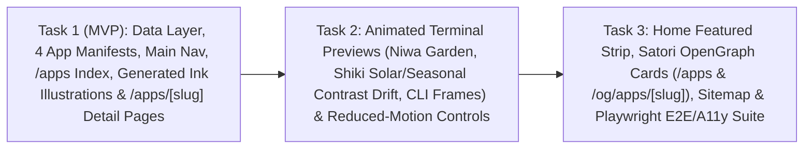

# Plan: Ink Apps Workshop (`pm-303`)

- **Plan ID**: `pm-303`
- **Product Title**: Ink Apps Workshop
- **Revision**: `1`
- **Product-Owner Run**: `run-10083` (`agy-argon-medium`, Gemini 4 Argon (Medium), fleet worker `avietidol-z490`, account `billie-agy`, workflow `legacy_v1`)
- **Plan Folder**: `projects/apps-showcase-module-a-dedicated-apps-section-on-otohime-dev/`
- **Prerequisites Manifest**: `projects/apps-showcase-module-a-dedicated-apps-section-on-otohime-dev/prerequisites.json` (`external_dependencies_reviewed: true`, `prerequisites: []`)
- **Prior Research**: `projects/apps-showcase-module-a-dedicated-apps-section-on-otohime-dev/research.md` (`rep-6011` from `run-10081`)

---

## 1. Outcome & Visitor Contract

`otohime.dev` gains a dedicated `/apps` showcase module in the site's warm paper, sumi ink, riso swatch, and carved vermilion hanko style—featuring **Bento**, **Niwa**, **Kakeibo**, and **Shiki** out of the box, while letting future applications be added by dropping a single JSON manifest into `content/apps/<slug>.json` with **zero code changes**.

Following the **MVP-first** directive (*"index + detail pages with the four apps first, previews and extras after"*), delivery is structured into three sequential vertical slices:
1. **Task 1 (MVP — Data Layer, Four Apps, Main Nav, `/apps` Index & `/apps/[slug]` Detail Pages)**: Typed per-app JSON manifests in `content/apps/*.json` + `content/apps/_schema.json`, pure schema validator/filter/hanko model in `lib/apps.ts`, `node:fs` directory auto-discovery in `lib/apps-server.ts`, `PUBLIC_PAGES` sidebar/Pocket Terminal navigation (`Apps`), filterable `/apps` card grid with carved hanko status stamps and generated `<Inked>` SVG illustrations (`bento-box`, `bonsai-garden`, `ledger-book`, `sun-dial`, plus deterministic `blueprint` fallback), `/apps/[slug]` detail pages (hero, what it does, key features, install snippet with copy button, 5-step lifecycle + roadmap milestones, changelog, repo/Homebrew/follow links), and comprehensive data/nav unit tests.
2. **Task 2 (Animated Terminal Previews & Contrast/Reduced-Motion Engine)**: Lightweight ASCII/Canvas/CSS terminal previews (`Niwa` 5-stage growing TUI garden + simulated macOS menu-bar readout, `Shiki` continuous sunrise/noon/sunset/midnight × 4-season gradient drift with live WCAG contrast ratio >= 7.0 readout, and declarative `frames` CLI stepper for `Bento` `bentoctx`, `Kakeibo` `kakeibo`, and future JSON apps), keyboard-accessible Play/Pause and stage/time controls, strict `prefers-reduced-motion: reduce` static pose handling, and unit tests.
3. **Task 3 (Home Featured Strip, Per-App Satori OpenGraph Images, Sitemap & E2E/Accessibility Suite)**: Pure Server Component featured apps strip on `app/(site)/(home)/page.tsx`, `/apps` OpenGraph stamp (`app/(site)/(app)/apps/opengraph-image.tsx`), per-app Satori OpenGraph endpoint (`app/og/apps/[slug]/route.tsx` wired into `/apps/[slug]` `generateMetadata`), dynamic `app/sitemap.ts` + `public/robots.txt`, SEO unit tests (`lib/apps-seo.test.ts`), and full Playwright E2E + accessibility verification (`e2e/apps.test.ts`).

| Starting state | Visitor / author action | Observable result |
| --- | --- | --- |
| Any site page | Inspect `<nav aria-label="Main">` or open Pocket Terminal (`/` or `Cmd/Ctrl-K`) and run `apps` / `go apps` | `Apps` appears in the main sidebar nav, highlights on `/apps` and `/apps/[slug]`, and navigates to `/apps` without adding an 8th line to the 7-slot physical LCD |
| Home page (`/`) | Scroll to the featured apps strip above `Elsewhere` | Sees featured apps (`Bento`, `Niwa`, `Kakeibo`, `Shiki`) with carved status badge, platform pills, one-line tagline, links to `/apps/[slug]`, and `All apps →` link to `/apps` |
| `/apps` index | Filter by platform (`macOS`, `CLI`, `TUI`) and/or status (`Idea`, `Planned`, `In development`, `Beta`, `Released`), or combine filters with zero matches | Grid updates immediately with `aria-pressed` filter buttons, `aria-live="polite"` count (`Showing N of 4 apps`), and a paper `<Notice>` empty state with `Reset filters` when empty |
| `/apps/[slug]` detail | Visit `/apps/bento`, `/apps/niwa`, `/apps/kakeibo`, `/apps/shiki` (with or without JS) | Renders hero with hanko status stamp, `<Inked>` illustration, terminal preview, copyable install command (`Copied` feedback + clipboard-denied fallback), description, key features, 5-stage lifecycle & milestones, dated changelog, and repo/Homebrew/zero-backend follow links |
| `/apps/niwa` or `/apps/shiki` | View terminal preview in normal motion vs `prefers-reduced-motion: reduce` | Normal motion gently steps Niwa's 5-stage garden or drifts Shiki's solar/seasonal palette (WCAG contrast >= 7.0 throughout); reduced motion (or no-JS) renders a complete static frame with zero automatic timers while keeping manual controls operable |
| Repository author | Add `content/apps/new-tool.json` conforming to `content/apps/_schema.json` | Without touching TypeScript or React files, `loadApps()` discovers `new-tool`, rendering it on `/apps`, `/apps/new-tool`, Home (if `featured: true`), `/og/apps/new-tool`, and `/sitemap.xml` |
| Unknown slug | Request `/apps/does-not-exist` or `/og/apps/does-not-exist` | Returns HTTP 404 (`notFound()` paper 404 sheet on `/apps/...`; `404` response on `/og/apps/...`) |

---

## 2. Architecture & Hard Repository Invariants

Implementers **must** read `AGENTS.md` and the installed Next.js 16.4.2 guides in `node_modules/next/dist/docs/01-app/01-getting-started/{03-layouts-and-pages,05-server-and-client-components,14-metadata-and-og-images,15-route-handlers}.md` and `02-guides/migrating-to-cache-components.md` before writing code, and verify `bash scripts/setup-owner-git.sh --check` (`Otohime <quiinthieu@gmail.com>`) before committing.

1. **Next.js 16.4.2 `cacheComponents: true` & Dynamic Params**:
   - **Never** export legacy route segment configs (`dynamic`, `dynamicParams`, `revalidate`, `fetchCache`) on any page, layout, or route handler—`cacheComponents: true` rejects them at build time.
   - **Never** call `new Date()`, `Date.now()`, `Math.random()`, or `crypto.randomUUID()` during server prerendering (`page.tsx`, `route.tsx`, `sitemap.ts`). Use deterministic FNV-1a seeds (`lib/hanko.ts` and slug hashes) and static manifest dates (`changelog[0]?.date` or `process.env.BUILD_DATE`).
   - On `app/(site)/(app)/apps/[slug]/page.tsx`, export `generateStaticParams()` returning `loadApps().map(({ slug }) => ({ slug }))` (non-empty array), type props with `PageProps<"/apps/[slug]">` (awaiting `params`), and call `notFound()` when `appBySlug(slug)` returns `null` (matching `app/(site)/(app)/notes/[slug]/page.tsx`).
   - Add `outputFileTracingIncludes` in `next.config.ts` mapping `"/apps"`, `"/apps/[slug]"`, `"/og/apps/[slug]"`, and `"/sitemap.xml"` to `["./content/apps/**/*.json"]` so Vercel serverless bundles include all JSON manifests on dynamic invocations.

2. **`PUBLIC_PAGES` vs `CONSOLE_MENU` Physical 7-Slot LCD Invariant (`lib/pages.ts`, `lib/pages.test.ts`, `lib/motion.test.ts`, `lib/terminal.test.ts`)**:
   - `CONSOLE_MENU` drives the 7 physical lines on the home SVG pocket console (`menuBaseline(6) === -105 === LCD.y + LCD.h - 3` in `lib/pages.test.ts` line 38). Adding an 8th item to `CONSOLE_MENU` breaks `lib/pages.test.ts`.
   - Append `{ href: "/apps", label: "Apps" }` to `PUBLIC_PAGES` **after `"/sketches"`** (preserving `PUBLIC_PAGES[5].href === "/projects"` and `PUBLIC_PAGES[6].href === "/sketches"` pinned in `lib/pages.test.ts`).
   - Exclude `"/apps"` from `CONSOLE_MENU` alongside `"/"` and `"/lab"`:
     ```ts
     export type ConsoleItem = { href: Exclude<PublicPage["href"], "/" | "/lab" | "/apps"> | typeof DESK_PAGE.href; label: string };
     export const CONSOLE_MENU = [
       ...PUBLIC_PAGES.filter((page) => page.href !== "/" && page.href !== "/lab" && page.href !== "/apps"),
       DESK_PAGE,
     ] as const satisfies readonly ConsoleItem[];
     ```
   - Update `lib/pages.test.ts` (filter assertion on line 11 + dedicated test verifying `/apps` is in `PUBLIC_PAGES` and excluded from `CONSOLE_MENU`) and `lib/terminal.test.ts` (line 40 `PLACES.map((p) => p.name)` includes `"apps"`, plus `go apps` / `apps` test).
   - **Never** pass `morph="/apps"` to `<FigTitle>` (`lib/motion.test.ts` lines 500–506 assert `morph="..."` appears **only** on `CONSOLE_MENU` pages).

3. **ViewTransition, Stylesheet & Motion Settlement Invariants (`lib/motion.test.ts`, `scripts/probe-motion-state.mjs`)**:
   - Every `page.tsx` under `app/(site)` (`app/(site)/(app)/apps/page.tsx` and `app/(site)/(app)/apps/[slug]/page.tsx`) **must** `import { ViewTransition } from "react";` and wrap its root element in `<ViewTransition enter="page-in" exit="page-out" default="none">`.
   - Do **not** add any `loading.tsx` or catch-all `[...]` route under `app/(site)/(app)/apps` (`lib/motion.test.ts` lines 259 and 274).
   - Do **not** modify `app/(site)/globals.css`. Keep all showcase styles in `app/(site)/(app)/apps/apps.css` (and `components/apps-featured-strip.tsx` using existing utility classes), with `@media (prefers-reduced-motion: reduce)` as the final block of `apps.css`.
   - `scripts/probe-motion-state.mjs` (`landingSettled()`) waits for finite animations on `document.timeline` to finish. Terminal previews must use stepped JS timers / Canvas 2D (paused when `prefers-reduced-motion: reduce`, `document.hidden`, or offscreen) or `infinite` CSS animations—never long finite animations on mount.

4. **CI Footer Probe, Home Bundle Isolation & Satori OpenGraph Rules (`scripts/probe-end.mjs`, `lib/postcard.test.ts`, `next.config.ts`)**:
   - `scripts/probe-end.mjs` walks every `PUBLIC_PAGES` path (including `/` and `/apps`) and rejects **any** external network request, console error, hydration warning, or unexpected `<nav aria-label="Main">` on `/`. Never embed external GitHub badges, remote avatars, or client-side GitHub API fetches.
   - `lib/postcard.test.ts` lines 215–217 forbid `app/(site)/(home)/page.tsx`, `app/(site)/(app)/play/page.tsx`, `app/(site)/(app)/layout.tsx`, and `app/(site)/layout.tsx` from importing `lib/postcard`, `lib/og`, or `postcard/`. `components/apps-featured-strip.tsx` must be a pure Server Component importing only `@/lib/apps`, `@/lib/apps-server`, `@/components/riso-heading`, and `next/link` (and rendering `<section aria-labelledby="home-apps">`, never `<nav aria-label="Main">`).
   - `next.config.ts` excludes `./node_modules/sharp/**/*` and `./node_modules/@img/**/*` from serverless traces. Both `app/(site)/(app)/apps/opengraph-image.tsx` and `app/og/apps/[slug]/route.tsx` must use Satori `ImageResponse` from `next/og` (`1200×630` PNG, flexbox-only inline styles, zero `sharp`, zero network fetches).

5. **Unit Test Discovery & Prebuild Hygiene (`package.json`)**:
   - `npm test` globs `'lib/**/*.test.ts'` automatically. Put all pure logic and tests in `lib/apps.ts`, `lib/apps-server.ts`, `lib/apps-preview.ts`, `lib/apps.test.ts`, `lib/apps-preview.test.ts`, and `lib/apps-seo.test.ts` without needing to edit `package.json` (and introduce **zero** new npm dependencies).
   - `npm run build` and `scripts/e2e.mjs` trigger `prebuild` (`scripts/history-index.ts` and `scripts/sql-index.ts`), which can dirty `content/history.json` or `public/sql-index.json`. Restore any untracked `prebuild` side effects (`git checkout -- content/history.json public/sql-index.json`) after local build/E2E runs before staging task commits.

---

## 3. Data Contract & Initial Four Apps (`content/apps/*.json`)

### 3.1 Schema (`lib/apps.ts` + `content/apps/_schema.json`)

- **Canonical enums**:
  - `APP_STATUSES = ["idea", "planned", "building", "beta", "released"] as const`
  - `APP_PLATFORMS = ["macos", "cli", "tui", "web", "linux", "ios"] as const`
- **Status metadata & carved hanko seal mapping (`STATUS_META`)**:
  - `idea`: `{ label: "Idea", shortLabel: "Idea", seal: "構想", shape: "round" }`
  - `planned`: `{ label: "Planned", shortLabel: "Planned", seal: "計画", shape: "round" }`
  - `building`: `{ label: "In development", shortLabel: "Building", seal: "開発", shape: "square" }`
  - `beta`: `{ label: "Beta", shortLabel: "Beta", seal: "試作", shape: "square" }`
  - `released`: `{ label: "Released", shortLabel: "Released", seal: "公開", shape: "square" }`
  - Rendered via `sealModel({ name: app.seal?.text ?? STATUS_META[app.status].seal, shape: app.seal?.shape ?? STATUS_META[app.status].shape })` from `lib/hanko.ts` paired with visible status text so status is never communicated by colour or kanji alone.
- **Per-app manifest fields (`AppManifest`)**:
  - `slug`: lowercase kebab-case matching `/^[a-z0-9]+(?:-[a-z0-9]+)*$/` and exact filename `<slug>.json`
  - `order?: number`, `featured?: boolean`
  - `name: string`, `tagline: string` (one-line summary, `<= 140` chars), `description: string[]` (`1..4` plain-text paragraphs)
  - `platforms: AppPlatform[]` (non-empty, deduplicated), `status: AppStatus`, `swatch: Swatch` (`yellow | coral | mint | blue | pink`), `seal?: { text?: string; shape?: SealShape }`
  - `techStack: string[]` (non-empty)
  - `features: { title: string; detail: string }[]` (`>= 2`)
  - `install: { label: string; command: string; note?: string }`
  - `links: { repo?: string; homebrew?: { cask?: string; formula?: string; command: string; url?: string }; docs?: string; follow?: { label: string; href: string } }` (validated `https://` or `mailto:` URLs only; rejects `javascript:`/`data:`/`http:`)
  - `illustration`: `{ kind: "ink"; motif?: "bento-box" | "bonsai-garden" | "ledger-book" | "sun-dial" | "blueprint"; alt: string; caption?: string } | { kind: "screenshot"; src: string; alt: string; width: number; height: number; caption?: string }` (`src` must start with `"/"`, never an external URL)
  - `preview?: { kind: "niwa-garden"; title: string; command: string; alt: string } | { kind: "shiki-drift"; title: string; command: string; alt: string } | { kind: "frames"; title: string; command: string; alt: string; intervalMs?: number; frames: { label: string; lines: string[] }[] }`
  - `milestones: { title: string; state: "done" | "active" | "next"; target?: string; note?: string }[]` (`>= 2`)
  - `changelog: { version: string; date: string; summary: string; highlights?: string[] }[]` (`>= 1`, strict `YYYY-MM-DD` dates)

### 3.2 Initial Four App Manifests (all `status: "building"` -> `"In development"`, `featured: true`)

1. **`content/apps/bento.json`** (`order: 1`, `swatch: "coral"`, `platforms: ["macos", "cli"]`):
   - **Summary**: macOS app + CLI (`bentoctx`) that audits and manages plugins, skills, MCP servers, and rules across AI coding agents and optimises context/token budget per agent.
   - **Install**: `brew install --cask agent-bento` (with `bentoctx` CLI note).
   - **Links**: `repo: "https://github.com/quiinthieu/bento"`, `homebrew: { cask: "agent-bento", command: "brew install --cask agent-bento", url: "https://github.com/quiinthieu/bento" }`.
   - **Illustration & Preview**: `motif: "bento-box"`; `preview: { kind: "frames", command: "bentoctx audit --agents all", ... }`.
2. **`content/apps/niwa.json`** (`order: 2`, `swatch: "mint"`, `platforms: ["macos", "cli", "tui"]`):
   - **Summary**: A cozy idle garden that lives in your terminal and macOS menu bar and grows while you work (Rust TUI/CLI `niwa`, Swift menu bar app).
   - **Install**: `niwa` (with honest in-development note).
   - **Links**: Zero-backend follow link (`mailto:hello@otohime.dev?subject=Notify%20me%3A%20Niwa` + `@otohime73` fallback).
   - **Illustration & Preview**: `motif: "bonsai-garden"`; `preview: { kind: "niwa-garden", command: "niwa --watch", ... }`.
3. **`content/apps/kakeibo.json`** (`order: 3`, `swatch: "yellow"`, `platforms: ["cli"]`):
   - **Summary**: A local-only token budget diary for coding agents: breaks down where each agent session's tokens went (resumed context, tool output, retries, cache misses) and flags what drained your quota. CLI `kakeibo`.
   - **Install**: `kakeibo summary --today` (with honest in-development note).
   - **Links**: Zero-backend follow link (`mailto:hello@otohime.dev?subject=Notify%20me%3A%20Kakeibo` + `@otohime73` fallback).
   - **Illustration & Preview**: `motif: "ledger-book"`; `preview: { kind: "frames", command: "kakeibo summary --last 5", ... }`.
4. **`content/apps/shiki.json`** (`order: 4`, `swatch: "blue"`, `platforms: ["cli"]`):
   - **Summary**: Terminal colours drift slowly with local sunrise, sunset, and the seasons; continuous gradient with contrast safety. CLI `shiki-term`.
   - **Install**: `shiki-term status` (with honest in-development note).
   - **Links**: Zero-backend follow link (`mailto:hello@otohime.dev?subject=Notify%20me%3A%20Shiki` + `@otohime73` fallback).
   - **Illustration & Preview**: `motif: "sun-dial"`; `preview: { kind: "shiki-drift", command: "shiki-term --preview-day", ... }`.

---

## 4. Task Breakdown & Dependency Graph



---

### Task 1: Typed apps data layer, four app manifests, main nav, `/apps` index, ink illustrations, and `/apps/[slug]` detail pages (MVP)

- **Sequence**: `1`
- **Role**: `software_engineer`
- **QA**: `required`
- **Depends on**: `[]`
- **Interfaces**:
  - `content/apps/_schema.json`
  - `content/apps/bento.json`
  - `content/apps/niwa.json`
  - `content/apps/kakeibo.json`
  - `content/apps/shiki.json`
  - `lib/apps.ts`
  - `lib/apps-server.ts`
  - `lib/apps.test.ts`
  - `lib/pages.ts`
  - `lib/pages.test.ts`
  - `lib/terminal.test.ts`
  - `next.config.ts`
  - `app/(site)/(app)/apps/apps.css`
  - `app/(site)/(app)/apps/page.tsx`
  - `app/(site)/(app)/apps/[slug]/page.tsx`
  - `app/(site)/(app)/apps/_components/apps-catalog.tsx`
  - `app/(site)/(app)/apps/_components/hanko-status.tsx`
  - `app/(site)/(app)/apps/_components/copy-snippet.tsx`
  - `app/(site)/(app)/apps/_components/app-illustration.tsx`
  - `projects/apps-showcase-module-a-dedicated-apps-section-on-otohime-dev/task-1-evidence.md`
- **Problem**: `otohime.dev` currently has no `/apps` showcase module, no typed per-app data directory allowing new apps to be added without code changes, no `Apps` entry in the main navigation, and no index or detail pages for Bento, Niwa, Kakeibo, and Shiki.
- **Acceptance criteria**: Adding a JSON file in `content/apps/<slug>.json` populates `/apps` and `/apps/<slug>` without code changes; `Apps` appears in the main sidebar nav and Pocket Terminal (`go apps` / `apps`) while `CONSOLE_MENU` stays at 7 items; `/apps` renders all four app cards (`Bento`, `Niwa`, `Kakeibo`, `Shiki`) with carved hanko status stamps, platform badges, generated ink illustrations, and accessible platform/status filters; `/apps/[slug]` renders each app's hero, description, key features, copyable install snippet, 5-stage lifecycle & milestones, dated changelog, and repo/Homebrew/zero-backend follow links (with HTTP 404 for unknown slugs); and `npm run lint`, `npm run typecheck`, `npm test`, and `npm run build` pass.
- **Action items**:
  1. Read `AGENTS.md` and the Next.js 16.4.2 guides in `node_modules/next/dist/docs/01-app/01-getting-started/{03-layouts-and-pages,05-server-and-client-components,14-metadata-and-og-images}.md` and `02-guides/migrating-to-cache-components.md`, and run `bash scripts/setup-owner-git.sh --check` (`--configure` if needed) before committing.
  2. Create `lib/apps.ts` (pure, browser-safe, zero `node:fs` imports) defining `APP_STATUSES`, `APP_PLATFORMS`, `STATUS_META`, `PLATFORM_META`, `AppManifest` and sub-types, `validateAppManifest(raw, expectedSlug)` (enforcing strict kebab-case slug matching filename, non-empty arrays, `YYYY-MM-DD` changelog dates, safe `https://` or `mailto:` links, local-only `/...` screenshot paths, valid swatches/motifs/previews), `sortApps(apps)`, `filterApps(apps, { platform, status })`, `availablePlatforms(apps)`, and `resolveFollowAction(app)` (returning `Watch on GitHub` when `links.repo` is set, else `links.follow` or `mailto:hello@otohime.dev?subject=Notify%20me%3A%20<Name>` plus `@otohime73` secondary link).
  3. Create `lib/apps-server.ts` reading all `*.json` files (ignoring `_*.json`) from a configurable directory defaulting to `join(process.cwd(), "content", "apps")`, validating each via `validateAppManifest`, rejecting duplicate slugs, and exporting `loadApps(dir?)` and `appBySlug(slug, dir?)`. Update `next.config.ts` to add `outputFileTracingIncludes` for `"/apps"`, `"/apps/[slug]"`, `"/og/apps/[slug]"`, and `"/sitemap.xml"` pointing to `["./content/apps/**/*.json"]` while preserving `outputFileTracingExcludes` and all existing config.
  4. Author `content/apps/_schema.json` and the four initial manifests `content/apps/{bento,niwa,kakeibo,shiki}.json` strictly grounded in the plan's factual specs (`status: "building"`, `featured: true`, `Bento` linked to `https://github.com/quiinthieu/bento` + cask `agent-bento`, `Niwa` Rust TUI/CLI `niwa` + Swift menu bar app, `Kakeibo` local-only CLI `kakeibo`, `Shiki` solar/seasonal contrast-safe CLI `shiki-term`, including `illustration` and `preview` descriptors, milestones, and changelog entries).
  5. Update `lib/pages.ts` to append `{ href: "/apps", label: "Apps" }` to `PUBLIC_PAGES` after `"/sketches"` while excluding `"/apps"` from `CONSOLE_MENU` (`CONSOLE_MENU.length === 7`), and update `lib/pages.test.ts` and `lib/terminal.test.ts` to cover `/apps` in `PUBLIC_PAGES` and `PLACES` (`go apps`, `apps`).
  6. Build `app/(site)/(app)/apps/_components/hanko-status.tsx` (carved vermilion seal SVG using `sealModel` from `lib/hanko.ts` + visible `STATUS_META[status].label`), `copy-snippet.tsx` (`"use client"`, monospace `$ <command>` block with keyboard-accessible Copy button, `aria-live="polite"` `"Copied"` confirmation, and truthful fallback message when `navigator.clipboard` is unavailable or denied), `app-illustration.tsx` (hand-inked `<Inked>` isometric/line-art SVG motifs `bento-box`, `bonsai-garden`, `ledger-book`, `sun-dial`, a deterministic slug-hashed `blueprint` fallback for future JSON-only apps, plus local `screenshot` rendering with `alt` text), and `apps-catalog.tsx` (`"use client"`, SSR-complete card grid with `aria-pressed` Platform and Status filter toolbars, `aria-live="polite"` result summary, and `<Notice>` empty-filter reset state).
  7. Create `app/(site)/(app)/apps/apps.css` (paper card framing, hanko badge, lifecycle bar, snippet box, responsive grid, with `@media (prefers-reduced-motion: reduce)` as the final block), `app/(site)/(app)/apps/page.tsx` (`<ViewTransition enter="page-in" exit="page-out" default="none">`, `<FigTitle n="08" hint="in the workshop">Apps</FigTitle>` with NO `morph` prop, static `metadata`), and `app/(site)/(app)/apps/[slug]/page.tsx` (`generateStaticParams`, `generateMetadata`, `notFound()` on unknown slug, breadcrumb `← All apps`, hero + hanko stamp, `<AppIllustration />`, `<CopySnippet />`, description, key features, 5-step lifecycle bar with `aria-current="step"` + milestone list with `✓ / ● / ○` non-colour markers, dated changelog, and repo/Homebrew/follow links using `away()` from `lib/end.ts`).
  8. Write `lib/apps.test.ts` testing all 4 committed manifests, negative validation cases (slug mismatch, bad status/platform, invalid date, `javascript:`/`http:` URL, external screenshot URL, duplicate slugs), `filterApps` / `availablePlatforms` / `resolveFollowAction`, and a temporary-directory drop-in test proving a 5th JSON manifest is discovered and sorted by `loadApps(tmpDir)` with zero code changes. Record command outputs and commit identity in `projects/apps-showcase-module-a-dedicated-apps-section-on-otohime-dev/task-1-evidence.md` (ensuring `content/history.json` and `public/sql-index.json` remain clean).
- **Non-goals**:
  - Do not add animated terminal previews yet (Task 2).
  - Do not modify `app/(site)/(home)/page.tsx`, `app/og/apps/[slug]/route.tsx`, or `app/sitemap.ts` yet (Task 3).
  - Do not modify `app/(site)/globals.css` or `package.json`, add `loading.tsx`, or add an 8th item to `CONSOLE_MENU`.
- **Verification**:
  - `apps-and-nav-unit`: `(test -d node_modules || npm ci --prefer-offline --no-audit --no-fund) && TMPDIR=/tmp node --experimental-strip-types --disable-warning=ExperimentalWarning --disable-warning=MODULE_TYPELESS_PACKAGE_JSON --test lib/apps.test.ts lib/pages.test.ts lib/terminal.test.ts lib/end.test.ts lib/motion.test.ts`
  - `lint-typecheck-test-build`: `(test -d node_modules || npm ci --prefer-offline --no-audit --no-fund) && npm run lint && npm run typecheck && TMPDIR=/tmp npm test && TMPDIR=/tmp npm run build && git checkout -- content/history.json public/sql-index.json`

---

### Task 2: Lightweight animated ASCII/Canvas/CSS terminal previews with WCAG contrast safety and `prefers-reduced-motion` support

- **Sequence**: `2`
- **Role**: `software_engineer`
- **QA**: `required`
- **Depends on**: `["1"]`
- **Interfaces**:
  - `lib/apps-preview.ts`
  - `lib/apps-preview.test.ts`
  - `app/(site)/(app)/apps/_components/terminal-preview.tsx`
  - `app/(site)/(app)/apps/apps.css`
  - `app/(site)/(app)/apps/page.tsx`
  - `app/(site)/(app)/apps/[slug]/page.tsx`
  - `projects/apps-showcase-module-a-dedicated-apps-section-on-otohime-dev/task-2-evidence.md`
- **Problem**: Requirement 4 specifies that terminal apps (`Niwa`, `Shiki`, `Bento`'s `bentoctx`, `Kakeibo`'s `kakeibo`, and future CLI/TUI manifests) get a lightweight animated ASCII/terminal preview (such as Niwa's garden growing and Shiki's palette drifting through sunrise, sunset, and the seasons with continuous contrast safety) built with lightweight Canvas/CSS and strictly respecting `prefers-reduced-motion`.
- **Acceptance criteria**: Every app manifest with a `preview` descriptor renders an accessible, responsive terminal preview on `/apps/[slug]` (`Niwa` 5-stage growing ASCII garden + simulated macOS menu bar header; `Shiki` continuous Dawn/Noon/Sunset/Midnight × 4-season gradient drift with live WCAG contrast ratio >= 7.0 across the full `[0, 1]` solar cycle; declarative `frames` CLI output stepper for `Bento`, `Kakeibo`, and custom JSON manifests); under `prefers-reduced-motion: reduce` (and before hydration / without JS) automatic timers do not run and a complete static frame renders immediately while manual keyboard controls (`Play`/`Pause`, stage/time/season selectors) remain operable; zero finite mount animations block `probe-motion-state.mjs`; and `lib/apps-preview.test.ts`, `npm test`, and `npm run build` pass.
- **Action items**:
  1. Create `lib/apps-preview.ts` (pure, deterministic, zero DOM/React imports) implementing:
     - `NIWA_STAGES` (`5` ASCII/box-drawing TUI stages from seeded moss bed -> sprout -> bamboo shoots -> stone lantern & blossoms -> evening fireflies, each with simulated macOS menu bar status text such as `niwa · 48m focus · stage 4/5`, plus `niwaStageAt(index)` and `NIWA_STATIC_STAGE = 3` for reduced-motion/SSR).
     - `SHIKI_SEASONS = ["spring", "summer", "autumn", "winter"] as const`, `SHIKI_PHASES` (`Dawn`, `Noon`, `Sunset`, `Midnight`), `wcagContrastRatio(fgHex, bgHex)` (standard relative luminance `(L1 + 0.05) / (L2 + 0.05)`), and `shikiPaletteAt(progress01, season)` returning interpolated terminal background, foreground, prompt, accent, horizon gradient stops, solar label, and verified `contrastRatio >= 7.0` (AAA-grade contrast safety) across every `progress01` in `[0, 1]` and all 4 seasons (`SHIKI_STATIC_PROGRESS = 0.68` Sunset pose for reduced-motion/SSR).
     - `resolveFramePreview(preview, frameIndex)` for `kind: "frames"` manifests (`Bento` `bentoctx audit`, `Kakeibo` `kakeibo summary`, and any future JSON app), clamping indices safely and defaulting SSR/reduced-motion to the richest summary frame (`frames.length - 1` or `0` deterministically).
  2. Create `app/(site)/(app)/apps/_components/terminal-preview.tsx` (`"use client"`) rendering a paper-and-sumi terminal window (`role="region"`, `aria-label={preview.title}`, `data-terminal-preview={preview.kind}`, `data-reduced-motion="true" | "false"`, `data-playing="true" | "false"`):
     - Subscribe to `window.matchMedia("(prefers-reduced-motion: reduce)")` via `useSyncExternalStore` (defaulting server snapshot to `"true"` / paused so SSR HTML and hydration match cleanly with zero mismatch), and pause timers whenever `reducedMotion` is true, the user clicks `Pause`, `document.hidden` is true, or the preview scrolls offscreen (`IntersectionObserver`).
     - For `niwa-garden`: render the simulated macOS menu-bar strip + monospace garden frame, stepping gently (~1400 ms interval when playing) and offering keyboard-accessible stage buttons (`Stage 1`..`5`) + `Play`/`Pause`.
     - For `shiki-drift`: render a lightweight Canvas 2D solar/horizon strip + styled terminal session whose CSS custom properties update smoothly (~120 ms interval / throttled rAF when playing), displaying the live solar phase, season selector (`Spring`, `Summer`, `Autumn`, `Winter`), time-of-day preset/scrubber controls (`Dawn`, `Noon`, `Sunset`, `Midnight`), and live WCAG contrast badge (e.g. `Contrast 11.4:1 AAA`).
     - For `frames`: render the `$ <command>` prompt and current CLI output lines with `Prev` / `Next` frame buttons and `Play`/`Pause` toggle.
     - Ensure **no** finite CSS/WAAPI animation (`endTime !== Infinity`) runs on `document.timeline` at mount so `scripts/probe-motion-state.mjs` settles immediately.
  3. Wire `<TerminalPreview preview={app.preview} />` into `app/(site)/(app)/apps/[slug]/page.tsx` (and add a subtle static CLI command/preview cue on `/apps` cards in `app/(site)/(app)/apps/page.tsx` / `apps.css` where `app.preview` exists, keeping `@media (prefers-reduced-motion: reduce)` as the final block in `apps.css`).
  4. Write `lib/apps-preview.test.ts` verifying: all 5 Niwa stages have consistent line widths/non-empty art and deterministic SSR stage; `shikiPaletteAt(t, season)` maintains `contrastRatio >= 7.0` across 200 sampled points `t in [0, 1]` for all 4 seasons plus boundary values (`0`, `0.25`, `0.5`, `0.75`, `1`, out-of-range clamping); `wcagContrastRatio` matches known black/white (`21:1`) and identical-colour (`1:1`) negative controls; and `resolveFramePreview` handles `Bento`, `Kakeibo`, and single-frame custom JSON manifests cleanly. Record outputs in `projects/apps-showcase-module-a-dedicated-apps-section-on-otohime-dev/task-2-evidence.md`.
- **Non-goals**:
  - Do not add heavy third-party animation or terminal libraries (`xterm`, `framer-motion`, `gsap`).
  - Do not modify `app/(site)/globals.css` or `package.json`.
- **Verification**:
  - `preview-unit-and-contrast`: `(test -d node_modules || npm ci --prefer-offline --no-audit --no-fund) && TMPDIR=/tmp node --experimental-strip-types --disable-warning=ExperimentalWarning --disable-warning=MODULE_TYPELESS_PACKAGE_JSON --test lib/apps-preview.test.ts lib/apps.test.ts lib/motion.test.ts`
  - `lint-typecheck-test-build`: `(test -d node_modules || npm ci --prefer-offline --no-audit --no-fund) && npm run lint && npm run typecheck && TMPDIR=/tmp npm test && TMPDIR=/tmp npm run build && git checkout -- content/history.json public/sql-index.json`

---

### Task 3: Home featured strip, per-app Satori OpenGraph images, sitemap, and Playwright E2E & accessibility verification

- **Sequence**: `3`
- **Role**: `software_engineer`
- **QA**: `required`
- **Depends on**: `["2"]`
- **Interfaces**:
  - `components/apps-featured-strip.tsx`
  - `app/(site)/(home)/page.tsx`
  - `app/(site)/(app)/apps/opengraph-image.tsx`
  - `app/og/apps/[slug]/route.tsx`
  - `app/(site)/(app)/apps/[slug]/page.tsx`
  - `app/sitemap.ts`
  - `public/robots.txt`
  - `lib/apps-seo.test.ts`
  - `e2e/apps.test.ts`
  - `projects/apps-showcase-module-a-dedicated-apps-section-on-otohime-dev/task-3-evidence.md`
- **Problem**: Requirement 5 and Requirement 6 require a featured apps strip on the Home page (`/`), SEO metadata and per-app OpenGraph images, sitemap entries for `/apps` and `/apps/[slug]`, and end-to-end browser verification of page rendering, keyboard accessibility, contrast, reduced motion, responsive layout, and zero-external-fetch compliance.
- **Acceptance criteria**: `/` renders a pure Server Component featured apps strip linking to `/apps` and each featured `/apps/[slug]` without adding `<nav aria-label="Main">` or importing `lib/og`/`lib/postcard`; `/apps/opengraph-image` and `/og/apps/{bento,niwa,kakeibo,shiki}` return `200 image/png` (`1200×630` Satori paper + hanko cards, `404` on unknown slugs) and are wired into page `openGraph` / `twitter` metadata; `/sitemap.xml` (`app/sitemap.ts`) and `public/robots.txt` publish canonical URLs for `PUBLIC_PAGES`, `/notes/[slug]`, and all `loadApps()` slugs; and `lib/apps-seo.test.ts`, `npm test`, `npm run ask:check`, `scripts/check-gate-closure.mjs`, and `e2e/apps.test.ts` all pass.
- **Action items**:
  1. Create `components/apps-featured-strip.tsx` as a pure Server Component (no `"use client"`, **no** imports from `lib/og`, `lib/postcard`, `postcard/`, or `next/image`, and **no** `<nav>` element) that loads `loadApps().filter((app) => app.featured)` and renders `<section aria-labelledby="home-apps" className="mt-12 border-t border-line pt-8">` with `<h2 id="home-apps" className="caption"><RisoText>Apps</RisoText></h2>`, an `"All apps →"` link to `/apps`, and a responsive 2-column / 4-card ink grid linking to `/apps/${app.slug}` with status pill, platform badges, and one-line tagline. Mount `<AppsFeaturedStrip />` in `app/(site)/(home)/page.tsx` above the `Elsewhere` section while keeping `lib/postcard.test.ts` and `scripts/probe-end.mjs` (`0` `<nav aria-label="Main">` on `/`) completely green.
  2. Create `app/(site)/(app)/apps/opengraph-image.tsx` exporting `alt = ogAlt("Apps")`, `size = OG_SIZE`, `contentType = OG_CONTENT_TYPE`, and `default function Image() { return stamp("Apps", "otohime.dev/apps"); }` (matching `app/(site)/(app)/work/opengraph-image.tsx`).
  3. Create `app/og/apps/[slug]/route.tsx` using Satori `ImageResponse` from `next/og` (`1200×630` PNG, flexbox-only inline styles, zero `sharp`, zero network fetches, exporting `generateStaticParams()` from `loadApps()`): render the site's warm paper frame (`#f2efe7` / `#faf8f3`, `#231e16` ink border, `#ddd6c8` shadow), vermilion hanko status stamp (`#b33228`) + `STATUS_META[app.status].label`, app name, tagline, platform pills, and `otohime.dev/apps/${app.slug}` footer; return `new Response("Not found", { status: 404 })` when `appBySlug(slug)` is `null`. Update `generateMetadata` in `app/(site)/(app)/apps/[slug]/page.tsx` to set `alternates: { canonical: \`/apps/\${app.slug}\` }`, `openGraph: { title: app.name, description: app.tagline, url: \`/apps/\${app.slug}\`, images: [{ url: \`/og/apps/\${app.slug}\`, width: 1200, height: 630, alt: \`\${app.name} — \${app.tagline}\` }] }`, and `twitter: { card: "summary_large_image", title: app.name, description: app.tagline, images: [\`/og/apps/\${app.slug}\`] }`.
  4. Create `app/sitemap.ts` returning `MetadataRoute.Sitemap` rooted at `(process.env.SITE_URL ?? "https://otohime.dev").replace(/\/$/, "")` covering `PUBLIC_PAGES` (including `/apps`), every `/notes/${note.slug}` from `site.notes`, and every `/apps/${app.slug}` from `loadApps()` using deterministic `lastModified` strings (`app.changelog[0]?.date ?? process.env.BUILD_DATE`, never `new Date()`), and append `Sitemap: https://otohime.dev/sitemap.xml` to `public/robots.txt`.
  5. Write `lib/apps-seo.test.ts` verifying `app/sitemap.ts` entries (all `PUBLIC_PAGES`, notes, and all 4 apps with valid URLs and deterministic `lastModified`), `public/robots.txt` `Sitemap:` directive, `app/(site)/(home)/page.tsx` & `components/apps-featured-strip.tsx` import/landmark invariants, and `/apps` + `/og/apps/[slug]` Satori source invariants (no `sharp` import).
  6. Write `e2e/apps.test.ts` (using `playwright-core` with the repo's short-`TMPDIR` browser launcher pattern from `e2e/pocket-terminal.test.ts`) verifying against the production build:
     - Home page (`/`) renders the `Apps` featured strip with links to `/apps` and `/apps/{bento,niwa,kakeibo,shiki}`, and clicking `All apps →` lands on `/apps` with `<nav aria-label="Main">` marking `Apps` active (`aria-current="page"`).
     - `/apps` renders all 4 cards with hanko status stamps and platform badges; keyboard activation (`Tab` + `Enter`/`Space`) filters by platform (`macOS` -> Bento & Niwa; `TUI` -> Niwa) and status (`Released` -> 0 results `<Notice>` empty state, then `Reset filters` restores all 4).
     - Every `/apps/{bento,niwa,kakeibo,shiki}` detail page returns `200`, renders `h1`, `<Inked>` SVG illustration, terminal preview, lifecycle step (`aria-current="step"`), changelog, canonical/OG meta tags, and working Copy button (plus graceful fallback when clipboard write rejects); `/apps/does-not-exist` returns `404`.
     - Reduced motion (`reducedMotion: "reduce"`) sets `data-reduced-motion="true"` and `data-playing="false"` on Niwa & Shiki terminal previews (verified unchanged across a 1600 ms wait while manual stage/phase buttons still update the readout), and `javaScriptEnabled: false` still renders readable `/apps` cards and `/apps/niwa` + `/apps/shiki` static content.
     - Responsive viewports `390×844` and `1366×900` have zero horizontal overflow (`documentElement.scrollWidth <= innerWidth`), zero `pageerror`/console errors, and zero off-origin requests.
     - HTTP checks on `GET /apps/opengraph-image` and `GET /og/apps/{bento,niwa,kakeibo,shiki}` return `200` with `content-type: image/png` and PNG magic bytes (`\x89PNG`), `GET /og/apps/does-not-exist` returns `404`, and `GET /sitemap.xml` returns `200` XML containing `/apps` and all 4 `/apps/<slug>` URLs.
     - Record full verification output in `projects/apps-showcase-module-a-dedicated-apps-section-on-otohime-dev/task-3-evidence.md` and restore `content/history.json` / `public/sql-index.json` if touched by `prebuild`.
- **Non-goals**:
  - Do not import `sharp` in `app/og/apps/[slug]/route.tsx` or `lib/og`/`lib/postcard` in `app/(site)/(home)/page.tsx`.
  - Do not add backend endpoints, database tables, or external analytics/newsletter scripts.
- **Verification**:
  - `unit-seo-and-gate-closure`: `(test -d node_modules || npm ci --prefer-offline --no-audit --no-fund) && npm run lint && npm run typecheck && TMPDIR=/tmp npm test && npm run ask:check && TMPDIR=/tmp node scripts/check-gate-closure.mjs`
  - `apps-e2e`: `(test -d node_modules || npm ci --prefer-offline --no-audit --no-fund) && TMPDIR=/tmp node --experimental-strip-types --disable-warning=ExperimentalWarning --disable-warning=MODULE_TYPELESS_PACKAGE_JSON scripts/e2e.mjs --test e2e/apps.test.ts && git checkout -- content/history.json public/sql-index.json`

---

## 5. Execution Evidence, QA & Acceptance Handoff

- **No external or scheduled dependencies**: There are no cron jobs, remote model runtimes, paid APIs, database migrations, or operator-owned secrets. Every claim is proven deterministically inside the repository checkout and on the GitHub Actions -> Vercel deployment (`https://otohime.dev/api/health` serving the delivery SHA or a descendant on `main`).
- **Independent QA & Acceptance checks (with negative controls)**:
  1. **Zero-code extensibility proof**: Drop a synthetic `content/apps/zzzz-probe.json` in an isolated test/temp directory (and verify negative control: malformed `status: "shipping-soon"` or `repo: "javascript:alert(1)"` throws a typed validation error).
  2. **Navigation & LCD boundary proof**: Verify `/apps` is present in `<nav aria-label="Main">` and Pocket Terminal (`apps`, `go apps`), while the Home SVG LCD still renders exactly 7 `CONSOLE_MENU` lines inside `[-150, -105]` and `/` still has `0` `<nav aria-label="Main">` landmarks.
  3. **Accessibility, contrast & motion proof**: Independently verify keyboard-only filter/copy/preview operation, Shiki foreground/background contrast >= 7.0 across Dawn/Noon/Sunset/Midnight, static paused state under `prefers-reduced-motion: reduce` and `javaScriptEnabled: false`, and zero external network requests.
  4. **SEO, OG & negative-route proof**: Verify `200 image/png` PNG headers/dimensions on `/apps/opengraph-image` and `/og/apps/{bento,niwa,kakeibo,shiki}`, `404` negative control on `/apps/not-an-app` and `/og/apps/not-an-app`, and `/sitemap.xml` completeness.
