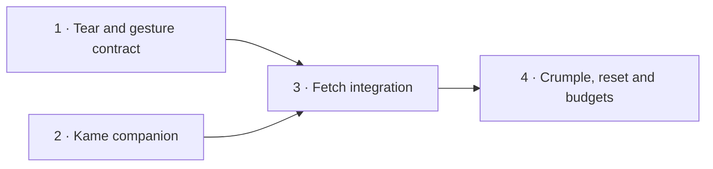

# Kame and Crumple

Plan: pm-259 · Revision: 1 · Product owner: run-8751 · 2026-10-26
Research: [rep-5095, preserved verbatim](research.md)
Planning base: `5cd6ee0` (resolve the delivery SHA from the commit containing this file).
Actual drafting profile: `codex-sol-6-1-high`, model `gpt-6.1-sol`, effort `high` (run-8751 record).

## Product outcome

Make Otohime's existing paper feel playful: an ink turtle swims along the page edge, and paper can be peeled, fetched, folded into a ball and tossed into a footer basket. Every action has a keyboard equivalent and an immediate recovery. The paper's text, links and geometry remain intact. Both toys are progressive enhancements on the existing public `(site)` pages; the normal site is the usable baseline without JavaScript.

The first release covers project cartridges on `/projects`, every public note entry on `/notes`, footer social link chips and a small lazy-rendered decorative paper sticker. The registry can opt in other plain paper surfaces using the same contract. Kame accompanies public pages within the existing site root. Existing independent root-layout exhibits, signed-in rooms, auth/admin pages, editable forms, the Ink Desk and stamp-board gestures are outside gesture discovery. Do not apply a document-wide `.card` selector: most current `.card` elements are account/admin controls. This scope is explicit so safe eligibility can be tested rather than guessed.

Success is the completed browser walkthrough and passing delivery-SHA gates for all four contracts below. This document is a build plan, not a claim that the toys are already implemented.

## Chosen experience

- **Kame:** rough, currentColor SVG turtle; small flipper strokes and zZ ink bubbles; a pointer-transparent fixed layer except for real controls. Scroll updates its edge target via rAF-coalesced transforms. It naps after 45 seconds without activity, follows a called cursor, pets on a held gesture, fetches a tossed visual proxy and retracts into a footer shell. Call Kame, Pet, Name and Hide/Restore are labelled buttons/input. The artwork itself is aria-hidden. Optional K only works outside fields/dialogs and without modifiers.
- **Mood and memory:** local hour 00–05 sleepy, 06–11 bright, 12–18 calm, 19–23 drowsy; an unbroken streak of at least three local dates adds a friendly greeting. Count a visit once per date; same-day reloads do not inflate it, a missed day resets it, and a future/invalid stored day cannot create a streak. Store `kame:v1` as `{name,lastVisit,streak,dismissed}`; trim names to 24 characters and render as text. Inject clock/calendar and storage for tests; failed storage becomes in-memory state.
- **Sound:** reuse `lib/sound-client.ts` and its sound toggle/context. Quiet synthesized purr while petting, started only by an input gesture when sound is on, ending on release, cancel, blur, hide, toggle-off or unmount. Reuse cue data if sufficient; otherwise add a tested bounded cue. No media files or second audio context.
- **Tear:** explicit upper corner handle, 24px geometric hot zone with at least 44px accessible control hit area. Pull reveals a seeded deckled edge and a short real DOM margin note or an existing internal secret link. Peel corner does the same via keyboard. Keep controls and recovered text outside the clipped visual layer.
- **Fetch:** drag a card body on mouse or an explicit touch grip, then release with velocity. Kame retrieves an aria-hidden visual proxy and returns it to the source rectangle. The source stays in its original DOM order. Ordinary click/modified click/key activation still navigates; suppress exactly the synthetic click caused by a completed drag. Fetch back is also a button.
- **Crumple:** a stationary 600ms card-body hold or Crumple button folds a seeded Canvas 2D triangle mesh into a ball in about 400ms. Draw paper and ink creases as vectors, avoiding content screenshots. Toss with mouse/touch or Toss to basket. Footer SVG basket receives balls using a tiny fixed-step 2D integrator with rim collisions, friction and rest detection.
- **Recovery:** per-card Reset, Read card and global Iron flat stay reachable even when the card's painted layer is gone. Original text and links stay in the accessibility tree; focusing a source link immediately restores visible paper. Iron flat reverses tears/crumpling with a short sweep overlay. Escape and route change clear cosmetic state, proxies, captures and animation work. Kame name/streak survive reset.
- **Motion and touch:** reduced motion means an asleep, stationary Kame and instantaneous paper states; no follow/fetch movement or physics animation. Buttons still work. A preference change stops active movement immediately. Touch scroll is the default outside deliberate grips/corner handles; scope touch-action before pointerdown on those controls, never on the document. Save-Data offers explicit on-demand enabling instead of automatically downloading the toys.

## Architecture and shared interfaces

Reuse the patterns in `components/pond-loader.tsx`, `ink-hero-loader.tsx`, `stamp-board.tsx`, `lost-sheet.tsx`, `lib/sound.ts`, `lib/sound-client.ts` and `components/end-footer.tsx`. Use existing layouts only. The installed Next 16.4.2 guide at `node_modules/next/dist/docs/01-app/02-guides/lazy-loading.md` requires `ssr:false` inside a Client Component; server-side dynamic import does not provide the desired boundary. Do not change route-group motion/sibling classifications.

| Interface | Responsibility and observable state |
| --- | --- |
| `lib/tactile.ts` | Pure surface registry/eligibility, one-pointer gesture owner, injected clock/storage, route-session reset. Stable surface ids derive from project href/title and note date, never array position. |
| `data-paper-id`, `data-tossable` | Opt-in metadata on original server DOM. Not an SSR enhancement marker; no interactive toy nodes, proxies or canvases exist there before activation. |
| `lib/tear.ts` | Seeded deckle geometry and intact/peeled/reset transitions. Safe bounded session serialization. |
| `lib/kame.ts` | Pure state/mood/calendar/storage policy and a small fetch/cancel command interface; no React or browser imports. |
| `lib/kame-fetch.ts` | Bounded velocity samples, origin/return geometry and exact-once click suppression using the shared gesture owner. |
| `lib/crumple.ts` | Seeded fold mesh and fixed-step physics; sleep and basket-in results are deterministic values. |
| `components/tactile/`, `components/kame/` | Separate lazy loaders and renderers, guarded browser adapters and full teardown. Expose real user controls and data-state attributes that browser tests can observe. |
| `components/end-footer.tsx` | Stable shell/basket slots and lazy controls; preserve navigation, credits and the Ryugu-jo entry. |

Gesture precedence is a single contract: corner peel owns its pointer; nested controls and existing toy roots retain theirs; otherwise a stationary hold can become crumple at 600ms. A body drag over 6px may become fetch and immediately cancels its hold; motion over 8px always cancels an unclaimed hold. On touch outside a grip, scrolling wins and cancels pending hold/drag. No event may produce both fetch and crumple. Pointercancel, lost capture, Escape, blur, pagehide, target removal, route departure or viewport resize restore sources and stop the active gesture. Kame pet hold is 500ms on Kame's own control, independent of card holds. Unit fixtures cover threshold boundaries.

New layers use the existing stacking vocabulary: above ordinary content, below PeekLayer, Pocket and dialogs; never cover a focused control. Fixed/absolute visuals cannot affect paper geometry. Limit active balls to eight, DPR to two, and integrate with clamped deltas; stop rAF when at rest/hidden. Session state is bounded, keyed by route plus stable id, and removed on route departure; revisiting a route starts flat. Reload within the same route may restore peeled state. Blocked/malformed storage never blocks reading.

## Delivery order and size

Settings read during run-8751: `max_plan_elapsed=6h0m0s`, `max_live_runs_per_plan=3`, `qa_mode=auto`. Four SWE tasks; all retain `qa=required` because all change visible behaviour. No separate QA task duplicates the platform's per-task QA/acceptance dispatch.



Tasks 1 and 2 have no functional dependency; both declare the shared layout/footer paths so the platform can schedule footprint conflicts. Task 3 composes their interfaces; task 4 consumes the completed gesture contract. With the documented 1h fallback per task the conservative weighted sum is 4h and longest dependency path is 3h. The admission service's measured role p50 is authoritative. If it refuses this proposal above 6h, submit tasks 1–2 here and file fetch then crumple as chained parts with `after_plan_id`, retaining this document as the scope reference. Do not pre-plan later parts against unlanded code.

## Verification and acceptance

The JSON contracts below are the exact proposal payload, not illustrative tasks. Each feature has a new named verifier which must fail or be missing before implementation and pass at delivery. Generic existing green tests alone cannot close a new feature. Feature tests use clock/calendar/seed injection and real production-browser pointer/key inputs; nobody proves idle/streak/physics by spending real time idle.

Local gate commands run from the repository root after `npm ci`. `scripts/e2e.mjs` with no BASE_URL creates its own isolated database, builds and serves the production app; these tests must use public pages and must not mutate a shared deployment. Browser tests close contexts promptly. Named new tests and the budget script are delivered by their owning contracts. A missing browser or a skipped/zero-test run is inconclusive, never success.

Task 4's performance acceptance is precise:

1. Loader bootstrap at most 2KiB gzip; incremental Kame under 15KiB gzip; combined tear/crumple under 20KiB gzip, including new shared helper code counted once and excluding already-shipped React/runtime. Identify real transitive output chunks, not just source file sizes; report gzip accounting. Existing heavy libraries must not become toy imports.
2. Parsed initial server HTML contains no interactive Kame/paper controls, no toy canvas/proxies and no toy preload request. Inert surface metadata and stable footer slots are allowed. The loader renders null on the server and requests toy modules only after window load plus an idle callback (bounded setTimeout fallback); Crumple's renderer is further deferred until its first action.
3. Compare five paired cold navigations each at 1280×860 and 390×844, same browser/production build/CPU-network settings. Use browser-side request interception to block toy chunks for the control, without adding a production feature flag. Log every sample and the original final LCP element. Enabled median LCP minus control median is at most max(100ms, 5% of control median); the toy never becomes an LCP candidate. This tolerance handles measurement noise and does not authorize critical-path requests.
4. No toy-caused layout shift (measurement tolerance 0.001); card bounding boxes before/after action/reset differ by at most 1 CSS pixel. Assert observer entries and geometry, not a bare total CLS that another animation could mask.
5. Exercise no-JS, blocked storage, Save-Data, live reduced-motion changes, dark/light and readable content while crumpled. Use real touch event dispatch for scrolling/long-press conflicts; mouse emulation alone is insufficient.

QA and final acceptance independently inspect the delivery diff and the actual running browser build (meta build-sha plus build/chunk fingerprint); an unrelated new SHA is insufficient. Walk each user path on desktop and touch, verify keyboard focus recovery and readable original content, and exercise negative controls: a normal footer link must still navigate, scrolling a card must not toss it, typing k in a field must not call Kame, sound-off must not create purr audio, reduced motion must not run animation, and an excluded desk/stamp gesture must still work. Read the source accessibility tree and response/request evidence rather than only screenshots or the SWE's proof script. Reports include starting state → action → result → artifact, observed defects and exact identities.

This repository actually uses GitHub Actions `.github/workflows/ci.yml` with Vercel deployments; generic GitLab/k3s instructions do not identify its deployment. Green gate and independent QA own deployed proof; SWE action items stop at tested commit/push. If a delivered build is unavailable, report the exact missing build/deployment id and owner rather than accepting a stale public site. There are no external scheduled jobs in this feature, so runtime queue/history/callback evidence is not applicable; browser execution remains required. Record fake clock/physics boundaries separately from actual production-renderer execution.

## Build contracts

### 1. Peel paper corners with a shared gesture contract

```json
{
  "sequence": 1,
  "title": "Peel paper corners with a shared gesture contract",
  "role": "software_engineer",
  "depends_on": [],
  "qa": "required",
  "problem": "Paper surfaces have no reversible tear interaction, and adding separate drag listeners would conflict with navigation, scrolling and existing toys.",
  "action_items": [
    "Declare and test lib/tactile.ts first: stable surface ids, opt-in discovery, route exclusion, route-session state and one-pointer gesture arbitration (idle/peel/hold/fetch/crumple). Inject clock, storage and seed; invalid or throwing storage falls back to memory. Keep the pure interface independent of React.",
    "Implement components/tactile/loader.tsx and paper-layer.tsx, mounted once in the existing app/(site)/layout.tsx. Render null on the server; dynamically import only after window load and idle, and only on eligible public routes. Save-Data leaves an on-demand enable control; reduced motion keeps instant keyboard operations. Cleanup listeners, captures and transforms on route departure/pagehide; clear route-session storage on route departure only.",
    "Opt in every project Cartridge and public notes entry using stable data-paper-id/data-tossable metadata; exclude protected/account/admin/auth routes, /desk, stamp boards, inputs, editable content, controls and live canvases. Register a bounded text margin note or existing internal secret link per card. Preserve original DOM, hrefs, content, text selection and layout.",
    "Implement a 24px corner peel handle with a larger accessible hit area, seeded deckled clip polygon and real hidden-layer DOM revealed by drag or Peel corner. Add visible-on-focus controls outside clipping, per-card Reset, Escape cancellation, instant reduced-motion paths and session persistence. Touch scroll wins outside the explicit handle; greater than 8px motion cancels pending holds.",
    "Write unique pure and production-browser tests before implementation, including pointercancel, navigation cleanup, blocked storage, reduced motion, Save-Data, no-JS link access, keyboard reveal, stable card geometry and existing stamp/desk drag exclusions. Document the registry and gesture vocabulary under the plan folder; stop engineering work after tested commit/push."
  ],
  "interfaces": [
    "lib/tactile.ts",
    "lib/tactile.test.ts",
    "lib/tear.ts",
    "lib/tear.test.ts",
    "components/tactile/",
    "components/cartridge.tsx",
    "app/(site)/(app)/notes/page.tsx",
    "app/(site)/layout.tsx",
    "app/(site)/tactile.css",
    "e2e/tactile-tear.test.ts",
    "e2e/tactile-helpers.ts",
    "projects/kame-crumple-two-tactile-paper-and-ink-toys-for-otohime-dev/tactile-contract.md"
  ],
  "non_goals": [
    "Kame visuals or fetch implementation",
    "crumple renderer and basket physics",
    "new root layouts, backend endpoints or dependencies",
    "editing card content or affecting auth/admin/desk tools"
  ],
  "acceptance_criteria": "On /projects and /notes, eligible paper cards peel into a deterministic deckled corner revealing accessible margin content; keyboard Peel corner and Reset perform the same actions. Links and scrolling retain normal behaviour, cancellation and route changes restore the card, and no interactive toy markup or heavyweight code is in the server render.",
  "verification": [
    {
      "name": "tear and gesture edge cases",
      "cwd": ".",
      "cmd": "node --experimental-strip-types --disable-warning=ExperimentalWarning --disable-warning=MODULE_TYPELESS_PACKAGE_JSON --test lib/tactile.test.ts lib/tear.test.ts",
      "expect": "exit0",
      "timeout_s": 300
    },
    {
      "name": "existing repository suite",
      "cwd": ".",
      "cmd": "npm test",
      "expect": "exit0",
      "timeout_s": 300
    },
    {
      "name": "lint and type contracts",
      "cwd": ".",
      "cmd": "npm run lint && npm run typecheck",
      "expect": "exit0",
      "timeout_s": 300
    },
    {
      "name": "production tear, touch and progressive enhancement",
      "cwd": ".",
      "cmd": "node --experimental-strip-types --disable-warning=ExperimentalWarning --disable-warning=MODULE_TYPELESS_PACKAGE_JSON scripts/e2e.mjs --test e2e/tactile-tear.test.ts",
      "expect": "exit0",
      "timeout_s": 900
    }
  ]
}
```

### 2. Give Kame a persistent accessible ink companion

```json
{
  "sequence": 2,
  "title": "Give Kame a persistent accessible ink companion",
  "role": "software_engineer",
  "depends_on": [],
  "qa": "required",
  "problem": "The site has no companion; Kame needs deterministic mood, persistence and accessible controls before gestures can request fetch.",
  "action_items": [
    "Declare and test lib/kame.ts with swim/nap/follow/fetch/pet/shell states, injected elapsed clock, local calendar day and storage. Idle at 45s sleeps; visit streak increments once per local date, resets after a missed date and tolerates malformed/future records. Define hour-based mood ranges and cap/trim the stored name to 24 characters.",
    "Implement a separate components/kame/loader.tsx and ink SVG companion in the existing app/(site)/layout.tsx without importing tactile code. After load plus idle, show slow edge swimming and zZ ink bubbles, Call Kame, inline naming, Pet and shell dismissal/restoration; expose a small local fetch-command interface for task 3 without creating global test-only APIs.",
    "Keep original layout and controls unobstructed at 390px and desktop; turtle artwork is aria-hidden while real labelled buttons handle Call, hold-to-pet and dismiss/restore. Pause follow and inputs behind Pocket/dialogs. Provide keyboard press/release petting and touch hold at 500ms, with pointer cancellation and focus-loss cleanup. Use optional K shortcut only outside editable fields/modifier combinations.",
    "Persist only kame:v1 name/lastVisit/streak/dismissed with guarded access. On reduced motion Kame stays asleep in a corner with static responses and working controls; preference changes immediately stop motion. Save-Data defers optional code to an explicit enable control. Pause animation and release audio when document hides or page unmounts.",
    "Reuse the existing sound context/toggle for a bounded quiet chiptune purr (existing cue sequence or a tested new cue), starting only from a pet gesture while sound is on; stop on release/cancel/blur/hide/toggle-off/unmount. Add state, storage, sound and production-browser tests including accelerated idle and calendar fixtures; stop after tested commit/push."
  ],
  "interfaces": [
    "lib/kame.ts",
    "lib/kame.test.ts",
    "components/kame/",
    "app/(site)/layout.tsx",
    "app/(site)/kame.css",
    "components/end-footer.tsx",
    "lib/sound.ts",
    "lib/sound-client.ts",
    "lib/sound.test.ts",
    "e2e/kame.test.ts",
    "projects/kame-crumple-two-tactile-paper-and-ink-toys-for-otohime-dev/kame-contract.md"
  ],
  "non_goals": [
    "drag/fetch integration",
    "paper tear or crumple implementation",
    "server tracking, analytics or sound files",
    "new route groups or third-party dependencies"
  ],
  "acceptance_criteria": "Kame paddles along public page edges, naps after a fixture-driven 45s idle, follows when called, accepts hold-to-pet and a quiet sound-toggle-gated purr, remembers its inline name/streak/dismissal, and restores from a footer shell. Reduced motion gives a stationary sleeping companion with keyboard controls; blocked storage and sound-off remain fully usable.",
  "verification": [
    {
      "name": "Kame states, local dates and sound policy",
      "cwd": ".",
      "cmd": "node --experimental-strip-types --disable-warning=ExperimentalWarning --disable-warning=MODULE_TYPELESS_PACKAGE_JSON --test lib/kame.test.ts lib/sound.test.ts",
      "expect": "exit0",
      "timeout_s": 300
    },
    {
      "name": "existing repository suite",
      "cwd": ".",
      "cmd": "npm test",
      "expect": "exit0",
      "timeout_s": 300
    },
    {
      "name": "lint and type contracts",
      "cwd": ".",
      "cmd": "npm run lint && npm run typecheck",
      "expect": "exit0",
      "timeout_s": 300
    },
    {
      "name": "production companion and accessibility",
      "cwd": ".",
      "cmd": "node --experimental-strip-types --disable-warning=ExperimentalWarning --disable-warning=MODULE_TYPELESS_PACKAGE_JSON scripts/e2e.mjs --test e2e/kame.test.ts",
      "expect": "exit0",
      "timeout_s": 900
    }
  ]
}
```

### 3. Fetch tossed cards, stickers and link chips safely

```json
{
  "sequence": 3,
  "title": "Fetch tossed cards, stickers and link chips safely",
  "role": "software_engineer",
  "depends_on": [
    "1",
    "2"
  ],
  "qa": "required",
  "problem": "The companion and paper layer need a shared toss-to-fetch interaction that returns items without stealing link clicks, touch scrolling, or another toy's gesture.",
  "action_items": [
    "Extend the existing tactile gesture port and Kame command interface with capture, bounded velocity samples, toss origin/return rectangle, cancel and completion. Body motion above 6px starts fetch only when not owned by peel or the 600ms crumple hold. Freeze the full hold/drag arbitration table in tests so task 4 can consume it.",
    "Integrate fetch for all opted-in project and note cards, footer social link chips and a small decorative paper sticker rendered after lazy activation. For touch use explicit draggable grips with touch-action scoped there from pointerdown; leave the rest of each card scrollable. Regular clicks, modified clicks, keyboard activation and text selection keep their native behaviour; suppress only the one click generated by a completed toss.",
    "Animate an aria-hidden visual proxy on toss, let Kame swim to it and return it to the measured origin; original source DOM and href stay in place. Restore on completion, Escape, pointercancel, blur, route change, target detachment, resize or reduced-motion changes. Dismissed/sleep-only Kame declines fetch and restores the object immediately.",
    "Add keyboard Fetch back buttons associated with the same registered surfaces; announce completion once. Ensure peel handles, nested controls, long-press candidates, stamp boards, /desk and open Pocket dialogs never start a fetch; bound simultaneous activity to one gesture.",
    "Add tests of toss velocity and exact-once click suppression, real mouse and touch grip paths, link navigation negative controls, route cleanup and coexistence with tear. Keep purr and terminal sound behaviour unchanged; stop after tested commit/push."
  ],
  "interfaces": [
    "lib/tactile.ts",
    "lib/tactile.test.ts",
    "lib/kame.ts",
    "lib/kame.test.ts",
    "lib/kame-fetch.ts",
    "lib/kame-fetch.test.ts",
    "components/tactile/",
    "components/kame/",
    "components/end-footer.tsx",
    "app/(site)/tactile.css",
    "app/(site)/kame.css",
    "e2e/kame-fetch.test.ts",
    "e2e/tactile-tear.test.ts",
    "projects/kame-crumple-two-tactile-paper-and-ink-toys-for-otohime-dev/fetch-contract.md"
  ],
  "non_goals": [
    "moving/removing original content or changing hrefs",
    "basket scoring or crumple renderer",
    "taking gestures from protected forms, existing games or native scrolling"
  ],
  "acceptance_criteria": "A mouse toss or touch-grip toss of an opted-in card, sticker or footer link chip makes Kame fetch its visual copy and return it. Untossed links still navigate, completed tosses suppress exactly one click, keyboard Fetch back is equivalent, and peel/hold/dialog/desk gestures stay independent. Every cancellation restores the source immediately.",
  "verification": [
    {
      "name": "fetch and arbitration edge cases",
      "cwd": ".",
      "cmd": "node --experimental-strip-types --disable-warning=ExperimentalWarning --disable-warning=MODULE_TYPELESS_PACKAGE_JSON --test lib/kame-fetch.test.ts lib/tactile.test.ts lib/kame.test.ts",
      "expect": "exit0",
      "timeout_s": 300
    },
    {
      "name": "existing repository suite",
      "cwd": ".",
      "cmd": "npm test",
      "expect": "exit0",
      "timeout_s": 300
    },
    {
      "name": "lint and type contracts",
      "cwd": ".",
      "cmd": "npm run lint && npm run typecheck",
      "expect": "exit0",
      "timeout_s": 300
    },
    {
      "name": "production fetch and peel coexistence",
      "cwd": ".",
      "cmd": "node --experimental-strip-types --disable-warning=ExperimentalWarning --disable-warning=MODULE_TYPELESS_PACKAGE_JSON scripts/e2e.mjs --test e2e/kame-fetch.test.ts e2e/tactile-tear.test.ts",
      "expect": "exit0",
      "timeout_s": 900
    }
  ]
}
```

### 4. Crumple, toss and iron paper with measured budgets

```json
{
  "sequence": 4,
  "title": "Crumple, toss and iron paper with measured budgets",
  "role": "software_engineer",
  "depends_on": [
    "3"
  ],
  "qa": "required",
  "problem": "Visitors cannot yet crumple and toss paper or reset both toys, and final composition needs proof of content recovery, bounded work and loading performance.",
  "action_items": [
    "Declare and test lib/crumple.ts physics and fold model with seeded triangles/ink creases, fixed timestep, clamped delta, gravity, rim collisions, restitution, friction, basket-in detection and sleep-at-rest. Use injected clock/seed for instant fixture execution; cap active balls at 8 and device pixel ratio at 2.",
    "Implement lazy Canvas 2D triangle-mesh crumpling (~400ms) into a ball sprite, bounded offscreen geometry, footer SVG basket, mouse/touch tossing and keyboard Toss to basket. A stationary card-body hold at 600ms crumples, >8px movement cancels the hold, and the shared gesture owner prevents fetch/tear double activation.",
    "Keep the original accessible DOM and reserved layout box; use a visual proxy/paint-only suppression, not display:none, visibility:hidden, removal or aria-hidden on content. Provide always-reachable Read card and Reset controls outside the painted area; focus of any original link restores its visibility. On renderer failure restore the original synchronously.",
    "Implement per-card Reset and global Iron flat, reversing tear and crumple with an iron-sweep overlay; reduced motion swaps instantly and keyboard toss places the ball directly in the basket. Reset both cosmetic states on route departure; clear pending gestures, captures and animations on Escape/cancel/hide/resize/unmount. Reset may stop fetch but keeps Kame's name and visit history.",
    "Add full production-browser regressions (mouse, real touch events, keyboard, theme, reduced motion toggled mid-action, Save-Data, blocked storage, no-JS, Pocket/peeks/stamps/desk). Assert original accessible names, hrefs, text and card geometry survive crumple/reset and footer links remain usable.",
    "Add scripts/tactile-budget.mjs and e2e/tactile-performance.test.ts: identify actual production chunks from build output, count shared toy code once, enforce loader <=2KiB gzip, Kame <15KiB gzip and tear+crumple <20KiB gzip incremental code. Prove toy requests occur after load+idle and absent in critical preload; assert no interactive toy elements/canvas in parsed server HTML, no toy-caused CLS and paired LCP tolerance from the plan. Record measurements and fixture/build identity under the plan folder; stop after tested commit/push."
  ],
  "interfaces": [
    "lib/crumple.ts",
    "lib/crumple.test.ts",
    "lib/tactile.ts",
    "lib/tactile.test.ts",
    "components/tactile/",
    "components/kame/",
    "components/end-footer.tsx",
    "app/(site)/tactile.css",
    "e2e/crumple.test.ts",
    "e2e/tactile-performance.test.ts",
    "e2e/tactile-helpers.ts",
    "scripts/tactile-budget.mjs",
    "projects/kame-crumple-two-tactile-paper-and-ink-toys-for-otohime-dev/execution-evidence.md"
  ],
  "non_goals": [
    "WebGL, html2canvas, screenshotting cards or new physics dependencies",
    "persisting discarded content or server writes",
    "modifying CI, authentication or unrelated visual toys"
  ],
  "acceptance_criteria": "Long-press or keyboard Crumple folds a card into an ink-creased canvas ball; mouse/touch tosses and keyboard Toss to basket reach the footer basket with deterministic collision/rest behaviour. Read card, Reset and Iron flat always recover all original content and tears without layout shift; reduced motion is instant. All four feature browser suites and measured lazy-load, gzip, LCP and CLS budgets pass at the delivery build.",
  "verification": [
    {
      "name": "crumple physics and shared gesture invariants",
      "cwd": ".",
      "cmd": "node --experimental-strip-types --disable-warning=ExperimentalWarning --disable-warning=MODULE_TYPELESS_PACKAGE_JSON --test lib/crumple.test.ts lib/tactile.test.ts lib/tear.test.ts lib/kame-fetch.test.ts",
      "expect": "exit0",
      "timeout_s": 300
    },
    {
      "name": "existing repository suite",
      "cwd": ".",
      "cmd": "npm test",
      "expect": "exit0",
      "timeout_s": 300
    },
    {
      "name": "lint and type contracts",
      "cwd": ".",
      "cmd": "npm run lint && npm run typecheck",
      "expect": "exit0",
      "timeout_s": 300
    },
    {
      "name": "production toys and performance budgets",
      "cwd": ".",
      "cmd": "node --experimental-strip-types --disable-warning=ExperimentalWarning --disable-warning=MODULE_TYPELESS_PACKAGE_JSON scripts/e2e.mjs --test e2e/tactile-tear.test.ts e2e/kame.test.ts e2e/kame-fetch.test.ts e2e/crumple.test.ts e2e/tactile-performance.test.ts",
      "expect": "exit0",
      "timeout_s": 900
    },
    {
      "name": "built incremental gzip budgets",
      "cwd": ".",
      "cmd": "node scripts/tactile-budget.mjs",
      "expect": "exit0",
      "timeout_s": 120
    }
  ]
}
```

## Non-goals and handoff

No new framework, package, root layout, backend API, server tracking, external runtime, WebGL dependency, screenshot-to-texture library, production test hook or persistent content mutation. The referenced social posts are provenance from the idea, not implementation dependencies; their contents were not fetched. The saved research is preserved verbatim; the explicit accessibility/motion choices above supersede its suggestions to hide the original card or skip all reduced-motion code.

No person-only prerequisite is known. If a future task first discovers a physical external chore, its engineer raises the stable `operator_action` at that task's start and reports the missing readiness immediately; independent work continues where possible. Policy/design choices are decided and recorded, not sent out as chores. The platform executes the DAG after proposal; this PO run commits only these Markdown artifacts and submits the summary.

Standing rules remain in AGENTS.md and the shared docs/claude/software-development.md. In this lease the two requested planning/rule documents resolve from /data/build-worker/repo/mono-v2/; they are not copied into this repository. Decisions and the lesson about actual GitHub/Vercel CI are in the plan-manager decision ledger.
