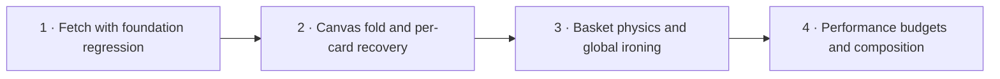

# Kame and Crumple

Plan: pm-259 · Revision: 2 · Product owner: run-8806 · 2026-10-26
Planning base: `15fd171`; delivery SHA is the commit containing this revision.
Actual run: `codex-sol-6-1-high` / `gpt-6.1-sol` / `high`, fleet worker `avietidol-z490` (run record).
Research: [rep-5095 preserved verbatim](research.md).

## Outcome and revision boundary

Kame is an optional ink turtle companion; Crumple makes existing paper peel, fold, fly into a basket and iron flat again. Content remains readable, links keep working and every gesture has a keyboard action. Both features remain lazy progressive enhancements with no new dependency.

Revision 1 delivered Kame at `dd21add9d4badb1af46a1f3affea59058d6418c2` and tear/registry at `a46ad8e496467183a5ed938dc5100e563a0e330b`, both ancestors of the planning base. Their board tasks t-1572/t-1573 are superseded, not proof that their code is missing. t-1574/t-1575 were also superseded. This revision retains delivered code and its tests, replaces the unfinished fetch and oversized final task with four smaller contracts, and explicitly re-verifies the foundation in composition. Old reports describe local execution; CI/deployed acceptance is still required and is not inferred from them.

The operator authorized changing the implementation approach. Canvas 2D seeded paper triangles/ink creases plus small deterministic physics preserve the requested appearance with less dependency and WebGL-context risk. A broad card-body drag can conflict with links, selection and scrolling; deliberate 44px grips provide the guaranteed drag route on mouse/touch, with optional blank-paper input only where safe. Stationary blank-paper/grip holds and keyboard buttons retain the crumple experience.

## Scope and interaction

Paper cards are project cartridges on /projects and public note entries on /notes. Fetch additionally includes footer Lines chips through noninteractive wrappers and a small lazy decorative sticker on those two routes. Fetch-only surfaces do not need a margin layer. Other plain paper can opt in later; “any card” means any explicitly registered paper card, never account/admin forms selected by a global CSS class.

Kame keeps the current public-route allowlist: /, /work, /play, /notes, /music, /projects, /sketches. Signed-in/auth/admin pages, independent exhibit roots, /desk, stamp boards, live canvases and editable/nested controls retain existing inputs. The SVG artwork stays aria-hidden and pointer-transparent; real labelled footer controls operate it.

Keep existing Kame behavior: slow edge swimming beside scroll, zZ after injected 45s idle, Call or unmodified K outside fields/dialogs to follow, 500ms hold-to-pet with existing sound-toggle-gated bounded synthesized purr, inline name trimmed to 24 Unicode code points, shell dismissal/restoration. Local hours 00–05/06–11/12–18/19–23 give sleepy/bright/calm/drowsy; a streak of three dates adds a friendly greeting. Guard `kame:v1` name/lastVisit/streak/dismissed storage, count once per local date and tolerate invalid/future/blocked storage.

Peel remains a 24px visual corner with 44px accessible hit area, seeded deckle and real margin DOM. Peel corner and Reset use the same state transitions. Fetch animates one proxy to the turtle and back. Crumple draws a roughly 400ms paper fold into a ball; a pointer flick can land it in the footer basket. Crumple, Fetch back, Toss to basket, Read card, Reset and Iron flat are real labelled keyboard actions. Reduced motion keeps a stationary sleeping turtle and instant paper recovery/toss without follow/fetch/physics animation; petting responds statically and sound stays opt-in.

## Architecture and interfaces

Read [the landed gesture contract](tactile-contract.md) and [the Kame port](kame-contract.md) before implementation. Extend them; do not mount a second gesture manager. The planning rules and standing software rules were recovered read-only from `/home/avietidol/codes/mono-v2/projects/20260921222547_plan_manager_chief_of_staff_extraction.md` and `/home/avietidol/codes/mono-v2/docs/claude/software-development.md`, absent in this repo. Standing rules stay in their source documents and AGENTS.md.

The installed Next guide `node_modules/next/dist/docs/01-app/02-guides/lazy-loading.md` was read: client dynamic boundaries provide lazy loading and `ssr:false` belongs in a Client Component. Preserve current null-fallback Suspense mounting in the existing site layout and feature CSS imports from loaders. Do not add root layouts/stylesheets or duplicate motion/sibling classifications.

| Interface | Contract |
| --- | --- |
| `lib/tactile.ts` + mounted PaperLayer | Stable typed registry, one gesture owner and route-session state; extend discovery for fetch-only wrappers without making anchors draggable. |
| `components/kame/commands.ts` | Local typed command/acknowledgement port. Existing boolean means acceptance only; task 1 adds actual arrival/completion/cancel observation. No window test API. |
| `lib/kame-fetch.ts` | Pure bounded velocity, original rectangle, toss/return and exact-once click-suppression policy. |
| `lib/crumple.ts` | Seeded folding lifecycle first; task 3 adds fixed-step bounded physics and hit/rest outcomes. |
| `components/tactile/` | Sole browser adapter, real controls, lazy Canvas module, proxy lifecycle, recovery and teardown. |
| `components/end-footer.tsx` | Existing shell, fetch-only wrappers and stable basket slot; preserve waterline, navigation and Ryugu-jo entry. |
| `scripts/tactile-budget.mjs` | Actual production chunk attribution/gzip accounting; fixture-tested refusal of empty/ambiguous evidence. |

Gesture arbitration is explicit: peel handle owns peel; nested controls and excluded roots own their input. A stationary primary hold reaches crumple at 600ms. Mouse blank-paper/grip movement above 6px claims fetch and cancels hold; touch body movement above 8px cancels hold for native scrolling. At exact thresholds no transition occurs. Touch-action:none is applied before pointerdown only to explicit grips/handles, never card bodies or document. Wrong-pointer events cannot release ownership. No event activates two toys.

All sources remain in DOM and the accessibility tree at their original geometry/hrefs. Visual proxies are aria-hidden; optional paint-only opacity on source children must restore before source focus, Read, Reset or failure completes. Never hide original content via visibility/display/inert/aria-hidden. Controls sit outside clipping/opacity. The only persistent identity is existing Kame memory; paper session data is bounded and route-scoped. Route departure clears paper cosmetics. Iron flat clears all paper state but preserves Kame identity/dismissal.

Use existing theme ink/paper variables and stacking below Peek/Pocket/dialogs. Pause or cancel behind modals. Cancel fetch/fold/flight and restore content on interruption; teardown releases captures, subscriptions, observers, frames, audio and canvas resources. Cap balls at eight, DPR at two, elapsed deltas and flight at five active seconds. rAF stops when resting/hidden. If a module/context is unavailable, source reading and reset still work. No backend, scheduled work, external runtime job, paid API or binary asset is needed.

## Delivery order and admission



Current settings read on run-8806: max_plan_elapsed=6h0m0s, max_live_runs_per_plan=1, qa_mode=auto. All tasks require QA because each affects visible behavior. Four serial SWE tasks have a 4h fallback estimate (1h each); the admission server's measured role p50 is authoritative. Tasks name overlapping paths deliberately. If admission exceeds the ceiling, submit only tasks 1–2 and file tasks 3–4 as a later part using after_plan_id=pm-259, naming this document; later drafting occurs against landed code, without pre-planning unlanded implementations. No parent_plan_id for parts.

No contract depends on a human choice or timed observation. Any newly discovered physical/sign-in chore is raised by the first task that needs it, at its start, via advisory plan_manager_ask_user kind=operator_action with a stable fingerprint and readiness probe only when meaningful. Record judgement calls and surprises as decisions/lessons. Engineering proves locally, commits with pm-259/<assigned-task-id>: and pushes; green gate, CI/deployed QA and acceptance belong to the platform. This product-owner run uses pm-259/run-8806: because it has no claimed task id.

## Verification protocol

Each JSON contract below is the exact proposal. New verifier files are implementation obligations: missing/no-match/skipped/zero-test results cannot pass. Start with a failing feature assertion, preserve existing tests and fix regressions. Run npm ci in the locked Node 22 checkout. Pure clock/calendar/seed/storage fixtures prove policy, not rendering. Real production Next imports and Chromium Canvas/Web Audio construction plus CDP touch prove the browser path. No test mutates a shared deployment.

Use scripts/e2e.mjs without BASE_URL for an isolated temporary PostgreSQL and production build/server; it runs test files serially. Do not override concurrency upward. Use short TMPDIR=/tmp for Chromium on lease paths. The footer walk/probe have their own isolated local database path. Task 4's commands clear BASE_URL and database overrides and build with CI=true and GITHUB_SHA equal to the delivery commit to reproduce CI identity. Independent QA reads the actual served build/chunk identity rather than trusting state attributes or supplied summary scripts.

Performance acceptance at task 4:

1. Enforce combined loader bootstrap <=2KiB gzip, incremental Kame <15KiB gzip, combined tear/fetch/crumple paper code <20KiB gzip. Assign shared new code once to paper and show the union total; exclude existing framework runtime, never omit a new helper. Traverse actual emitted dependencies and record contributing chunks; source-file gzip alone is insufficient.
2. Parse initial server HTML: no interactive toy controls, proxies or Canvas; inert paper metadata and reserved shell/basket slots are allowed. No toy renderer/module preload is critical-path. Kame/paper modules request only after load plus idle; Canvas requests only after first action. Hold the idle callback to demonstrate absence before release and presence afterward. Save-Data keeps optional renderers unloaded until explicit enable.
3. Run five paired cold navigations at each 1280×860 and 390×844 viewport on one production build with identical browser/CPU/network settings. Enabled and control differ only by browser-side blocking of identified toy chunks. Record every LCP sample, final LCP element and request timing. Enabled median minus control median <=max(100ms, 5% of control median), and no toy is a final LCP candidate.
4. Observe toy-attributable layout shifts <=0.001 and source bounding boxes before/action/reset within 1 CSS pixel. Inspect shift source nodes and overlay geometry; aggregate CLS or state strings alone cannot prove this.
5. Fault injection is explicit: malformed/blocked storage, failed import/Canvas, reduced motion toggled mid-action, Save-Data, source removal and lifecycle interruptions. Relevant negative controls must fail under an intentional budget breach/eager-request fixture and pass normally.

Independent per-task QA and final acceptance inspect delivered diffs plus real served build-sha/build id/chunk hashes, then obtain separate observations through keyboard, mouse and CDP touch. Walk: flat paper → peel → fetch → crumple → basket hit/miss → Iron flat → intact readable source; repeat under reduced motion, Save-Data and blocked storage. Preserve accessible names/hrefs/text/focus and geometry. Challenge normal link navigation, text selection, card scrolling, k in a field, sound-off, modal layering and excluded desk/stamp input. Footer walk/probe remain required alongside full e2e.

Reports distinguish local execution, deployed integration and product acceptance; name real/fake boundaries, exact build/executable identities, raw evidence, defects, independent negative controls and any deferred check's id/owner/failure condition. No asynchronous runtime history/callback scan applies to this browser-only change. The actual deployment topology is GitHub Actions plus Vercel in .github/workflows/ci.yml; generic mono-v2 GitLab/k3s instructions do not describe this repo. CI or deployment unreadability is reported as unobserved and never relabelled success. Future dated observations use acceptance/watch; no contract proves itself by elapsed idle time.

## Build contracts

### 1. Complete safe Kame fetch on the landed paper registry

```json
{
  "sequence": 1,
  "title": "Complete safe Kame fetch on the landed paper registry",
  "role": "software_engineer",
  "depends_on": [],
  "qa": "required",
  "problem": "Kame and peeling are on main, but commandKame acknowledges acceptance rather than arrival, and paper has no complete toss/return path. Rebuilding the foundation would discard validated fixes.",
  "action_items": [
    "Read the landed tactile-contract.md and kame-contract.md; retain a46ad8e and dd21add behavior and regression tests. Add failing fetch unit/browser tests first, and extend the existing PaperLayer's single createGesture owner instead of adding competing document-wide body listeners. Preserve current loaders, route eligibility and stylesheet placement.",
    "Declare lib/kame-fetch.ts pure velocity/proxy/return lifecycle and a typed completion subscription in components/kame/commands.ts. Acceptance, arrival, return and cancellation are distinct. Emit arrival from the rendered turtle's actual bounded position; cap each operation at 5s of active elapsed time and cancel safely if arrival never occurs. No guessed sleep proves completion; unit tests drive time, browser tests inspect geometry.",
    "Add 44px explicit drag grips and Fetch back buttons to registered project/note cards. Mouse blank-paper dragging is allowed only outside links, selectable text and controls; touch body scrolling wins. Register footer Lines chips via noninteractive wrappers, and one small lazy decorative sticker, with stable ids. Fetch-only chip/sticker entries need no margin note and no peel actions; extend discovery explicitly while keeping paper eligibility exclusions.",
    "Use one aria-hidden fixed proxy with bounded velocity on release. Kame reaches it and returns it to its measured source; source DOM, hrefs and layout stay intact. Suppress exactly the completed drag's pointer click, never a later real click or keyboard/modified activation. A rejected fetch restores immediately with a scoped accessible response.",
    "Cancel on Escape, pointercancel, capture loss, blur, hidden page, route departure, source removal, resize, modal opening, dismissal or motion change. Reduced motion never animates fetch; Fetch back restores instantly. Save-Data downloads only after explicit enable. Cleanup all subscriptions, frames and captures. Keep reset callable by later crumple work.",
    "Run existing tear/Kame plus new fetch production browser checks, including initial sprite placement, actual arrival/return geometry, mobile CDP grip input, native link navigation and card-body scroll negative controls. Write fetch-contract.md with lifecycle/arbitration and evidence identity. Commit with the assigned pm-259/task-id prefix and push; engineering ends at push."
  ],
  "interfaces": [
    "lib/tactile.ts",
    "lib/tactile.test.ts",
    "lib/kame-fetch.ts",
    "lib/kame-fetch.test.ts",
    "lib/kame.ts",
    "lib/kame.test.ts",
    "components/tactile/",
    "components/kame/",
    "components/end-footer.tsx",
    "app/(site)/tactile.css",
    "app/(site)/kame.css",
    "e2e/kame-fetch.test.ts",
    "e2e/kame.test.ts",
    "e2e/tactile-tear.test.ts",
    "e2e/tactile-helpers.ts",
    "projects/kame-crumple-two-tactile-paper-and-ink-toys-for-otohime-dev/fetch-contract.md"
  ],
  "non_goals": [
    "recreating landed Kame or peel features",
    "crumple rendering or basket physics",
    "new dependencies, route groups, global event APIs or backend writes"
  ],
  "acceptance_criteria": "On /projects and /notes, cards, footer Lines chips and a decorative sticker can be tossed with an explicit touch/mouse grip or Fetch back button. The visible turtle reaches the proxy and returns it within 5s active time; source text, links and geometry remain intact. Cancel/reduced-motion/dismissed paths restore immediately. Ordinary links, text selection, touch scrolling, peel, Pet and existing desk/stamp gestures still work.",
  "verification": [
    {
      "name": "fetch policy and existing foundation",
      "cwd": ".",
      "cmd": "node --experimental-strip-types --disable-warning=ExperimentalWarning --disable-warning=MODULE_TYPELESS_PACKAGE_JSON --test lib/kame-fetch.test.ts lib/tactile.test.ts lib/kame.test.ts lib/tear.test.ts",
      "expect": "exit0",
      "timeout_s": 300
    },
    {
      "name": "repository suite",
      "cwd": ".",
      "cmd": "npm test",
      "expect": "exit0",
      "timeout_s": 300
    },
    {
      "name": "lint and type contracts",
      "cwd": ".",
      "cmd": "npm run lint && npm run typecheck",
      "expect": "exit0",
      "timeout_s": 300
    },
    {
      "name": "production fetch, companion and peel",
      "cwd": ".",
      "cmd": "node --experimental-strip-types --disable-warning=ExperimentalWarning --disable-warning=MODULE_TYPELESS_PACKAGE_JSON scripts/e2e.mjs --test e2e/kame-fetch.test.ts e2e/kame.test.ts e2e/tactile-tear.test.ts",
      "expect": "exit0",
      "timeout_s": 900
    }
  ]
}
```

### 2. Fold paper into reversible Canvas balls

```json
{
  "sequence": 2,
  "title": "Fold paper into reversible Canvas balls",
  "role": "software_engineer",
  "depends_on": [
    "1"
  ],
  "qa": "required",
  "problem": "The shared gesture layer can fetch but cannot turn a card into a tactile paper ball; rendering and restoration need a bounded, independently provable implementation before adding basket physics.",
  "action_items": [
    "Declare lib/crumple.ts seeded fold mesh and intact/folding/ball/reset lifecycle using injected seed/elapsed clock. Add failing tests for finite bounded geometry, deterministic creases, completion, cancellation and invalid input before implementing.",
    "Load a small Canvas 2D renderer only on the first Crumple action after the existing load/idle activation. Draw vector paper triangles and ink creases into an approximately 400ms fold-to-ball proxy. Do not screenshot DOM, use WebGL or add dependencies. Cap DPR at 2 and active balls at 8; extra actions leave the source unchanged and announce the limit.",
    "Add per-card Crumple, Read card and Reset controls outside the animated source area. A primary stationary grip or noninteractive blank-paper hold at 600ms uses the same createGesture owner; touch movement above 8px cancels for scrolling, grip/mouse movement above 6px gives fetch precedence, and corner peel never becomes a hold. Do not intercept text selection, links, nested controls or browser context menus; keyboard Crumple is the equivalent.",
    "Preserve source DOM, accessibility names, hrefs and its reserved layout box. Paint-only opacity may conceal original visual children while the proxy represents the card; never remove content or apply display:none, visibility:hidden, inert or aria-hidden to original content. Focus of any original link, Read card or Reset synchronously restores visible paper. Controls remain visible/focusable while crumpled.",
    "On import/canvas/context failure, restore the source immediately and keep Read/Reset functional. Reduced motion uses an instant ball/static state with no running animation. Cancel active folds on Escape, pointer cancellation, blur/hide, source removal, resize, route departure, motion change and modal opening; release resources. Ordinary per-card Reset also clears the peel/fetch state through task 1's shared lifecycle.",
    "Add real production-browser mouse/touch/keyboard tests for fold output, retained accessible content/geometry, renderer failure and recovery; assert actual nonempty canvas paint plus source focus restoration, not data-state alone. Preserve all foundation tests. Document the renderer port for basket work in crumple-contract.md, then test, commit and push."
  ],
  "interfaces": [
    "lib/crumple.ts",
    "lib/crumple.test.ts",
    "lib/tactile.ts",
    "lib/tactile.test.ts",
    "components/tactile/",
    "app/(site)/tactile.css",
    "e2e/crumple.test.ts",
    "e2e/tactile-helpers.ts",
    "projects/kame-crumple-two-tactile-paper-and-ink-toys-for-otohime-dev/crumple-contract.md"
  ],
  "non_goals": [
    "ball flight, rim collision or basket scoring",
    "global Iron flat animation",
    "HTML capture, new physics/rendering dependencies, content persistence"
  ],
  "acceptance_criteria": "Every opted-in project/note paper card crumples through the same keyboard, 600ms hold or button action into a seeded ink-creased Canvas ball. Read card, focus and Reset restore the original immediately without content loss or geometry change. Reduced motion is static; blocked imports/canvas, scroll cancellation, route departure and the ninth-ball limit leave readable content.",
  "verification": [
    {
      "name": "fold geometry and gesture boundaries",
      "cwd": ".",
      "cmd": "node --experimental-strip-types --disable-warning=ExperimentalWarning --disable-warning=MODULE_TYPELESS_PACKAGE_JSON --test lib/crumple.test.ts lib/tactile.test.ts lib/tear.test.ts lib/kame-fetch.test.ts",
      "expect": "exit0",
      "timeout_s": 300
    },
    {
      "name": "repository suite",
      "cwd": ".",
      "cmd": "npm test",
      "expect": "exit0",
      "timeout_s": 300
    },
    {
      "name": "lint and type contracts",
      "cwd": ".",
      "cmd": "npm run lint && npm run typecheck",
      "expect": "exit0",
      "timeout_s": 300
    },
    {
      "name": "production crumple and fetch coexistence",
      "cwd": ".",
      "cmd": "node --experimental-strip-types --disable-warning=ExperimentalWarning --disable-warning=MODULE_TYPELESS_PACKAGE_JSON scripts/e2e.mjs --test e2e/crumple.test.ts e2e/kame-fetch.test.ts e2e/tactile-tear.test.ts",
      "expect": "exit0",
      "timeout_s": 900
    }
  ]
}
```

### 3. Toss balls into the basket and iron paper flat

```json
{
  "sequence": 3,
  "title": "Toss balls into the basket and iron paper flat",
  "role": "software_engineer",
  "depends_on": [
    "2"
  ],
  "qa": "required",
  "problem": "Crumpled paper has no toss destination, and visitors need a single reliable way to recover every cosmetic state without resetting Kame's memory.",
  "action_items": [
    "Extend the pure crumple port with fixed-step 2D circle/segment physics: gravity, friction, bounded restitution, basket rim collision, in-opening detection, finite/clamped delta and resting-state detection. Write tests first; drive seed/time directly to prove hit, rim miss, high velocity, resize and rest without wall-clock idle.",
    "Add an ink SVG footer basket in a stable reserved slot. Ball grips support captured pointer flicks; Toss to basket offers the keyboard equivalent. Use one owner and no conflicting card/fetch listeners. Convert viewport/source/basket coordinates explicitly; pointer tossing targets the visible basket, and keyboard Toss places the ball directly in the basket when it is offscreen without automatic page scrolling. Read/Reset remain usable.",
    "Bound physics to eight balls and DPR 2; stop rAF at rest and while hidden. Document and test the maximum 5s active simulation: a ball still moving is settled safely at a bounded location, not simulated forever. A basket hit is an observable state but never removes the source content or creates persisted score.",
    "Implement global Iron flat plus the existing per-card Reset: cancel fetch/fold/flight, clear tear/crumple session state and proxies, restore original paint/focus and run one short iron-sweep decoration. Reduced motion restores instantly and Toss places directly in the basket. Kame's name, visit streak and dismissal survive recovery.",
    "Route departure, Escape, modal opening, live reduced-motion change, source removal and renderer failure synchronously restore source paint and release active resources; pagehide cleans adapters and no duplicate mounts appear on pageshow. Per-card actions affect only that card; global reset covers every registered paper card.",
    "Add deterministic physics tests and real production-browser basket hit/miss, touch flick, keyboard toss, interruption and full reset checks. Verify footer navigation, waterline, shell, notes/projects geometry and accessible source content. Document recovery ownership in recovery-contract.md; test, commit and push."
  ],
  "interfaces": [
    "lib/crumple.ts",
    "lib/crumple.test.ts",
    "lib/tactile.ts",
    "lib/tactile.test.ts",
    "components/tactile/",
    "components/end-footer.tsx",
    "app/(site)/tactile.css",
    "e2e/crumple.test.ts",
    "e2e/tactile-recovery.test.ts",
    "e2e/tactile-helpers.ts",
    "projects/kame-crumple-two-tactile-paper-and-ink-toys-for-otohime-dev/recovery-contract.md"
  ],
  "non_goals": [
    "server scores, achievements or discarded-content storage",
    "resetting Kame identity or changing unrelated footer toys",
    "new libraries, CI topology changes or unbounded simulation"
  ],
  "acceptance_criteria": "A real pointer flick produces bounded ball flight, rim misses and basket hits; Toss to basket works by keyboard and reduced motion places instantly. Iron flat and per-card Reset restore tears, folds, fetched proxies and original focus/geometry, including interruptions. Animation stops at rest or by 5s active simulation. Footer links, shell controls and Kame memory survive every reset.",
  "verification": [
    {
      "name": "physics and shared lifecycle",
      "cwd": ".",
      "cmd": "node --experimental-strip-types --disable-warning=ExperimentalWarning --disable-warning=MODULE_TYPELESS_PACKAGE_JSON --test lib/crumple.test.ts lib/tactile.test.ts lib/kame-fetch.test.ts",
      "expect": "exit0",
      "timeout_s": 300
    },
    {
      "name": "repository suite",
      "cwd": ".",
      "cmd": "npm test",
      "expect": "exit0",
      "timeout_s": 300
    },
    {
      "name": "lint and type contracts",
      "cwd": ".",
      "cmd": "npm run lint && npm run typecheck",
      "expect": "exit0",
      "timeout_s": 300
    },
    {
      "name": "production basket, recovery and companion",
      "cwd": ".",
      "cmd": "node --experimental-strip-types --disable-warning=ExperimentalWarning --disable-warning=MODULE_TYPELESS_PACKAGE_JSON scripts/e2e.mjs --test e2e/crumple.test.ts e2e/tactile-recovery.test.ts e2e/kame.test.ts e2e/tactile-tear.test.ts",
      "expect": "exit0",
      "timeout_s": 900
    }
  ]
}
```

### 4. Enforce loading budgets and complete composition checks

```json
{
  "sequence": 4,
  "title": "Enforce loading budgets and complete composition checks",
  "role": "software_engineer",
  "depends_on": [
    "3"
  ],
  "qa": "required",
  "problem": "Individual toy checks cannot prove combined lazy-loading, LCP, layout and existing site interactions; previous site-wide additions passed focused tests but broke footer and frame-count gates.",
  "action_items": [
    "Add scripts/tactile-budget.mjs with tests using miniature built-chunk fixtures: traverse real production chunk dependencies, enforce the plan's incremental gzip budgets, reject missing/ambiguous attribution or an empty chunk set and count shared toy modules once. Report build id, lock hash, contributing chunks and per-feature totals. Fix actual loader/import boundaries if the budgets fail, retaining the existing route and motion contracts.",
    "Add e2e/tactile-performance.test.ts against the exact production build: parse server DOM separately from Flight text, inspect actual response bytes/network requests for toy modules, and prove load-plus-idle gating, Save-Data explicit opt-in and first-action-only Canvas import. Scope markers/roles and rAF counters to the feature they observe so multiple legitimate status regions/animations coexist; preserve assertion strength.",
    "Run the performance protocol below on demand with held-idle and network-blocked negative controls; enforce LCP/CLS/geometry thresholds. Include a fixture that intentionally breaches a budget and a browser control that would detect an eager module request. Never relax thresholds or accept a skipped/no-test run to close the task.",
    "Complete composed browser checks for no-JS, blocked storage, light/dark, 390px touch, keyboard focus, reduced motion changed mid-action, open Pocket/Peek layering, excluded desk/stamp gestures, normal footer links and sound-off. Use real production imports/Canvas/Web Audio and real CDP touch; clock/seed/storage/media/network fixtures only control policy and failure paths.",
    "Run the entire repository e2e suite serially plus the existing footer walk and Chromium probe using the local-only commands in verification. Fix any defects in changed components and keep existing assertions. Record raw sample rows, negative-control outputs, build/executable/chunk identities and real/fake boundaries in execution-evidence.md; commit and push. Deployment and independent QA are owned by the platform after delivery."
  ],
  "interfaces": [
    "scripts/tactile-budget.mjs",
    "lib/tactile-budget.test.ts",
    "e2e/tactile-performance.test.ts",
    "e2e/tactile-helpers.ts",
    "e2e/kame-fetch.test.ts",
    "e2e/crumple.test.ts",
    "e2e/tactile-recovery.test.ts",
    "components/kame/",
    "components/tactile/",
    "app/(site)/kame.css",
    "app/(site)/tactile.css",
    "projects/kame-crumple-two-tactile-paper-and-ink-toys-for-otohime-dev/execution-evidence.md"
  ],
  "non_goals": [
    "broadening eligible routes or adding features",
    "weakening footer/motion/sibling assertions",
    "shared infrastructure writes or changing dependency locks"
  ],
  "acceptance_criteria": "Actual built chunks meet bootstrap <=2KiB, Kame <15KiB and combined paper <20KiB gzip budgets with explicit shared-code accounting. Toy requests start only after load+idle, Canvas only after action, and server HTML has no interactive toy markup. Paired desktop/mobile runs meet the specified LCP tolerance, toy CLS <=0.001 and source geometry <=1px. Full serial e2e, footer walk/probe and negative controls pass with no skips.",
  "verification": [
    {
      "name": "budget verifier positive and negative fixtures",
      "cwd": ".",
      "cmd": "node --experimental-strip-types --disable-warning=ExperimentalWarning --disable-warning=MODULE_TYPELESS_PACKAGE_JSON --test lib/tactile-budget.test.ts",
      "expect": "exit0",
      "timeout_s": 300
    },
    {
      "name": "repository suite",
      "cwd": ".",
      "cmd": "npm test",
      "expect": "exit0",
      "timeout_s": 300
    },
    {
      "name": "lint and type contracts",
      "cwd": ".",
      "cmd": "npm run lint && npm run typecheck",
      "expect": "exit0",
      "timeout_s": 300
    },
    {
      "name": "all production browser tests",
      "cwd": ".",
      "cmd": "env -u BASE_URL -u SKIP_BUILD CI=true GITHUB_SHA=$(git rev-parse HEAD) npm run test:e2e",
      "expect": "exit0",
      "timeout_s": 1500
    },
    {
      "name": "built incremental gzip budgets",
      "cwd": ".",
      "cmd": "node scripts/tactile-budget.mjs",
      "expect": "exit0",
      "timeout_s": 120
    },
    {
      "name": "CI-equivalent footer walk on isolated local server",
      "cwd": ".",
      "cmd": "env -u BASE_URL -u DATABASE_URL -u EXPECT_SHA CI=true GITHUB_SHA=$(git rev-parse HEAD) bash scripts/walk-end.sh",
      "expect": "exit0",
      "timeout_s": 900
    },
    {
      "name": "CI-equivalent footer browser probe on isolated local server",
      "cwd": ".",
      "cmd": "env -u BASE_URL -u DATABASE_URL -u EXPECT_SHA CI=true GITHUB_SHA=$(git rev-parse HEAD) bash scripts/probe-end.sh",
      "expect": "exit0",
      "timeout_s": 900
    }
  ]
}
```
