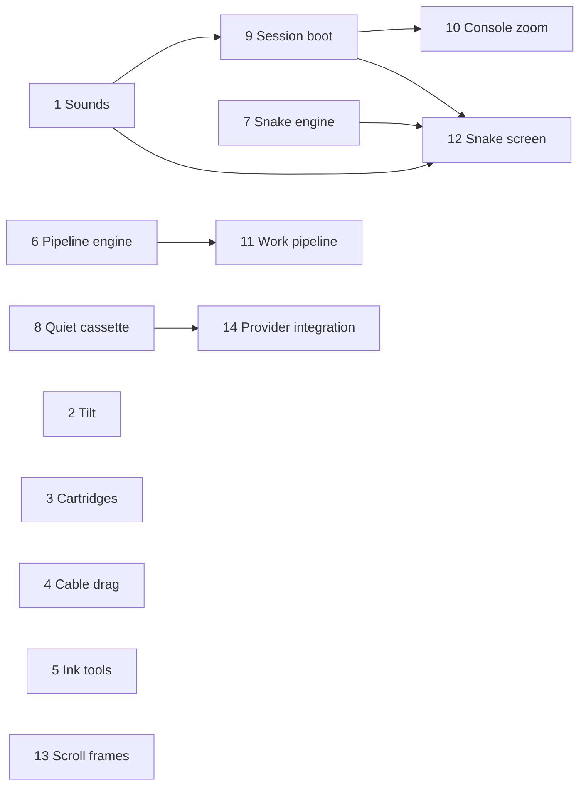

# Pocket Console Encore

Plan **pm-242**, product-owner run **run-8315**. Baseline: `368d15e`
(main; rebased over the newly landed pm-241 footer); research: `rep-4800`, captured verbatim in [research.md](research.md)
from run-8308 at `702c5dd82d5c66c6d1f8acb5df2a8c4826df7b9a`.
The exact task payload is [tasks.json](tasks.json); the contracts below render
that payload. This run delivers planning artifacts and the small baseline
loading-boundary repair described below, not the proposed enhancement features.

Give the existing paper-and-ink site twelve small moments of play: an
in-console first-session boot, spatial navigation, an explanatory pipeline,
a pocket game, quiet-by-default beeps, pointer depth, material choices,
a music cassette, sketch entrances, a draggable contact cable and project
cartridges. Keep the still illustration complete, ordinary links usable and
all motion respectful of the visitor's preference.

## Scope and decisions

| Original idea | Delivery |
| --- | --- |
| 1 Boot cartridge | Task 9; session split, finite native animation; chime only after eligible gesture |
| 2 Ink-wipe theme | Already implemented in theme-toggle.tsx and ink-spread CSS; retain and independently check during acceptance |
| 3 Screen-to-title zoom | Task 10; named HTML pair and typed React transition with fallback |
| 4 Pipeline doodle | Tasks 6 + 11; deterministic simulation, explicitly not live production telemetry |
| 5 Pocket game | Tasks 7 + 12; pipeline snake, local best score, scoped Konami |
| 6 UI sounds | Task 1; synthesised WebAudio, default muted |
| 7 Console tilt | Task 2; bounded pointer tilt; touch still |
| 8 Drawing materials | Task 5; ink, pencil, crayon, watercolour, re-roll, optional bounded boil |
| 9 Now Playing | Tasks 8 + 14; quiet label then cached provider integration; real activation separately evidenced |
| 10 Sketch entrances | Task 13; frame/wash around current raster artwork |
| 11 Switchboard | Task 4; add drag to existing connection/ring flow |
| 12 Cartridges | Task 3; retain routes, list semantics and title morphs |

No GSAP: README Motion expressly chooses CSS, React and browser transitions.
The original references are inspiration descriptions, not a requirement to
reproduce inaccessible designs. Research could not read the X/Dribbble
posts. Build original ink figures without adding images, binary assets,
fonts or runtime dependencies.

The research instruction to make Sketches depend on pm-240 closing is
superseded by the no-idle rule. Current Sheet already supports portraits,
download links and responsive dimensions. Wrap that interface, preserve
future/current records and rebase; no task checks or waits for another plan.
Shared files also overlap pm-241's footer. Retain footer behavior and its
independent achievement key.

The pipeline's optional Live trickle is deferred to keep the first slice
bounded and easy to understand. Snake is still a game under reduced motion:
each direction advances one step, with no autonomous clock. Tilt has no gyro
permission prompt and no fabricated back faces.

## Dependency graph and work order

Sequences are proposal-local identifiers, not platform task ids.

Start independent small slices first. Only engine/UI and sound/boot consumers
have dependencies. Path conflicts use the platform's normal scheduling and
a rebase, not a person or cross-plan gate. Each commit is reviewable and
reversible by feature.

## Shared delivery contract

These rules apply to every task in addition to its explicit contract.

- Read the actual AGENTS.md, README Motion/Live data/Deploying and relevant
  installed `node_modules/next/dist/docs/` guides. No Next API guesses.
- Reuse site palette roles, `Inked`, `box`, `Machine`, knobs, 12 fps
  reducers and existing semantic controls. Copy local examples rather than
  importing across isolated project route groups.
- Keep user-facing copy in `content/site.ts`. Extend props optionally.
  Preserve route destinations, TV owner permissions, layout wrappers,
  masthead behavior, all existing project links and title identities.
- Add CSS before the final reduced-motion block. Rest is the base style.
  JS motion re-reads preference changes and stops offscreen/hidden.
  Scroll animations need explicit `animation: none`; merely shortening
  duration does not disable a scroll timeline.
- Never read storage during render. Use guarded effects/external stores or
  a guarded pre-paint root script; no hydration warnings or hidden essential
  content when storage, JS, an API or transition support is absent.
- No new runtime package or asset is expected. Reuse the current lockfile.
  If implementation evidence forces a design change, record a decision and
  preserve the acceptance intent rather than weakening tests.
- Each task runs its verification at the delivered source revision inside
  the checkout. Production build precedes `SKIP_BUILD=1` probes. Scripts
  may create disposable local servers/databases/fakes and must clean them
  on every exit; no shared environment mutation in verification.
- Browser wrappers follow the existing temporary pinned Playwright pattern,
  support local `PORT`, `SKIP_BUILD`, `EXPECT_SHA` and read-only
  `BASE_URL` where applicable, with bounded readiness and process cleanup.
  Provider fake modes and fixture seams are local-only. No screenshots,
  recordings, generated assets or secrets belong in git.
- Visible tasks use actual Chromium DOM at 1366x768 and 390x844 touch,
  both themes, visible keyboard focus, no overflow, no-JS where meaningful,
  initial/live reduced-motion changes and attributable console/page errors.
  Check accessibility through actual controls/readouts, not SVG alone.
- Each new feature probe has a relevant local negative control using the
  same assertion (e.g. disabled handler, wrong href, altered counter or
  denied provider response), then restores/reloads and passes. A fake proves
  integration, never browser quality or real-provider delivery.
- Unit-only engine tasks set `qa=skip` because their verification fully
  covers internal deterministic behavior. Every UI/integration task requires
  independent QA. No migration is part of this plan.
- Run all listed commands, fix failures, commit with
  `pm-242/<task_id>: <imperative subject>`, author
  `Otohime <quiinthieu@gmail.com>`, and push with
  `git push origin HEAD`. On rejection, pull --rebase, rerun checks and push;
  never force-push. Software implementation ends at the push. Deployment
  proof belongs to verification/QA/acceptance, not SWE action steps.

## Build contracts

### 1. Add opt-in console sounds

**Role:** software_engineer. **QA:** required. **Depends on:** none.

**Problem.** Console input is silent and has no user-controlled audio preference.

**Action items**

1. Read AGENTS.md, README and relevant installed Next docs before changes. Preserve concurrent pm-240/pm-241 work, use additive interfaces, and apply the shared delivery and browser-evidence rules in plan.md. Commit and push the finished slice with pm-242/<task_id>: and the owner identity; stop implementation work at the push.
2. Create a pure tested cue/envelope table and a site-local lazy WebAudio adapter; square waves, short attack/decay, capped gain at -18 dB. Export move/open/back/chime/eat/burst cues for later tasks.
3. Add a fixed-size accessible speaker toggle beside the theme toggle; off by default, aria-pressed and storage key sound. Use a hydration-safe external store and handle denied storage.
4. Create/resume AudioContext only in a user gesture, reuse it, handle rejected resume safely and close on pagehide. Wire menu movement and A activation; do not add audio to other figures.
5. Add scripts/probe-sound.sh and .mjs using the existing temporary pinned Playwright pattern. Prove no constructor before gesture/off, one context after enable, persistence, toggle-off silence, blocked storage/autoplay fallback and no masthead shift. Inspect both themes at desktop and mobile.

**Interfaces**

- `lib/sound.ts`
- `lib/sound.test.ts`
- `lib/sound-client.ts`
- `components/sound-toggle.tsx`
- `components/masthead.tsx`
- `components/handheld.tsx`
- `content/site.ts`
- `app/(site)/globals.css`
- `scripts/probe-sound.sh`
- `scripts/probe-sound.mjs`

**Non-goals**

- Audio files or dependencies
- Automatic sound on load
- Changing Vinyl audio

**Acceptance criteria.** Sound starts muted; enable, move and open produce short cues only after a gesture. Mute and blocked autoplay remain usable, preference survives reload when storage works, and the masthead stays stable.

**Verification** (checkout-local; cwd `.`; expect exit 0)

| Check | Command | Timeout |
| --- | --- | --- |
| Unit regressions | `npm test` | 300s |
| Lint | `npm run lint` | 300s |
| Next generated types | `npm run typecheck` | 300s |
| Production build | `npm run build` | 900s |
| Feature browser matrix | `SKIP_BUILD=1 bash scripts/probe-sound.sh` | 900s |
| Existing motion and root hops | `SKIP_BUILD=1 bash scripts/probe-motion.sh` | 900s |
| Isolated HTTP/RBAC suite | `SKIP_BUILD=1 APP_PORT=4099 bash scripts/e2e-local.sh` | 900s |

### 2. Tilt the pocket console

**Role:** software_engineer. **QA:** required. **Depends on:** none.

**Problem.** The console has no subtle pointer depth response.

**Action items**

1. Read AGENTS.md, README and relevant installed Next docs before changes. Preserve concurrent pm-240/pm-241 work, use additive interfaces, and apply the shared delivery and browser-evidence rules in plan.md. Commit and push the finished slice with pm-242/<task_id>: and the owner identity; stop implementation work at the push.
2. Add an optional tilt prop to Machine and opt Handheld in; preserve all callers. Map pointer position to bounded +/-6 degree CSS perspective rotation and opposite shadow shift; restore the base transform on leave.
3. Enable only on hover-capable pointers with no reduced-motion preference, react to preference changes and reset on hidden/unmount. Keep pointer work event-driven and animate the outer compositor transform, outside the filtered ink.
4. Add scripts/probe-tilt.sh/.mjs: pointer changes transform, leave resets within 500 ms; touch and reduced motion stay still, including mid-hover preference change; controls, boot and focus still work. Inspect desktop/mobile and both themes.

**Interfaces**

- `components/machine.tsx`
- `components/handheld.tsx`
- `app/(site)/globals.css`
- `scripts/probe-tilt.sh`
- `scripts/probe-tilt.mjs`

**Non-goals**

- Gyroscope permissions
- Drag rotation or new back faces
- Tilting other machines

**Acceptance criteria.** A hover pointer tilts only the console within six degrees; leave returns to the original pose, and touch/reduced-motion users see the still console with working controls.

**Verification** (checkout-local; cwd `.`; expect exit 0)

| Check | Command | Timeout |
| --- | --- | --- |
| Unit regressions | `npm test` | 300s |
| Lint | `npm run lint` | 300s |
| Next generated types | `npm run typecheck` | 300s |
| Production build | `npm run build` | 900s |
| Feature browser matrix | `SKIP_BUILD=1 bash scripts/probe-tilt.sh` | 900s |
| Existing motion and root hops | `SKIP_BUILD=1 bash scripts/probe-motion.sh` | 900s |
| Isolated HTTP/RBAC suite | `SKIP_BUILD=1 APP_PORT=4099 bash scripts/e2e-local.sh` | 900s |

### 3. Shelve projects as cartridges

**Role:** software_engineer. **QA:** required. **Depends on:** none.

**Problem.** Project rows do not yet use the requested cartridge metaphor.

**Action items**

1. Read AGENTS.md, README and relevant installed Next docs before changes. Preserve concurrent pm-240/pm-241 work, use additive interfaces, and apply the shared delivery and browser-evidence rules in plan.md. Commit and push the finished slice with pm-242/<task_id>: and the owner identity; stop implementation work at the push.
2. Add a server-rendered cartridge SVG component with a swatch label, notch, shadow and status stamp. Keep the original title, description, destinations and semantic list/link structure.
3. Keep every li.rise, --i, .project-title and project-* --vt identity; size the grid for two readable columns at 390 px without overflow. Hover/focus lifts six pixels; active inserts two pixels; reduced motion suppresses movement.
4. Add scripts/probe-cartridges.sh/.mjs to compare hrefs/count to current content, measure overflow and text fit, exercise hover/focus/active, reduced motion and cross-root title morph. Use no per-card filters; inspect light/dark desktop/mobile.

**Interfaces**

- `components/cartridge.tsx`
- `app/(site)/(app)/projects/page.tsx`
- `app/(site)/globals.css`
- `scripts/probe-cartridges.sh`
- `scripts/probe-cartridges.mjs`

**Non-goals**

- New projects or changed URLs
- Client island
- Changing project root layouts

**Acceptance criteria.** All existing projects remain normal links and morph into their destinations; two mobile columns show legible cartridge labels, hover/focus lifts, click inserts and reduced motion stays still.

**Verification** (checkout-local; cwd `.`; expect exit 0)

| Check | Command | Timeout |
| --- | --- | --- |
| Unit regressions | `npm test` | 300s |
| Lint | `npm run lint` | 300s |
| Next generated types | `npm run typecheck` | 300s |
| Production build | `npm run build` | 900s |
| Feature browser matrix | `SKIP_BUILD=1 bash scripts/probe-cartridges.sh` | 900s |
| Existing motion and root hops | `SKIP_BUILD=1 bash scripts/probe-motion.sh` | 900s |
| Isolated HTTP/RBAC suite | `SKIP_BUILD=1 APP_PORT=4099 bash scripts/e2e-local.sh` | 900s |

### 4. Drag the switchboard plug

**Role:** software_engineer. **QA:** required. **Depends on:** none.

**Problem.** The switchboard has connect/ring controls but its cable cannot be dragged.

**Action items**

1. Read AGENTS.md, README and relevant installed Next docs before changes. Preserve concurrent pm-240/pm-241 work, use additive interfaces, and apply the shared delivery and browser-evidence rules in plan.md. Commit and push the finished slice with pm-242/<task_id>: and the owner identity; stop implementation work at the push.
2. Extend the pure switchboard state machine with drag, release, cancel and six-frame spring return. Release within fourteen figure units of a jack connects through the existing flow; release elsewhere or pointercancel returns safely.
3. Use pointer capture, touch-action on the handle only, getScreenCTM inverse for coordinates and a length-aware cord sag. Keep all labelled chip controls and Open contact links; preserve any concurrent footer away helper.
4. Add reducer tests for snap radius boundary, missed release, cancellation, reduced-motion settle and spring termination. Add scripts/probe-switchboard-drag.sh/.mjs for real mouse/touch drag to Telegram, miss/cancel, keyboard chips, no accidental external navigation and readout/focus. Inspect both themes.

**Interfaces**

- `components/switchboard.tsx`
- `lib/machines.ts`
- `lib/machines.test.ts`
- `content/site.ts`
- `app/(site)/globals.css`
- `scripts/probe-switchboard-drag.sh`
- `scripts/probe-switchboard-drag.mjs`

**Non-goals**

- Changing owner contact destinations
- Replacing keyboard controls
- Footer scene redesign

**Acceptance criteria.** Dragging onto a jack selects the existing contact action; a miss/cancel returns in six frames or immediately under reduced motion, and mouse, touch and keyboard all retain normal contact links.

**Verification** (checkout-local; cwd `.`; expect exit 0)

| Check | Command | Timeout |
| --- | --- | --- |
| Unit regressions | `npm test` | 300s |
| Lint | `npm run lint` | 300s |
| Next generated types | `npm run typecheck` | 300s |
| Production build | `npm run build` | 900s |
| Feature browser matrix | `SKIP_BUILD=1 bash scripts/probe-switchboard-drag.sh` | 900s |
| Existing motion and root hops | `SKIP_BUILD=1 bash scripts/probe-motion.sh` | 900s |
| Isolated HTTP/RBAC suite | `SKIP_BUILD=1 APP_PORT=4099 bash scripts/e2e-local.sh` | 900s |

### 5. Add ink tools and re-roll

**Role:** software_engineer. **QA:** required. **Depends on:** none.

**Problem.** The figures expose wobble and swatch but only one drawing material.

**Action items**

1. Read AGENTS.md, README and relevant installed Next docs before changes. Preserve concurrent pm-240/pm-241 work, use additive interfaces, and apply the shared delivery and browser-evidence rules in plan.md. Commit and push the finished slice with pm-242/<task_id>: and the owner identity; stop implementation work at the push.
2. Add a pure tested mode table for ink, pencil, crayon and watercolour. Extend Inked with optional mode/seed props whose defaults preserve the current filter exactly; keep crisp strokes and bounded material parameters.
3. Add per-figure Hand picker and Re-roll control through Machine's existing knobs. Add explicit off-by-default Boil at six seed changes per second through the existing tick machinery; only one figure boils at a time and stop when hidden/offscreen.
4. Disable boiling under reduced motion, including a live preference change, while keeping static material selection/re-roll functional. Preserve existing figure reducer and swatch behavior; avoid persistence and continuous idle work.
5. Add scripts/probe-ink-modes.sh/.mjs checking actual filter attributes and material distinction, seed re-roll, bounded boil rate, off/hidden stop, multiple-figure ownership and reduced-motion stop. Inspect contrast and line quality at both viewport sizes and themes.

**Interfaces**

- `lib/ink-modes.ts`
- `lib/ink-modes.test.ts`
- `components/figures.tsx`
- `components/machine.tsx`
- `content/site.ts`
- `app/(site)/globals.css`
- `scripts/probe-ink-modes.sh`
- `scripts/probe-ink-modes.mjs`

**Non-goals**

- Replacing the default ink look
- Persisting figure cosmetics
- New motion libraries

**Acceptance criteria.** Four visibly distinct materials and Re-roll work on machine figures without changing default ink. Optional boiling updates at six Hz only while eligible and stops under reduced motion, hidden pages and offscreen figures.

**Verification** (checkout-local; cwd `.`; expect exit 0)

| Check | Command | Timeout |
| --- | --- | --- |
| Unit regressions | `npm test` | 300s |
| Lint | `npm run lint` | 300s |
| Next generated types | `npm run typecheck` | 300s |
| Production build | `npm run build` | 900s |
| Feature browser matrix | `SKIP_BUILD=1 bash scripts/probe-ink-modes.sh` | 900s |
| Existing motion and root hops | `SKIP_BUILD=1 bash scripts/probe-motion.sh` | 900s |
| Isolated HTTP/RBAC suite | `SKIP_BUILD=1 APP_PORT=4099 bash scripts/e2e-local.sh` | 900s |

### 6. Model the data pipeline

**Role:** software_engineer. **QA:** skip. **Depends on:** none.

**Problem.** A source-to-dashboard simulation needs deterministic state before adding a figure.

**Action items**

1. Read AGENTS.md, README and relevant installed Next docs before changes. Preserve concurrent pm-240/pm-241 work, use additive interfaces, and apply the shared delivery and browser-evidence rules in plan.md. Commit and push the finished slice with pm-242/<task_id>: and the owner identity; stop implementation work at the push.
2. Implement a pure pipeline reducer and exported initial state/types in lib/pipeline.ts: emit, backfill of eight spaced packets, pause/resume queue drain, tick and settle; expose counters and bounded busy state.
3. Test leg ordering, conservation of emitted/queued/in-flight/stored/shown counts, paused queue accumulation, resume drain, eight-packet backfill, id uniqueness, immutable input and finite settle. Use explicit frames/fixtures; no wall clock, random source or live service.
4. Document the state and action interface for the figure task. Settle must preserve paused queued packets and stop busy work; an unpaused settle delivers all pending packets.

**Interfaces**

- `lib/pipeline.ts`
- `lib/pipeline.test.ts`

**Non-goals**

- Rendered UI
- Real telemetry
- Continuous live input

**Acceptance criteria.** Seeded action traces conserve packets, never skip a pipeline leg, queue during pause, drain on resume and settle deterministically with no unbounded work.

**Verification** (checkout-local; cwd `.`; expect exit 0)

| Check | Command | Timeout |
| --- | --- | --- |
| Unit regressions | `npm test` | 300s |
| Lint | `npm run lint` | 300s |
| Next generated types | `npm run typecheck` | 300s |

### 7. Model pipeline snake

**Role:** software_engineer. **QA:** skip. **Depends on:** none.

**Problem.** The console mini-game needs a deterministic, independently verifiable engine.

**Action items**

1. Read AGENTS.md, README and relevant installed Next docs before changes. Preserve concurrent pm-240/pm-241 work, use additive interfaces, and apply the shared delivery and browser-evidence rules in plan.md. Commit and push the finished slice with pm-242/<task_id>: and the owner identity; stop implementation work at the push.
2. Implement lib/snake.ts on a 16 by 14 grid with seeded food placement, direction/start/restart/step/tick actions, growth, wall/self collision, score and a bounded speed table. Prevent reverse direction and handle filling the board.
3. Add a pure prefix matcher for the in-console Konami sequence; debug mode wraps walls, with achievement state exposed separately from any footer achievement.
4. Test known seeded food, no food on the body, tail-cell movement legality, reverse input, collisions, growth, speed floor, full-board completion, bad/correct code, wrapping and immutability. A direction-step action must support turn-based reduced motion without timers.

**Interfaces**

- `lib/snake.ts`
- `lib/snake.test.ts`

**Non-goals**

- Console rendering or pad changes
- Storage or audio
- Global keyboard listener

**Acceptance criteria.** Deterministic traces prove snake movement, scoring, loss, restart, food placement and debug wrapping; the same reducer supports timed and explicit step play.

**Verification** (checkout-local; cwd `.`; expect exit 0)

| Check | Command | Timeout |
| --- | --- | --- |
| Unit regressions | `npm test` | 300s |
| Lint | `npm run lint` | 300s |
| Next generated types | `npm run typecheck` | 300s |

### 8. Draw the quiet cassette

**Role:** software_engineer. **QA:** required. **Depends on:** none.

**Problem.** Music has no cassette label or safe data model for listening/game status.

**Action items**

1. Read AGENTS.md, README and relevant installed Next docs before changes. Preserve concurrent pm-240/pm-241 work, use additive interfaces, and apply the shared delivery and browser-evidence rules in plan.md. Commit and push the finished slice with pm-242/<task_id>: and the owner identity; stop implementation work at the push.
2. Create pure unknown-input parsers/types for Spotify current track and Steam current game; strip unneeded fields, validate external URLs, cap display lengths and return null for malformed, private, empty and error fixtures.
3. Add a server-rendered cassette and game cartridge below the music television using site.now and the existing playlist as the quiet face. Include ordinary text/links, provider credits, reserved label space and an explicit quiet state. Do not fetch yet.
4. Keep current TV, owner channel controls and authorization unchanged. Add scripts/walk-now-playing.sh in QUIET_ONLY=1 mode for local production HTML and scripts/probe-cassette.sh/.mjs for long fixture text, no-JS, contrast, responsive fit and reduced-motion still reels.

**Interfaces**

- `lib/now-playing-data.ts`
- `lib/now-playing-data.test.ts`
- `components/cassette.tsx`
- `app/(site)/(app)/music/page.tsx`
- `content/site.ts`
- `app/(site)/globals.css`
- `scripts/walk-now-playing.sh`
- `scripts/probe-cassette.sh`
- `scripts/probe-cassette.mjs`

**Non-goals**

- Provider network access
- Credentials or OAuth UI
- Recent listening history

**Acceptance criteria.** Music gains one readable paper cassette/game label with quiet copy and playlist links; malformed provider fixtures parse safely, and the complete quiet display works without JavaScript.

**Verification** (checkout-local; cwd `.`; expect exit 0)

| Check | Command | Timeout |
| --- | --- | --- |
| Unit regressions | `npm test` | 300s |
| Lint | `npm run lint` | 300s |
| Next generated types | `npm run typecheck` | 300s |
| Production build | `npm run build` | 900s |
| Feature browser matrix | `SKIP_BUILD=1 QUIET_ONLY=1 bash scripts/walk-now-playing.sh && SKIP_BUILD=1 bash scripts/probe-cassette.sh` | 900s |
| Existing motion and root hops | `SKIP_BUILD=1 bash scripts/probe-motion.sh` | 900s |
| Isolated HTTP/RBAC suite | `SKIP_BUILD=1 APP_PORT=4099 bash scripts/e2e-local.sh` | 900s |

### 9. Make the boot session-aware

**Role:** software_engineer. **QA:** required. **Depends on:** 1.

**Problem.** The existing LCD splash repeats on every visit and lacks the requested cartridge boot treatment.

**Action items**

1. Read AGENTS.md, README and relevant installed Next docs before changes. Preserve concurrent pm-240/pm-241 work, use additive interfaces, and apply the shared delivery and browser-evidence rules in plan.md. Commit and push the finished slice with pm-242/<task_id>: and the owner identity; stop implementation work at the push.
2. Read installed Next layout/script guidance. Keep the intro inside the console: brief stepped flicker, scan, OTOHIME print and small cartridge click-in; encode the finite sequence as tested data with total duration at most 2.4 s and each movement at most 400 ms.
3. Use guarded sessionStorage console:booted and a pre-paint html attribute to skip animation delays as well as durations on returning visits. Mark completion from the finite sequence and handle interrupted boot/denied storage without hiding the menu.
4. Integrate the shared chime only if sound is on and this document already has an unlocked gesture context; cold loads remain silent. Reduced motion shows the final usable menu immediately; essential menu links remain in initial HTML.
5. Add scripts/probe-boot.sh/.mjs for fresh session, same-session route return/reload, new session, interrupted intro, blocked storage, no-JS, reduced motion and audio eligibility. Compare reserved layout bounds across the sequence in both themes and sizes.

**Interfaces**

- `lib/boot.ts`
- `lib/boot.test.ts`
- `components/handheld.tsx`
- `app/(site)/layout.tsx`
- `app/(site)/globals.css`
- `scripts/probe-boot.sh`
- `scripts/probe-boot.mjs`

**Non-goals**

- Fullscreen overlay
- GSAP
- Autoplay on cold load

**Acceptance criteria.** First session visit shows a finite in-console boot, subsequent visits skip all intro delays, and blocked storage/no-JS/reduced motion preserve a usable menu. Chime obeys explicit audio opt-in and browser gesture policy.

**Verification** (checkout-local; cwd `.`; expect exit 0)

| Check | Command | Timeout |
| --- | --- | --- |
| Unit regressions | `npm test` | 300s |
| Lint | `npm run lint` | 300s |
| Next generated types | `npm run typecheck` | 300s |
| Production build | `npm run build` | 900s |
| Feature browser matrix | `SKIP_BUILD=1 bash scripts/probe-boot.sh` | 900s |
| Existing motion and root hops | `SKIP_BUILD=1 bash scripts/probe-motion.sh` | 900s |
| Isolated HTTP/RBAC suite | `SKIP_BUILD=1 APP_PORT=4099 bash scripts/e2e-local.sh` | 900s |

### 10. Morph console choices into pages

**Role:** software_engineer. **QA:** required. **Depends on:** 9.

**Problem.** Console navigation currently fades with no spatial link between LCD label and destination heading.

**Action items**

1. Read AGENTS.md, README and relevant installed Next docs before changes. Preserve concurrent pm-240/pm-241 work, use additive interfaces, and apply the shared delivery and browser-evidence rules in plan.md. Commit and push the finished slice with pm-242/<task_id>: and the owner identity; stop implementation work at the push.
2. Follow the installed Next view-transition guide. Pair an HTML console label with FigTitle through a unique named React ViewTransition; prove the source is captured in the old snapshot before navigation, without depending on a simultaneous uncommitted overlay update.
3. Use typed console navigation and bounded zoom from the measured LCD centre, at most 400 ms. Preserve masthead/group wrappers, normal page fades, root hops, plain links, keyboard navigation and prefetch behavior.
4. Handle unsupported transition APIs and a destination that suspends by retaining complete navigation and a simple fallback. Do not add duplicate page-title names or weaken motion invariants merely to make checks green.
5. Extend lib/motion.test.ts and scripts/probe-motion.mjs; add scripts/probe-console-zoom.sh/.mjs for pointer A/Enter, actual captured group and zoom animations, destination title, back navigation, fallback under delayed navigation, no-JS and reduced motion.

**Interfaces**

- `components/handheld.tsx`
- `components/figures.tsx`
- `app/(site)/(app)/layout.tsx`
- `app/(site)/(app)`
- `app/(site)/globals.css`
- `lib/motion.test.ts`
- `scripts/probe-motion.mjs`
- `scripts/probe-console-zoom.sh`
- `scripts/probe-console-zoom.mjs`

**Non-goals**

- SVG text transition naming
- New root layouts
- Changing destination URLs

**Acceptance criteria.** Console A/Enter visibly morphs the selected label into the matching page heading and opens from the LCD; unsupported/delayed paths navigate normally, other fades and project hops still work, and reduced motion has no zoom.

**Verification** (checkout-local; cwd `.`; expect exit 0)

| Check | Command | Timeout |
| --- | --- | --- |
| Unit regressions | `npm test` | 300s |
| Lint | `npm run lint` | 300s |
| Next generated types | `npm run typecheck` | 300s |
| Production build | `npm run build` | 900s |
| Feature browser matrix | `SKIP_BUILD=1 bash scripts/probe-console-zoom.sh` | 900s |
| Existing motion and root hops | `SKIP_BUILD=1 bash scripts/probe-motion.sh` | 900s |
| Isolated HTTP/RBAC suite | `SKIP_BUILD=1 APP_PORT=4099 bash scripts/e2e-local.sh` | 900s |

### 11. Draw the interactive work pipeline

**Role:** software_engineer. **QA:** required. **Depends on:** 6.

**Problem.** Work shows individual machines but not the whole source-to-dashboard path.

**Action items**

1. Read AGENTS.md, README and relevant installed Next docs before changes. Preserve concurrent pm-240/pm-241 work, use additive interfaces, and apply the shared delivery and browser-evidence rules in plan.md. Commit and push the finished slice with pm-242/<task_id>: and the owner identity; stop implementation work at the push.
2. Compose a Pipeline Machine from task 6's tested reducer with source, queue, warehouse and dashboard boxes, pipes and packets in the existing ink style. Place it after the Work intro and retain Conveyor, Stack and ServerRack content.
3. Expose Emit, Backfill and Pause/Resume chips plus in-flight, queue, stored and dashboard-lag stats/readout. Label the drawing as an illustrative simulation; initial state is still and no external service is called.
4. Animate packets only through the existing 12 fps clock while busy; settle immediately for reduced motion. A paused non-draining queue must not keep an idle timer running. Omit optional automatic Live trickle from this slice.
5. Add scripts/probe-pipeline.sh/.mjs: backfill delivers eight, pause accumulates queue and resume drains, display agrees with counters, reduced-motion settlement works, hidden/offscreen stops work and long runs stay bounded. Inspect 1366/390 and both themes.

**Interfaces**

- `components/pipeline.tsx`
- `lib/pipeline.ts`
- `lib/pipeline.test.ts`
- `app/(site)/(app)/work/page.tsx`
- `content/site.ts`
- `app/(site)/globals.css`
- `scripts/probe-pipeline.sh`
- `scripts/probe-pipeline.mjs`

**Non-goals**

- Production telemetry
- Automatic live trickle
- Removing existing figures

**Acceptance criteria.** Work has a readable four-stage simulation with packet flow and truthful counters; Backfill, pause and resume show queue lag/drain, resting/hidden states do no animation work, and reduced motion settles on input.

**Verification** (checkout-local; cwd `.`; expect exit 0)

| Check | Command | Timeout |
| --- | --- | --- |
| Unit regressions | `npm test` | 300s |
| Lint | `npm run lint` | 300s |
| Next generated types | `npm run typecheck` | 300s |
| Production build | `npm run build` | 900s |
| Feature browser matrix | `SKIP_BUILD=1 bash scripts/probe-pipeline.sh` | 900s |
| Existing motion and root hops | `SKIP_BUILD=1 bash scripts/probe-motion.sh` | 900s |
| Isolated HTTP/RBAC suite | `SKIP_BUILD=1 APP_PORT=4099 bash scripts/e2e-local.sh` | 900s |

### 12. Play snake inside Pocket

**Role:** software_engineer. **QA:** required. **Depends on:** 1, 7, 9.

**Problem.** The console B button is inert and there is no playable pocket game.

**Action items**

1. Read AGENTS.md, README and relevant installed Next docs before changes. Preserve concurrent pm-240/pm-241 work, use additive interfaces, and apply the shared delivery and browser-evidence rules in plan.md. Commit and push the finished slice with pm-242/<task_id>: and the owner identity; stop implementation work at the push.
2. Integrate task 7's reducer on the existing LCD; B enters/exits game, A starts/restarts, four labelled d-pad directions drive it. Extend pad state additively and retain the six-line menu and screen-reader links.
3. Persist guarded pocket:high and pocket:achievement through hydration-safe effects/store, restore high scores on reload, and route move/eat/burst cues through task 1's mute preference.
4. Limit keyboard handling to the active console without stealing editable-target/modifier inputs. Match Konami only on scoped console input, consume its game inputs safely, keep footer end:achievement independent and prevent footer unlocking from the same handled input.
5. Under reduced motion disable the automatic tick and advance one cell per direction; pause on hidden/offscreen, stop on loss/menu/unmount, bound SVG work by board size and announce score/state without flooding live regions.
6. Add scripts/probe-pocket-game.sh/.mjs for real B/A/arrows, deterministic food/scoring through a checkout-only fixture, collision/restart/menu, high-score restore, corrupt/blocked storage, correct/wrong scoped code, footer isolation and reduced-motion explicit-step-only play.

**Interfaces**

- `components/handheld.tsx`
- `lib/machines.ts`
- `lib/machines.test.ts`
- `lib/snake.ts`
- `lib/snake.test.ts`
- `content/site.ts`
- `app/(site)/globals.css`
- `scripts/probe-pocket-game.sh`
- `scripts/probe-pocket-game.mjs`

**Non-goals**

- Seventh menu row
- Global cheat listener
- Online leaderboard

**Acceptance criteria.** B opens pipeline snake inside the LCD; A/restart/d-pad, scoring, collisions and persisted best score work. Scoped Konami unlocks wrapping independently of the footer; reduced motion is turn-based and menu navigation survives.

**Verification** (checkout-local; cwd `.`; expect exit 0)

| Check | Command | Timeout |
| --- | --- | --- |
| Unit regressions | `npm test` | 300s |
| Lint | `npm run lint` | 300s |
| Next generated types | `npm run typecheck` | 300s |
| Production build | `npm run build` | 900s |
| Feature browser matrix | `SKIP_BUILD=1 bash scripts/probe-pocket-game.sh` | 900s |
| Existing motion and root hops | `SKIP_BUILD=1 bash scripts/probe-motion.sh` | 900s |
| Isolated HTTP/RBAC suite | `SKIP_BUILD=1 APP_PORT=4099 bash scripts/e2e-local.sh` | 900s |

### 13. Draw gallery frames on scroll

**Role:** software_engineer. **QA:** required. **Depends on:** none.

**Problem.** Raster sketches cannot reveal their own strokes; the gallery needs a progressive ink-frame entrance.

**Action items**

1. Read AGENTS.md, README and relevant installed Next docs before changes. Preserve concurrent pm-240/pm-241 work, use additive interfaces, and apply the shared delivery and browser-evidence rules in plan.md. Commit and push the finished slice with pm-242/<task_id>: and the owner identity; stop implementation work at the push.
2. Inspect the current Sheet markup and preserve all pm-240 portrait manifests, download links, dimensions and sections. Add frame/wash wrappers only; rebase shared paths without making another plan's completion a prerequisite.
3. Add a small unfiltered rough SVG frame with pathLength one and a compositor paper-wash transform; apply view-timeline animation only under @supports. Base styles show the complete drawing and caption.
4. Add explicit animation:none for these scroll-driven elements in the final reduced-motion block, including preference changes. Keep all images and downloads visible without JavaScript or scroll-timeline support.
5. Extend scripts/probe-sketches.mjs and walk-sketches.sh as needed: before/after scroll geometry, complete frame/wash at end, unsupported-mode still, no-JS, reduced-motion no active animations, unchanged portrait downloads and responsive loaded images. Fixture optional portraits locally; do not generate or publish art.

**Interfaces**

- `app/(site)/(app)/sketches/page.tsx`
- `app/(site)/globals.css`
- `lib/motion.test.ts`
- `scripts/probe-sketches.mjs`
- `scripts/walk-sketches.sh`

**Non-goals**

- Regenerating art
- Changing portrait activation
- Cross-plan completion gate

**Acceptance criteria.** Every current sketch keeps its image/caption/download and gains a scroll-drawn frame and paper reveal on supported browsers; no-JS, unsupported and reduced-motion views show complete artwork with no active reveal.

**Verification** (checkout-local; cwd `.`; expect exit 0)

| Check | Command | Timeout |
| --- | --- | --- |
| Unit regressions | `npm test` | 300s |
| Lint | `npm run lint` | 300s |
| Next generated types | `npm run typecheck` | 300s |
| Production build | `npm run build` | 900s |
| Feature browser matrix | `SKIP_BUILD=1 bash scripts/walk-sketches.sh` | 900s |
| Existing motion and root hops | `SKIP_BUILD=1 bash scripts/probe-motion.sh` | 900s |
| Isolated HTTP/RBAC suite | `SKIP_BUILD=1 APP_PORT=4099 bash scripts/e2e-local.sh` | 900s |

### 14. Connect cassette to cached providers

**Role:** software_engineer. **QA:** required. **Depends on:** 8.

**Problem.** The cassette currently has only a quiet face; safe request-time provider integration is missing.

**Action items**

1. Read AGENTS.md, README and relevant installed Next docs before changes. Preserve concurrent pm-240/pm-241 work, use additive interfaces, and apply the shared delivery and browser-evidence rules in plan.md. Commit and push the finished slice with pm-242/<task_id>: and the owner identity; stop implementation work at the push.
2. Read installed caching, cacheLife, route-handler and request-time docs plus README Live data. Add one server-only adapter holding all provider fetches/env access. Inject host overrides only through validated server env; never accept a user-supplied upstream URL.
3. Implement Spotify refresh/current-track and optional public Steam current-game adapters with four-second aborts, independent provider failures, pure parsing, no retries and no network at build. Never log or serialize credentials. Missing configuration yields quiet/static labels without network.
4. Make /music request-time with the documented boundary before awaiting the cached reader, retaining existing television and owner tools. Use use cache/cacheLife with roughly 60 s revalidation and expire >=300; stamp read time visibly. Prove a no-JS live-fixture response instead of leaving it in Suspense fallback.
5. Add GET /api/now-playing as an on-demand read of the identical cached reader used by /music; return only sanitized display data and state with 200 for quiet/failure. No cron, separate collector or unprotected cache-purge endpoint.
6. Extend walk-now-playing.sh with temporary loopback token/Spotify/Steam providers and ephemeral env values: first call, cache reuse, forced fixture-clock/invalidation through a checkout-only test seam, 204/401/429/malformed/private data, dead/slow upstream, independent partial failure and no requests during build. Production paths must not expose fixture or bypass controls.
7. Document env names/placeholders, setup scopes, optional current-game privacy and the activation handoff. This build uses fixtures and requires no person prerequisite. The first later run actually needing account setup raises operator_action at its start using spotify-app:now-playing or steam-key:current-game and ends that run; live output remains unproven until independently observed.
8. Extend cassette probe to live fixtures, long labels, reduced-motion reels, no-JS content and a secret-sentinel scan of HTTP responses/client chunks. Preserve all current auth and channel e2e behavior.

**Interfaces**

- `lib/now-playing.ts`
- `lib/now-playing.test.ts`
- `lib/now-playing-data.ts`
- `components/cassette.tsx`
- `app/(site)/(app)/music/page.tsx`
- `app/api/now-playing/route.ts`
- `content/site.ts`
- `app/(site)/globals.css`
- `.env.example`
- `README.md`
- `scripts/walk-now-playing.sh`
- `scripts/probe-cassette.mjs`

**Non-goals**

- Production OAuth consent or secret installation
- Scheduled polling jobs
- Playback control or listening history

**Acceptance criteria.** The exact cached reader serves /music and GET /api/now-playing; local fake-provider success, partial failure, absent credentials and outage cases produce bounded safe output, no-JS receives the fixture reading, and builds/client output contain no network calls or secrets. Real provider activation is explicitly outside this task's proven integration scope.

**Verification** (checkout-local; cwd `.`; expect exit 0)

| Check | Command | Timeout |
| --- | --- | --- |
| Unit regressions | `npm test` | 300s |
| Lint | `npm run lint` | 300s |
| Next generated types | `npm run typecheck` | 300s |
| Production build | `npm run build` | 900s |
| Feature browser matrix | `SKIP_BUILD=1 bash scripts/walk-now-playing.sh && SKIP_BUILD=1 bash scripts/probe-cassette.sh` | 900s |
| Existing motion and root hops | `SKIP_BUILD=1 bash scripts/probe-motion.sh` | 900s |
| Isolated HTTP/RBAC suite | `SKIP_BUILD=1 APP_PORT=4099 bash scripts/e2e-local.sh` | 900s |

## Provider boundaries and activation handoff

The quiet cassette and fake-provider integration are deliverable now. The
real Spotify owner still needs a development app, consent and environment
configuration. That is an external physical/account chore, not a policy
choice and not a SWE build prerequisite. The run that first needs it calls
`plan_manager_ask_user(kind=operator_action)` at its start and ends with a
short report; it never polls. Use these stable fingerprints:

- `spotify-app:now-playing`: owner creates/uses a Spotify app, performs
  Authorization Code consent for `user-read-currently-playing`, and installs
  `SPOTIFY_CLIENT_ID`, `SPOTIFY_CLIENT_SECRET`,
  `SPOTIFY_REFRESH_TOKEN` through the existing secure Vercel settings.
- `steam-key:current-game`: optional owner Steam key and SteamID64
  (`STEAM_API_KEY`, `STEAM_ID`), with public Game details. Until then,
  the current-game label honestly uses static site.now content.

No question asks the owner to choose an implementation approach. No credential
or token belongs in a report, plan, URL parameter, client bundle or git.
Document the provider's ongoing account requirements; the current Spotify
migration guide requires an active Premium app owner. The exact scopes and
provider terms must be revalidated when implementing the adapter.

Task 14 adds sanitized on-demand `GET /api/now-playing`, backed by the
same cached function as the page. It is a read, not a cache purge or cron.
Fresh/expiry behavior is proven with local clocks/fixtures/invalidation test
seams; no real-minute waiting. Operator readiness can use
`{type:http,url:https://otohime.dev/api/now-playing,expect_status:200,body_contains:"spotify-live"}`
only after the implementation returns that state exclusively for a successful
authenticated live Spotify response. Steam uses `steam-live` independently.
Do not use “currently playing” as readiness: a correctly connected owner may
be idle. A real authenticated empty result can mark connected; the widget
must still say quiet. Fakes cannot set a public production live state.

Now Playing's research proposed a Suspense-only widget. README Live data
warns that no-JS visitors can stay on the fallback. Task 14 must add the
documented request-time boundary before provider access and test completed
HTML without JavaScript. The existing music page currently uses Suspense for
channels and owner tools; preserve those controls while adding this boundary.
No fetch at build, no removed segment revalidate/dynamic/fetchCache options.

## Independent QA and acceptance

QA inspects actual delivered source and a fresh browser independently of the
author's scripts. Acceptance correlates CI checks, deployment build-sha and
relevant code/lock/config fingerprint; an unrelated newer commit is not proof.
Use the walkthrough columns **starting state · action · observable result ·
evidence**. Check these on demand:

| Starting state and action | Required observable result |
| --- | --- |
| New browser session, then reload and revisit Home | Finite boot once, returning menu immediately; denied storage still usable |
| Sound off, enable, navigate, mute | No context before gesture; enabled cue and silent mute with stable masthead |
| Pointer over/away from console; touch/reduced motion | Bounded tilt and reset; still on ineligible inputs |
| Console choose Work with A/Enter, then back | Correct title morph/zoom when supported, ordinary navigation otherwise; no duplicate names |
| Work emit/backfill, pause, resume | Conserved packet counts, queue lag and drain; still at rest |
| Console B/A and deterministic snake play | Food/score, loss/restart, persisted best, scoped achievement; explicit steps under reduced motion |
| Switchboard drag to a jack, miss, cancel; keyboard chip | Correct selection/link, bounded spring, retained focus and no forced navigation |
| Material picker, re-roll, boil then hide/change preference | Four distinct legible styles; changed seed; eligible rate only and stopped hidden/reduced |
| Projects hover/focus/click | Every source-defined link preserved, readable cartridges, root title morph and no overflow |
| Sketch below fold, scroll, unsupported/no-JS/reduced contexts | Tiny frame draws and wash leaves; still complete images, captions and original downloads |
| Music without config and fake upstream success/error/slow | Quiet 200 or safe fixture label, bounded abort/cache behavior, no-JS final HTML, secret sentinel absent |
| Existing ink-wipe toggle with reduced motion | Circle starts at toggle, theme applies and reduced motion skips movement |

Each reviewer exercises a relevant negative control independently, such as
typing the cheat in an editable field (no unlock), deliberately missing a
contact jack (no connection), or supplying a malformed provider response
(quiet display). Rerunning the author's script alone is insufficient. Inspect
actual still/animated composition, text fit, input focus and frame pacing;
passing state tests do not prove visual quality. Report browser version and
unrun Safari/Firefox limits honestly.

Record implementation pushed, CI green, deployed integration observed and
product delivered as distinct states. This run's small loader repair is
validated through the real locked Next build and browser/HTTP tests; it uses
no external job runtime, model artifacts or queued execution history.
For future adapters, real imports and adapter
construction must run in the exact installed locked environment as well as
fake tests. Inspect bounded relevant attempt history if a runtime platform
is introduced, with counts, pagination completeness and raw failures.
Known deterministic failures remain defects beside pending replacements.

Real Spotify/Steam output is unproven by task 14's fake integration. When
credentials are available, acceptance triggers the real sanitized read now
and checks the same build's cassette independently. If missing, report that
exact activation chore and owner through the platform mechanism; request a
follow-up activation rather than declaring real product output passed. A
quiet authenticated account proves connection only, not a displayed track.
No scheduled task, soak, periodic poll or natural-run criterion exists here.

If CI or a deployment is unavailable, inspect its actual state once and cite
the exact run URL/id, missing evidence, responsible role and failure condition.
Use existing pending/watch mechanisms only for checks that truly cannot run
now; do not create waiting tasks. Do not claim “pending CI” is green.

## Validation repair delivered with this plan

The required motion regression run exposed a baseline defect after rebasing
over the new footer: at the return hop from Shore to Projects, both desktop
and mobile captured the generic loading skeleton instead of the project
title. The title had a zero-sized hidden rectangle at pagereveal.ready and
only appeared after the hop. The unmodified browser probe reported 508 passing
and two failing assertions. One preceding attempt also lost its local server;
that incomplete attempt is not counted as passing evidence.

The repair moves the identical exit-only skeleton from the shared public
app group to account, dashboard and admin. Public static pages now render in
the initial snapshot; Music retains its existing data-specific Suspense
fallbacks. The structural motion test requires that precise loader scope.
Focused real-browser checks now capture project-shore with a visible target
and its shared transition group at both 1366x768 and 390x844. Full regression
results are recorded in the run summary. The page/footer caching experiments
were reverted, and the existing browser assertions were not weakened.

Changed implementation paths are app/(site)/(app)/layout.tsx, the deleted
group loading.tsx, the three account/admin/dashboard loading.tsx files and
lib/motion.test.ts. This is an observed regression repair required for green
delivery, separate from the fourteen future build contracts.

## Evidence, source freshness and rule gap

- Research is preserved verbatim, including its historical observations,
  future-dependency recommendations and external claims. This plan supersedes
  those recommendations where it explicitly differs.
- The initial checkout was `dc2f302`, the portrait tooling QA report.
  Planning rebased to `368d15e`, the newly landed pm-241 console save-point
  footer. Preserve its switchboard `away` import from `lib/end` and its
  defaultPrevented-aware in-view Konami handler.
  The installed Next 16.4.2 view-transition guide confirms
  React 19.3 named pairs, same-commit pairing, typed transitions and fallback
  behavior. The caching/revalidation guides specify cacheLife and short-lived
  cache behavior. Implementers reread their installed versions.
- The requested
  `projects/20260921222547_plan_manager_chief_of_staff_extraction.md` and
  `docs/claude/software-development.md` were absent in this checkout and
  workspace search. A lesson records the gap. Do not invent standing rules
  or copy a foreign repository's instructions into AGENTS.md.
- Official provider sources checked 2026-10-25:
  [Spotify migration](https://developer.spotify.com/documentation/web-api/tutorials/february-2026-migration-guide),
  [current playback and scope](https://developer.spotify.com/documentation/web-api/reference/get-the-users-currently-playing-track),
  [Steam summaries](https://partner.steamgames.com/doc/webapi/ISteamUser).
  These support only provider access/interface choices, not proof of a
  working owner integration.
- Planning provenance from the actual run record: profile
  `codex-sol-6-1-high`, model `gpt-6.1-sol`, effort `high`.
  Research provenance is run-8308/report rep-4800; do not attribute its work
  to this planning model or substitute future default profiles.
- Summary report supplies proposal task ids, branch, committed SHA, tests
  and observed CI state. It must distinguish the planning artifacts and
  loader repair from the proposed enhancements; live-provider output remains
  unproven.
