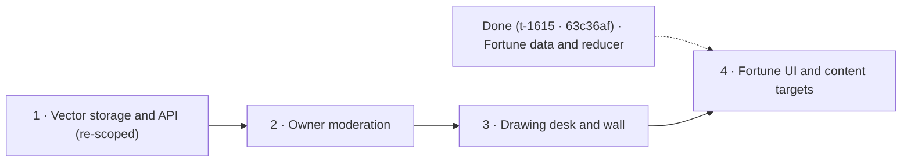

# Ink and Folds

Plan: pm-273 · Revision: 2 · Product owner: run-9371 · 2026-10-28
Planning base: `7d2a49923ebaa4b709e954442729bb0c5617b8f9` (`origin/main`). Prior revision 1 base: `acd85dea898d519e1209527dde90846636f93a1f` (`run-8943`). Delivery identity is the commit containing this document.
Actual run: `agy-argon-high` / `gemini-4-argon` / `high`.
Research: [rep-5227, preserved verbatim](research.md). Explicit revision-2 decisions `dec-61618`, `dec-61619`, and `dec-61621` are recorded on the board.

## Revision 2: What changed from the failed attempts

Revision 2 responds to the operator change request (`dec-61600`, `fix_exhausted` on `t-1612` after `qa_run-9369` report `rep-5562` and fix plan `rep-5563`):

1. **Completed work preserved (`t-1615` stays `done`)**: Original task 4 (`t-1615: Build deterministic fortunes from current site content`) was completed on `origin/main` at `63c36af21bdeba1394a225451ce255896eb6990e` and accepted by `dec-61553` / `dec-61554` (`lib/fortune.ts`, `lib/fortune.test.ts`, `lib/fortune-targets.ts`, `lib/fortune-targets.test.ts`, and `projects/otohime-dev-ink-guestbook-wall-origami-fortune-teller-1-ink/fortune-contract.md`). Per replanning rules, `t-1615` is kept as finished and not re-proposed; the remaining 4 tasks are numbered `1` through `4` and depend only on each other (`1 -> 2 -> 3 -> 4`).
2. **Immutable historical migration provenance reconciled (`dec-61621`, `dec-61618`, `guestbook-contract.md:25`)**: All of `t-1612`'s functional code (`db/migrations/0004_green_scarlet_witch.sql`, `db/schema.ts`, `lib/guestbook.ts`, `lib/guestbook-http.ts`, `lib/guestbook-store.ts`, `app/api/guestbook/route.ts`, `e2e/guestbook-api.test.ts`), the CI footer-fixture fix (`259aefd` in `lib/end.test.ts`), and the expanded CI author guard covering `db/schema.ts` and `db/migrations/` (`88ac8b2` / `7ba2e80` in `.github/workflows/ci.yml:84` and `scripts/ci-workflow.test.mjs`) are already landed on `origin/main` and passed board green gate `ver-3722`. `qa_run-9369` failed because the initial commit introducing `db/migrations/0004_green_scarlet_witch.sql` (`c0368d162ac086b8089a7fd38eeaec1ac107e92f`) had Git author `Otohime <otohime@users.noreply.github.com>` (committer `Otohime <quiinthieu@gmail.com>`). Rewriting `origin/main` requires a forbidden force-push (`AGENTS.md`), and deleting or replacing an already-applied Drizzle migration corrupts `db/migrations/meta/_journal.json` and deployed production tables. Following `qa_run-9369/fix_plan.md`, board decision `dec-61621` (with `dec-61618`) formally reconciles and accepts `c0368d162ac086b8089a7fd38eeaec1ac107e92f` at `guestbook-contract.md:25` as the immutable baseline for migration `0004`, while requiring `Otohime <quiinthieu@gmail.com>` on all subsequent guestbook, schema, and migration commits (`658f6fcbf631ce2e4736c8211be0a45cb8e3cb27`, `f4b3de8ee23f336e04adaed24097d324326eb106`, `88ac8b28860679e72f03651a89278a8b2ab73fd8`, `7ba2e804a9f9ecc9d490c4cbbae1eb27a6a3c75e`, and all future commits), enforced by `.github/workflows/ci.yml:84` and `scripts/ci-workflow.test.mjs`.
3. **Stateful isolated-Postgres verification separated from read-only live production checks (`dec-61621`, `dec-61619`)**: `qa_run-9369` also failed because live `GET https://otohime.dev/api/guestbook` returned `{"entries":[],"nextCursor":null}` and could not by itself demonstrate approved-row visibility, pending/rejected moderation isolation, or `3/IP-hour`, `100/day`, and `500-pending` quota exhaustion, and because a newer CI/doc commit (`7ba2e80`) still had its ~25-minute GitHub Actions workflow in progress while production served an earlier commit containing the identical guestbook runtime (`f4b3de8`). Task 1's `acceptance_criteria` now explicitly separate:
   - **Stateful write, moderation isolation, 24-row cursor pagination across tied timestamps, migration `0004` sentinel preservation, and concurrent atomic quota proof (`3/IP-hour`, `100/day`, `500 pending`)**: verified against an isolated migrated Postgres 17 instance and real `next start` server (`e2e/guestbook-api.test.ts` and independent isolated Postgres probes), never by inserting or approving test rows on shared production `https://otohime.dev`.
   - **Live production (`https://otohime.dev`) checks**: scoped strictly to read-only `GET /api/guestbook` (`200`, `Cache-Control: no-store`, valid `{entries,nextCursor}` shape) plus non-inserting negative controls (`400 reason=cursor`, `400 reason=shape`, `403 reason=origin`) and confirming `https://otohime.dev/api/health` serves a commit descended from the guestbook runtime delivery `f4b3de8ee23f336e04adaed24097d324326eb106` with zero diff on runtime guestbook files (`app/api/guestbook/`, `lib/guestbook*`, `db/schema.ts`, `db/migrations/0004_green_scarlet_witch.sql`).
4. **Positive `match:` verification evidence and mandatory `git push origin HEAD:main`**: Task 1's first `verification[]` item runs `scripts/ci-workflow.test.mjs` alongside `lib/guestbook.test.ts` and `lib/guestbook-http.test.ts` with `"expect": "match:guestbook author guard rejects a wrong-author schema or migration-only push and passes the owner"` so the platform's inline red gate (`alreadyGreenEvidence` in `gates.go`) has positive non-zero test evidence to verify the already-landed implementation on `origin/main`. Every task (`1..4`) also explicitly mandates pushing to `origin/main` via `git push origin HEAD:main` and checking `git fetch origin && git merge-base --is-ancestor HEAD origin/main` before submitting a report, preventing the earlier `push_not_on_main` stops (`esc-437`, `esc-438`, `esc-441`, `esc-442`).

## Product outcome

Visitors leave tiny vector doodles on a moderated ink-and-paper wall at **/guestbook**, then play a folded-paper fortune teller at **/fortune** that leads them to something already on the site. Both are discoverable by name from Pocket. The wall feels like paper pinned with washi tape; the fortune teller has shaded creases and a gentle opt-in fold cue.

Success is observable immediately: a submitted drawing receives a pending acknowledgement, is absent publicly, can be visually reviewed by the owner, appears after approval, replays when approached, and disappears after rejection/deletion. A visitor can finish the fortune game with mouse, touch or keyboard and follow a genuine current content target. Reduced motion keeps both products complete.

The optional home easter egg is deferred. Pagination meets the wall request; automatic infinite scrolling is optional and must retain the explicit More control. There is no new external service, paid API, binary asset, scheduled job, digest or asynchronous compute runtime.

## Evidence and repository fit

- Next 16.4.2 / React 19.3, Drizzle/Postgres, Better Auth roles, existing sound singleton, palette and Pocket command model are already installed. `drizzle.config.ts` points at `db/schema.ts` and `db/migrations/`; `npm run db:migrate` is canonical. Prisma is the existing studio tool, not the migration writer.
- Existing `ask_usage` and `lib/ask-llm.ts` demonstrate HMAC/time buckets and streaming capped bodies. Guestbook uses its own table/namespace and admission transaction rather than changing Ask quotas.
- `lib/permissions.ts` grants full statements to owner and an explicit smaller set to admin. Add guestbook permissions through that mechanism; an admin role alone cannot moderate.
- `lib/terminal.ts` PLACES is the Pocket navigation interface. Adding two named places supplies bare commands, go commands, help and suggestions. Do not expand `PUBLIC_PAGES`, `CONSOLE_MENU` or the seven-line SVG LCD geometry.
- Notes and sketch/song listings currently lack item fragment ids. Merely checking that /notes or /music responds is insufficient proof of a deep link. Completed task `t-1615` (`63c36af21bdeba1394a225451ce255896eb6990e`) declared shared target ids in `lib/fortune-targets.ts` and `lib/fortune.ts`; Task 4 (below) renders them on destination pages and follows them.
- `content/site.ts`, Gazette `ARTICLES` and request-time `listSongs()` supply fresh candidates. Only serializable target data crosses to the browser; filesystem/DB readers remain server-side.
- The actual CI is GitHub Actions/Vercel, not the generic GitLab/k3s topology in the shared rules. Checks run lint, typecheck, unit tests, the deployment-script fixture, content-index checks, Drizzle checks, production build, migrations and browser flows. Production builds before migrations and deploys afterward through scripts/vercel-deploy.sh, which checks the served health SHA. A projects-only push is excluded by `paths-ignore`; absence of a CI run for this planning commit is expected, not a CI pass.
- Root `AGENTS.md` was read. The two requested standing documents are absent from this repo; their full readable copies were recovered read-only from the shared worker repository `mono-v2` (`projects/20260921222547_plan_manager_chief_of_staff_extraction.md` and `docs/claude/software-development.md`). Standing rules remain there and in `AGENTS.md`. This plan declares product contracts rather than copying standing policies.
- Installed Next guides read: route handlers, Server Actions, lazy loading and Playwright. Implementers re-read relevant installed guides before code. Cache Components is enabled: defer DB reads to request time, keep no-store public API reads and fresh mutation authorization, avoid unsupported route config remembered from older Next, and put `ssr:false` only behind a client boundary.
- The three X posts are visual inspiration supplied by the idea, not fetched evidence. Their content is not required to build or verify either feature.

## Guestbook interface

### Compact drawing

Logical bounds are 240×160. Version 1 stores whole-pixel integer coordinates and quantised width, with one colour index per stroke. The canonical POST shape is:

```json
{
  "v": 1,
  "name": "A visitor",
  "note": "A little wave from me",
  "durationMs": 1200,
  "website": "",
  "strokes": [
    {"c": 0, "p": [18, 82, 36, 70, 52, 83], "w": [8, 6, 9], "t0": 0, "d": 1200}
  ]
}
```

| Field or limit | Contract |
| --- | --- |
| HTTP body | Incremental byte cap 8192 before JSON.parse; do not trust Content-Length. JSON only; explicit foreign Origin rejected. |
| Version and shape | v=1 only; accept declared fields, reject wrong types/unknown control fields; never accept status, reviewer, id, tape, tilt, SVG strings or image data from the caller. |
| Strokes | 1–40, <=1500 points total and <=6144 UTF-8 bytes for serialized strokes, whichever limit is hit first. At least two points per stroke; p length is even, w length=p.length/2. |
| Coordinates/width | Finite integers x in 0..240, y in 0..160; w in 1..15, mapped consistently to 0.5 + 0.3*w logical pixels. Server rejects out-of-range coordinates; the client clamps capture positions. |
| Colour | c is 0, 1 or 2, mapping to current site --ink, --coral, --blue. Theme tokens decide the rendered colour; no arbitrary colour string. |
| Timing | durationMs, t0 and d are integer milliseconds in 0..60000; d>0, t0+d<=durationMs and stroke start times nondecreasing. Client coalesces extremely short marks to a positive bounded duration. Client time is a replay hint, never proof a human drew. |
| Optional text | Missing fields become empty strings; maximum 24 name / 80 note Unicode code points after NFKC/control/whitespace normalization. One line; no rendered HTML. Reject URLs and obvious profanity, including a small documented set of leet/spacing variants. Test benign lookalikes to avoid naive substring false positives. |
| Honeypot | website is empty; a populated honeypot cannot insert data. No minimum two-stroke rule or false claim of bot-proof timing. |
| Drawing deadline | First pointer stroke or keyboard mark starts a 60s wall-clock budget. Undo/clear do not reset it, and hidden-tab elapsed time counts. Explicit New sheet resets it. Expiry finalizes the active stroke, then locks drawing but still permits submit/undo. |
| Accessibility | Place an ink mark creates a valid small preset vector using the selected ink. A motor/keyboard-only visitor can submit through exactly the same validation/storage path. |
| Rendering | Derive safe SVG geometry from numeric data, including variable width; bounded progressive reveal uses the same geometry. No bitmap persistence or caller-authored markup. |

### Storage and API

`guestbook_entry`: UUID text primary key; name/note; versioned strokes jsonb; duration/point_count/byte_count; constrained status pending|approved|rejected default pending; server-created tilt -4..4 and tape 0..3; created_at timestamptz; nullable reviewed_at and reviewed_by referencing user with ON DELETE SET NULL. Add an index on status, created_at DESC, id DESC. Avoid a redundant row-level ink when individual strokes already carry it.

`guestbook_usage`: bucket text primary key, accepted count and updated_at. Derive namespaced HMAC SHA-256 client/hour buckets with existing BETTER_AUTH_SECRET and UTC global/day keys. Store no raw addresses or submission payloads in logs. A missing secret disables writes honestly with 503; approved read remains usable. Follow the actual trusted ingress address convention; absent/untrusted identity shares one conservative unknown bucket, never a client-controlled arbitrary identity. Task 1 documents the trust assumption.

Admission is one database transaction, serialized by a guestbook-specific transaction advisory lock: check IP/hour<3, global/day<100, pending<500; insert pending row and increment counters together; rollback together. This small global write lock is proportionate to a 100/day product. Expired usage cleanup occurs in a bounded write path, with no timer/cron. Pending art is never auto-approved.

| Interface | Observable result |
| --- | --- |
| POST /api/guestbook | 201 {id,status:"pending"} on successful persistence. Empty/invalid/profane/link/honeypot input: 400; forbidden Origin: 403; oversized: 413; non-JSON: 415; quota: 429 with Retry-After; missing dependency/secret or queue capacity: 503. JSON errors carry stable reason and friendly message. |
| GET /api/guestbook?cursor=... | 200 {entries,nextCursor}; 24 approved-only entries in created_at DESC,id DESC order. Opaque validated cursor includes the full timestamp precision and id. No caller-selectable status. Invalid cursor: 400; unavailable DB: 503, not a fictitious empty wall. |
| Public entry DTO | id, normalized name/note, v/strokes/durationMs, tilt/tape and createdAt only. No review metadata, IP/buckets or hidden rows. Both API responses use Cache-Control:no-store. |
| /guestbook?cursor=... | Readable approved server-rendered SVG wall plus real More navigation. Form loads lazily with explicit keyboard controls, bounds/countdown and pending/error status. |
| /admin/guestbook | Owner-only queue with actual static vector previews and pending/reviewed pagination. Every action separately checks authoritative fresh permission before reading/mutating. |
| Approve/reject/delete | Allow pending->approved/rejected and approved->rejected, idempotent same-state action, stale conflicting transition rejected. Retained rows record reviewer/time. Delete any status; no public soft-deleted leak. |

The wall stores decorative randomness once, so refresh, pagination and hydration do not reshuffle cards. Each card provides visible name/note and an accessible doodle label. Hover/focus/tap can replay in <=2s; pointer exit/blur may finish immediately. Offscreen/unmounted/hidden cards cancel work. Reduced motion always displays complete art, cancels an active replay and does not schedule another frame. Submission is never an optimistic public pin.

## Fortune interface

`FortuneTarget` is serializable {id,label,href,kind} (already implemented and verified in `lib/fortune-targets.ts` and `lib/fortune.ts` by completed task `t-1615` at `63c36af21bdeba1394a225451ce255896eb6990e`); a pure builder consumes typed source collections, de-duplicates targets and excludes unsafe URLs. Stable target ids are shared by the builder and actual notes, sketches, song listings and project fallback cards. Live project paths and /articles/[slug] remain real routes. Article data comes from Gazette's actual ARTICLES export. Songs include current owner additions via the existing server reader. Database failure preserves the static song/content pool.

`FortuneState` and its reducer are pure. A session seed and current content snapshot reproduce all choices. Four outer colours are Coral (5 letters), Blue (4), Mint (4) and Yellow (6); they use the matching site palette. After choosing a colour, count/spell it, alternating pinch axis. Show one quartet of 1..8 from the current axis; choose a first number and count it, then choose a final exposed number and reveal its shuffled target. Illegal or repeated events cannot skip phases. A Finish counting button advances through the same reducer completion path. Arrow Left/Right visibly pinch/change axis; they never choose an item or steal focus outside the toy.

Each choice is a real labelled button. Enter/Space activates it, stage/count feedback is polite, and reveal moves focus to the fortune. Fortune copy is a short content-derived invitation; the normal anchor is the promised destination. Again supplies a new seed. Empty pools safely link to /projects. No network request is required from the reducer, and new content does not require editing a separate fortune list.

SVG facets plus a few CSS 3D transforms create paper depth; no 3D dependency or bitmap is required. Reduced motion uses flat static facets, resolves counting synchronously and retains the entire game. The fold cue extends the existing bounded CUES/MAX_DB system and plays from user interaction only, through its singleton. Sound remains off by default and respects the existing toggle, blocked Web Audio and blocked storage. Cancel timers/resources on route departure or motion changes.

## Delivery order and size admission



Settings read during `run-9371`: `max_live_runs_per_plan=1`, `max_plan_elapsed=6h0m0s`, `qa_mode=auto`. Four remaining SWE tasks yield a 4h fallback weighted sum (`1 -> 2 -> 3 -> 4`), with Task 1 already implemented on `origin/main` and structured to pass `alreadyGreenEvidence` at the inline red gate. All four remaining tasks set `qa="required"`.

There is no external or person-only prerequisite identified from the repo (`external_dependencies_reviewed=true`, empty `prerequisites: []` in `platform.plan-prerequisites.v1`): deployed auth already uses `BETTER_AUTH_SECRET`, CI provisions Postgres, and owner access already exists as a role. New missing credential/sign-in chores are raised at the start of the first task needing them with `kind=operator_action`, stable fingerprint and readiness probe when meaningful; fixture-verifiable work comes first.

## Verification and acceptance

Contracts below are the exact proposal payload for the 4 remaining tasks (`1..4`). New named test files are implementation obligations. An absent file, zero tests, silent skipped feature assertion, fake-only adapter result or a marker-only UI assertion cannot pass. Domain tests inject clock/seed/store, exercise relevant negative controls and prove exact boundaries. Each task also runs all npm tests and lint/typecheck; real production browser commands build and import the actual locked app.

The current e2e harness creates isolated embedded Postgres, applies real migrations and serves `next start`. Feature commands clear `BASE_URL`, `DATABASE_URL` and `SKIP_BUILD` to avoid accidental shared writes, and set `TMPDIR=/tmp` for Chromium socket paths. Preserve serial test execution. Fixture owners/admins are temporary local accounts promoted using the existing `e2e/rbac.test.ts` convention and deleted afterward; no production sign-in bypass or test-only public route is shipped. Only local fixture databases may be directly seeded. Existing unrelated isolated exhibit stylesheets are checked for leaked selectors rather than a brittle exact sheet count.

Task 1's verification and QA boundary explicitly separates:
- **Isolated production-equivalent Postgres 17 + `next start` (`e2e/guestbook-api.test.ts` and independent isolated Postgres probes)**: proves migration `0004` upgrade preserving preexisting sentinel rows, valid write (`201 pending`) and DB read, pending/rejected absence from public `GET`, 25+ approved entries including tied timestamps across 24-row cursors, malformed/oversized streaming input, explicit bad `Origin`, profanity and benign controls, missing config/dependency, and concurrent exact `3/IP-hour`, `100/day`, and `500-pending` caps with persisted counters inspected.
- **Read-only live production (`https://otohime.dev`)**: proves `GET /api/guestbook` returns `200` with `Cache-Control: no-store` and valid `{entries,nextCursor}` shape, non-inserting negative controls (`400 reason=cursor`, `400 reason=shape`, `403 reason=origin`), and `https://otohime.dev/api/health` serves a commit descended from the guestbook runtime commit `f4b3de8ee23f336e04adaed24097d324326eb106` with zero runtime diff on `app/api/guestbook/`, `lib/guestbook*`, `db/schema.ts`, and `db/migrations/0004_green_scarlet_witch.sql`. Never mutate shared production data or exhaust real visitor rate limits on `https://otohime.dev`.
- **Provenance (`dec-61621`)**: historical commit `c0368d162ac086b8089a7fd38eeaec1ac107e92f` is formally accepted by board decision `dec-61621` (with `dec-61618` and `dec-61619`, documented at `guestbook-contract.md:25`) for the initial creation of `db/migrations/0004_green_scarlet_witch.sql`; all subsequent guestbook, schema, and migration commits (`658f6fc`, `f4b3de8`, `88ac8b2`, `7ba2e80`, and any new commits) carry `Otohime <quiinthieu@gmail.com>` and are guarded by `.github/workflows/ci.yml:84` and `scripts/ci-workflow.test.mjs`.

Task 2's independent mutations exercise owner, admin, plain, anonymous and demoted identities and verify unchanged status/audit after denial. Task 3 uses injected/browser clocks to reach expiry now, never a literal one-minute pause, and tests actual rendered/replayed geometry, touch capture, overflow, keyboard ink marking and no-JS paging. Task 4 consumes the already-delivered `lib/fortune.ts` and `lib/fortune-targets.ts` (`t-1615`, `63c36af21bdeba1394a225451ce255896eb6990e`), renders the actual fortune targets on destination pages for every content kind (including an injected new song in the isolated DB), and verifies keyboard focus/announcements, interrupted counting, reduced motion, ordinary link navigation and sound-off silence plus opt-in audio construction. Full production e2e regression covers the shared Pocket, music, navigation and isolated roots in composition.

Acceptance walkthrough:

| Starting state | Action | Required observable result / negative control |
| --- | --- | --- |
| Fresh isolated build, empty approved wall | Submit valid pointer or keyboard mark | Real persisted pending id; wall/API have no such id. Invalid vector or URL note is rejected with no row. |
| Pending entry; non-owner session | Directly call moderation then try owner queue | Denied; row/audit unchanged. Owner can see the actual vector and approve it. |
| Owner approves, then rejects/deletes | Refresh public API/wall after each action | Approved geometry/text appears; rejected/deleted id disappears with no stale cached copy. |
| 25+ approved entries | Load More via keyboard and with JS off | Descending cursor pages have no duplicate/missing tied-date ids; pending entries are never included. |
| Active drawing/replay | Advance fake/browser clock, undo/clear, toggle reduced motion | Deadline cannot be extended; expired input locks. Replay paints genuine geometry, stops offscreen, and reduced motion has complete static art. |
| Pocket on an ordinary public page | Open guestbook and fortune by name | Correct routes; existing menu geometry, pages and stamps still work. |
| Fortune fresh, sound off | Complete colour/count/first-number/count/final-number by keyboard | Stage announcements, visible folds, focused reveal and working target; illegal phase input has no effect and sound stays silent. |
| Fortune reduced motion / sound enabled | Complete/reset, pinch by touch/arrows | Static complete reduced-motion game; bounded opt-in cue only on user action, no orphan timers/contexts. |
| Each content kind and new owner song | Follow revealed href | Destination route succeeds and actual hash element exists with the promised content; missing/unsafe project link is excluded/falls back safely. |

SWE claims its assigned task first, records judgments, runs the contract, commits with `Otohime <quiinthieu@gmail.com>` and subject `pm-273/<assigned-task-id>: ...`, and pushes directly to `origin/main` via `git push origin HEAD:main` (verifying `git fetch origin && git merge-base --is-ancestor HEAD origin/main` before submitting its summary report). This PO run uses `pm-273/run-9371:`.

## Build contracts

### 1. Persist moderated vector doodles behind a bounded API

```json
{
  "sequence": 1,
  "title": "Persist moderated vector doodles behind a bounded API",
  "role": "software_engineer",
  "depends_on": [],
  "qa": "required",
  "problem": "The guestbook API, Drizzle migration 0004, CI footer-fixture fix (259aefd), and CI author guard covering db/schema.ts and db/migrations/ (.github/workflows/ci.yml:84 and scripts/ci-workflow.test.mjs at 88ac8b2/7ba2e80) are already on origin/main and pass all five local gates. Prior t-1612 attempts failed QA only because (1) historical commit c0368d162ac086b8089a7fd38eeaec1ac107e92f introducing migration 0004 had author Otohime <otohime@users.noreply.github.com> before an explicit board decision reconciled it in guestbook-contract.md:25, and (2) stateful moderation/quota proof was not explicitly scoped to isolated migrated Postgres 17 + next start vs. read-only live checks.",
  "action_items": [
    "Do not rewrite the working guestbook feature or create a replacement migration. Run `git fetch origin && git status` and verify that `db/migrations/0004_green_scarlet_witch.sql`, `db/schema.ts`, `lib/guestbook.ts`, `lib/guestbook-http.ts`, `lib/guestbook-store.ts`, `app/api/guestbook/route.ts`, `e2e/guestbook-api.test.ts`, `.github/workflows/ci.yml` (line 84 covering `db/schema.ts` and `db/migrations/`), `scripts/ci-workflow.test.mjs`, and `projects/otohime-dev-ink-guestbook-wall-origami-fortune-teller-1-ink/guestbook-contract.md` (citing board decision `dec-61621` at line 25) are present and intact on `origin/main`.",
    "Ensure `node_modules` is installed from `package-lock.json` (`npm ci --prefer-offline --no-audit --no-fund`) using Node >=22.23 (`/Users/avietidol/.local/bin/node`) and, if the macOS host lacks GNU `timeout`, provide a temporary `timeout` shim on `PATH` outside the repository before running `npm test`.",
    "Run all five verification commands below on the clean checkout. Restore (do not commit) any E2E-generated `content/history.json` worktree change.",
    "If any file change is needed, verify `bash scripts/setup-owner-git.sh --check` (`Otohime <quiinthieu@gmail.com>` for both author and committer), commit with subject `pm-273/<task-id>: ...`, and push directly to `origin/main` with `git push origin HEAD:main` (on non-fast-forward rejection, `git pull --rebase origin main`, rerun verification, and push `HEAD:main` again; never push only to a side branch). Confirm `git fetch origin && git merge-base --is-ancestor HEAD origin/main` exits 0 before submitting the report."
  ],
  "interfaces": [
    "db/schema.ts",
    "db/migrations/",
    "lib/guestbook.ts",
    "lib/guestbook.test.ts",
    "lib/guestbook-http.ts",
    "lib/guestbook-http.test.ts",
    "lib/guestbook-store.ts",
    "lib/end.test.ts",
    "e2e/guestbook-api.test.ts",
    "app/api/guestbook/route.ts",
    ".github/workflows/ci.yml",
    "scripts/ci-workflow.test.mjs",
    "README.md",
    "projects/otohime-dev-ink-guestbook-wall-origami-fortune-teller-1-ink/guestbook-contract.md"
  ],
  "non_goals": [
    "Rewriting origin/main history or replacing/editing already-applied migration 0004_green_scarlet_witch.sql",
    "Mutating or seeding shared production data on https://otohime.dev",
    "Drawing UI, public wall page, or owner moderation UI",
    "Pushing to any branch other than origin/main"
  ],
  "acceptance_criteria": "origin/main contains the guestbook API, migration 0004, the CI fixture fix (259aefd), the expanded CI author guard (.github/workflows/ci.yml:84 + scripts/ci-workflow.test.mjs), and guestbook-contract.md:25 citing board decision dec-61621. Per dec-61621, historical commit c0368d162ac086b8089a7fd38eeaec1ac107e92f is accepted as the immutable initial introduction of migration 0004, while all subsequent guestbook, schema, and migration commits (658f6fc, f4b3de8, 88ac8b2, 7ba2e80, and any new commits) are authored and committed by Otohime <quiinthieu@gmail.com>, and `git merge-base --is-ancestor <reported git_sha> origin/main` exits 0. Against isolated migrated Postgres 17 + real `next start` (`e2e/guestbook-api.test.ts`), POST stores only valid bounded vectors as pending (201 with id), public GET returns approved rows only (24 per cursor page without private fields), migration 0004 preserves sentinel rows, concurrent requests cannot exceed 3/IP-hour, 100/day or 500 pending, and malformed/profane/URL/oversized/foreign-Origin payloads insert no rows. On live https://otohime.dev, verification is strictly read-only (`GET /api/guestbook` returns 200 with Cache-Control: no-store, non-inserting 400/403 negative controls pass, and `/api/health` serves a descendant of guestbook runtime commit f4b3de8ee23f336e04adaed24097d324326eb106 with zero diff on `app/api/guestbook/`, `lib/guestbook*`, `db/schema.ts`, and `db/migrations/0004_green_scarlet_witch.sql`).",
  "verification": [
    {
      "name": "payload, HTTP and CI author-guard tests",
      "cwd": ".",
      "cmd": "node --experimental-strip-types --disable-warning=ExperimentalWarning --disable-warning=MODULE_TYPELESS_PACKAGE_JSON --test lib/guestbook.test.ts lib/guestbook-http.test.ts scripts/ci-workflow.test.mjs",
      "expect": "match:guestbook author guard rejects a wrong-author schema or migration-only push and passes the owner",
      "timeout_s": 300
    },
    {
      "name": "repository tests",
      "cwd": ".",
      "cmd": "npm test",
      "expect": "exit0",
      "timeout_s": 300
    },
    {
      "name": "lint and types",
      "cwd": ".",
      "cmd": "npm run lint && npm run typecheck",
      "expect": "exit0",
      "timeout_s": 300
    },
    {
      "name": "real migrated database and API contract",
      "cwd": ".",
      "cmd": "env -u BASE_URL -u DATABASE_URL -u SKIP_BUILD TMPDIR=/tmp node --experimental-strip-types --disable-warning=ExperimentalWarning --disable-warning=MODULE_TYPELESS_PACKAGE_JSON scripts/e2e.mjs --test e2e/guestbook-api.test.ts",
      "expect": "exit0",
      "timeout_s": 900
    },
    {
      "name": "migration metadata and reconciled provenance contract",
      "cwd": ".",
      "cmd": "npx drizzle-kit check && npm run db:generate && git diff --exit-code -- db/schema.ts db/migrations && test -z \"$(git ls-files --others --exclude-standard db/migrations)\" && grep -q 'dec-61621' projects/otohime-dev-ink-guestbook-wall-origami-fortune-teller-1-ink/guestbook-contract.md",
      "expect": "exit0",
      "timeout_s": 300
    }
  ]
}
```

### 2. Give the owner a protected visual moderation queue

```json
{
  "sequence": 2,
  "title": "Give the owner a protected visual moderation queue",
  "role": "software_engineer",
  "depends_on": [
    "1"
  ],
  "qa": "required",
  "problem": "Pending doodles need visual review and explicit owner approval; a page-only role check would leave mutation entry points exposed.",
  "action_items": [
    "Read the installed Next Server Actions/security guides and existing lib/dal.ts, lib/permissions.ts and admin page patterns. At task start raise any newly discovered person-only sign-in chore via plan_manager_ask_user kind=operator_action with a stable fingerprint; use isolated test accounts to prove authorization now.",
    "Add guestbook review/delete permissions to the existing access-control statements, granted to owner only (admin/user receive neither). Declare moderation operations with an injected authoritative-session port and GuestbookStore, then write denial and transition tests before wiring real Server Actions. Never trust client reviewer/status fields.",
    "Create /admin/guestbook with bounded pending/reviewed lists, actual vector previews and textual metadata, pagination, approve/reject/delete controls and understandable empty/error states. Add an owner-visible link via the existing signed-in navigation pattern. Gate the page before reading queue data and check fresh permissions in every action, including direct action calls.",
    "Create the shared SVG doodle renderer in components/guestbook/doodle.tsx and pure geometry in lib/guestbook-render.ts; variable-width geometry comes only from validated numeric vectors, never supplied SVG/path strings. Reuse three existing palette tokens. Static previews are complete without motion/JavaScript and have an accessible name plus visible note/name.",
    "Implement pending->approved/rejected, approved->rejected removal, and deletion of any status, recording reviewed_at/reviewed_by for retained rows. Refuse invalid ids/actions and stale conflicting transitions with stable reasons; repeated same-state operations are idempotent. Refresh queue and uncached public reads immediately; rejected/pending/deleted data never leaks in public reads.",
    "Extend real isolated database and browser tests to submit a doodle, deny signed-out/user/admin moderation, approve as an isolated owner, verify public visibility, reject and delete, and verify absence again. Test a demoted session and direct unauthorized mutation with unchanged row/audit fields. Document the moderation/renderer port, verify `bash scripts/setup-owner-git.sh --check` (`Otohime <quiinthieu@gmail.com>`), restore any generated `content/history.json`, run all verification gates, commit with `pm-273/<task-id>:`, push directly to `origin/main` with `git push origin HEAD:main`, and confirm `git fetch origin && git merge-base --is-ancestor HEAD origin/main` exits 0."
  ],
  "interfaces": [
    "lib/permissions.ts",
    "lib/permissions.test.ts",
    "lib/guestbook-moderation.ts",
    "lib/guestbook-moderation.test.ts",
    "lib/guestbook-store.ts",
    "lib/guestbook-render.ts",
    "lib/guestbook-render.test.ts",
    "components/guestbook/doodle.tsx",
    "app/(site)/(app)/admin/guestbook/",
    "app/(site)/(app)/layout.tsx",
    "e2e/guestbook-moderation.test.ts",
    "e2e/guestbook-api.test.ts",
    "README.md",
    "projects/otohime-dev-ink-guestbook-wall-origami-fortune-teller-1-ink/guestbook-contract.md"
  ],
  "non_goals": [
    "Changing owner provisioning or granting moderation to admins",
    "Guestbook drawing/wall UI",
    "Moderation notifications, auto-approval or AI image classification",
    "Pushing to any branch other than origin/main"
  ],
  "acceptance_criteria": "Only an owner can view pending vector previews and approve, reject or delete through the queue. The mutation itself rejects signed-out, user, admin and demoted actors. Approval makes the doodle publicly readable; rejection/deletion removes it immediately. A direct unauthorized action leaves status and audit fields unchanged. Preview text and vectors remain safe and accessible. All task commits are authored by Otohime <quiinthieu@gmail.com> and landed on origin/main (`git merge-base --is-ancestor <reported git_sha> origin/main` exits 0).",
  "verification": [
    {
      "name": "permissions, transition and renderer tests",
      "cwd": ".",
      "cmd": "node --experimental-strip-types --disable-warning=ExperimentalWarning --disable-warning=MODULE_TYPELESS_PACKAGE_JSON --test lib/permissions.test.ts lib/guestbook-moderation.test.ts lib/guestbook-render.test.ts",
      "expect": "exit0",
      "timeout_s": 300
    },
    {
      "name": "repository tests",
      "cwd": ".",
      "cmd": "npm test",
      "expect": "exit0",
      "timeout_s": 300
    },
    {
      "name": "lint and types",
      "cwd": ".",
      "cmd": "npm run lint && npm run typecheck",
      "expect": "exit0",
      "timeout_s": 300
    },
    {
      "name": "real owner and hostile-session flow",
      "cwd": ".",
      "cmd": "env -u BASE_URL -u DATABASE_URL -u SKIP_BUILD TMPDIR=/tmp node --experimental-strip-types --disable-warning=ExperimentalWarning --disable-warning=MODULE_TYPELESS_PACKAGE_JSON scripts/e2e.mjs --test e2e/guestbook-api.test.ts e2e/guestbook-moderation.test.ts e2e/rbac.test.ts",
      "expect": "exit0",
      "timeout_s": 900
    }
  ]
}
```

### 3. Open the ink drawing desk and paper guestbook wall

```json
{
  "sequence": 3,
  "title": "Open the ink drawing desk and paper guestbook wall",
  "role": "software_engineer",
  "depends_on": [
    "2"
  ],
  "qa": "required",
  "problem": "The persisted and moderated doodles have no visitor experience; visitors need a tiny tactile drawing desk and a readable paginated wall without loading toys on every route.",
  "action_items": [
    "Read installed Next lazy-loading/CSS guidance and the API/renderer contract. At task start raise any newly discovered person-only configuration chore as plan_manager_ask_user kind=operator_action with a stable fingerprint. Write brush, elapsed-time and replay lifecycle tests first with injected time; all tests use isolated data.",
    "Add /guestbook under app/(site)/(app) using route-local guestbook.css, public metadata, the existing ViewTransition convention, readable first-page approved SVG cards and a lazy drawing client. Preserve the existing root layouts and initial readable page title; import no drawing module into home or unrelated routes.",
    "Implement a fixed 240x160 logical drawing surface with one sumi brush, three site inks, undo, clear and reset/new-sheet controls. Use pointer capture and scaled/clamped coordinates; pen pressure contributes width and mouse/unreliable touch pressure falls back to smoothed speed. Store quantised paths only, enforce shared caps during sampling/simplification, and use visible limit feedback instead of silently dropping a submit.",
    "Start one 60-second wall-clock budget on the first mark; undo/clear cannot extend it, backgrounding consumes elapsed time, and expiry finalises the current stroke and locks additional drawing. New sheet resets the session explicitly. Provide a labelled keyboard Place an ink mark button that generates the same valid vector as pointer input, plus keyboard-accessible ink/undo/submit controls, name and note fields and nonintrusive status announcements.",
    "POST the canonical payload without bitmap conversion. Keep the draft on network/filter/rate-limit failure, disable duplicate submits in flight, and announce 'Sent for approval' only after 201 pending. A successful pending doodle never appears optimistically on the public wall. Handle 400/413/415/429/503 and empty/unavailable wall states honestly.",
    "Render stable server-stored -4..4 degree paper cards with CSS washi variants and corkboard texture. Replay actual variable-width vectors progressively on hover, keyboard focus or tap, bounded to 2 seconds, and cancel when offscreen, hidden, unmounted or reduced motion becomes active. Reduced motion always shows the completed drawing and starts no replay loop. Use visible escaped name/note plus accessible doodle labeling.",
    "Use approved keyset pagination with an explicit More link that works without JS; progressive enhancement may append pages without duplicates and preserves focus/error/retry. Add exact guestbook and go guestbook Pocket PLACES/help/suggestion entries and terminal tests; keep PUBLIC_PAGES, CONSOLE_MENU and LCD geometry unchanged. Add real mouse, CDP touch, keyboard-mark, approval, pagination, reduced-motion and clock-driven expiry e2e cases; verify `bash scripts/setup-owner-git.sh --check` (`Otohime <quiinthieu@gmail.com>`), restore any generated `content/history.json`, run verification, commit with `pm-273/<task-id>:`, push directly to `origin/main` with `git push origin HEAD:main`, and confirm `git fetch origin && git merge-base --is-ancestor HEAD origin/main` exits 0."
  ],
  "interfaces": [
    "app/(site)/(app)/guestbook/",
    "components/guestbook/",
    "lib/guestbook-drawing.ts",
    "lib/guestbook-drawing.test.ts",
    "lib/guestbook-render.ts",
    "lib/guestbook-render.test.ts",
    "lib/terminal.ts",
    "lib/terminal.test.ts",
    "e2e/guestbook.test.ts",
    "e2e/guestbook-moderation.test.ts",
    "e2e/guestbook-api.test.ts",
    "README.md",
    "projects/otohime-dev-ink-guestbook-wall-origami-fortune-teller-1-ink/guestbook-contract.md"
  ],
  "non_goals": [
    "Home easter egg or physical console LCD menu expansion",
    "Drawing layers, upload/export bitmaps, erasers or multiple brush tools",
    "Requiring an observer/infinite-scroll implementation when pagination meets the request",
    "Pushing to any branch other than origin/main"
  ],
  "acceptance_criteria": "Pocket opens /guestbook. Mouse/pen/touch or a keyboard ink mark creates compact palette-matched vectors; undo works and the first mark starts a 60-second deadline that clear/backgrounding cannot extend. Successful submission says pending and remains hidden until owner approval. Approved paper cards replay on hover/focus/tap, have stable tape/tilt and paginate; reduced motion shows complete static art, and no-JS visitors can read and page the wall. All task commits are authored by Otohime <quiinthieu@gmail.com> and landed on origin/main (`git merge-base --is-ancestor <reported git_sha> origin/main` exits 0).",
  "verification": [
    {
      "name": "brush, deadline, replay and Pocket tests",
      "cwd": ".",
      "cmd": "node --experimental-strip-types --disable-warning=ExperimentalWarning --disable-warning=MODULE_TYPELESS_PACKAGE_JSON --test lib/guestbook-drawing.test.ts lib/guestbook-render.test.ts lib/terminal.test.ts",
      "expect": "exit0",
      "timeout_s": 300
    },
    {
      "name": "repository tests",
      "cwd": ".",
      "cmd": "npm test",
      "expect": "exit0",
      "timeout_s": 300
    },
    {
      "name": "lint and types",
      "cwd": ".",
      "cmd": "npm run lint && npm run typecheck",
      "expect": "exit0",
      "timeout_s": 300
    },
    {
      "name": "real guestbook submission, moderation and reading",
      "cwd": ".",
      "cmd": "env -u BASE_URL -u DATABASE_URL -u SKIP_BUILD TMPDIR=/tmp node --experimental-strip-types --disable-warning=ExperimentalWarning --disable-warning=MODULE_TYPELESS_PACKAGE_JSON scripts/e2e.mjs --test e2e/guestbook.test.ts e2e/guestbook-api.test.ts e2e/guestbook-moderation.test.ts e2e/pocket-terminal.test.ts e2e/ryugu.test.ts",
      "expect": "exit0",
      "timeout_s": 900
    }
  ]
}
```

### 4. Unfold an accessible fortune teller from Pocket

```json
{
  "sequence": 4,
  "title": "Unfold an accessible fortune teller from Pocket",
  "role": "software_engineer",
  "depends_on": [
    "3"
  ],
  "qa": "required",
  "problem": "The pure fortune pool, target-id helpers and seeded reducer are already delivered on origin/main (`lib/fortune.ts`, `lib/fortune-targets.ts`, `fortune-contract.md` from completed task t-1615 at 63c36af21bdeba1394a225451ce255896eb6990e), but visitors cannot yet play the fortune model or follow its rendered targets in the browser; the feature must feel like folding paper while remaining complete with keyboard, reduced motion and sound off.",
  "action_items": [
    "Read installed Next lazy-loading, route-data and CSS guidance and `projects/otohime-dev-ink-guestbook-wall-origami-fortune-teller-1-ink/fortune-contract.md`, and consume the already-landed `lib/fortune.ts` and `lib/fortune-targets.ts` helpers directly without breaking their existing unit tests. At task start raise any newly discovered person-only credential/sign-in chore through plan_manager_ask_user kind=operator_action with a stable fingerprint. Write component/browser assertions for gameplay and target existence before implementing; use the existing sound and content APIs.",
    "Add public /fortune under app/(site)/(app), route-local fortune.css, metadata and the normal ViewTransition wrapper, with a lazy SVG/CSS-3D client. Assemble candidates server-side from content/site.ts, Gazette ARTICLES and current listSongs(), then pass serializable targets to the pure model. A stored-song read failure keeps static candidates playable; no DB or filesystem loader enters the client bundle.",
    "Build the four-facet cootie catcher with paper crease shading/grain, bounded open/close transforms and visible colour/count/number instructions. Real flap buttons drive the reducer; clicking/counting visibly pinches paper and Left/Right toggle its axis without hijacking keys outside the toy. Enter/Space activate the focused choice. Count steps are short, skippable through a Finish counting button and instantly complete under reduced motion; choose a first number, count, then choose the final flap and reveal.",
    "Give every choice an accessible name, expose current stage/count in a polite live region and move focus to the revealed fortune heading/link. Reveal a content-derived sentence plus normal link and Again control. Use a flat static reduced-motion presentation with no replay/count timer/3D rotation, retain choices and final link, and handle motion changes or route departure by cancelling timers/audio/resources.",
    "Add a short bounded fold cue in lib/sound.ts and use lib/sound-client.ts so sound-off is silent and Web Audio starts only on the user's interaction. Extend cue/envelope/MAX_DB tests and browser sound-toggle cases, including rapid pinch input. Reuse the existing audio singleton rather than making one context per fold.",
    "Render the shared stable ids from `lib/fortune-targets.ts` (`fortuneNoteId`, `fortuneSketchId`, `fortuneSongId`, `fortuneProjectId`) on note cards, sketch figures, song listings and fallback project cards; preserve existing content, tactile surface ids, Peek marks and music behavior. Article paths use the actual Gazette slug source. Ensure every selected hash exists on the loaded destination and source removals refresh the pool, including owner-added song cases. Update generated indexes only if their canonical source data changes; run ask:check.",
    "Add exact fortune/go fortune Pocket PLACES/help/suggestions entries and tests without growing PUBLIC_PAGES or CONSOLE_MENU. Prove keyboard-only colour/count/number/reveal/link/reset, mouse/touch pinch, sound on/off, reduced motion, target navigation for each content kind and guestbook coexistence on the real production build. Run the full repository browser regression suite as the final composition check, verify `bash scripts/setup-owner-git.sh --check` (`Otohime <quiinthieu@gmail.com>`), restore any generated `content/history.json`, commit with `pm-273/<task-id>:`, push directly to `origin/main` with `git push origin HEAD:main`, and confirm `git fetch origin && git merge-base --is-ancestor HEAD origin/main` exits 0."
  ],
  "interfaces": [
    "app/(site)/(app)/fortune/",
    "components/fortune/",
    "app/(site)/(app)/notes/page.tsx",
    "app/(site)/(app)/sketches/page.tsx",
    "app/(site)/(app)/music/page.tsx",
    "app/(site)/(app)/projects/page.tsx",
    "lib/fortune.ts",
    "lib/fortune-targets.ts",
    "lib/sound.ts",
    "lib/sound.test.ts",
    "lib/terminal.ts",
    "lib/terminal.test.ts",
    "e2e/fortune.test.ts",
    "e2e/guestbook.test.ts",
    "README.md",
    "projects/otohime-dev-ink-guestbook-wall-origami-fortune-teller-1-ink/fortune-contract.md"
  ],
  "non_goals": [
    "Home easter egg",
    "New audio/3D packages or prerecorded binary assets",
    "Autoplay music, external fortune service, edited content catalogue or scheduled behavior",
    "Pushing to any branch other than origin/main"
  ],
  "acceptance_criteria": "Pocket opens /fortune. A shaded paper cootie catcher opens/closes on clicks or arrow keys, counts a chosen colour and first number, then unfolds the final numbered flap to a current content deep link. Keyboard and screen-reader users can complete/reset it with clear focus and announcements. Every fragment resolves to the displayed note/sketch/song/project; articles use real routes. Fold sound follows the existing opt-in toggle. Reduced motion completes the same game with static paper and no counting delay, and the guestbook and existing pages still work. All task commits are authored by Otohime <quiinthieu@gmail.com> and landed on origin/main (`git merge-base --is-ancestor <reported git_sha> origin/main` exits 0).",
  "verification": [
    {
      "name": "fortune, sound and Pocket regression",
      "cwd": ".",
      "cmd": "node --experimental-strip-types --disable-warning=ExperimentalWarning --disable-warning=MODULE_TYPELESS_PACKAGE_JSON --test lib/fortune.test.ts lib/fortune-targets.test.ts lib/sound.test.ts lib/terminal.test.ts",
      "expect": "exit0",
      "timeout_s": 300
    },
    {
      "name": "repository tests",
      "cwd": ".",
      "cmd": "npm test",
      "expect": "exit0",
      "timeout_s": 300
    },
    {
      "name": "lint and types",
      "cwd": ".",
      "cmd": "npm run lint && npm run typecheck",
      "expect": "exit0",
      "timeout_s": 300
    },
    {
      "name": "content index stays aligned",
      "cwd": ".",
      "cmd": "npm run ask:check",
      "expect": "exit0",
      "timeout_s": 300
    },
    {
      "name": "production fortune and surrounding routes",
      "cwd": ".",
      "cmd": "env -u BASE_URL -u DATABASE_URL -u SKIP_BUILD TMPDIR=/tmp node --experimental-strip-types --disable-warning=ExperimentalWarning --disable-warning=MODULE_TYPELESS_PACKAGE_JSON scripts/e2e.mjs --test e2e/fortune.test.ts e2e/guestbook.test.ts e2e/guestbook-moderation.test.ts e2e/pocket-terminal.test.ts e2e/music.test.ts e2e/rbac.test.ts",
      "expect": "exit0",
      "timeout_s": 900
    },
    {
      "name": "full production browser regression",
      "cwd": ".",
      "cmd": "env -u BASE_URL -u DATABASE_URL -u SKIP_BUILD TMPDIR=/tmp npm run test:e2e",
      "expect": "exit0",
      "timeout_s": 1200
    }
  ]
}
```
