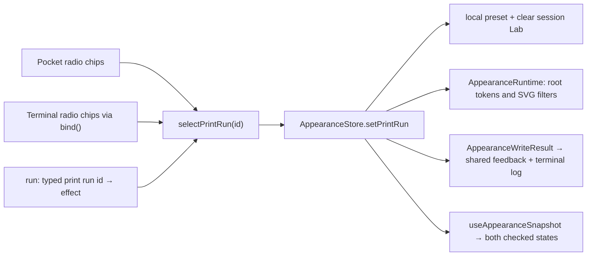

# Pocket print runs — pm-268/t-1600

Visitors can choose the site's print run with labeled native radio chips beside the Pocket console controls on Home, or in the Pocket terminal's settings. Both surfaces use the existing browser `AppearanceStore`; selecting from either surface or a command synchronizes both controls and the site's appearance immediately. No dependency or physical LCD menu item is added.

## Choices and commands

| Id | Visible label | Command |
| --- | --- | --- |
| `house` | House | `print run house` |
| `sumi` | Sumi black | `print run sumi` |
| `riso` | Riso pink + mint | `print run riso` |
| `indigo` | Indigo night | `print run indigo` |

`print run` reports the effective choice, for example `print run: Riso pink + mint (riso)`. When an explicitly applied Lab snapshot is effective, the report names that snapshot's run and appends `; Ink Lab override active`, even if the stored preset differs. The radios show this same effective run. Clicking the already checked preset also selects it, so a visitor can clear Lab overrides without changing the run or retry a failed save.

`lab`, `go lab` and `go /lab` navigate to `/lab` through `PLACES` and close the terminal. HELP and suggestions include the print-run choices and Lab navigation. This task implements the navigation effect; the public Lab page and public navigation entry are delivered by the separate Lab task. The seven-item physical console menu, LCD pitch and TitleMorph wiring remain unchanged.

Commands ignore case and repeated whitespace. Preset ids must be exact. `print`, `print riso`, `print run purple`, `print run ris`, and `print run riso extra` print usage without effects, DOM changes or storage writes. The usage line is:

```text
print run: house, sumi, riso or indigo; use print run to see the current choice
```

## Persistence and feedback

Each selection calls `setPrintRun` on the existing adapter: write the validated id to localStorage `otohime:print-run:v1`, clear sessionStorage `otohime:ink-lab:v1`, and publish the requested current-page snapshot. No other preferences are touched. Reload reads the same keys through the existing pre-paint/runtime adapters.

Successful selection reports the effective choice followed by:

```text
Saved for reload; Ink Lab override cleared.
```

If either storage-object access, write or removal throws, the current page still changes and reports:

```text
Storage is blocked; active on this page only. Reload may not retain this choice.
```

This conservative warning includes quota errors and partial writes. If local storage fails but Lab removal succeeds, reload can restore House or an earlier preset. If session removal fails, a stale persisted Lab can override the successfully written preset after reload. Neither outcome is described as saved. Retrying a chip or command attempts both operations again.

`selectPrintRun` in `components/print-run-switch.tsx` publishes the adapter's actual `AppearanceWriteResult` to a small shared, in-memory feedback subscription. Both controls show the latest selection result; command results also print in the terminal log. This subscription is necessary because a repeated choice can fail to persist without changing the appearance snapshot. External Lab/preset changes invalidate feedback for a different snapshot. Hydration uses House and no feedback on the server, then follows the browser store.

## Keyboard and focus

Each instance has a unique native radio name, a persistent Print run legend, visible chip labels, a checked state, visible focus and a polite status associated through `aria-describedby`. Outside the terminal, browser radio arrows, Space and Tab work normally; the handheld capture listener already exempts inputs.

The terminal loader captures and stops keydown at `window`, before React's target handlers. Its existing `bind()` path calls `printRunKey` for a radio in this switch: Left/Up select and focus the previous chip, Right/Down the next, wrapping at either end; Space selects the focused chip. It prevents the original default for handled selection keys and uses the native input's `click()` activation to run the same controlled selection path. Modified keys are left alone. Prompt arrows still operate the suggestion palette; typing and form submission retain their existing paths.

Tab and Shift+Tab use native order within the modal, with wrap at the first/last enabled control. Unchecked radios are excluded from the boundary list so each group has one logical stop. Chrome can also focus an overflowing log/list for keyboard scrolling; that native stop remains available. Escape closes from a radio, prompt or button and returns focus to the element that opened the terminal. Enter on the Esc button still activates it. Captured keys do not reach document or handheld listeners. The dialog's settings/prompt/header do not shrink when the log and suggestions grow; the existing scrollable log/list contain overflow.

## Architecture



The parser remains pure. Its extended `TerminalState.appearance` is read when a command executes; it never trusts stale UI state. Existing adventure fixtures only gain this required state field; their assertions and behavior are preserved. `lib/pages.ts`, appearance adapters and their persistence semantics are unchanged.

## Verification and evidence boundary

Run profile: plan-manager run `run-8934`, `codex-sol-6-1-high`, model `gpt-6.1-sol`, effort `high`, worker `avietidol-mac-mini`; Node 22.23.3, npm 10.9.9, locked Next.js 16.4.2/React 19.3.0/Playwright 1.64.0. The installed Next.js Server and Client Components guide was read. The requested process documents are absent here; their host mono-v2 copies were consulted. The task's existing Next.js stack, Otohime chips and stop-at-push delivery contract take precedence over generic host migration/deployment guidance.

- `node --experimental-strip-types --test lib/terminal.test.ts`: 22 passing parser/navigation/status cases, including malformed ids and applied Lab state.
- `npm test`: full project unit suite, including existing terminal, adventure, handheld/LCD and TitleMorph assertions.
- `npm run typecheck` and `npm run lint`: required static checks; lint has 10 pre-existing warnings, no errors.
- `node --experimental-strip-types scripts/e2e.mjs --test e2e/print-run-console.test.ts`: real production build, embedded PostgreSQL migrations, `next start`, installed Chrome, and the real browser appearance adapter. Eight cases cover pointer/keyboard changes, synchronization, invalid commands, actual storage read-back/reload, throwing local/session getters, quota/remove failures, stale Lab restoration, same-run persistence feedback, Tab/Shift+Tab, Escape/focus return and Lab routing.
- The existing `e2e/pocket-terminal.test.ts` is rerun with the feature suite to preserve lazy opening, suggestions, navigation, theme/sound/season and both adventure journeys.
- Browser layouts: 1366×768, 1920×1080, 390×844 and 640×450 CSS pixels (200% equivalent reflow of 1280×900, not a claim of browser-zoom automation). Pocket and terminal screenshots were opened and inspected. Optional screenshot output uses `PRINT_RUN_CONSOLE_EVIDENCE`; local screenshots/logs and `commits.txt` belong to ignored `.agent-artifacts/pm-268-t-1600/`, not the source commit.

Only failure injection uses fakes: throwing real browser storage accessors/methods, and injected pure-store storage ports in unit tests. There is no fake appearance runtime or simulated command runner. Negative controls include a document key received while the terminal is shut versus stopped while open, invalid command ids that preserve storage and checked state, and actual reload restoration after failed writes.

Red evidence: the initial unit test failed on the missing status export; the initial production-browser test failed on the absent visible Print run group. A later same-run write-failure regression failed by observing the earlier `Saved for reload` message; the shared result subscription fixes it. An intermediate focus assertion incorrectly excluded Chrome's native scrollable-log stop, and `networkidle` reloads timed out; browser inspection justified preserving native focus behavior and using `load` plus explicit hydration/selection readiness. One diagnostic run reused a harness server that was shutting down; its connection failures are inconclusive, and the final verification uses its own harness/server.

This is local execution evidence for t-1600, not a deployed-product or whole-plan acceptance claim. No queued runtime or capacity deferral applies. CI, deployed acceptance and independent QA belong to plan-manager after the delivery push; this engineering run does not watch CI or probe deployment. No remote failed/completed job history is claimed as inspected; the bounded local attempts and their failures above are explicit.
