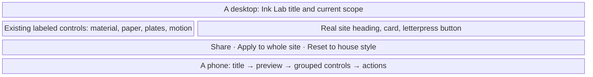
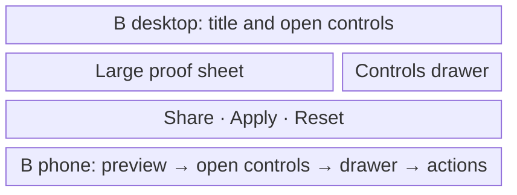
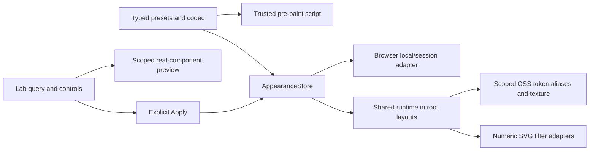
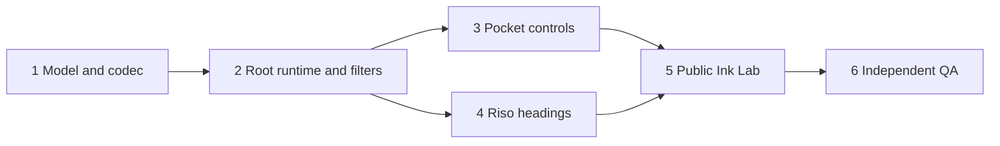

# Riso Ink Studio

Plan: **pm-268** · product-owner run: **run-8861** · repository: **otohime**  
Prepared: 2026-10-26 · status: execution contracts, pending proposal admission  
Run profile observed from plan_manager_get_run: **codex-sol-6-1-high**, model **gpt-6.1-sol**, effort **high**, fleet worker **avietidol-z490**. This is a planning delivery; the product is not implemented by this commit.

## Outcome and visitor contract

A visitor can choose a print run from the Pocket console, watch the main site's headings print in, and tune the same site's materials at public **/lab**. A copied URL reproduces the preview. Apply affects the visitor's tab session across the site; Reset to house style is a complete, reversible recovery.

| Starting state | Action | Visible and persisted result |
| --- | --- | --- |
| Existing site, no appearance keys | Open public pages | Existing seasonal/theme paper and original filters; main-site heading plates print in without hiding semantic text |
| Pocket console visible | Choose Riso pink + mint | Spot plates, paper and decorative filters change together; reload retains the choice |
| Lab preview only | Edit any control | Real heading/card/button preview changes; surrounding site remains unchanged |
| Shared Lab URL in a clean context | Open /lab?... | Same sanitized preview and control values; no implicit Apply |
| Tuned preview | Apply to whole site, leave, reload | Applied snapshot is restored in this tab, including across root-layout navigation |
| Applied preview or preset | Reset to house style | Both appearance keys cleared; root tokens/filters restored; season/theme choices retained |
| Browser denies storage or clipboard | Apply/share | Current page still works; status accurately describes scope and offers copyable URL fallback |

## Evidence and reuse

The original research report **rep-5163** is preserved verbatim in [research.md](research.md). It did not fetch the two inspiration links. This run checked the [Heller repository](https://github.com/manu-brighter/manus-portfolio), whose README describes per-character plates, a single accessible text copy, persisted presets and a live playground. This is technique inspiration, not a license to copy implementation; its reuse license was not verified. The [uixNinja post](https://www.linkedin.com/posts/uixninja_fluid-ink-engine-a-custom-webgl2-experiment-activity-7516205344298160128-xJ7s) could not be fetched; no implementation claim depends on it.

Repository inspection confirms:
- lib/seasons.ts and app/(site)/layout.tsx implement validated pre-paint visitor preferences.
- lib/terminal.ts owns pure command interpretation; components/pocket-terminal.tsx owns effects and capture-key binding.
- lib/ink-modes.ts owns MATERIALS/HANDS and inkFilter; existing consumers include figures, season particles, Ink Press and ledger stamps. Radio hiss, 404 crumple and Ryugu caustics use inline SVG filters.
- lib/letterpress.test.ts pins contrast, worst-case grain alpha <=0.06 and house materials.
- Root layouts are independent documents. app/(design-system)/_lib/isolation.test.ts explicitly rejects shared imports; root-only appearance exceptions require positive and negative controls.
- lib/pages.ts separately owns PUBLIC_PAGES and CONSOLE_MENU; adding /lab to both would overflow the physical seven-item LCD.
- npm test discovers lib/**/*.test.ts; .github/workflows/ci.yml discovers e2e/**/*.test.ts through the repo's node:test/Playwright runner.
- The installed Next.js 16.4.2 guides at node_modules/next/dist/docs/01-app/01-getting-started/{03-layouts-and-pages,05-server-and-client-components}.md were consulted. Implementers must also read the installed guides relevant to their actual changes.

The two process documents requested by the job are absent from this checkout. Their host copies at /data/build-worker/repo/mono-v2/{AGENTS.md,docs/claude/software-development.md,projects/20260921222547_plan_manager_chief_of_staff_extraction.md} were consulted. Standing rules remain in their canonical documents; this plan adds no replacement policy. This is the existing Otohime Next.js repository with GitHub Actions/Vercel delivery, not a mono-v2 frontend migration.

## Decisions and alternatives

All product choices below are resolved. Human input is advisory per this job; there is no layout-selection gate, external account chore, scheduled behavior, paid service, runtime queue, or capacity dependency.

### Implementation choice

Capability: a bounded visitor appearance snapshot, previewed and applied through one repository-owned interface. Keep React/CSS/SVG and the existing materials; introduce no dependencies.

Checked 2026-10-26 using upstream repositories. Maintenance release dates, issue trends and advisory histories were not independently verified; no claim of a security audit or benchmark is made.

| | Option 0: existing React/CSS/SVG | A: GSAP | B: Motion | C: Tweakpane |
| --- | --- | --- | --- | --- |
| License | Existing repository/dependency terms | Custom GreenSock standard license; not asserted OSI open source | MIT | MIT |
| Primary source | package.json, lib/ink-modes.ts | [GSAP](https://github.com/greensock/GSAP) | [Motion](https://github.com/motiondivision/motion) | [Tweakpane](https://github.com/cocopon/tweakpane) |
| Adoption signal | Already used here | Public source; count not verified | Upstream showed about 34.5k stars | Upstream showed about 4.6k stars |
| Fit and footprint | Typed model + small client adapter; no added package, pod or store | Timeline orchestration adds an animation runtime | React motion API adds a second motion system | Parameter pane adds a second control/visual system |
| Advantage here | Reuses existing filters, transitions and controls; lowest exit cost | Strong staged choreography | Declarative transitions and gestures | Ready-made numeric/color controls |
| Disadvantage here | We own narrow validation and coordination | More than bounded transform/opacity needs; custom terms | Existing ViewTransition integration still needs work | Public-page keyboard/mobile styling still needs custom integration |
| Decision | **Chosen** | Rejected | Rejected | Rejected |

Upstream descriptions are capability claims, not measured results. Each rejected candidate adds installation/upgrade/supply-chain surface without filling a required gap. No upstream source code is copied. The boundary is PrintRun/InkLabSettings/AppearanceStore, with pure logic and a single browser adapter.

### Layout choice

Visitor task: tune a material while seeing it on actual site components, then share, apply, or reset it. Existing Otohime Design system provides local live-control conventions; Heller's playground and Tweakpane illustrate parameter tuning. These observations are not usability tests.

Option A, **proof sheet**, is chosen: preview adjacent to grouped controls on desktop, preview first on mobile; actions always reachable in normal flow.



Option B, **preview with a controls drawer**, maximizes the canvas but adds an opening step and hides current settings.



| Layout | Change a value and apply | Primary action | Phone and keyboard | Cost |
| --- | --- | --- | --- | --- |
| A | Direct control, Apply | Visible below work area | One document scroll; no focus trap | Low |
| B | Open drawer, control, Apply | Visible but controls hidden | Drawer focus/return and overlay work | Higher |

Verification hypothesis: A lets a visitor adjust, share, apply, navigate away and restore the house style with no hidden essential control. QA walks this exact journey at 1366x768, 1920x1080, 390x844 and 200% zoom, records actions and input latency, and inspects screenshots. No traffic experiment or user-study claim is needed. Block on inaccessible controls, false persistence, scope leakage, unreadable text or lost reset.

## Exact appearance contract

### State, precedence and lifetime

- PrintRun ids: **house**, **sumi**, **riso**, **indigo**. Visible labels: House, Sumi black, Riso pink + mint, Indigo night.
- localStorage key: **otohime:print-run:v1**; stored value is a validated id. Missing/invalid means house.
- sessionStorage key: **otohime:ink-lab:v1**; stores a versioned, sanitized complete snapshot. Missing/invalid means no override.
- Effective appearance: existing house + stored theme/season, then selected print preset, then explicitly applied Lab snapshot. Preview query state is independent.
- Preset selection clears the applied Lab snapshot, avoiding an invisible higher-priority setting. Cross-tab persistent-preset changes also clear a stale applied snapshot in the receiving tab.
- Reset clears only these two appearance keys, corresponding attributes and inline properties, and restores original SVG values. It does not clear theme, season, stamps, audio, focus-timer state or saved drawings.
- Session means the current browsing context's sessionStorage lifetime. Reload and full document hops retain it; independent fresh contexts do not. Browser opener-clone behavior is not promised away.
- All storage access, including obtaining the object, is guarded. Failed writes retain the current-page in-memory result but must not claim reload/session persistence. Failed reset must report any inability to remove a persisted value.
- Expose getSnapshot, subscribe, setPrintRun, applyLab and resetHouse through AppearanceStore. The pure contract and fake storage are tested separately from the real browser implementation. Derive pre-paint validation from trusted schema data so it cannot drift.
- DOM markers: data-print-run and data-ink-lab on html. Only validated ids/numeric/hex fields may reach token or SVG adapters. No credentials or user content enter web storage.

### Presets and contrast

Colors below are design inputs; contrast tests are binding. Body, muted text, controls and focus remain readable even when decorative plate colors are edited. Add coherent --field, --line, --hairline and semantic aliases for every affected root; derive them from these surfaces while proving required contrast.

| Preset | Paper / second paper | Ink / muted | Plates | Filter and overlay |
| --- | --- | --- | --- | --- |
| House | Existing project/season/theme | Existing | Anchor current ink, pink #f3a6bb, mint #93d3b0 | Original filter values; original grain |
| Sumi light | #f2efe7 / #ebe7dc | #231e16 / #6b6456 | Anchor current ink, gray #65605a; 2 plates | Warp frequency x0.85, displacement x0.8; grain peak 0.03, no halftone |
| Sumi dark | #1c1915 / #27231d | #ebe6da / #a39b8b | Anchor current ink, gray #aaa296; 2 plates | Same multipliers |
| Riso light | #fff4e8 / #f2e5d8 | #292522 / #696154 | Anchor current ink, pink #ff48b0, mint #00a95c; 3 plates | Warp x1.1, displacement x1.15; grain peak 0.04, optional halftone |
| Riso dark | #201e1c / #2a2724 | #f3ebdf / #b1a598 | Same ghosts, readable current-ink anchor | Same multipliers |
| Indigo night | #10152d / #19203b | #f2edff / #b4b8d3 | Anchor #f2edff, periwinkle #9baaff, pink #f39dcc; 3 plates | Warp x0.9, displacement x0.9; grain peak 0.03, optional halftone |

Indigo sets effective dark color-scheme while selected without overwriting the saved theme; clearing it restores the visitor's theme. Sumi/Riso respect the saved/system theme. Season state remains intact underneath active presets. Grain and halftone are static, optional and pointer transparent; their **combined** worst-case alpha, including the house texture, stays <=0.06. Disable decorative overlays in forced colors. Use a readable anchor layer and disable multiply blending when it would darken light ink on dark paper. Text contrast is >=4.5:1; large text and meaningful non-text controls >=3:1.

### Lab schema and URL

Use v=1 and these allowed keys. Maximum accepted query length is **2048 characters**. Unsupported version or overlong query gives house preview with a polite explanation. Missing keys use the selected run's resolved defaults; invalid individual fields fall back to that field's default. First duplicate occurrence wins. Ignore unknown keys. Reject non-finite numeric values, clamp finite values, quantize to the specified step, and canonicalize. No eval, dynamic code, arbitrary CSS, raw SVG or user-chosen filter URL.

| Query | Field | Inclusive range / validation | House default |
| --- | --- | --- | --- |
| r | print run | house, sumi, riso, indigo | house |
| t | turbulence frequency | 0.005–0.120, step 0.001 | 0.035 |
| d | displacement amplitude | 0–12, step 0.1 | 3.5, matching inkFilter |
| w | wobble/seed changes per second | 0–6, step 0.1 | 0; existing explicit figure interactions unchanged |
| g | total paper grain peak alpha | 0–0.06, step 0.005 | existing house peak 0.06 |
| p | decorative plate colors | exactly 3 comma-separated six-digit hex colors; encode without # | 231e16,f3a6bb,93d3b0; actual heading anchor remains readable ink |
| n | visual plate count | 2 or 3 | 3 |
| m | entry/appearance transition duration, ms | 0–1200, step 10 | 420 |
| h | hand/stroke style | ink, pencil, crayon, watercolour | ink |
| o | optional halftone | 0 or 1 | 0 |

Hand is the existing HANDS/MATERIALS style, including its stroke weight/tooth/wash. Numeric Lab values override the resolved material where explicitly controlled. Presets adjust existing filter frequencies/amplitudes as multipliers; preserve each scene's geometry, seeds and interactive effects. An applied snapshot sets resolved numeric values, not raw query strings. The readable anchor's foreground is body ink; freely editable plate colors affect decorative ghosts/swatch previews and never the body color.

Example: /lab?v=1&r=riso&t=0.040&d=4&w=0&g=0.03&p=292522,ff48b0,00a95c&n=3&m=420&h=ink&o=1. The encoder may omit default fields but must produce one stable representation; decode(encode(snapshot)) must equal the normalized snapshot. Share is preview-only. Updates replace URL state without one history entry per slider tick; popstate/reload restores the preview.

### Render boundaries



Whole-site appearance includes every public root layout: enumerate from app/ during task 2 and test one reachable public route per root, including /shore, /ryugu and /design-system. The house style of each isolated project remains its own. Allow only the specific appearance boundary in root layout isolation guards; engines and unrelated imports remain isolated. Adapt visual paper/ink/texture and decorative SVG appearance, not audio DSP, game mechanics, saved artwork or media pixels.

Riso heading rollout is main-site public h1/h2 content, the common FigTitle/StampHeading surfaces and the Lab preview. Standalone project typography remains intact while its appearance tokens follow the selected run. Each character has 2–3 plates; ghost offsets settle at deterministic ±1–2px, the base remains readable, one semantic copy is exposed, and existing TitleMorph names stay on the original heading wrapper. No-JavaScript and reduced-motion output is settled. No background heading animation loop.

Live preview updates are coalesced through rAF; one appearance seed clock at most, no clock at speed zero or under reduced motion, paused for hidden/offscreen work and disposed on unmount. Measure update count and input-to-paint latency on the test machine; target <=100ms, disclose hardware and browser. No fabricated universal performance guarantee.

## Task DAG and admission

The payload below is the proposal source of truth. Sequences are proposal-local references, not board task ids.



Settings observed: max_live_runs_per_plan=1, max_plan_elapsed=6h, qa_mode=auto. With fallback durations, the weighted sum is 6h and the longest path 5h: max(6h,5h)=6h, equal to the ceiling. Actual latest-200 role medians, if enough samples exist, are authoritative in propose_tasks. Task 1 is pure plumbing with qa=skip; visible tasks require QA. If actual admission refuses plan_too_large, propose only the Print Shop foundation/controls/headings/QA part here, and file the Lab part using submit_idea(repo=otohime, after_plan_id=pm-268), citing this file. Do not pre-plan a later part against unlanded code. No part is dropped.

## Execution and verification rules for these contracts

Before implementation: npm ci with Node 22 and the committed lock; provision matching Chromium at job time if absent. Read installed Next.js guides. Feature-specific test files in each verification item must exist and assert the described behavior; a missing file, skipped suite, errored browser or all-green unrelated suite does not prove delivery. Write failing behavior tests before implementation; retain existing regression suites.

The local e2e runner provisions its own throwaway Postgres and production build when BASE_URL is unset, then cleans them up. Verification commands must stay inside the checkout and must not mutate shared infrastructure. Feature E2E files are automatically covered by the existing CI glob. Software engineers finish at the tested commit/push; deployment proof belongs to the green gate, QA and acceptance. Commit subjects use pm-268/<assigned-task-id>: followed by an imperative subject. Retry non-fast-forward pushes by rebasing and rerunning tests; never force-push.

QA/acceptance derive independent evidence from the delivered diff and public UI. Verify the deployed build identity via /api/health and the exact GitHub Actions checks/production jobs; a local test or a board decision is not rollout evidence. For browser evidence preserve and inspect screenshots/traces under .agent-artifacts/<task>/, including the failed-storage and long-content states. A health 200 alone never proves interaction.

This browser feature has no model executable, remote job, queue, scheduled event, recipient, quota watch or operator-only prerequisite. Execution evidence therefore means the real Node/Next build, installed dependency lock and browser behavior; fake storage tests are reported separately. Record defect causes and actual model/profile/effort for each run, not a mutable default. Inspect available failed/completed CI attempts bounded by relevant code/lock/config fingerprints and say whether history is complete. No wait-based task steps or natural-run acceptance.

## Acceptance evidence required

| Claim | Deterministic gate | Independent observation / negative control |
| --- | --- | --- |
| Schema and safe sharing | codec/contrast tests | QA changes query values, includes hostile/oversized input |
| Persistent print run | browser read-back and reload | Fresh real page, denied storage, effective computed colors |
| No initial appearance flash | delayed-hydration browser test | First styled frame across root layouts, exact build identity |
| True SVG carry-through | inspect actual SVG attributes | Changed and reset filter outputs on real components |
| Accessible plate headings | Unicode/offset tests and E2E | Accessibility tree, reduced-motion/no-JS, dark-paper readability |
| No transition/stamp regressions | console and heading E2E | Console-to-Work morph plus Play Stamp it |
| Preview isolation and session apply | real browser journey | Unapplied separate card, fresh context, cross-root reload |
| Recovery | blocked-storage/clipboard tests | Truthful status, selectable URL, clear both appearance keys |
| Responsiveness/performance | coalesced preview update assertions | Screenshots, keyboard, zoom, measured latency and cleanup |

Acceptance produces a walkthrough table (starting state · action · observable result · evidence) for the delivery SHA after all task gates are green. Code defects fail; unavailable evidence is inconclusive. No dated or watch-only check is required by this feature.

## Task contracts

```json
[
  {
    "sequence": 1,
    "title": "Define bounded print and Lab appearance contracts",
    "role": "software_engineer",
    "qa": "skip",
    "depends_on": [],
    "problem": "Seasonal appearance and ink materials exist, but no validated print-run model or shareable Lab snapshot defines consistent values, precedence, storage, or reset semantics.",
    "acceptance_criteria": "Pure typed interfaces resolve House, Sumi black, Riso pink + mint, and Indigo night plus a bounded Lab snapshot. Versioned URLs round-trip canonically; corrupt, oversized and hostile input safely falls back. Preset body/muted ink meets 4.5:1 on all supported paper surfaces at maximum grain.",
    "action_items": [
      "Declare the repository-owned PrintRun, InkLabSettings, AppearanceSnapshot and AppearanceStore interfaces before implementation. Put immutable presets in lib/print-runs.ts and the codec/ranges in lib/ink-lab.ts; use the exact schema, keys, defaults and precedence below.",
      "Write failing node:test cases in lib/print-runs.test.ts and lib/ink-lab.test.ts first: all preset ids, theme/season coexistence, default equivalence with MATERIALS.ink, canonical URL round-trip, every clamp boundary, blocked storage through a fake store, duplicate and unknown parameters, invalid hex/hand/version, NaN/Infinity, overlong input and script-like strings.",
      "Define getSnapshot/subscribe/setPrintRun/applyLab/resetHouse through the AppearanceStore port, with fake-store contract tests. Preset selection clears Lab; resetting clears both appearance keys while preserving season/theme and other local data. Do not import browser globals in these pure files.",
      "Calculate preset contrast including muted text, form fields, both papers and worst-case total grain; keep body ink separate from editable decorative plates. Keep existing inkFilter default output identical. Add a plan-local developer contract note under the plan folder."
    ],
    "interfaces": [
      "lib/print-runs.ts",
      "lib/print-runs.test.ts",
      "lib/ink-lab.ts",
      "lib/ink-lab.test.ts",
      "projects/otohime-dev-riso-print-shop-ink-lab-1-riso-print-shop-headin/"
    ],
    "non_goals": [
      "browser adapter or UI",
      "new dependencies or backend storage",
      "changing house materials or persisted user content"
    ],
    "verification": [
      {
        "name": "feature contract tests",
        "cwd": ".",
        "cmd": "node --experimental-strip-types --test lib/print-runs.test.ts lib/ink-lab.test.ts",
        "expect": "exit0",
        "timeout_s": 300
      },
      {
        "name": "project unit suite",
        "cwd": ".",
        "cmd": "npm test",
        "expect": "exit0",
        "timeout_s": 300
      },
      {
        "name": "typecheck",
        "cwd": ".",
        "cmd": "npm run typecheck",
        "expect": "exit0",
        "timeout_s": 300
      },
      {
        "name": "lint",
        "cwd": ".",
        "cmd": "npm run lint",
        "expect": "exit0",
        "timeout_s": 300
      }
    ]
  },
  {
    "sequence": 2,
    "title": "Carry appearance through every public root layout",
    "role": "software_engineer",
    "qa": "required",
    "depends_on": [
      "1"
    ],
    "problem": "The site has many independent root layouts and real SVG filters. A CSS-only theme in app/(site) would disappear across full navigations and would never change numeric SVG filter attributes.",
    "acceptance_criteria": "A validated stored print run colors the first styled frame on the main site and every public root layout. Applied Lab settings survive same-tab reload and cross-root navigation, alter actual decorative SVG filter attributes and paper, and reset completely. Unset appearance preserves each project's house look; reduced motion and forced colors remain usable without hydration errors.",
    "action_items": [
      "Read installed Next.js layout, CSS and server/client guides. Implement the AppearanceStore browser adapter in lib/appearance-client.ts, a shared pre-paint script generated from trusted schema/presets, components/appearance-runtime.tsx and components/appearance.css. Do not serialize untrusted strings directly into CSS or scripts.",
      "Inventory app/*/layout.tsx root layouts and wire the same small appearance boundary into each. Map active preset tokens to each project's paper/ink aliases without importing app/(site)/globals.css or Tailwind into isolated projects. House/unset must add no project token overrides. Apply color/texture tokens before paint; hydrate from a consistent server snapshot and reconcile storage/events safely.",
      "Implement numeric SVG adapters for components/figures.tsx, season-layer.tsx, ink-press.tsx, ink-radio.tsx, the ledger stamp-calendar, app/(site)/not-found.tsx and app/(ryugu)/_components/sea.tsx. Preserve filter ids, filter region bounds, source seeds and interaction-specific amplitudes; use numeric props or tagged filter updates after hydration, never CSS var() as an SVG numeric attribute. Isolated project engines stay pure.",
      "Adjust isolation tests only with an exact allowlist for the shared appearance boot/runtime/CSS boundary in root layouts, with positive and negative controls. Continue rejecting imports of site globals, unrelated components and shared state from project _lib engines. Do not delete existing tests.",
      "Add optional static grain/halftone overlays with pointer-events:none, combined alpha <=0.06, no duplicate fixed overlays, and forced-colors off. Honor reduced motion for heading movement/seed clocks, cancel rAF/listeners/observers on teardown and keep at most one appearance clock, only while visible and needed.",
      "Write lib/appearance-client.test.ts and e2e/print-runs.test.ts. Exercise storage denial/corruption, first-paint computed colors with hydration delayed, all preset/theme/season combinations, same-tab/cross-tab updates, session reload, reset, and full document hops to every root. Assert actual SVG values change and restore, no errors, no input interception, and unchanged default project isolation. Keep technical evidence in .agent-artifacts/; update the plan's runtime architecture note."
    ],
    "interfaces": [
      "lib/appearance-client.ts",
      "lib/appearance-client.test.ts",
      "lib/print-runs.ts",
      "lib/ink-lab.ts",
      "components/appearance-runtime.tsx",
      "components/appearance.css",
      "components/figures.tsx",
      "components/season-layer.tsx",
      "components/ink-press.tsx",
      "components/ink-radio.tsx",
      "app/",
      "e2e/print-runs.test.ts",
      "projects/otohime-dev-riso-print-shop-ink-lab-1-riso-print-shop-headin/"
    ],
    "non_goals": [
      "site-global CSS imports into isolated projects",
      "rewriting educational engines, audio processing, user drawings or exported artifacts",
      "deployment or shared-infrastructure changes in task action items"
    ],
    "verification": [
      {
        "name": "feature contract tests",
        "cwd": ".",
        "cmd": "node --experimental-strip-types --test lib/appearance-client.test.ts",
        "expect": "exit0",
        "timeout_s": 300
      },
      {
        "name": "project unit suite",
        "cwd": ".",
        "cmd": "npm test",
        "expect": "exit0",
        "timeout_s": 300
      },
      {
        "name": "typecheck",
        "cwd": ".",
        "cmd": "npm run typecheck",
        "expect": "exit0",
        "timeout_s": 300
      },
      {
        "name": "lint",
        "cwd": ".",
        "cmd": "npm run lint",
        "expect": "exit0",
        "timeout_s": 300
      },
      {
        "name": "real-browser feature contract",
        "cwd": ".",
        "cmd": "node --experimental-strip-types scripts/e2e.mjs --test e2e/print-runs.test.ts",
        "expect": "exit0",
        "timeout_s": 900
      }
    ]
  },
  {
    "sequence": 3,
    "title": "Add the Pocket print-run switch and commands",
    "role": "software_engineer",
    "qa": "required",
    "depends_on": [
      "2"
    ],
    "problem": "Visitors have no discoverable or keyboard-accessible way to choose print runs, and the Pocket Terminal capture-phase key routing requires explicit control handling.",
    "acceptance_criteria": "The Pocket console offers a small labeled Print run control for House, Sumi black, Riso pink + mint and Indigo night. The terminal supports print run, print run <id>, and lab; controls and commands agree immediately and persist on reload. Invalid commands have no effect, and native keyboard behavior, focus containment and focus return still work.",
    "action_items": [
      "Add components/print-run-switch.tsx using the AppearanceStore adapter. Mount a compact labeled switch beside the Pocket console controls in components/handheld.tsx and within the existing terminal settings. Reuse existing chips/keys; do not rely on a shortcut as the only visible entry.",
      "Extend lib/terminal.ts state, parser, effect, HELP and suggestions: print run reports the current choice; print run house|sumi|riso|indigo selects; lab and go lab navigate to /lab through PLACES without increasing the seven-item physical LCD menu.",
      "Route switch keyboard handling through the terminal bind() path where required; native radio/button behavior must work even under the loader's capture listener. Selecting a preset clears session Lab overrides and reports the effective choice; denied storage works in memory and indicates that reload will not retain it.",
      "Write failing lib/terminal.test.ts cases and e2e/print-run-console.test.ts for pointer and keyboard changes, command/control synchronization, invalid ids, reload, blocked local/session storage, Tab/Shift+Tab, Escape and focus return. Preserve existing terminal, adventure, handheld and TitleMorph tests.",
      "Document the print-run commands, labels, storage failure messages and capture-key behavior in projects/otohime-dev-riso-print-shop-ink-lab-1-riso-print-shop-headin/console-contract.md."
    ],
    "interfaces": [
      "components/print-run-switch.tsx",
      "components/handheld.tsx",
      "components/pocket-terminal.tsx",
      "components/pocket-terminal.css",
      "lib/terminal.ts",
      "lib/terminal.test.ts",
      "e2e/print-run-console.test.ts",
      "projects/otohime-dev-riso-print-shop-ink-lab-1-riso-print-shop-headin/console-contract.md"
    ],
    "non_goals": [
      "expanding or resizing the physical console LCD menu",
      "new console commands unrelated to appearance",
      "authentication"
    ],
    "verification": [
      {
        "name": "feature contract tests",
        "cwd": ".",
        "cmd": "node --experimental-strip-types --test lib/terminal.test.ts",
        "expect": "exit0",
        "timeout_s": 300
      },
      {
        "name": "project unit suite",
        "cwd": ".",
        "cmd": "npm test",
        "expect": "exit0",
        "timeout_s": 300
      },
      {
        "name": "typecheck",
        "cwd": ".",
        "cmd": "npm run typecheck",
        "expect": "exit0",
        "timeout_s": 300
      },
      {
        "name": "lint",
        "cwd": ".",
        "cmd": "npm run lint",
        "expect": "exit0",
        "timeout_s": 300
      },
      {
        "name": "real-browser feature contract",
        "cwd": ".",
        "cmd": "node --experimental-strip-types scripts/e2e.mjs --test e2e/print-run-console.test.ts",
        "expect": "exit0",
        "timeout_s": 900
      }
    ]
  },
  {
    "sequence": 4,
    "title": "Print accessible Riso heading plates",
    "role": "software_engineer",
    "qa": "required",
    "depends_on": [
      "2"
    ],
    "problem": "Main-site headings lack per-character overprint motion. Existing TitleMorph and StampHeading interactions make naive duplicated text or transition names inaccessible and fragile.",
    "acceptance_criteria": "Main-site public h1/h2 text and the shared heading preview print in with two or three spot-color plates per Unicode character, settling at deterministic 1–2px ghost offsets. Assistive technology receives one plain heading name; reduced motion/no-JavaScript show the settled text immediately. TitleMorph navigation and /play Stamp it retain their behavior.",
    "action_items": [
      "Declare RisoHeading and RisoText string-based interfaces, plus pure deterministic character/offset helpers in lib/riso-heading.ts. Write failing lib/riso-heading.test.ts cases for Unicode, whitespace, long/wrapped titles, deterministic SSR/client offsets and bounded plate counts. Preserve semantic h1/h2 ownership and avoid nested headings.",
      "Build components/riso-heading.tsx and components/riso-heading.css: one plain accessible text copy, aria-hidden per-character visual plates, only the anchor layer selectable, ghost layers user-select:none, accessible anchor ink preserved. Use preset plate tokens and two/three-plate setting; no view-transition-name on plate spans.",
      "Use transform/opacity only for entry, cap total stagger, and animate each mounted heading once as it enters view using one observer. Server/no-JavaScript output is settled and visible. Under reduced motion, forced colors and print media, show readable settled text without sliding, seed animation or blending artifacts.",
      "Integrate into FigTitle, StampHeading, the Home heading and main-site public h2 text. Keep decorative Fig. prefixes hidden, rich-text titles intact, and .stamp-text source text and stamp generation free from duplicated ghosts. Standalone exhibit typography is preserved; its paper/ink still follows task 2.",
      "Write e2e/riso-headings.test.ts for accessible names, selectable text, plate transforms, reduced motion, no JavaScript, mobile wrapping and heading navigation. Drive the console-to-/work TitleMorph and /play Stamp it negative controls; require no duplicate transition names or page errors. Include representative empty and long headings.",
      "Document the RisoHeading/RisoText usage, semantic-copy rules, reduced-motion behavior and TitleMorph/Stamp it integration in projects/otohime-dev-riso-print-shop-ink-lab-1-riso-print-shop-headin/heading-contract.md."
    ],
    "interfaces": [
      "lib/riso-heading.ts",
      "lib/riso-heading.test.ts",
      "components/riso-heading.tsx",
      "components/riso-heading.css",
      "components/figures.tsx",
      "components/stamp-heading.tsx",
      "components/stamp-island.tsx",
      "app/(site)/",
      "e2e/riso-headings.test.ts",
      "projects/otohime-dev-riso-print-shop-ink-lab-1-riso-print-shop-headin/heading-contract.md"
    ],
    "non_goals": [
      "rewriting exhibit headings and type systems",
      "GSAP/WebGL or continuous title animation",
      "changing console page-transition names"
    ],
    "verification": [
      {
        "name": "feature contract tests",
        "cwd": ".",
        "cmd": "node --experimental-strip-types --test lib/riso-heading.test.ts",
        "expect": "exit0",
        "timeout_s": 300
      },
      {
        "name": "project unit suite",
        "cwd": ".",
        "cmd": "npm test",
        "expect": "exit0",
        "timeout_s": 300
      },
      {
        "name": "typecheck",
        "cwd": ".",
        "cmd": "npm run typecheck",
        "expect": "exit0",
        "timeout_s": 300
      },
      {
        "name": "lint",
        "cwd": ".",
        "cmd": "npm run lint",
        "expect": "exit0",
        "timeout_s": 300
      },
      {
        "name": "real-browser feature contract",
        "cwd": ".",
        "cmd": "node --experimental-strip-types scripts/e2e.mjs --test e2e/riso-headings.test.ts",
        "expect": "exit0",
        "timeout_s": 900
      }
    ]
  },
  {
    "sequence": 5,
    "title": "Open the public Ink Lab proof sheet",
    "role": "software_engineer",
    "qa": "required",
    "depends_on": [
      "3",
      "4"
    ],
    "problem": "Visitors cannot explore the site's actual materials, share a reproducible style, or apply and undo a session-scoped experiment.",
    "acceptance_criteria": "Unauthenticated /lab is reachable from public navigation and the Pocket terminal. Labeled live controls update real heading/card/button previews, a sanitized share URL recreates the same preview, Apply to whole site persists only for the tab session across routes/reload, and Reset to house style clears appearance overrides. Storage/clipboard failure is truthful and recoverable; editing a shared URL never silently applies it.",
    "action_items": [
      "Read installed Next.js guides, including searchParams/useSearchParams and Suspense requirements. Add a server shell at app/(site)/(app)/lab/page.tsx with title/description and a client Ink Lab island, dedicated CSS and a loading/fallback state that keeps the page heading present.",
      "Build the chosen proof-sheet layout using existing Otohime card markup, letterpress button primitives and RisoHeading shared with the site; extract a small shared site-preview component only if necessary. Desktop has controls beside the preview, mobile puts the preview above grouped controls, and Apply/Share/Reset remain reachable. Add /lab to PUBLIC_PAGES and terminal navigation, but exclude it from CONSOLE_MENU and preserve existing LCD geometry assertions.",
      "Expose every schema control below with persistent labels, current values and keyboard input, including plate colors/count, grain/halftone, hand, timing and wobble. Preview is isolated with unique filter ids and scoped variables; editing it must not change root style, storage or unrelated cards.",
      "Decode the versioned query through task 1's codec. Update a canonical shareable URL via replaceState without flooding history; restore the preview on Back/Forward and reload. Share copies the current canonical absolute URL; if Clipboard API fails, expose a selected readonly URL field and a useful status without losing edits.",
      "Apply an immutable sanitized snapshot through the common store and report success only when it takes effect; storage denial must say it lasts only on this page. Reset clears both appearance keys/attributes/variables and restores the original season/theme house style, preview defaults and a clean /lab URL. A clean fresh browser context never inherits an applied session; do not use an opener-cloned tab as the independence test.",
      "Coalesce preview changes to one rAF update per frame, never rasterize the entire page on a slider input, pause clocks offscreen/hidden, use effective speed zero under reduced motion, and tear down work on navigation. Record measured input-to-preview latency and filter update count; target <=100ms on the documented test machine without claiming a universal SLA.",
      "Write e2e/ink-lab.test.ts for every control, preview isolation, share/open in clean context, canonical/hostile URLs, apply -> /work -> /shore -> reload -> /lab -> reset, Back/Forward, denied storage/clipboard, keyboard interaction at 390x844 and 200% zoom, and a scoped preview negative control. Keep .github/workflows/ci.yml's e2e glob coverage; update developer documentation under the plan folder."
    ],
    "interfaces": [
      "app/(site)/(app)/lab/",
      "components/ink-lab.tsx",
      "components/ink-lab.css",
      "components/ink-lab-preview.tsx",
      "lib/pages.ts",
      "lib/pages.test.ts",
      "lib/terminal.ts",
      "lib/terminal.test.ts",
      "e2e/ink-lab.test.ts",
      "projects/otohime-dev-riso-print-shop-ink-lab-1-riso-print-shop-headin/"
    ],
    "non_goals": [
      "accounts, databases, server preset API or short links",
      "persisting Lab settings across sessions",
      "site-wide changes before Apply",
      "changing the physical LCD menu"
    ],
    "verification": [
      {
        "name": "project unit suite",
        "cwd": ".",
        "cmd": "npm test",
        "expect": "exit0",
        "timeout_s": 300
      },
      {
        "name": "typecheck",
        "cwd": ".",
        "cmd": "npm run typecheck",
        "expect": "exit0",
        "timeout_s": 300
      },
      {
        "name": "lint",
        "cwd": ".",
        "cmd": "npm run lint",
        "expect": "exit0",
        "timeout_s": 300
      },
      {
        "name": "feature contract tests",
        "cwd": ".",
        "cmd": "node --experimental-strip-types --test lib/print-runs.test.ts lib/ink-lab.test.ts",
        "expect": "exit0",
        "timeout_s": 300
      },
      {
        "name": "real-browser feature contract",
        "cwd": ".",
        "cmd": "node --experimental-strip-types scripts/e2e.mjs --test e2e/ink-lab.test.ts",
        "expect": "exit0",
        "timeout_s": 900
      }
    ]
  },
  {
    "sequence": 6,
    "title": "Audit the complete print and Lab visitor journey",
    "role": "quality_engineer",
    "depends_on": [
      "5"
    ],
    "problem": "Shared theme, SVG, accessibility, persistence and transition changes need independent browser evidence beyond an implementer's green test report.",
    "acceptance_criteria": "Independent QA documents the complete visitor journey and failure controls on the delivered SHA, with observed contrast, first paint, reduced motion, accessible headings, all root-layout carry-through, URL reproducibility and truthful storage recovery. Code defects fail QA; unobserved deployment or browser evidence is explicitly inconclusive.",
    "action_items": [
      "Claim the QA task, inspect the delivered diff and exact green-gate/CI build identity, and independently derive tests from this plan. Read health build SHA rather than treating a decision row as deployment evidence. Use the repository GitHub Actions/Vercel deployment, not mono-v2 GitLab jobs.",
      "Walk a fresh visitor choosing each print run, reloading, navigating across all public root layouts, opening /lab publicly, changing every control, sharing to a clean browser context, applying, leaving/reloading and resetting. Verify desktop 1366x768/1920x1080, mobile 390x844, 200% zoom, keyboard-only, reduced motion, forced colors and no-JavaScript headings.",
      "Read actual computed paper/ink/muted/focus values and actual SVG attributes; measure contrast with the maximum combined overlay and inspect screenshots. Inspect the accessibility tree for one heading name, and exercise TitleMorph and Stamp it. Record root route inventory coverage and any missing evidence explicitly.",
      "Run independent negative controls: open a hostile/oversized query, deny both storages and clipboard, edit preview without Apply while inspecting a separate real-site card, and open a fresh browser context after Apply. These must not inject style/script, report false persistence, leak scope or inherit the session.",
      "Submit qa_report and a summary with a walkthrough table, exact SHA/build/browser/Node/lockfile identities, measured preview timing, evidence paths and defects. Separate real browser persistence from fake-store tests and any unobserved deployment. Do not change application code, wait for natural events or add a human approval gate."
    ],
    "interfaces": [
      "projects/otohime-dev-riso-print-shop-ink-lab-1-riso-print-shop-headin/qa.md"
    ],
    "non_goals": [
      "application fixes by QA",
      "a usability study or fabricated performance evidence",
      "proving delivery through health alone"
    ]
  }
]
```

## Planning validation

On this planning checkout: Node v22.23.3, npm ci from package-lock.json; **npm test: 2133 passed, 0 failed, 0 skipped**. **npm run lint: exit 0, 10 existing warnings**. Application code is unchanged; feature/browser/build/deployment acceptance above remains future engineering work. Proposal and report reference the pushed plan commit; this file cannot contain its own eventual commit hash.

The prior research body is preserved unchanged, including its original source-access limitation. This plan's source checks and explicit contracts supersede research suggestions where they differ.
