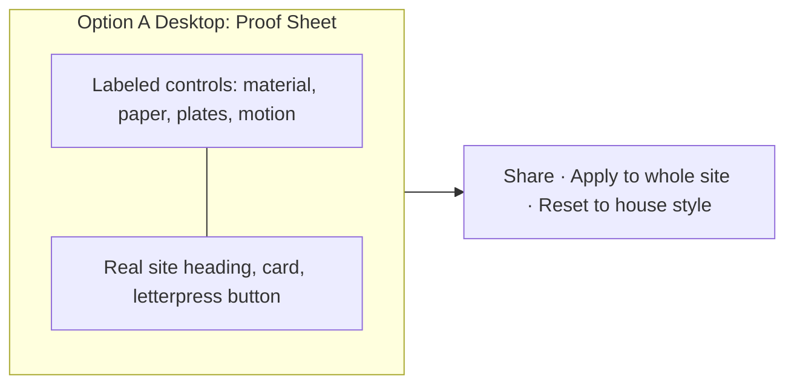
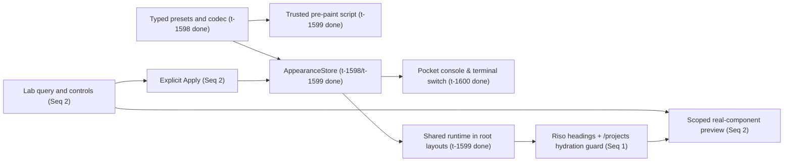
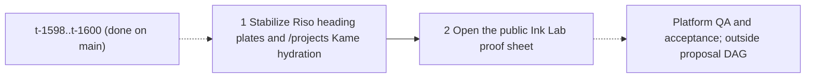

# Riso Ink Studio

Plan: **pm-268** · revision: **2** · product-owner run: **run-9245** (replanning revision 1 from **run-8861**) · repository: **otohime**  
Prepared: 2026-10-27 · status: execution contracts for remaining scope, pending proposal admission  
Run profile observed from `plan_manager_get_run`: **agy-argon-high**, model **gemini-4-argon**, effort **high**, fleet worker **avietidol-mac-mini**, account **billie-agy**, delivery workflow **legacy_v1**. This is a planning delivery; application code is not modified by this commit.

## Outcome and visitor contract

A visitor can choose a print run from the Pocket console, watch the main site's headings print in, and tune the same site's materials at public **/lab**. A copied URL reproduces the preview. Apply affects the visitor's tab session across the site; Reset to house style is a complete, reversible recovery.

| Starting state | Action | Visible and persisted result |
| --- | --- | --- |
| Existing site, no appearance keys | Open public pages | Existing seasonal/theme paper and original filters; main-site heading plates print in without hiding semantic text |
| Pocket console visible | Choose Riso pink + mint | Spot plates, paper and decorative filters change together; reload retains the choice |
| Lab preview only | Edit any control | Real heading/card/button preview changes; surrounding site remains unchanged |
| Shared Lab URL in a clean context | Open /lab?... | Same sanitized preview and control values; no implicit Apply |
| Tuned preview | Apply to whole site, leave, reload | Applied snapshot is restored in this tab, including across root-layout navigation |
| Applied preview or preset | Reset to house style | Both appearance keys cleared; root tokens/filters restored; season/theme choices retained |
| Browser denies storage or clipboard | Apply/share | Current page still works; status accurately describes scope and offers copyable URL fallback |

## Revision 2 replan: completed foundation and what changes after `t-1601` QA failures

### Completed and preserved tasks on `main`

The first three revision-1 tasks are complete, merged on `main`, and preserved as the foundation for the remaining work:

1. **`t-1598` — Define bounded print and Lab appearance contracts (`done`)**: Shipped `lib/print-runs.ts`, `lib/print-runs.test.ts`, `lib/ink-lab.ts`, `lib/ink-lab.test.ts`, and `projects/otohime-dev-riso-print-shop-ink-lab-1-riso-print-shop-headin/appearance-contract.md`.
2. **`t-1599` — Carry appearance through every public root layout (`done`, QA passed in `run-8985`)**: Shipped `lib/appearance-client.ts`, `lib/appearance-client.test.ts`, `components/appearance-boot.tsx`, `components/appearance-runtime.tsx`, `components/appearance.css`, all 14 root layouts plus `app/global-not-found.tsx`, numeric SVG filter adapters, `e2e/print-runs.test.ts`, and `projects/otohime-dev-riso-print-shop-ink-lab-1-riso-print-shop-headin/runtime-architecture.md`.
3. **`t-1600` — Add the Pocket print-run switch and commands (`done`, QA passed in `run-9201`)**: Shipped `components/print-run-switch.tsx`, `components/handheld.tsx`, `components/pocket-terminal.tsx`, `components/pocket-terminal.css`, `lib/terminal.ts`, `lib/terminal.test.ts`, `e2e/print-run-console.test.ts`, `projects/otohime-dev-riso-print-shop-ink-lab-1-riso-print-shop-headin/console-contract.md`, `scripts/vercel-deploy.sh`, and `scripts/vercel-deploy.test.sh`.

Per the operator replan instruction, those completed tasks are kept as-is and **only the remaining work is proposed below**, numbered from `1` (`sequence: 1` and `sequence: 2`) and depending only on each other.

### Why `t-1601` failed across three fix cycles and what Sequence 1 does differently

In revision 1, task `t-1601` ("Print accessible Riso heading plates") failed QA after three fix cycles (`run-8983` -> `run-9213` -> `run-9217` -> `run-9238`) across two agent profiles (`codex-sol-6-1-high` and `agy-argon-high`):

- **What already works on `main`**: The Riso heading implementation (`lib/riso-heading.ts`, `lib/riso-heading.test.ts`, `components/riso-heading.tsx`, `components/riso-heading.css`, `e2e/riso-headings.test.ts`, `heading-contract.md`, and integration across `FigTitle`, `StampHeading`, `EndFooter`, and main-site public `h1`/`h2` headings) is already landed on `main`. In `qa_run-9241.md`, delivery `9815ddd` passed the task green gate (`ver-3669`, including `e2e/riso-headings.test.ts`) and local/public heading checks.
- **Why QA still failed (`qa_run-9241.md` and `fix_plan_run-9241.md`)**: In GitHub Actions workflow run `40531718309` (`checks` job `122286013559` on `9815ddd`), the full E2E suite failed at `e2e/kame.test.ts:75` (`swimming, accelerated 45s idle, Call, keyboard name, dismissal and shell persist`) when opening `/projects` with an uncaught browser page error: `Minified React error #418; visit https://react.dev/errors/418?args[]=HTML&args[]=`. Because `checks` failed, the downstream `production` deployment job was skipped, leaving public `/api/health` on `8b0c491`.
- **Why the three fix cycles repeated the failure**: Each fix attempt (`run-9213`, `run-9217`, `run-9238`) only executed `t-1601`'s task `verification[]` (`e2e/riso-headings.test.ts`) and pushed evidence-only or build-lock helper commits (`scripts/e2e-build.test.mjs`, `scripts/main-lane-closure.test.mjs`) without running `e2e/kame.test.ts` or fixing the `/projects` hydration race.
- **Root cause of the `/projects` React `#418` (`args[]=HTML`) failure**:
  1. In `app/(site)/layout.tsx`, `<Suspense fallback={null}><KameLoader /></Suspense>` and `<Suspense fallback={null}><TactileLoader /></Suspense>` are mounted in separate `<Suspense>` boundaries **before** `{children}` (`AppLayout` -> `<ViewTransition>` -> `/projects` `<DarumaBoard>` -> `<Cartridge>` and `<EndFooter>` containing `<div id="kame-shell" />` and `.end-lines`).
  2. With main-site headings (`FigTitle`, `GazetteDesks`, `EndFooter`) rendered as `<RisoText>` client islands alongside `<DarumaBoard>` (`8b0c491`) and `AppLayout`'s streaming `<Suspense>` boundaries (`<Account />`, `<ImpersonationBanner />`, `<Nav />`), React 19 can hydrate the earlier `<KameLoader />` and `<TactileLoader />` boundaries before `{children}` finishes hydrating.
  3. In `e2e/kame.test.ts`, `open(..., clock = true)` installs a Playwright fake clock (`page.clock.install(...)`) before `page.goto("${BASE}/projects", { waitUntil: "load" })` and immediately calls `page.clock.fastForward(46_000)` once `[data-kame]` attaches. When `TactileLoader`'s `PaperLayer` (`requestIdleCallback(..., { timeout: 2000 })`) or `KameLoader`'s `Companion` mutates `#kame-shell` (appending `.paper-sticker` or portaling `section.kame-tools`) or `.cartridge` / `.end-lines li` (`data-paper-active`, `data-paper-state`, `.paper-tools`) before `<DarumaBoard>` and `<EndFooter>` finish hydrating, React 19 encounters unexpected DOM nodes/attributes during hydration and throws `Minified React error #418?args[]=HTML&args[]=`.
- **What Sequence 1 does differently from the failed `t-1601` attempts**:
  1. **Fixes the `/projects` hydration ordering instead of pushing evidence-only commits**: Moves `<KameLoader />` and `<TactileLoader />` after `{children}` in `app/(site)/layout.tsx` and gates `KameLoader` / `TactileLoader` (`PaperLayer`) DOM mutations (`#kame-shell`, `[data-paper-id][data-tossable]`, `.end-lines li`) so they only attach/mutate after the `{children}` host elements have completed React hydration, and updates `e2e/kame.test.ts`'s `open`/`ready` handshake so fake-clock fast-forwarding runs after `/projects` hydration settles—without weakening or filtering `pageerror`.
  2. **Preserves and verifies the landed Riso heading implementation**: Keeps `lib/riso-heading.ts`, `components/riso-heading.tsx`, `components/riso-heading.css`, `e2e/riso-headings.test.ts`, and `heading-contract.md` intact and verified.
  3. **Gates task `verification[]` on both `e2e/riso-headings.test.ts` and `e2e/kame.test.ts`**: The plan-manager green gate now executes both `e2e/riso-headings.test.ts` and `e2e/kame.test.ts` (including repeated `/projects` clock/reload runs), making it impossible for Sequence 1 to pass its task gate while failing the `/projects` Kame check in GitHub Actions.

## Evidence and reuse

The original research report **rep-5163** is preserved verbatim in [research.md](research.md). It did not fetch the two inspiration links. Revision 1 checked the [Heller repository](https://github.com/manu-brighter/manus-portfolio), whose README describes per-character plates, a single accessible text copy, persisted presets and a live playground. This is technique inspiration, not a license to copy implementation; its reuse license was not verified. The [uixNinja post](https://www.linkedin.com/posts/uixninja_fluid-ink-engine-a-custom-webgl2-experiment-activity-7516205344298160128-xJ7s) could not be fetched; no implementation claim depends on it.

Repository inspection confirms:
- `lib/seasons.ts` and `app/(site)/layout.tsx` implement validated pre-paint visitor preferences; `lib/print-runs.ts`, `lib/ink-lab.ts`, `lib/appearance-client.ts`, `components/appearance-boot.tsx`, `components/appearance-runtime.tsx`, and `components/appearance.css` now implement the shared print-run and Ink Lab runtime across all 14 root layouts.
- `lib/terminal.ts`, `components/print-run-switch.tsx`, `components/handheld.tsx`, and `components/pocket-terminal.tsx` implement the Pocket print-run switch and terminal `print run` / `lab` commands.
- `lib/riso-heading.ts`, `components/riso-heading.tsx`, `components/riso-heading.css`, and `e2e/riso-headings.test.ts` implement per-character Riso heading plates on main-site headings, `FigTitle`, and `StampHeading`.
- `app/(site)/layout.tsx`, `components/kame/loader.tsx`, `components/kame/companion.tsx`, `components/tactile/loader.tsx`, `components/tactile/paper-layer.tsx`, and `e2e/kame.test.ts` govern post-load interactive overlays (`#kame-shell`, `[data-paper-id][data-tossable]`) on `/projects`.
- `lib/pages.ts` separately owns `PUBLIC_PAGES` and `CONSOLE_MENU`; adding `/lab` to both would overflow the physical seven-item LCD.
- `npm test` discovers `lib/**/*.test.ts` and `scripts/*.test.ts`; `.github/workflows/ci.yml` discovers `e2e/**/*.test.ts` through `scripts/e2e.mjs`.
- The installed Next.js 16.4.2 guides at `node_modules/next/dist/docs/01-app/01-getting-started/{03-layouts-and-pages,05-server-and-client-components}.md` were consulted. Implementers must also read the installed guides relevant to their actual changes.

Standing rules remain in `AGENTS.md`. This is the existing Otohime Next.js repository with GitHub Actions/Vercel delivery.

## Decisions and alternatives

All product choices below are resolved. Human input is advisory per this job; there is no layout-selection gate, external account chore, scheduled behavior, paid service, runtime queue, or capacity dependency.

### Implementation choice

Capability: a bounded visitor appearance snapshot, previewed and applied through one repository-owned interface. Keep React/CSS/SVG and the existing materials; introduce no dependencies.

Checked 2026-10-26 using upstream repositories. Maintenance release dates, issue trends and advisory histories were not independently verified; no claim of a security audit or benchmark is made.

| | Option 0: existing React/CSS/SVG | A: GSAP | B: Motion | C: Tweakpane |
| --- | --- | --- | --- | --- |
| License | Existing repository/dependency terms | Custom GreenSock standard license; not asserted OSI open source | MIT | MIT |
| Primary source | package.json, lib/ink-modes.ts | [GSAP](https://github.com/greensock/GSAP) | [Motion](https://github.com/motiondivision/motion) | [Tweakpane](https://github.com/cocopon/tweakpane) |
| Adoption signal | Already used here | Public source; count not verified | Upstream showed about 34.5k stars | Upstream showed about 4.6k stars |
| Fit and footprint | Typed model + small client adapter; no added package, pod or store | Timeline orchestration adds an animation runtime | React motion API adds a second motion system | Parameter pane adds a second control/visual system |
| Advantage here | Reuses existing filters, transitions and controls; lowest exit cost | Strong staged choreography | Declarative transitions and gestures | Ready-made numeric/color controls |
| Disadvantage here | We own narrow validation and coordination | More than bounded transform/opacity needs; custom terms | Existing ViewTransition integration still needs work | Public-page keyboard/mobile styling still needs custom integration |
| Decision | **Chosen** | Rejected | Rejected | Rejected |

Upstream descriptions are capability claims, not measured results. Each rejected candidate adds installation/upgrade/supply-chain surface without filling a required gap. No upstream source code is copied. The boundary is `PrintRun`/`InkLabSettings`/`AppearanceStore`, with pure logic and a single browser adapter.

### Layout choice

Visitor task: tune a material while seeing it on actual site components, then share, apply, or reset it. Existing Otohime Design system provides local live-control conventions; Heller's playground and Tweakpane illustrate parameter tuning. These observations are not usability tests.

Option A, **proof sheet**, is chosen: preview adjacent to grouped controls on desktop, preview first on mobile; actions always reachable in normal flow.



Option B, **preview with a controls drawer**, maximizes the canvas but adds an opening step and hides current settings.

| Layout | Change a value and apply | Primary action | Phone and keyboard | Cost |
| --- | --- | --- | --- | --- |
| A | Direct control, Apply | Visible below work area | One document scroll; no focus trap | Low |
| B | Open drawer, control, Apply | Visible but controls hidden | Drawer focus/return and overlay work | Higher |

Verification hypothesis: A lets a visitor adjust, share, apply, navigate away and restore the house style with no hidden essential control. QA walks this exact journey at 1366x768, 1920x1080, 390x844 and 200% zoom, records actions and input latency, and inspects screenshots. No traffic experiment or user-study claim is needed. Block on inaccessible controls, false persistence, scope leakage, unreadable text or lost reset.

## Exact appearance contract

### State, precedence and lifetime

- PrintRun ids: **house**, **sumi**, **riso**, **indigo**. Visible labels: House, Sumi black, Riso pink + mint, Indigo night.
- localStorage key: **otohime:print-run:v1**; stored value is a validated id. Missing/invalid means house.
- sessionStorage key: **otohime:ink-lab:v1**; stores a versioned, sanitized complete snapshot. Missing/invalid means no override.
- Effective appearance: existing house + stored theme/season, then selected print preset, then explicitly applied Lab snapshot. Preview query state is independent.
- Preset selection clears the applied Lab snapshot, avoiding an invisible higher-priority setting. Cross-tab persistent-preset changes also clear a stale applied snapshot in the receiving tab.
- Reset clears only these two appearance keys, corresponding attributes and inline properties, and restores original SVG values. It does not clear theme, season, stamps, audio, focus-timer state or saved drawings.
- Session means the current browsing context's sessionStorage lifetime. Reload and full document hops retain it; independent fresh contexts do not. Browser opener-clone behavior is not promised away.
- All storage access, including obtaining the object, is guarded. Failed writes retain the current-page in-memory result but must not claim reload/session persistence. Failed reset must report any inability to remove a persisted value.
- Expose `getSnapshot`, `subscribe`, `setPrintRun`, `applyLab` and `resetHouse` through `AppearanceStore`. The pure contract and fake storage are tested separately from the real browser implementation. Derive pre-paint validation from trusted schema data so it cannot drift.
- DOM markers: `data-print-run` and `data-ink-lab` on `html`. Only validated ids/numeric/hex fields may reach token or SVG adapters. No credentials or user content enter web storage.

### Presets and contrast

Colors below are design inputs; contrast tests are binding. Body, muted text, controls and focus remain readable even when decorative plate colors are edited. Add coherent `--field`, `--line`, `--hairline` and semantic aliases for every affected root; derive them from these surfaces while proving required contrast.

| Preset | Paper / second paper | Ink / muted | Plates | Filter and overlay |
| --- | --- | --- | --- | --- |
| House | Existing project/season/theme | Existing | Anchor current ink, pink #f3a6bb, mint #93d3b0 | Original filter values; original grain |
| Sumi light | #f2efe7 / #ebe7dc | #231e16 / #6b6456 | Anchor current ink, gray #65605a; 2 plates | Warp frequency x0.85, displacement x0.8; grain peak 0.03, no halftone |
| Sumi dark | #1c1915 / #27231d | #ebe6da / #a39b8b | Anchor current ink, gray #aaa296; 2 plates | Same multipliers |
| Riso light | #fff4e8 / #f2e5d8 | #292522 / #696154 | Anchor current ink, pink #ff48b0, mint #00a95c; 3 plates | Warp x1.1, displacement x1.15; grain peak 0.04, optional halftone |
| Riso dark | #201e1c / #2a2724 | #f3ebdf / #b1a598 | Same ghosts, readable current-ink anchor | Same multipliers |
| Indigo night | #10152d / #19203b | #f2edff / #b4b8d3 | Anchor #f2edff, periwinkle #9baaff, pink #f39dcc; 3 plates | Warp x0.9, displacement x0.9; grain peak 0.03, optional halftone |

Indigo sets effective dark color-scheme while selected without overwriting the saved theme; clearing it restores the visitor's theme. Sumi/Riso respect the saved/system theme. Season state remains intact underneath active presets. Grain and halftone are static, optional and pointer transparent; their **combined** worst-case alpha, including the house texture, stays <=0.06. Disable decorative overlays in forced colors. Use a readable anchor layer and disable multiply blending when it would darken light ink on dark paper. Text contrast is >=4.5:1; large text and meaningful non-text controls >=3:1.

### Lab schema and URL

Use `v=1` and these allowed keys. Maximum accepted query length is **2048 characters**. Unsupported version or overlong query gives house preview with a polite explanation. Missing keys use the selected run's resolved defaults; invalid individual fields fall back to that field's default. First duplicate occurrence wins. Ignore unknown keys. Reject non-finite numeric values, clamp finite values, quantize to the specified step, and canonicalize. No eval, dynamic code, arbitrary CSS, raw SVG or user-chosen filter URL.

| Query | Field | Inclusive range / validation | House default |
| --- | --- | --- | --- |
| r | print run | house, sumi, riso, indigo | house |
| t | turbulence frequency | 0.005–0.120, step 0.001 | 0.035 |
| d | displacement amplitude | 0–12, step 0.1 | 3.5, matching inkFilter |
| w | wobble/seed changes per second | 0–6, step 0.1 | 0; existing explicit figure interactions unchanged |
| g | total paper grain peak alpha | 0–0.06, step 0.005 | existing house peak 0.06 |
| p | decorative plate colors | exactly 3 comma-separated six-digit hex colors; encode without # | 231e16,f3a6bb,93d3b0; actual heading anchor remains readable ink |
| n | visual plate count | 2 or 3 | 3 |
| m | entry/appearance transition duration, ms | 0–1200, step 10 | 420 |
| h | hand/stroke style | ink, pencil, crayon, watercolour | ink |
| o | optional halftone | 0 or 1 | 0 |

Hand is the existing `HANDS`/`MATERIALS` style, including its stroke weight/tooth/wash. Numeric Lab values override the resolved material where explicitly controlled. Presets adjust existing filter frequencies/amplitudes as multipliers; preserve each scene's geometry, seeds and interactive effects. An applied snapshot sets resolved numeric values, not raw query strings. The readable anchor's foreground is body ink; freely editable plate colors affect decorative ghosts/swatch previews and never the body color.

Example: `/lab?v=1&r=riso&t=0.040&d=4&w=0&g=0.03&p=292522,ff48b0,00a95c&n=3&m=420&h=ink&o=1`. The encoder may omit default fields but must produce one stable representation; `decode(encode(snapshot))` must equal the normalized snapshot. Share is preview-only. Updates replace URL state without one history entry per slider tick; `popstate`/reload restores the preview.

### Render boundaries



Whole-site appearance includes every public root layout (implemented and verified in `t-1599`). Riso heading rollout is main-site public `h1`/`h2` content, the common `FigTitle`/`StampHeading` surfaces and the Lab preview. Standalone project typography remains intact while its appearance tokens follow the selected run. Each character has 2–3 plates; ghost offsets settle at deterministic ±1–2px, the base remains readable, one semantic copy is exposed, and existing `TitleMorph` names stay on the original heading wrapper. No-JavaScript and reduced-motion output is settled. No background heading animation loop.

Live preview updates are coalesced through `requestAnimationFrame`; one appearance seed clock at most, no clock at speed zero or under reduced motion, paused for hidden/offscreen work and disposed on unmount. Measure update count and input-to-paint latency on the test machine; target <=100ms, disclose hardware and browser. No fabricated universal performance guarantee.

## Task DAG and admission (Revision 2 remaining tasks)

The payload below is the proposal source of truth for Revision 2. Sequences are proposal-local references (`1` and `2`), not board task ids; completed tasks `t-1598`, `t-1599`, and `t-1600` remain on the plan board as `done`.



Settings observed via `plan_manager_get_settings`: `max_live_runs_per_plan=2`, `max_plan_elapsed=0s` (disabled), `qa_mode=auto`. Sequence 2 depends on Sequence 1 (`depends_on: ["1"]`) so `/lab` consumes the verified `RisoHeading` contract and avoids concurrent `main`-lane pushes/deployments under `max_live_runs_per_plan=2`. Both remaining tasks change user-visible frontend surfaces and therefore set `"qa": "required"`.

## Execution and verification rules for these contracts

Before implementation: `npm ci` with Node 22 and the committed lock; provision matching Chromium at job time if absent. Read installed Next.js guides. Feature-specific test files in each verification item must exist and assert the described behavior; a missing file, skipped suite, errored browser or all-green unrelated suite does not prove delivery. Write failing behavior tests before implementation; retain existing regression suites.

The local e2e runner provisions its own throwaway Postgres and production build when `BASE_URL` is unset, then cleans them up. Verification commands must stay inside the checkout and must not mutate shared infrastructure. Feature E2E files are automatically covered by the existing CI glob. Software engineers finish at the tested commit/push; deployment proof belongs to the green gate, QA and acceptance. Commit subjects use `pm-268/<assigned-task-id>:` followed by an imperative subject. Retry non-fast-forward pushes by rebasing and rerunning tests; never force-push.

QA/acceptance derive independent evidence from the delivered diff and public UI. Verify the deployed build identity via `/api/health` and the exact GitHub Actions `checks`/`production` jobs; a local test or a board decision is not rollout evidence. For browser evidence preserve and inspect screenshots/traces under `.agent-artifacts/<task>/`, including the failed-storage and long-content states. A health 200 alone never proves interaction.

This browser feature has no model executable, remote job, queue, scheduled event, recipient, quota watch or operator-only prerequisite. Execution evidence therefore means the real Node/Next build, installed dependency lock and browser behavior; fake storage tests are reported separately. Record defect causes and actual model/profile/effort for each run, not a mutable default. Inspect available failed/completed CI attempts bounded by relevant code/lock/config fingerprints and say whether history is complete. No wait-based task steps or natural-run acceptance.

## Acceptance evidence required

| Claim | Deterministic gate | Independent observation / negative control |
| --- | --- | --- |
| Schema and safe sharing | codec/contrast tests | QA changes query values, includes hostile/oversized input |
| Persistent print run | browser read-back and reload | Fresh real page, denied storage, effective computed colors |
| No initial appearance flash | delayed-hydration browser test | First styled frame across root layouts, exact build identity |
| True SVG carry-through | inspect actual SVG attributes | Changed and reset filter outputs on real components |
| Accessible plate headings & clean `/projects` hydration | Unicode/offset tests + `e2e/riso-headings.test.ts` + `e2e/kame.test.ts` | Accessibility tree, reduced-motion/no-JS, dark-paper readability, zero React `#418` hydration errors on `/projects` |
| No transition/stamp regressions | console and heading E2E | Console-to-Work morph plus Play Stamp it |
| Preview isolation and session apply | real browser journey | Unapplied separate card, fresh context, cross-root reload |
| Recovery | blocked-storage/clipboard tests | Truthful status, selectable URL, clear both appearance keys |
| Responsiveness/performance | coalesced preview update assertions | Screenshots, keyboard, zoom, measured latency and cleanup |

Acceptance produces a walkthrough table (starting state · action · observable result · evidence) for the delivery SHA after all task gates are green. Code defects fail; unavailable evidence is inconclusive. No dated or watch-only check is required by this feature.

## Integrated QA handoff (platform-assigned)

The proposal API accepts only `software_engineer` rows; the platform launches quality engineers after green gates according to `qa=required` and performs final acceptance. The following independent integrated audit is a required handoff to each visible task's QA and plan acceptance, not an extra proposed SWE task.

**Problem:** Shared theme, SVG, accessibility, persistence, hydration ordering and transition changes need independent browser evidence beyond an implementer's green test report.

**Pass condition:** Independent QA documents the complete visitor journey and failure controls on the delivered SHA, with observed contrast, first paint, reduced motion, accessible headings, zero `/projects` Kame hydration errors, all root-layout carry-through, URL reproducibility and truthful storage recovery. Code defects fail QA; unobserved deployment or browser evidence is explicitly inconclusive.

1. Claim the QA task, inspect the delivered diff and exact green-gate/CI build identity, and independently derive tests from this plan. Read `/api/health` build SHA rather than treating a decision row as deployment evidence. Use the repository GitHub Actions/Vercel deployment, not mono-v2 GitLab jobs.
2. Walk a fresh visitor choosing each print run, reloading, navigating across all public root layouts, opening `/projects` (verifying Riso headings and Kame idle/recall/reload without React `#418`), opening `/lab` publicly, changing every control, sharing to a clean browser context, applying, leaving/reloading and resetting. Verify desktop 1366x768/1920x1080, mobile 390x844, 200% zoom, keyboard-only, reduced motion, forced colors and no-JavaScript headings.
3. Read actual computed paper/ink/muted/focus values and actual SVG attributes; measure contrast with the maximum combined overlay and inspect screenshots. Inspect the accessibility tree for one heading name, and exercise `TitleMorph` and `Stamp it`. Record root route inventory coverage and any missing evidence explicitly.
4. Run independent negative controls: open a hostile/oversized query, deny both storages and clipboard, edit preview without Apply while inspecting a separate real-site card, and open a fresh browser context after Apply. These must not inject style/script, report false persistence, leak scope or inherit the session.
5. Submit `qa_report` and a `summary` with a walkthrough table, exact SHA/build/browser/Node/lockfile identities, measured preview timing, evidence paths and defects. Separate real browser persistence from fake-store tests and any unobserved deployment. Do not change application code, wait for natural events or add a human approval gate.

Evidence destination: `projects/otohime-dev-riso-print-shop-ink-lab-1-riso-print-shop-headin/qa.md`. QA may write evidence and reports, never application fixes. An assigned quality engineer claims its platform task; the product owner does not claim it.

## Task contracts (Revision 2: remaining tasks only)

```json
[
  {
    "sequence": 1,
    "title": "Stabilize Riso heading plates and /projects Kame hydration",
    "role": "software_engineer",
    "qa": "required",
    "depends_on": [],
    "problem": "Riso heading plates (lib/riso-heading.ts, components/riso-heading.tsx, components/riso-heading.css, e2e/riso-headings.test.ts) landed on main, but t-1601 failed QA three times because GitHub Actions checks failed e2e/kame.test.ts:75 on /projects with Minified React error #418 (args[]=HTML). In app/(site)/layout.tsx, KameLoader and TactileLoader sit in Suspense boundaries above {children} and can hydrate and mutate #kame-shell and .cartridge/.end-lines before /projects client subtrees (DarumaBoard, EndFooter, RisoText) finish hydrating under Playwright fake-clock installation and fast-forwarding.",
    "acceptance_criteria": "Main-site public h1/h2 text, FigTitle and StampHeading print in with two or three spot-color plates per Unicode character and one plain accessible heading name, settled immediately under reduced motion and no-JavaScript, while /projects hydrates and runs the full Kame companion and tactile paper-layer lifecycle under both real time and Playwright fake clocks with zero React #418 hydration errors or browser pageerrors.",
    "action_items": [
      "Reproduce and diagnose the /projects hydration mismatch between KameLoader, TactileLoader (PaperLayer), /projects client subtrees (DarumaBoard, EndFooter, RisoText), and e2e/kame.test.ts fake-clock installation/fast-forwarding. Do not suppress, filter, or weaken pageerror assertions in e2e/kame.test.ts or e2e/riso-headings.test.ts.",
      "Update app/(site)/layout.tsx, components/kame/loader.tsx, components/kame/companion.tsx, components/tactile/loader.tsx, and components/tactile/paper-layer.tsx as needed so post-load overlays mount after {children} and never mutate #kame-shell, [data-paper-id][data-tossable], or .end-lines DOM attributes/children before the host route subtree has finished React hydration.",
      "Check e2e/kame.test.ts open()/ready() and reload flows at lines 23-41 and 75-100: ensure the test waits for /projects client hydration and companion readiness cleanly before advancing the Playwright fake clock, while preserving all 9 Kame tests (including the clock fixture negative control, 45s idle emergence, Call button, naming, dismissal, reload persistence, and 3-day streak).",
      "Preserve and verify the landed RisoHeading and RisoText contract in lib/riso-heading.ts, components/riso-heading.tsx, components/riso-heading.css, components/figures.tsx, components/stamp-heading.tsx, and app/(site)/: one plain accessible heading name, aria-hidden per-character ghost plates with user-select:none, deterministic 1-2px settled offsets, no view-transition-name on plate spans, and working TitleMorph and /play Stamp it interactions.",
      "Add regression unit coverage in lib/riso-heading.test.ts (or a dedicated hydration-order test) and update projects/otohime-dev-riso-print-shop-ink-lab-1-riso-print-shop-headin/heading-contract.md to document the /projects Kame/Tactile hydration boundary alongside the RisoHeading contract."
    ],
    "interfaces": [
      "app/(site)/layout.tsx",
      "components/kame/loader.tsx",
      "components/kame/companion.tsx",
      "components/tactile/loader.tsx",
      "components/tactile/paper-layer.tsx",
      "lib/riso-heading.ts",
      "lib/riso-heading.test.ts",
      "components/riso-heading.tsx",
      "components/riso-heading.css",
      "e2e/kame.test.ts",
      "e2e/riso-headings.test.ts",
      "projects/otohime-dev-riso-print-shop-ink-lab-1-riso-print-shop-headin/heading-contract.md"
    ],
    "non_goals": [
      "suppressing or filtering React #418 or pageerror in E2E suites",
      "rewriting standalone exhibit headings or type systems",
      "building the /lab route (covered in sequence 2)"
    ],
    "verification": [
      {
        "name": "riso heading unit contract",
        "cwd": ".",
        "cmd": "node --experimental-strip-types --test lib/riso-heading.test.ts",
        "expect": "exit0",
        "timeout_s": 300
      },
      {
        "name": "project unit suite",
        "cwd": ".",
        "cmd": "npm test",
        "expect": "exit0",
        "timeout_s": 300
      },
      {
        "name": "typecheck",
        "cwd": ".",
        "cmd": "npm run typecheck",
        "expect": "exit0",
        "timeout_s": 300
      },
      {
        "name": "lint",
        "cwd": ".",
        "cmd": "npm run lint",
        "expect": "exit0",
        "timeout_s": 300
      },
      {
        "name": "real-browser riso headings and kame hydration suite",
        "cwd": ".",
        "cmd": "node --experimental-strip-types scripts/e2e.mjs --test e2e/riso-headings.test.ts e2e/kame.test.ts",
        "expect": "exit0",
        "timeout_s": 900
      }
    ]
  },
  {
    "sequence": 2,
    "title": "Open the public Ink Lab proof sheet",
    "role": "software_engineer",
    "qa": "required",
    "depends_on": [
      "1"
    ],
    "problem": "Visitors cannot explore the site's actual materials, share a reproducible style, or apply and undo a session-scoped experiment at /lab.",
    "acceptance_criteria": "Unauthenticated /lab is reachable from public navigation and the Pocket terminal. Labeled live controls update real heading/card/button previews, a sanitized share URL recreates the same preview, Apply to whole site persists only for the tab session across routes/reload, and Reset to house style clears appearance overrides. Storage/clipboard failure is truthful and recoverable; editing a shared URL never silently applies it.",
    "action_items": [
      "Read installed Next.js guides, including searchParams/useSearchParams and Suspense requirements. Add a server shell at app/(site)/(app)/lab/page.tsx with title/description and a client Ink Lab island, dedicated CSS and a loading/fallback state that keeps the page heading present.",
      "Build the chosen proof-sheet layout using existing Otohime card markup, letterpress button primitives and RisoHeading shared with the site; extract a small shared site-preview component in components/ink-lab-preview.tsx. Desktop has controls beside the preview, mobile puts the preview above grouped controls, and Apply/Share/Reset remain reachable. Confirm /lab is in PUBLIC_PAGES and terminal navigation while excluded from CONSOLE_MENU so the seven-item physical LCD menu geometry stays intact.",
      "Expose every schema control (print run r, turbulence t, displacement d, wobble speed w, paper grain g, 3 decorative plate colors p, plate count n, transition duration m, hand style h, halftone o) with persistent labels, current values and keyboard input. Isolate the preview with unique SVG filter ids and scoped CSS variables; editing preview controls must not mutate root document style, web storage or surrounding site chrome before Apply.",
      "Decode the versioned query through lib/ink-lab.ts. Update a canonical shareable URL via replaceState without flooding history; restore the preview on Back/Forward and reload. Share copies the current canonical absolute URL; if Clipboard API fails, expose a selected readonly URL field and a truthful status message without losing edits.",
      "Apply an immutable sanitized snapshot through AppearanceStore (lib/appearance-client.ts) and report success only when it takes effect; storage denial must state that the applied style lasts only on the current page. Reset to house style clears both appearance keys/attributes/variables and restores the original season/theme house style, preview defaults and a clean /lab URL. A clean fresh browser context never inherits an applied session.",
      "Coalesce preview changes to one rAF update per frame, never rasterize the entire page on a slider input, pause seed clocks when offscreen/hidden, use effective speed zero under reduced motion, and tear down work on navigation. Record measured input-to-preview latency and filter update count; target <=100ms on the documented test machine.",
      "Write e2e/ink-lab.test.ts covering every control, preview isolation negative control, share/open in clean context, canonical/hostile/overlong URLs, apply -> /work -> /shore -> reload -> /lab -> reset, Back/Forward, denied storage/clipboard, and keyboard interaction at 1366x768, 390x844 and 200% zoom. Document public Lab controls, URL/apply/reset behavior and failure recovery in projects/otohime-dev-riso-print-shop-ink-lab-1-riso-print-shop-headin/ink-lab-contract.md."
    ],
    "interfaces": [
      "app/(site)/(app)/lab/",
      "components/ink-lab.tsx",
      "components/ink-lab.css",
      "components/ink-lab-preview.tsx",
      "lib/pages.ts",
      "lib/pages.test.ts",
      "lib/terminal.ts",
      "lib/terminal.test.ts",
      "e2e/ink-lab.test.ts",
      "projects/otohime-dev-riso-print-shop-ink-lab-1-riso-print-shop-headin/ink-lab-contract.md"
    ],
    "non_goals": [
      "accounts, databases, server preset API or short links",
      "persisting Lab settings across independent browser contexts",
      "site-wide changes before explicit Apply",
      "changing the seven-item physical LCD menu"
    ],
    "verification": [
      {
        "name": "project unit suite",
        "cwd": ".",
        "cmd": "npm test",
        "expect": "exit0",
        "timeout_s": 300
      },
      {
        "name": "typecheck",
        "cwd": ".",
        "cmd": "npm run typecheck",
        "expect": "exit0",
        "timeout_s": 300
      },
      {
        "name": "lint",
        "cwd": ".",
        "cmd": "npm run lint",
        "expect": "exit0",
        "timeout_s": 300
      },
      {
        "name": "feature contract tests",
        "cwd": ".",
        "cmd": "node --experimental-strip-types --test lib/print-runs.test.ts lib/ink-lab.test.ts lib/pages.test.ts lib/terminal.test.ts",
        "expect": "exit0",
        "timeout_s": 300
      },
      {
        "name": "real-browser feature contract",
        "cwd": ".",
        "cmd": "node --experimental-strip-types scripts/e2e.mjs --test e2e/ink-lab.test.ts",
        "expect": "exit0",
        "timeout_s": 900
      }
    ]
  }
]
```

## Planning validation

On this Revision 2 planning checkout (`avietidol-mac-mini`, Node `v22.23.3`, `npm ci` from `package-lock.json`): **`npm test`: 2552 passed, 0 failed, 0 skipped**; **`npm run typecheck`: exit 0**; **`npm run lint`: exit 0, 10 existing warnings**. Application code is unchanged by this planning commit; feature/browser/build/deployment verification above governs the two remaining software engineering tasks and subsequent QA/acceptance runs. Proposal and report reference the pushed plan commit on `main`.

The prior research body in [research.md](research.md) is preserved unchanged.
