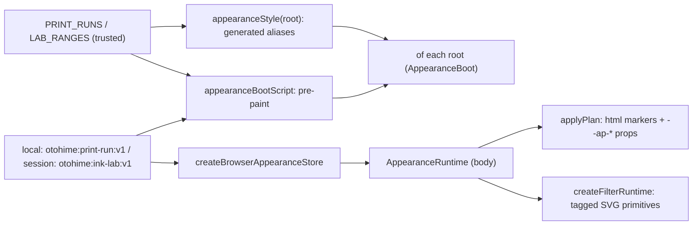

# Runtime architecture: print runs across every root layout (pm-268/t-1599)

This task carries the pure appearance contract (`lib/print-runs.ts`, `lib/ink-lab.ts`, see [appearance-contract.md](appearance-contract.md)) into every document the site serves. Before paint, a stored print run or applied Ink Lab snapshot colors each root's own tokens. After hydration it rescales the real SVG filter attributes and follows changes made in this tab and in other tabs. It adds no UI: the Pocket switch (t-3), the riso headings (t-4) and `/lab` (t-5) build on this boundary.

Installed guides read: `node_modules/next/dist/docs/01-app/01-getting-started/{03-layouts-and-pages,05-server-and-client-components,11-css}.md` and `03-api-reference/03-file-conventions/layout.md`. They cover multiple root layouts (a hop between them is a full page load), CSS ordering by import order, and client components that use only serializable props.

## The boundary

| Piece | File | Role |
| --- | --- | --- |
| Browser adapter | `lib/appearance-client.ts` | `createBrowserAppearanceStore`, `appearanceStore()` singleton, `appearancePlan`/`applyPlan`, `appearanceBootScript`, `ROOT_APPEARANCE` + `appearanceStyle`, `filterScale`, `appearanceTags`, `createFilterRuntime`. Importing it touches no browser global. |
| Pre-paint | `components/appearance-boot.tsx` (server) | Renders `<style data-appearance="<root>">` (that root's aliases) and the boot `<script>` in `<head>`; imports `components/appearance.css`. |
| Runtime | `components/appearance-runtime.tsx` (client) | Renders nothing. On mount it applies the store's snapshot to `<html>` and the filters, subscribes to the store, and exposes `window.otohimeAppearance` (`getSnapshot`, `setPrintRun`, `applyLab`, `resetHouse`). It also exports `useAppearanceSnapshot()`, which returns House on the server and in the hydrating render. |
| Shared sheet | `components/appearance.css` | `--ap-*` defaults, the single texture layer (`html::before`), reduced-motion transition, forced-colors/print off. |

`components/appearance-boot.tsx` goes beyond the task's listed interfaces. A `"use client"` module cannot safely render the pre-paint `<script>`, so boot is a server component and runtime is a client one. Root layouts import exactly these two specifiers.

### DOM markers

| Snapshot | `<html>` attributes | Inline properties |
| --- | --- | --- |
| House, no Lab (also unset, denied or corrupt storage) | none | none |
| Preset sumi/riso/indigo | `data-print-run="<id>"` | `--ap-grain` = preset grain |
| Applied Lab | `data-ink-lab=""`, `data-print-run` = the Lab's run unless house, `data-ap-halftone=""` when on | `--ap-grain`, `--ap-plate-1..3`, `--ap-plate-count`, `--ap-transition` |

House therefore adds no attribute, so none of the generated rules can match it. The boot script and `applyPlan` produce identical markers. `lib/appearance-client.test.ts` runs the script in a `vm` against `createAppearanceStore` over the same fake storage: every run, 400 generated canonical Labs, 24 corrupt or hostile variants × 5 run values, and denied getters and calls. Disabling the script's canonical-number check turns that test red. Only validated ids, `#rrggbb` and re-quantized numbers reach the DOM. Storage text is never interpolated into CSS or script.

### Store and events

`createBrowserAppearanceStore(window)` wraps the pure store and delegates all writes to it, so its semantics and `{persisted, failedKeys}` stay unchanged. It adds:

- `storage` event for `otohime:print-run:v1` (or `localStorage.clear()`): another tab chose a run or reset. This tab removes its session Lab (preset semantics) and re-reads.
- `storage` event for `otohime:ink-lab:v1`, and `pageshow` with `persisted` (bfcache): re-read.
- Listeners attach with the first subscriber and detach with the last.
- Denied storage (getter or call) leaves the page working in memory with `persisted: false`. A reload then boots House.

## Root-layout inventory and token aliases

`app/*/layout.tsx` are all root layouts (no group nests another). Each, plus `app/global-not-found.tsx`, mounts `<AppearanceBoot root="…" />` last in `<head>` and `<AppearanceRuntime />` once in `<body>`. Each `<html>` carries `suppressHydrationWarning`, because the boot script marks it before React hydrates. The unit test derives the inventory from `app/` and fails on an unlisted root.

| Root | Public route | Scheme | paper | paper2 | field | ink | muted | line | hairline | Texture |
| --- | --- | --- | --- | --- | --- | --- | --- | --- | --- | --- |
| site (+ global 404) | `/`, any unknown path | data-theme / OS | `--paper` | `--paper-2` | `--field` | `--ink` | `--muted` | — | `--line` | yes |
| articles | `/articles` | data-theme / OS | `--paper` | — | — | `--ink` | `--muted` | — | `--rule` | yes; own `--grain: none` while active |
| barometer | `/barometer` | data-theme / OS | `--paper` | `--panel` | `--field` | `--ink` | `--ink-soft` | — | — | yes |
| capsule | `/capsule` | light | `--paper` | `--paper-deep` | `--white` | `--ink` | `--ink-soft` | — | `--rule` | yes; own body grain off while active |
| design-system | `/design-system` | data-theme / OS | `--paper` | — | — | `--ink` | `--muted` | `--rule` | `--grid` | yes |
| elements | `/elements` | data-theme / OS | `--paper` | — | `--card` | `--ink` | `--muted` | — | `--line` | yes |
| orrery | `/orrery` | light | `--paper` | `--paper-edge` | — | `--ink` | `--ink-soft` | — | — | yes |
| planisphere | `/planisphere` | data-theme / OS | `--paper` | `--panel` | `--field` | `--ink` | `--ink-soft` | — | — | yes |
| rotor | `/rotor` | data-theme / OS | `--paper` | `--panel` | `--field` | `--ink` | `--ink-soft` | — | — | yes |
| ryugu | `/ryugu` | dark | `--deep` | `--sea` | — | `--ink` | `--muted` | — | — | no (opaque sea gradient) |
| shore | `/shore` | light | `--paper` | `--stage` | — | `--ink` | `--muted` | — | `--line` | yes |
| structures | `/structures` | data-theme / OS | `--paper` | — | — | `--ink` | `--muted` | `--rule` | `--grid` | yes |
| vinyl | `/vinyl` | dark | `--bg` | `--card` | — | `--ink` | `--muted` | `--line` | — | yes |
| zine | `/zine` | light | `--paper` | — | `--sheet` | `--ink` | `--muted` | — | `--line` | yes (screen only; print untouched) |

Rules: `appearanceStyle(root)` emits `@media screen{html:root[data-print-run="<id>"]{…}}` per preset and scheme. For "data-theme / OS" roots it also emits `[data-theme="dark"]` and `(prefers-color-scheme:dark) :not([data-theme="light"])` variants. `html:root` outranks every root's own `:root[data-theme]` and seasonal blocks. Indigo is dark everywhere and adds `color-scheme: dark` without touching the saved theme. Unlisted tokens (accents, instrument colours, swatches) stay the root's own. No root imports `app/(site)/globals.css` or Tailwind. Each alias is checked against a property its own sheet declares, and each root's scheme against its sheet's dark-mode rules.

**Night run on a light-theme visitor.** Indigo is dark everywhere and must not overwrite the saved theme, so it cannot switch on a root's own `[data-theme="dark"]` block. Each data-theme/OS root therefore lists `darkTokens`: its own dark values for every token it does not alias. Examples are Rotor `--glass`/`--amber`, Barometer `--wood`/`--cream`, Planisphere `--sky`/`--star-line`, Elements `--fact`/`--shadow`, the Gazette, Design system and Structures `--spot`/`--hot`. Indigo carries these, and a unit test holds them equal to the sheet's dark block, with nothing missing or extra. The site needs none because its tokens are `light-dark()` and Indigo sets `color-scheme: dark`.

A few roots paint scenes with literal colours rather than tokens. Their `surfaces` map those scenes to tokens while a coloured run is active, and only under a night run where marked:

- Shore: light-scene gradient → `var(--paper)`/`var(--stage)`, plus scene buttons and hovers. Under a night run, the panel wash, chosen chip and danger text take Shore's own dark-scene values.
- Elements: category tints switch to the root's own `--cat-dark` under a night run.

Surfaces may only use tokens or hex values already in the root's sheet, and Shore's own dark scene stays its own. Screenshots of all 15 documents, before and after hydration, for Sumi, Riso and Indigo were inspected. They found exactly these gaps (Rotor key letters and Shore's scene under Indigo), and the rules above close them.

Season and theme stay as attributes underneath. A House reset makes the season's own tint reappear. The e2e test covers all 48 run × theme (light, dark, OS-dark) × season combinations.

### Texture

There is one `html::before` per document: fixed, `z-index: -1` over the canvas and under every glyph, `pointer-events: none`, static, and given `content` only by an active root's generated rule. Its image peaks at alpha 1, and its `opacity` is the run's **total** grain: preset 0.03/0.04, Lab 0–0.06. Halftone dots share the same layer, so specks and dots composite to at most that opacity. Specks are white on light paper and black on dark, as in the contrast contract. While a run is active, the page's paper moves from `<body>` to `<html>` beneath the layer, and a root's own paper texture (Gazette `--grain`, Capsule body grain) is switched off so the two never stack. Forced colors and print remove the layer. Ryugu shows none because its body paints an opaque sea.

## SVG adapters

Primitives carry their **source** value as a tag: `data-ap-frequency`, `data-ap-scale` and `data-ap-seed`. The rendered attribute starts as the same value, so server HTML and the hydrating render are the house drawing. After hydration, `createFilterRuntime` writes `baseFrequency = source × turbulence`, `scale = source × displacement` and `seed = source + clock offset`. It never uses `var()` in an SVG attribute. A MutationObserver re-applies the scale when React re-renders a primitive (its tag changes in the same commit) or mounts new ones. It runs only while the scale is not identity. House writes the exact source text back.

| Adapter | File | Tagged | Kept |
| --- | --- | --- | --- |
| Inked figures | `components/figures.tsx` | warp `feTurbulence` (frequency, seed) and its `feDisplacementMap` (scale) via `appearanceTags(p)` | filter id from `useId`, region −5%/110%, hand grain/wash/tooth, wobble slider amplitude |
| Season bits | `components/season-layer.tsx` | the same warp pair | userSpaceOnUse region, seed 0 |
| Ink Press poster SVG | `components/ink-press.tsx` | the same warp pair | `3 + 5 × d.wobble` amplitude (scaled, not replaced), design seed |
| Ink Radio | `components/ink-radio.tsx` | dial via `Inked`; hiss `feTurbulence` frequency `0.85` | station seed, hiss region |
| Ledger stamps | `app/(site)/(app)/ledger/_components/stamp-calendar.tsx` | each smudge filter's warp pair | smudge ids/regions, SMUDGE_FILTERS hands/seeds |
| 404 crumple | `app/(site)/not-found.tsx` | `feTurbulence 0.03`, `feDisplacementMap CRUMPLE_SCALE` | id `lost-crumple`, region, seed 4 |
| Ryugu caustic | `app/(ryugu)/_components/sea.tsx` | `feTurbulence "0.009 0.016"` (literal attribute, no import) | id `ryugu-caustic`, region, seed 7; WebGL water untouched |

Scales: a preset uses its multipliers (Sumi 0.85/0.8, Riso 1.1/1.15, Indigo 0.9/0.9). An applied Lab's `t`/`d` are read as multiples of its hand's material (`t / warp.frequency`, `d / (3.5 × warp.scale)`), so a default Lab is identity and each scene keeps its geometry and interaction amplitude. The Lab's `hand` does not override a figure's visitor-chosen hand. Engines under `_lib/`, audio, drawings and exports are unchanged.

**Clock.** At most one per document, for the Lab's wobble (`w` seed steps per second, wrapped on the 89-seed ring). It runs only while `w > 0`, motion is allowed, the tab is visible and tagged line work exists. Hiding the tab, reduced motion or House stops it and restores source seeds. Teardown cancels the frame and removes the observer and listeners. `--ap-transition` is forced to `0ms` under reduced motion for the headings task.

## Isolation tests

Each isolated project's `_lib/isolation.test.ts` gains one exact allowlist: `@/components/appearance-boot` and `@/components/appearance-runtime`, in that project's `layout.tsx` only. A new test per project asserts the following.

- The layout's only outside imports are exactly those two.
- `<AppearanceBoot root="<id>" />` closes `<head>` and `<AppearanceRuntime />` closes `<body>`.
- Positive controls: both specifiers are allowed in the layout.
- Negative controls: the same specifiers from `_lib/` or `_components/`, and `appearance.css`, `@/lib/appearance-client`, `@/lib/ink-lab`, `@/components/figures`, `appearance-boot.tsx` and `../../(site)/globals.css` from the layout, are all rejected. The checker itself still flags the boundary.

All other assertions (no site globals or Tailwind, no unrelated components, `_lib/` engines free of React, storage and shared state) are unchanged. No test was deleted. Ryugu's own-document test now expects `suppressHydrationWarning` and the runtime in `<body>`. `lib/motion.test.ts` and `lib/ink-press.test.ts` name the new body child and the `appearanceTags` import exactly.

## Verification

One evidence-only browser test (`evidence: every root hydrated…`) runs only with `APPEARANCE_EVIDENCE` set and is skipped in CI.

| Command | Covers |
| --- | --- |
| `node --experimental-strip-types --test lib/appearance-client.test.ts` | boot/store parity and hostile input (vm + fake storage), inventory, aliases vs sheets, generated colors, texture budget, browser store events and denial (fake window), filter scale/restore, one clock and teardown (fake DOM) |
| `npm test`, `npm run typecheck`, `npm run lint` | whole unit suite including the 12 isolation suites; types; lint |
| `node --experimental-strip-types scripts/e2e.mjs --test e2e/print-runs.test.ts` | real Chrome against a production build: House adds nothing on all 15 documents; first styled frame with every script chunk aborted on all 15 for riso and indigo; 48 run × theme × season combinations; Lab apply → reload → hops to /ryugu, 404, /shore, /vinyl, /music with actual SVG attributes ×2 → reset to exact source text and house computed look; same-tab and cross-tab; denied storage; hostile storage; pointer pass-through; reduced motion; forced colors; no page or hydration errors |

The fake-storage, vm and fake-DOM tests prove the adapter logic only. Real persistence, painting and navigation are proven by the browser run. Deployment is proven by plan-manager's green gate and QA. Measurements from the local run are in `.agent-artifacts/t-1599/print-runs.json`. With `APPEARANCE_EVIDENCE` set, the run also writes first-frame (scripts aborted) and hydrated screenshots of every document per run to that directory. They are not committed (binaries).
