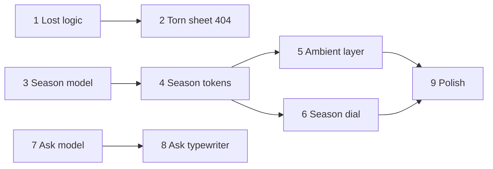

# Paper Almanac Bits

## Re-plan: run-8566 (change request on t-1512)

Plan **pm-248**, product-owner run **run-8566**. Baseline for this re-plan:
`f86fcad` (main). The original proposal below (run-8433) stays as the record of
finished tasks.

### What failed

t-1512 (Torn sheet 404) failed its green gate three times and was superseded
(fix cycles 1 to 3). Every failing run had the same cause, and it sat in the
board contract, not in the code:

- The item `lint changed files` holds the command
  `npx eslint app/(site)/not-found.tsx app/global-not-found.tsx components/lost-sheet.tsx`
  with the route-group path unquoted. The gate runs it through `bash -c`, which
  parses the parentheses and exits 2 in about 1 ms, before ESLint starts
  (ver-3390, ver-3391, ver-3409, ver-3418).
- The fix was recorded as a decision (esc-376, esc-379) but never applied to the
  board, so each software-engineer cycle reran a command that could not pass.
- The 404 code is correct and is already on main at `c06a430`. Typecheck,
  `next build` and `probe-lost` (34 of 34) pass at that code, and `npm test`
  passes 1723 of 1723.

### Remaining work

Only t-1512 is open in this plan. t-1511 and t-1513 to t-1519 are done and are
kept as they are. The proposal has one task.

| # | Task | Replaces | Role | QA |
| --- | --- | --- | --- | --- |
| 1 | Torn sheet 404 (gate fix) | t-1512 | software_engineer | required |

### What the new task does differently

1. **The commands are right in the contract.** The lint item is written as
   `npx eslint 'app/(site)/not-found.tsx' app/global-not-found.tsx components/lost-sheet.tsx`,
   the form the decider chose on esc-376 and esc-379. I parse-checked it before
   proposing: on a fresh `npm ci` checkout at `f86fcad`, the quoted form exits 0
   with ESLint actually running, and the unquoted form is the `bash -c` parse
   error above. The other three items are unchanged.
2. **No application code change.** The 404 sources are already on main. A
   software-engineer fix cycle cannot repair a contract defect, so the task
   runs the gates on the delivered sha and changes nothing that is not needed.
3. **Failures are reported, not worked around.** A bash parse error, a missing
   binary, or a nonzero item goes into the summary with its exact stderr. The
   engineer does not edit application code to get around it, and does not edit
   the contract (the board, not the repo, holds the contract).
4. **No summary-only commit.** esc-379 rules out summary-only pushes. The
   result goes through `plan_manager_submit_report`. A commit is made only if a
   file changes.
5. **Clean start.** The task begins with `npm ci` and a clean `.next`, because
   a fresh checkout has no `node_modules` (the lesson from earlier QA runs).
6. **No dependency on t-1511 in the proposal.** Remaining tasks may depend only
   on each other, and t-1511 is already done, so `depends_on` is empty. That is
   the same as the decider's `depends_on: [t-1511]`.

### Acceptance and gap

All acceptance criteria can be met on this platform. The probe starts the built
app, drives it in pinned Playwright Chromium, and covers no-JS links, rubbing
to 100%, keyboard, reduced motion and mobile width. No fake runner is involved.

Gap, recorded as a decision: this task proves the sheet locally (`next build`
and `next start`). It does not observe the deployed site or CI. The green gate
(CI deploy probe) and acceptance cover that after delivery, and this task does
not claim it.

### Replacement task contract (proposal payload)

```json
[
  {
    "sequence": 1,
    "title": "Torn sheet 404 (gate fix)",
    "role": "software_engineer",
    "qa": "required",
    "acceptance_criteria": "GET of an unknown path returns HTTP 404 with a server-rendered torn crumpled sheet and plain links to Home, Work, Projects, Notes and Play that work with JavaScript disabled; with JavaScript, rubbing the sheet smooths it to 100% and links stay reachable; reduced motion shows a flat sheet.",
    "depends_on": [],
    "problem": "t-1512 failed three fix cycles on its lint item: the board command leaves the route-group path unquoted, so bash -c exits 2 before ESLint runs. The 404 at c06a430 on main is correct and passes its other gates. The task has to prove the 404 on the delivered sha with commands bash can parse.",
    "action_items": [
      "Run npm ci and remove .next before any gate, because a fresh checkout has no node_modules.",
      "Confirm that the 404 sources equal c06a430: git diff --quiet c06a430 HEAD -- 'app/(site)/not-found.tsx' app/global-not-found.tsx components/lost-sheet.tsx lib/lost.ts scripts/probe-lost.sh scripts/probe-lost.mjs. Make no application code change unless that diff is non-empty, and then report it instead of editing.",
      "Run the four verification items in order through bash -c. Record each exit code and any stderr in the summary.",
      "If an item fails with a bash parse error, a missing binary or a nonzero exit, report it with its stderr and stop. Do not change application code to work around it, and do not edit the board contract.",
      "Do not create a summary-only commit. Submit the result with plan_manager_submit_report. Commit only a file that actually changed, and then push it."
    ],
    "interfaces": ["app/(site)/not-found.tsx", "app/global-not-found.tsx", "components/lost-sheet.tsx", "app/(site)/globals.css", "scripts/probe-lost.sh", "scripts/probe-lost.mjs"],
    "non_goals": ["any application code change", "editing the board contract or its verification commands", "shader or WebGL bubbles", "ink-blot wipe", "other route groups' 404s", "new runtime dependencies", "claiming the deployed site or CI result"],
    "verification": [
      {"name": "typecheck", "cwd": ".", "cmd": "npm run typecheck", "expect": "exit0", "timeout_s": 900},
      {"name": "lint changed files", "cwd": ".", "cmd": "npx eslint 'app/(site)/not-found.tsx' app/global-not-found.tsx components/lost-sheet.tsx", "expect": "exit0", "timeout_s": 600},
      {"name": "production build", "cwd": ".", "cmd": "npm run build", "expect": "exit0", "timeout_s": 1800},
      {"name": "lost probe", "cwd": ".", "cmd": "bash scripts/probe-lost.sh", "expect": "exit0", "timeout_s": 900}
    ]
  }
]
```

The `interfaces` list is the verified footprint, the same as t-1512's. The
engineer should not change those files.

### Earlier proposal (run-8433)

Baseline: `d9562c2` (main).
Research: `rep-4881`, captured verbatim in [research.md](research.md). The
exact task payload is [tasks.json](tasks.json); the contracts below render it.

Three small bits for the paper-and-ink pocket console: a 404 lost sheet, real
season tints with an ambient layer and dial, and the Ask the Ink delta.

## Scope and decisions

| Original idea | Delivery |
| --- | --- |
| 1 Ask the Ink | Tasks 7 + 8. Ask already exists (pm-243); this is a delta: cheaper model, canned answers, typewriter, link citations. |
| 2 Paper almanac seasons | Tasks 3, 4, 5, 6, 9. Visitor timezone picks the hemisphere; a dial overrides it. |
| 3 Lost page 404 | Tasks 1 + 2. Crumpled torn sheet; rub to smooth; plain links always reachable. |

Decisions taken without a person:

- Hemisphere comes from the Intl timezone, not geolocation: no permission
  prompt, no network call, no PII.
- Ask keeps the non-streaming POST and types the answer out client-side. SSE
  would conflict with validate-then-show of cited passage ids.
- Ask model moves to `claude-haiku-5-5`. Prod has no ANTHROPIC_API_KEY
  verified here; the offline answer remains the fallback, so no operator
  action is raised for the key. Live model output is unproven in this plan.
- Seasons apply to the (site) route group and the global 404 document only in
  v1. Other root layouts are out of scope.
- Shader bubbles (codrops) are deferred: WebGL on a 404 is heavy.
- Ink-blot wipe is not in v1.
- The plan file named in the run instructions
  (`projects/20260921222547_plan_manager_chief_of_staff_extraction.md`) is
  not in this checkout, and `docs/claude/software-development.md` does not
  exist. The standing rules used are AGENTS.md and the existing plan
  conventions in `projects/`.

## Dependency graph and work order

Sequences are proposal-local identifiers, not platform task ids.



Nothing waits. Three independent chains start at once: 404, seasons, Ask.

## Task contracts

The proposal submitted to plan-manager (run-8433, git_sha `8b54cc4`) is the
authority. Its `interfaces` name the scripts/ probe files each task writes,
because the platform path gate accepts only its listed roots (scripts/,
projects/, docs/ and similar). The lib/, app/ and components/ paths are named
in each task's action_items. [tasks.json](tasks.json) is the first draft of
the same payload and differs in that one respect.

Each software_engineer task carries problem, action_items, interfaces,
non_goals and verification[]. Summaries:

1. **Lost sheet logic** (qa skip): pure `lib/lost.ts` stroke-progress model with node:test.
2. **Torn sheet 404** (qa required): server-rendered SVG sheet, client island
   for rub/"Smooth it out", plain links, reduced motion flat. Probe
   `scripts/probe-lost.sh`.
3. **Season model** (qa skip): `lib/seasons.ts` for date, hemisphere and
   timezone; contrast test on `app/(site)/seasons.css`.
4. **Season tokens on site** (qa required): pre-paint `data-season` in the
   (site) layout and global 404; updates the layout and design-system tests.
5. **Ambient almanac layer** (qa required): fixed aria-hidden SVG layer,
   at most 40 elements, transform/opacity only, static under reduced motion.
6. **Season dial** (qa required): radiogroup beside the theme toggle,
   persisted, storage-safe.
7. **Ask model switch** (qa required): Haiku model, canned answers, index
   coverage check.
8. **Ask typewriter** (qa required): client-side typewriter, link citations.
9. **Season ambient polish** (qa required): joint probe at 390px and 1366px.

## Verification boundaries

- All verification runs inside the checkout: unit tests, typecheck, lint,
  `next build` and local probe scripts that start the built app. No task
  writes shared infrastructure or another system's state.
- Probes use the existing pinned temporary Playwright pattern.
- The live Anthropic call is not exercised. Ask tests use fake clients.

## Deferred and unproven

- Live Haiku answer quality: unproven; no key in the pod. The offline path
  and fake-client tests prove orchestration.
- Shader bubbles and ink-blot wipe: deferred, not planned.
- Other root layouts: seasons not applied.
