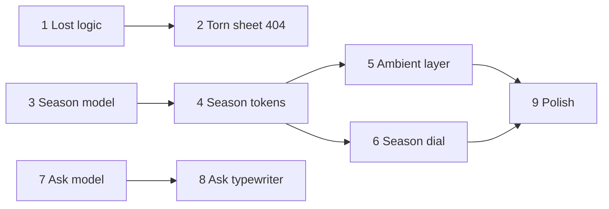

# Paper Almanac Bits

Plan **pm-248**, product-owner run **run-8433**. Baseline: `d9562c2` (main).
Research: `rep-4881`, captured verbatim in [research.md](research.md). The
exact task payload is [tasks.json](tasks.json); the contracts below render it.

Three small bits for the paper-and-ink pocket console: a 404 lost sheet, real
season tints with an ambient layer and dial, and the Ask the Ink delta.

## Scope and decisions

| Original idea | Delivery |
| --- | --- |
| 1 Ask the Ink | Tasks 7 + 8. Ask already exists (pm-243); this is a delta: cheaper model, canned answers, typewriter, link citations. |
| 2 Paper almanac seasons | Tasks 3, 4, 5, 6, 9. Visitor timezone picks the hemisphere; a dial overrides it. |
| 3 Lost page 404 | Tasks 1 + 2. Crumpled torn sheet; rub to smooth; plain links always reachable. |

Decisions taken without a person:

- Hemisphere comes from the Intl timezone, not geolocation: no permission
  prompt, no network call, no PII.
- Ask keeps the non-streaming POST and types the answer out client-side. SSE
  would conflict with validate-then-show of cited passage ids.
- Ask model moves to `claude-haiku-5-5`. Prod has no ANTHROPIC_API_KEY
  verified here; the offline answer remains the fallback, so no operator
  action is raised for the key. Live model output is unproven in this plan.
- Seasons apply to the (site) route group and the global 404 document only in
  v1. Other root layouts are out of scope.
- Shader bubbles (codrops) are deferred: WebGL on a 404 is heavy.
- Ink-blot wipe is not in v1.
- The plan file named in the run instructions
  (`projects/20260921222547_plan_manager_chief_of_staff_extraction.md`) is
  not in this checkout, and `docs/claude/software-development.md` does not
  exist. The standing rules used are AGENTS.md and the existing plan
  conventions in `projects/`.

## Dependency graph and work order

Sequences are proposal-local identifiers, not platform task ids.

Nothing waits. Three independent chains start at once: 404, seasons, Ask.

## Task contracts

Each software_engineer task carries problem, action_items, interfaces,
non_goals and verification[]. Summaries:

1. **Lost sheet logic** (qa skip): pure `lib/lost.ts` stroke-progress model with node:test.
2. **Torn sheet 404** (qa required): server-rendered SVG sheet, client island
   for rub/"Smooth it out", plain links, reduced motion flat. Probe
   `scripts/probe-lost.sh`.
3. **Season model** (qa skip): `lib/seasons.ts` for date, hemisphere and
   timezone; contrast test on `app/(site)/seasons.css`.
4. **Season tokens on site** (qa required): pre-paint `data-season` in the
   (site) layout and global 404; updates the layout and design-system tests.
5. **Ambient almanac layer** (qa required): fixed aria-hidden SVG layer,
   at most 40 elements, transform/opacity only, static under reduced motion.
6. **Season dial** (qa required): radiogroup beside the theme toggle,
   persisted, storage-safe.
7. **Ask model switch** (qa required): Haiku model, canned answers, index
   coverage check.
8. **Ask typewriter** (qa required): client-side typewriter, link citations.
9. **Season ambient polish** (qa required): joint probe at 390px and 1366px.

## Verification boundaries

- All verification runs inside the checkout: unit tests, typecheck, lint,
  `next build` and local probe scripts that start the built app. No task
  writes shared infrastructure or another system's state.
- Probes use the existing pinned temporary Playwright pattern.
- The live Anthropic call is not exercised. Ask tests use fake clients.

## Deferred and unproven

- Live Haiku answer quality: unproven; no key in the pod. The offline path
  and fake-client tests prove orchestration.
- Shader bubbles and ink-blot wipe: deferred, not planned.
- Other root layouts: seasons not applied.
