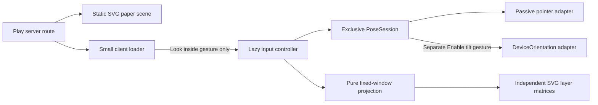
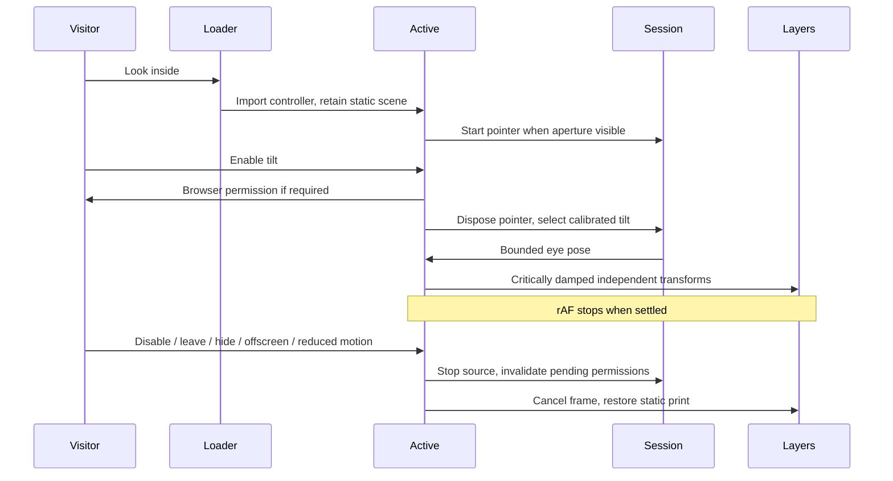
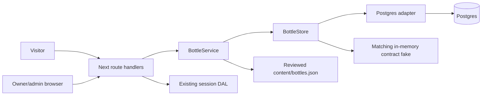
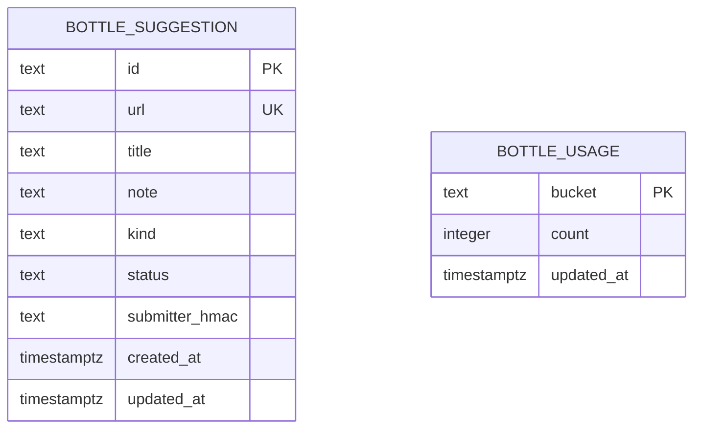

# Ryugu Paper Toys architecture

## Crumple accessibility gate repair · pm-269/t-1648 · run-9353

Following [run-9332's fix plan](fix_plan_t-1648_run-9332.md), the crumple browser gate captures the real link accessibility snapshot before folding and compares it after source restoration, retaining an explicit role-link presence check. Both snapshots use the same focused state, including the Projects link's asynchronously opened keyboard Peek. This preserves the full accessible name, URL and attributes without confusing RisoText's decorative `innerText` with its semantic name.

Concurrent repair `657f047` also verifies folded-link identity independently of Peek disclosure state and injects hidden-name and focus-loss failures. Those helpers and both negative-control subtests are retained; the focused before/after comparison adds a separate full-snapshot contract. The combined isolated suite passes 14 tests.

The subsequently landed basket (`f7f55ed`) exposed stale SVG counts in both footer verifiers. The SSR walk and shared browser helper now require the original three aria-hidden scene layers, exactly one named accessible basket, and one aria-hidden final waterline wave. Actual-block VM and real-Chrome regressions (JavaScript on/off) reject missing/extra layers or baskets and broken semantics. Both named regressions are required by Bottle receipts and the ten-control real gate closure; the shared helper is fingerprinted. All geometry thresholds and title-bounds checks remain intact. Full integrated UI E2E passes 255 tests, crumple/basket isolation 19, and final Bottle contracts include 2,652 repository tests plus 65 walk/176 Chromium assertions.

The real Notes RisoText regression proves the historical `innerText` oracle rejects an intact accessible link. Its restored-link helper passes a real fold/focus restore, rejects a link hidden after folding and a changed accessible name, then passes after each mutation is removed. The historical [failing QA report](qa_report_t-1648_run-9332.md) and fix plan are preserved verbatim from `d7d4c53`; they remain historical fail evidence. [Run-9353's summary](run-9353-summary.md) records fresh local verification and the hosted/deployed QA handoff. Bottle application code, geometry, lazy boundaries and deployment checks are preserved.

## Project delivery CI trigger · pm-269/t-1648 · run-9320

Following [fix plan run-9285](fix_plan_t-1648_run-9285.md), main pushes use ordered `paths: ["**", "!**.md", "projects/**"]`: project-only task deliveries enter the complete checks and production workflow; unrelated Markdown stays filtered. Job concurrency, main serialization, author verification and all production gates remain intact. `scripts/ci-workflow.test.mjs` exercises project summaries alone, multiple reports, artifacts and mixed changes; its identical delivery assertion rejects the historical ignore filter, a missing project exception and the exception in the wrong order.

`scripts/verify-deploy.sh` requires served ancestry for every `projects/**` delivery, including Markdown. Its older-build exemption now covers only unrelated Markdown, matching the workflow filter. The real-shell self-test uses temporary Git history and local HTTP health with an E2E marker: an undeployed project report must fail before E2E, while a served descendant containing it passes. The local fixtures establish trigger policy and verifier behavior, not hosted workflow execution. [Run-9320's summary](run-9320-summary.md) records fresh gates and the plan-manager/QA handoff; the SWE run stops at tested push.

## Deployed QA handoff · pm-269/t-1648 · run-9281

The operator reports that production health has advanced to `103f0c5511d4590e66a8a83b1a35acfe870e7ca3` since QA run-9201 sampled ancestor `741f59c`. This is supplied evidence, not a fresh SWE production observation. Follow [fix_plan_t-1648_run-9201.md](fix_plan_t-1648_run-9201.md): preserve the working Bottle implementation and direct team-scoped API readiness. A served SHA alone does not establish a green production job. The local revalidation and independent deployed follow-up are recorded in [run-9281-summary.md](run-9281-summary.md).

Plan-manager owns the complete green gate and production result for workflow `40478220840` (or its served descendant); QA owns a fresh independent Footer/Pocket walkthrough at the served SHA, including enlarged text, lazy/CLS budgets and a live API access negative control. The SWE run stops at its tested push without waiting on CI or querying production. No credential or application change is justified by the stale QA snapshot.

## Hosted CLI identity transcript · pm-269/t-1648 · run-9198

Production readiness stays on `741f59c`'s direct team-scoped `GET /v13/deployments/{hostname}` (`scripts/deployment-status.mjs`). The ee51ea9 CLI text matcher is not reintroduced. The deploy fixture's fake CLI now answers every non-deploy command with the exact hosted Vercel CLI 64.7.0 line `Error: Not able to load user because of unexpected error: User not found. (404)` (jobs `122084239061`, `122096077381`), and exits 1. A mutated copy of `vercel-deploy.sh` with a scoped `vercel inspect --wait` step reproduces that failure and never reaches health; the real script reaches API READY and exact-SHA health without calling inspect. The Bottle deployment receipt requires both controls. This fixture proves orchestration only; hosted API authorization is proven only by a green production job.

## Scoped API readiness fallback · pm-269/t-1648 · run-9194

Both Vercel inspect calls retain the configured team scope. Only when both exit 1 with `Error: User not found` and no recognized deployment state may `scripts/vercel-deployment-state.mjs` independently read the uploaded hostname through `GET /v13/deployments/{hostname}?teamId=...`. The helper uses the existing `VERCEL_TOKEN`, requires `VERCEL_PROJECT_ID`, and accepts only an owner response matching the exact hostname/project, production target, deployment id and explicit `READY`. It makes one bounded read, rejects redirects, caps response bytes, and prints neither bearer credentials nor vendor response bodies. A nonready, refused or malformed API response still fails deployment. Other CLI failures and timeouts cannot use this fallback. The exact top-level JSON served-SHA health requirement remains after either successful readiness path. No token binding changes or new secret are introduced.

The real-shell fixture executes the actual Node helper with real local HTTP and a fake CLI, including authenticated/team-bound Ready, wrong served SHA, identity mismatches, nonready states, HTTP failures, redirection, timeout and credential isolation controls. It proves orchestration and rejection behavior, not hosted authorization. The Bottle deployment receipt requires every new control; archived logs and synthetic receipt fixtures cannot certify current execution. See [run-9194-summary.md](run-9194-summary.md) for runtime identity, results and the post-push CI/QA handoff.

## Fresh isolated production builds · pm-269/t-1648 · run-9189

The self-hosted `scripts/e2e.mjs` build removes its checkout's `.next` output before `npm run build`. This prevents inherited Turbopack font import maps from blocking the Bottle and footer gates before browser execution. Explicit `SKIP_BUILD=1` reuse retains the artifact and cache; remote `BASE_URL` and database-only modes bypass this build path. A failed build still exits unsuccessfully without retrying or starting a server. Normal development and hosted production build commands are unchanged.

The real runner is exercised in a temporary checkout with a fake database adapter and npm: stale output fails the same clean-build assertion on the previous implementation and after removing cleanup, explicit reuse preserves the seeded artifact, and deliberate build/start failures remain failures. These fixtures prove orchestration only. The new named regression is required by the repository receipt and gate closure; archived closure logs cannot certify it. Fresh locked Next/Postgres/Chromium executions remain required for Bottle acceptance. Results and boundaries are recorded in [run-9189-summary.md](run-9189-summary.md).

## Complete repository and deployment receipts · pm-269/t-1648 · run-9187

The Bottle repository gate requires all twelve layout/picker cases and all eleven evidence-verifier regressions, alongside the existing shared workflow/footer controls. Removing a Bottle case while recomputing coherent passing TAP totals now fails the receipt validator. Deployment evidence also reconciles its summary with individual unique passing assertion lines, rejecting missing lines, duplicate replacements and inflated totals. Two new mutation regressions fail against the previous validator and pass after this repair. Receipt fixtures establish evidence rejection only; `scripts/verify-bottle-contracts.mjs` still executes the six original contract commands plus the real-shell/fake-Vercel deployment fixture for current execution proof. Static analysis remains a static-only claim. This preserves the scoped, fail-closed explicit Ready inspection and exact-SHA JSON health gate; hosted recovery and independent deployed Bottle acceptance remain plan-manager/QA obligations. Current identities and results are recorded in [run-9187-summary.md](run-9187-summary.md).

## Explicit deployment readiness · pm-269/t-1648 · run-9182

Production verification requires both a zero waiting-inspect exit and an explicit labelled `Ready` state before checking exact-SHA JSON health. A zero exit with `Building`, `Queued`, `Initializing`, missing output or an unknown status now takes the same bounded scoped diagnostic re-read and failure path as a failed inspect. Matching alias health cannot rescue these outcomes. Five additional real-shell fixtures reproduce the permissive path in the prior verifier and reject it after the repair; the positive Bottle verifier requires all five named assertions and at least 59 deployment fixture assertions. Receipt parser tests extend the archived fixture with explicitly synthetic assertions; current shell execution supplies the actual proof.

The existing `VERCEL_TOKEN` binding, both `--scope "$VERCEL_ORG_ID"` arguments, failed-wait rejection, upload bounds and exact top-level `ok: true`/SHA health check remain in force. Operator `esc-430` forbids replacing the secret. The earlier scoped repair is already landed; this run tightens a separately reproduced readiness gap and supplies a forward push for hosted validation. The SWE stop-at-push contract leaves hosted job inspection and independent deployed Bottle acceptance to plan-manager/QA. A local fake CLI cannot certify Vercel identity or recovery; [run-9182-summary.md](run-9182-summary.md) records fresh execution and that boundary.

## Positive Bottle gate contracts · pm-269/t-1648 · run-9178

`scripts/verify-bottle-contracts.mjs` now exports an import-safe evidence validator and supports `--gate <id> <artifact-directory>`. Each invocation executes the original contract command, requires its positive evidence, rejects silent success and writes the command, named assertions, log hash and browser build identity to `verification.json`. Importing it neither runs gates nor modifies the CI probe verifier's shared gate list. Independent child suites clear inherited `NODE_TEST_CONTEXT` so a verifier invoked from `node:test` still receives standalone TAP. `lib/bottle-verification.test.ts` exercises every gate's evidence boundary, all required test omissions/skips, incomplete footer output, renamed closure controls, fake certification and an actual single-gate CLI with a silent fake-child negative control. Archived logs are parser fixtures only; fresh full execution remains required.

The six contract items have direct positive-assertion wrappers: `node scripts/verify-bottle-contracts.mjs --gate <id> <artifact-directory>` with `layout`, `unit`, `static`, `closure`, `browser` and `footer`, respectively. The layout receipt now requires all twelve picker/layout tests; closure requires the actual control identities and passing raw TAP; footer requires individual success lines to agree with its 65 walk and 170 probe assertions. Static tooling proves static analysis only; browser tests establish product behavior. The default invocation additionally runs the scoped deployment fixture. SWE cannot replace persisted board verification metadata through its role's tools; these wrappers and named tests supply executable assertions while the six original commands remain intact. Current execution and deferred hosted acceptance are recorded in [run-9178-summary.md](run-9178-summary.md).

The browser interaction test now measures Bottle and scene rectangles in one browser evaluation after modal focus return. Sequential viewport-coordinate reads could span a scroll and report false overlap. An explicit instantaneous-scroll control reproduces that failure with the old mixed coordinates while the atomic gap remains unchanged; the nonnegative scene clearance and both historical CSS rejection controls remain enforced.

## Scoped production verification · pm-269/t-1648 · run-9171

The production verifier requires `VERCEL_ORG_ID` before uploading and passes that same team scope to both the waiting `vercel inspect` and its diagnostic re-read. The existing token binding, bounded upload/readiness, fail-closed inspection and exact `ok: true`/top-level SHA JSON health check remain in force. The scope-sensitive CLI fixture rejects unscoped inspection with `User not found`, accepts scoped `Ready`, checks both command argument lists, refuses missing context before upload and proves that scoped identity errors or failed waits cannot be rescued by matching health or a successful re-read. Real CLI help construction confirms `--scope` support; real authorization remains a production CI check.

Run `node scripts/verify-bottle-contracts.mjs <artifact-directory>` to execute all six Bottle contract commands plus the deployment fixture. This promotes the previous archived verifier into a reusable command. Receipts require named unskipped passing TAP cases, nonzero counts, certified real closure and 65 walk/170 Chromium assertions. Negative evidence controls reject silent success, renamed/skipped controls, missing TypeScript output, uncertified closure and omitted/failed deployment assertions. Static analysis certifies static contracts only. The landed Bottle geometry, lazy boundaries and interaction controls are preserved; current execution identities, counts and limits are recorded in [run-9171-summary.md](run-9171-summary.md).

## Bottle header containment and certification · pm-269/t-1648 · run-9159

The footer reserves `3.75rem` above its grid for Bottle. The button retains its absolute bottom anchor (`inset-block-end: 100%`, `.25rem` margin), uses `.8125rem` label text and a 44px minimum height in both footer and Pocket. The reserved band contains the entire button below the footer border and dashed hairline, including 32px label text; stage/copy alignment and scene geometry remain independent of button state. The installed Next 16.4.2 lazy-loading guide was read before editing. The gesture-only client import and lazy panel/CSS remain intact.

`lib/bottle-footer-layout.test.ts` checks stylesheet and independent box-model invariants. The production browser suite measures both scene clearance and containment below the two footer rules at 1366×768, 768×1024 and 390×844, with default/24px/32px labels and settled 200% root scaling. The same assertion helper rejects the former `-2.4rem` scene intrusion and `2.5rem` padding overflow. Normal labels are 13px/44px tall; doubled-root labels are 26px/45.796875px tall. At 32px label text the minimum top clearance is 2.40625px and the scene gap is 4px. Side-by-side stage/copy alignment is 0px and measured scene/footer state changes stay within 1px.

All six task gates have positive evidence in `run-9159/artifacts/verification.json`, produced by the repeatable `verify.mjs` beside it. Receipts require named passing TAP tests and nonzero unskipped counts, fingerprinted real gate-closure results, actual static-tool execution, and 65 walk/170 probe assertions. Silent success, renamed/skipped required tests, uncertified closure and omitted TypeScript output are rejected. Static analysis proves lint/type contracts only. The new layout suite also fails against unchanged base CSS in a temporary fixture.

The real production Bottle tests retain explicit Visit/new-tab behavior, Escape focus return, legacy Tab order, bounded no-repeat history with blocked storage, pending Postgres suggestion persistence, inert hostile responses, offline retry/429 handling, live reduced-motion cancellation and no-JS baseline. Hover/focus are now exercised before checking that panel/fallback content was absent from initial chunks. Bootstrap is 1,634 gzip bytes, lazy UI/CSS 4,966 bytes, and attributable CLS is 0 at desktop/mobile. The unchanged CI-mode footer gates also preserve the `/music` clear area and navigation/error controls.

Execution used the board's actual `codex-sol-6-1-high` profile, `gpt-6.1-sol`, effort `high`, fleet worker `avietidol-mac-mini`, locked Node 22.23.3/Next 16.4.2/React 19.3.0/Playwright Core 1.64.0 and Chrome 156.0.8078.48. The runner constructs real migrated embedded Postgres and builds/starts the actual application; edge/error responses and historical CSS are explicit fixtures. Source/build/chunk identities, history limitations and full commands/results are in [run-9159-summary.md](run-9159-summary.md). Local production execution is demonstrated. CI completion, deployment and independent product acceptance remain plan-manager's post-push work; this run does not inspect them.

## Footer geometry repair · pm-269/t-1591 · run-9095

The Bottle button remains an absolutely positioned child of the existing footer stage wrapper. Its bottom now sits at the wrapper's top with a `.25rem` gap; its own content determines its height. The former `-2.4rem` top offset allowed larger text to intrude into the scene. No stage dimensions, DOM order, camera runtime or global motion rules change. The production Bottle browser suite measures the real scene boundary at desktop/mobile sizes, enlarges the button text to 24px without changing reserved footer geometry, verifies tap/click and keyboard order, and checks a computed 200% root font size. Reinstating the old CSS in that browser makes the same boundary assertion fail. Full verification and execution identities are recorded in `run-9095-summary.md` and `run-9095/artifacts/`.

## Pointer and tilt Peep-box · pm-264/t-1590

The Play route server-renders `PeepBoxScene` inside `PeepBoxLoader`. The scene is source SVG: palace, seabed/kelp, fish and turtle at depths 500, 300, 160 and 60 SVG units. The 600×360 window reserves its aspect ratio, clips its contents, and uses existing paper/ink/colour tokens and the isolated `peep-ryugu-ink` filter. The controls reserve 320 CSS pixels before activation. Claw, Pond and Ink Press keep their existing implementations and entry points.



The pure `lib/peep-box.ts` port defines `EyePose`, `Aperture`, `LayerProjection` and `PoseSource`. Coordinates are relative to the aperture centre, +y down; the eye is in front at positive z and layer depth is behind at negative z. Ray intersection with z=0 gives `scale=z/(z+depth)` and window position `scale*world+(1-scale)*eye`. The SVG matrix adds the aperture centre. This scales and translates each layer separately; a displaced eye moves deeper layers farther. Eye x/y are bounded to ±150/±100, distance to half through 1.5× nominal viewer distance. Invalid eye/depth values normalize safely, negative depths stop at the aperture plane, and malformed aperture geometry throws `invalid_aperture`.

`PoseSession.select` disposes its previous source before starting another. Generation guards reject late callbacks after handoff/stop. A future camera adapter implements the same `PoseSource` and can enter through the controller's `choose` function. This task adds no camera UI, media request, worker, SDK, model, binary asset or dependency.

Pointer events are passive, accept mouse/pen, and never capture pointers. Touch input retains native `touch-action: pan-y`; touch/keyboard users have labelled directional buttons. Arrows/Home work only inside the direction group. Button input explicitly hands ownership back to pointer. Enable tilt alone may request DeviceOrientation permission; denial/missing API leaves pointer controls usable. The first valid sample calibrates beta/gamma, screen-angle changes recalibrate, wrapped angular deltas are rotated into screen coordinates, and Recenter tilt resets the neutral sample.



The exact critically damped spring step clamps elapsed time to 50ms and snaps at a finite rest threshold. Only movement schedules rAF. IntersectionObserver, document visibility, pagehide and effect cleanup cancel frames and detach input listeners; returning selects pointer and requires a fresh gesture for tilt. Live reduced motion tears down the controller's observers/input work and presents the static scene, retaining only the motion preference subscription. Save-Data has the same explicit activation requirement as every visit. No hover or viewport prefetch opens the lazy controller.

## Verification notes

Run `run-8819` uses the board-recorded profile `codex-sol-6-1-high`, model `gpt-6.1-sol`, reasoning effort `high`; fleet worker `avietidol-z490`. Dependencies are installed with `npm ci` under Node 22.23.3, Next 16.4.2, React 19.3.0 and Playwright Core 1.64.0. Browser checks use the real production build, actual SVG screen matrices and Chrome 154.0.8037.57, with a disposable embedded Postgres 17 instance provided by `scripts/e2e.mjs`.

The unit fixtures calculate neutral and mirrored ray intersections independently, cover distinct depth displacement, near-plane bounds, malformed/nonfinite inputs, rotated/calibrated orientation, spring rest and exclusive/late source handoff. Browser checks cover 390×844 and 1366×768 actual layer geometry, keyboard/pointer input, clipping/reserved dimensions, native touch scrolling, Save-Data, no-JS, permission grant/denial/absence, pending permission cancellation, rotation, rest/offscreen/hidden/pagehide/Disable, live reduced motion and client-side route cleanup. Normal movement producing nonzero attributed rAF is the negative control for the zero-work assertions. A real CDP touch pan scrolling the document is the touch negative control.

Orientation values, permission responses and document hidden-state events are synthetic browser fixtures. They prove adapter policy and lifecycle, not a physical sensor. Actual phone sensor quality remains unmeasured and is explicitly outside this delivery gate. Camera inference/privacy implementation belongs to plan task 5; no camera execution is claimed here.

The production browser measures a conservative 8,456-byte gzip upper bound at both required viewports: the entire Play page chunk (5,281 bytes, including pre-existing Play code), lazy controller and its pure helpers (2,637 bytes), plus scoped source CSS (538 bytes). Existing shared React/Next runtime is excluded. No camera/model/Wasm request, Worker construction or getUserMedia call occurs. Attributable CLS is 0 and stabilized inactive frame scheduling is 0. `e2e/peep-box.test.ts` prints the emitted chunk paths, SHA256 hashes, browser identity, gzip total and CLS and enforces the 35KiB/0.001 budgets.

The pre-existing Ink Press expands its mobile placeholder when loaded during scrolling. Geometry tests first finish that sibling's DOM layout, then start their attribution baseline; projected coordinates are measured against the aperture using the actual SVG viewBox scale. Next history may update before the outgoing ViewTransition/Activity hides its page, so route cleanup is asserted at the actual old-scene hide/commit.

The full regression also exposed the existing Kame 499/500ms fixture flake. `e2e/kame.test.ts` now explicitly pauses its installed clock after hydration and before key-down, preserving both boundary assertions and all Kame product code. Installing Playwright's clock alone leaves time running between protocol calls; the focused Kame suite verifies the repaired fixture.

The run summary records final commands, source/build fingerprints and local results. CI, deployment and independent QA are owned by plan-manager after the pushed delivery; this engineering run stops at push and makes no deployed-product claim.

## Rescue delivery verification · run-8844

The runner resumed the task as a single commit on local `main`, already based on `0c4a25d`. Retained all Peep-box code and the Kame clock fixture fix. No additional product behavior was needed. The earlier side-branch delivery failed the runner's `push_not_on_main` gate; this run delivers through `git push origin HEAD` from `main`. The incidental `content/history.json` prebuild refresh is excluded so the amended commit does not leave a snapshot pointing at its superseded provisional SHA.

Fresh locked installation and production execution use Node 22.23.3, Next 16.4.2, React 19.3.0, Playwright Core 1.64.0 and Chrome 154.0.8037.57. The actual profile remains `codex-sol-6-1-high`, model `gpt-6.1-sol`, effort `high`, worker `avietidol-z490`. Final build `Gc-DZDimCpinBxFycHj1H` reproduces the same subsystem fingerprint `6d4b115e33cfb82bdae3c9ded455c7817f7d92746fab693b7896e20f876e73c3` and emitted chunk hashes above. All four contract commands pass: six focused unit tests, 2,133 repository unit tests, lint/type checks (10 existing warnings), and eight production browser cases. Both required viewports reproduce 8,456 bytes gzip and zero attributable CLS; lifecycle tests demonstrate zero stabilized inactive rAF with moving input as a nonzero control. Native touch scrolling is exercised through CDP. Orientation/permission/visibility fixtures remain synthetic, with physical sensor quality outside the gate.

The new run summary and shared artifacts hold complete local logs and final browser regression results. The board's nonpaginated plan-run listing returned four runs: one failed task attempt, this running retry, and two succeeded research/planning runs; there is no completed SWE attempt for t-1590. The prior runner's raw tail is truncated and cannot establish complete historical execution. Its persisted terminal failure and report do establish the main-delivery failure. Red gate `ver-3533` targets original plan SHA `095c899`, where the new test files were absent; it is not a failure of this executable. No green gate exists yet. CI/deployment/independent QA remain plan-manager's post-push checks for t-1590; local browser execution does not establish deployed product delivery.

The first push rejected because main advanced to `841ca69`. Rebased without conflicts and retained its CI diagnostics and Kame flowing-clock negative control. Repeated the four task contracts and the full serial browser regression on the new real runner; this adds two unit cases without changing the Peep-box fingerprint or resource measurements. The delivery remains a single task-prefixed commit on main.

## Verifier repair · run-8885

QA run-8876 saw two intermittent failures in `e2e/peep-box.test.ts` on the same executable: the analytic displacement check and the native touch-scroll control. Both were in the verifier. Product code is unchanged; the emitted Play chunk `b399ef8c…` and lazy controller `3570b1f3…` are byte-identical to the delivery.

**Geometry.** The controller renders its direction buttons before its effect wires `control.current`. `look()` and `tilt()` then ignore input until the IntersectionObserver marks the aperture visible and sets `data-running="true"`. The old test pressed Enter as soon as `[data-peep-controller]` appeared. On a loaded worker that input was dropped, so "right" equalled "neutral". A throwaway probe on the production build reproduced this on demand by clicking Look right from a MutationObserver as the button appeared: `data-running` was unset and the layer transform was unchanged. The same click after running moved the far layer's matrix translation from 136.364 to 190.909 SVG units, which is 120·500/1100, the analytic ray intersection. `activate()` now waits for `data-running="true"` and `data-source="pointer"`, except in reduced motion, where the controller never runs. The 0.1px assertion keeps its tolerance. On failure it now reports expected and actual displacement, neutral and right points, SVG bounds and, for both poses, every layer's screen CTM, aperture and SVG bounds, scroll position and running/source/moving state. Dropping input during the one- or two-frame start-up window is accepted product behaviour.

**Touch.** The control used to swipe once after a fixed 150ms while Ink Press could still grow its placeholder (QA measured max scroll 3904→4089). It now first finishes Ink Press's layout, the same way the geometry cases do. It records `scrollY`, `scrollHeight − innerHeight` and the aperture bounds, pans toward whichever side has at least 60px of room, and waits up to 2s for a delta above 30px. Start, end and maximum values appear in the failure. The real CDP touch events, the `touch-action: pan-y` check and the 30px threshold are unchanged.

**Local evidence (run-8885).** macOS lease, Node 22.23.3, `npm ci`, Next 16.4.2, Playwright Core 1.64.0, Chrome 156.0.8078.48, production build `L7KbzHbgDU2LtGMkvOaz_` with embedded Postgres via `scripts/e2e.mjs`. Pure projection 6/6, `npm test` 2155/2155, lint (10 existing warnings) and typecheck exit 0. Focused production browser suite: 8/8 on the fresh build, 8/8 on three `SKIP_BUILD=1` repeats, and 8/8 with all 12 CPUs saturated by busy loops. Full serial production browser regression `npm run test:e2e`: 110/110, none skipped. Both viewports still measure 8,456 bytes gzip and 0 attributable CLS. Orientation, permission and visibility inputs remain synthetic fixtures; no physical-sensor claim is made. The `.github/workflows/ci.yml` concurrency change from fix_plan_run-8876 is left to plan pm-270, which owns that file's edits. The live site already serves a descendant of `28d4542`.

## CI scheduling repair · run-9012

Following `fix_plan_run-8904.md`, workflow-level concurrency is removed. Checks use `ci-checks-${{ github.event.pull_request.number || github.run_id }}`: PR updates cancel stale checks while each main push/manual recovery has a separate group. Preview uses its own cancellable PR group so it cannot cancel checks. Only production shares `otohime-production-main`, with `cancel-in-progress: false` and the existing `needs: checks`. Report-only path filters, pinned runners, manual recovery and served-SHA verification are preserved. A pending production job may still be superseded; concurrency does not prove commit order or delivery. QA must verify live ancestry after successful checks/deploy. No queue expansion, application or Peep-box verifier change is introduced.

The configuration regression first failed 3/10 cases against the old workflow, then passed 10/10 after the repair. It rejects the shared workflow queue even with cancellation disabled and guards separate checks/preview groups, per-run main checks, production serialization and report-only filtering. This is a source configuration contract, not execution of GitHub's scheduler. Local production execution and its real/synthetic boundaries are recorded in [run-9012-summary.md](run-9012-summary.md), with full logs and fingerprints in shared artifacts.

Pre-push history is bounded and incomplete: two pages each cover 50/100 failed and 50/439 completed main runs; the current 25-run page has no nonterminal run. Public run `40319533832` confirms the old verifier CI was cancelled before jobs by `ci-refs/heads/main`. Descendant `40319672622` is now successful; this is an observed CI result, not a new live-site check. Latest observed `40340641001`/checks `121634081296` failed `Run npm test`; raw REST logs returned 403 and the public step log returned 404, so its assertion is unread. The separately diagnosed installed-Chrome/inherited-CI fixture defect is repaired upstream by `17bca22`, integrated here with its fake Chrome/node handoff coverage and public unit-failure annotations. Preserve that repair and the concurrent deploy-script/terminal fixes; run all required checks on the combined tree. A broad production run also exposed stale Riso heading assertions: upstream fixes Pocket Terminal's accessible-name assertion, and this task bounds Ink Radio's SSR heading match while preserving its plain source, placement, credit and privacy checks. Final serial regression: 138 pass, 0 fail, 1 optional screenshot-evidence case skipped because its artifact directory was not requested.

Plan pm-275's deployment repair and real Ubuntu CI/deployment behavior remain post-push checks; macOS and fake shell success alone cannot establish them. No post-push pipeline watch or deployed-system probe runs here: plan-manager owns the new SHA's CI/green gate and QA/live ancestry, and failure of any of them blocks product delivery.

## Footer title verifier repair · run-9040

Following `fix_plan_run-9032.md`, `scripts/walk-end.sh` now reads the complete `riso-source` class token inside its existing bounded `h2#end-title` match. It compares that uninterrupted plain source exactly with `site.end.title`; plain headings retain their previous behavior. Decorative, aria-hidden character plates no longer duplicate the title. All other footer, link, scene, layout, isolation and build-identity checks remain intact. No application, Peep-box, dependency or workflow change is needed.

`lib/end.test.ts` executes the actual shell verifier's heading block with nested Riso markup, encoded apostrophes, additional source classes and plain-heading fallback. Negative controls reject a wrong source even when the plate is correct, extra title text, a missing heading id, matching text outside the heading and an imitation source class. The original implementation fails the nested-heading fixture; a word-boundary-only selector also fails the class-token control. Verification and execution boundaries are recorded in [run-9040-summary.md](run-9040-summary.md); full logs and executable/build hashes are in the run artifacts. The fresh production Footer walk passes 67 checks with zero failures across all seven public pages and the existing auth/404/isolated-project controls. New CI/deployment and independent live QA remain owned by plan-manager after the tested push.

## Footer Chromium probe heading repair · run-9044

Following `fix_plan_run-9043.md`, the Chromium probe's heading expressions now live in `scripts/probe-end-dom.mjs`. They are self-contained page functions that `scripts/probe-end.mjs` serializes into Chrome with `inPage()`. `endTitleText` reads the single `.riso-source` span inside `h2#end-title` (a complete class token through the selector engine). It falls back to a plain heading's own text, returns null without the heading id, and returns a never-matching marker when two sources compete. The seven route checks and the no-JS check compare that text exactly with `site.end.title`. Every other landmark, SVG, link, copy, year and anchor assertion is unchanged.

The desktop text-bounds check first runs `settleEndTitle`. That waits, for at most 3 s, until the heading has left `data-riso-state="ready"` and its finite Riso entry animations have finished; infinite animations are ignored. `endTitleBounds` then requires every visible `.riso-anchor` glyph box (or a plain heading's text range) to lie inside the heading and the viewport. A plain heading must also not scroll. A Riso heading's `scrollWidth` includes its aria-hidden plates. Those are offset from the glyphs by design even after settling: the first repaired real run measured /music at 1366 px with 0 pending animations, glyphs inside (1161.9 ≤ 1163) and `scrollWidth` 429 against a clientWidth of 424. That excess is reported as `plateOverflow` instead of failing; page-level horizontal overflow is still its own check. The failure detail records scroll/client widths, plate overflow, glyph and heading edges, the line count, the Riso state and any animations still pending. The readout, link-column, grid, mobile and reduced-motion checks are untouched. The opacity-0 source is deliberately not measured: in real Chrome its pre-wrap line ends hang spaces about 5 px past the heading edge.

`scripts/probe-end-dom.test.mjs` is part of `npm test`. It launches Chrome through `scripts/probe-browser.mjs` and runs these exact functions against RisoText-shaped footers styled by the real `components/riso-heading.css`. The positive cases cover nested, extra-class, decorative-mismatch, plain and no-JS-expression headings, and show that whole-heading `textContent` duplicates the title. The negative controls are a wrong source under a correct plate, extra text, a wrong id, a source outside the heading, an imitation class and two sources. For bounds, a paused first-frame entry scrolls (`noScroll=false`, which the old check failed) while its glyphs stay inside the heading, and a printed entry settles to zero pending. Plain nowrap overflow, plain and Riso off-viewport text, Riso glyphs spilling past a narrow heading and a missing heading all still fail. Fixtures are synthetic HTML; the real served pages are covered by the full probe run recorded in [run-9044-summary.md](run-9044-summary.md).

## Bottle persistence and moderation — pm-269/t-1587

The public Bottle launcher is a later task. This delivery supplies its data/service contracts, twelve curated discoveries, suggestion API and existing-admin-area moderation page. Pure `lib/bottles.ts` can be imported by that future client without importing secrets or Postgres. `Bottle` is `{id,url,title,note,kind}`; `BottleStore` and `BottleService` are declared in `lib/bottles-service.ts` before their adapters. `BottleStore` has atomic `admit`, public `approved`, bounded `list` and authorized `moderate` methods. Services accept the store, seed data, clock, id generator and secret; selection accepts RNG/seen ids, with `seededRng` for reproducible visits. Seen ids that no longer exist do not exhaust the pool; after all current ids have been seen, selection starts another cycle.





Migration `0005_magenta_william_stryker` is additive, generated by Drizzle with its snapshot/journal. Status and kind have check constraints, text lengths are bounded, URLs are unique, and usage count is constrained to 0–5. Existing users, auth data, songs and guestbook rows are untouched. `bottle_review_idx(status,id)` supports keyset pages of at most 25 suggestions, with one lookahead row and opaque/stable id cursors (no offsets or unbounded page sizes). Admin DTOs omit the submitter HMAC. Public DTOs contain only Bottle fields.

```mermaid
sequenceDiagram
  Visitor->>HTTP: POST suggestion (same trusted Origin, JSON ≤8KiB)
  HTTP->>Service: validate text, canonical HTTPS URL and honeypot
  Service->>PG: admit (HMAC, UTC-hour bucket)
  PG->>DB: BEGIN, per-bucket transaction lock
  PG->>DB: check duplicate; conditional usage upsert (<5)
  PG->>DB: insert unique URL as pending; COMMIT
  HTTP-->>Visitor: 201 {id,status:pending}
  Owner->>HTTP: PATCH approved/rejected with session
  HTTP->>DAL: current session + bottle:moderate
  HTTP->>PG: moderate with actor id
  PG->>DB: lock/recheck actor role + ban; lock suggestion
  PG->>PG: revalidate stored content before approval
  PG->>DB: update status; COMMIT
  Visitor->>HTTP: GET public pool
  HTTP->>DB: approved rows only (no cache)
  HTTP-->>Visitor: curated union approved; degraded flag
```

Admission consumes a quota slot only when a valid, new suggestion commits. Validation failures, duplicates (including curated URLs) and rolled-back writes do not consume slots. Different IPs racing on one URL are resolved by the unique constraint, with the losing usage increment rolled back. Expired usage receives a bounded 100-row cleanup during successful admission. All identifiers and SQL values use parameters.

URL rules: only HTTPS; reject credentials, nonstandard ports, any IP literal (including WHATWG-normalized hex/decimal/short forms), local/reserved DNS names, fragments, known tracking parameters, backslashes, whitespace/controls and URL strings over 2048 characters. Lowercase and trim the host's terminal dot, normalize default `:443`, and sort query parameters for dedupe. Fragments/trackers are rejected rather than silently removed, as the task requests. Arbitrary public-looking DNS names can still resolve privately; this is not a DNS reputation service. No destination lookup occurs. All titles/notes are 1–80 Unicode code points, trimmed plain text; markup, entity-like payloads and control/format characters are rejected. Unsafe legacy rows may be viewed as escaped text and rejected, but cannot be approved.

Trusted client identity is the [Vercel-overwritten `x-vercel-forwarded-for` header](https://vercel.com/docs/headers/request-headers#x-vercel-forwarded-for), read only with server-side `VERCEL=1` and only for a valid IP. Generic forwarded-for/real-ip headers are ignored. Direct/local servers conservatively share `unknown`; operators of a different deployment must implement its trusted proxy boundary before enabling per-client identity. No test-only header bypass is shipped. HMAC-SHA256 uses existing `BETTER_AUTH_SECRET` and a Bottle-specific namespace. Neither raw IP nor HMAC is logged or exposed publicly. HMAC is pseudonymous, not reversible encryption.

Writes require an explicit trusted Origin from the configured auth URL, the two production site origins, or the exact current Vercel preview URL; request Host/forwarded-host never expand trust. POST and PATCH cap streamed bytes as well as Content-Length. Responses use `cache-control: no-store`; public GET explicitly awaits `connection()` so a build-time fallback cannot become a cached pool. Admin page uses the existing DAL, proxy and permission; direct APIs independently return 401/403. Transactional actor-row locking rechecks current owner/admin permission and ban state before a status write, even if the service's actor is stale. Ordinary users have no `bottle:moderate` permission. The roles page discovers the new permission from the same access-control statements.

Stable reasons/statuses: `shape|honeypot|url|text|kind|json|status|cursor|invalid` 400; `duplicate` 409; `oversized` 413; `unsupported_content` 415; `rate_limited` 429 (UTC-hour Retry-After); `unavailable` 503; `unauthenticated` 401; `forbidden|origin` 403; `not_found` 404. Success is 201 `{id,status:'pending'}`. GET `/api/bottles` is `{bottles,degraded}` and returns all curated seeds with `degraded:true` on missing/unavailable database. Failed writes never claim success. Rejection takes effect on the next public read. Reviewed JSON takes precedence over an approved duplicate; rejected suggestions cannot override a curated seed.

Admin controls use the site's paper/card/button tokens and ordinary labelled buttons, with pending, success, failure and empty states. Status and page cursor live in the URL. URLs/notes are escaped text, never clickable submission anchors, HTML, images or iframes. In-flight moderation requests are aborted on unmount. No new authentication, crawler, external request, notification, launcher or animation is added.

### Local operator recipe and verification boundary

1. `npm ci`; configure the usual `DATABASE_URL`, `BETTER_AUTH_SECRET`, `BETTER_AUTH_URL`; run `npm run db:migrate` then `npm run dev`. Never put secret values in a committed file.
2. Use the existing account bootstrap documented in README: create an account, promote its user row to owner with your database console, then sign in normally. Existing admins can moderate too. Navigate to `/admin/bottles` or use the Bottles sidebar link.
3. Submit JSON `{url,title,note,kind,website:''}` to `/api/bottles/suggestions` with the site's Origin; observe pending and its id. GET the public pool: that id is absent. Review pending, approve, GET again, reject, GET again. Check the roles page for owner/admin-only `bottle:moderate`.
4. For a disposable real database, production build/server and integration fixtures: `node --experimental-strip-types --disable-warning=ExperimentalWarning --disable-warning=MODULE_TYPELESS_PACKAGE_JSON scripts/e2e.mjs --test e2e/bottles-api.test.ts`. No manual database, personal account or external-site access is required by the tests.

The shared contract runs against memory and real Postgres. Integration tests cover fresh migration, populated users/songs retention, reconstructed service persistence, tied-id pagination, concurrency, forged headers/origins, ordinary/anonymous API access, current-role/demotion checks, corrupted stored content, approval/rejection visibility and deliberate table unavailability. Chromium exercises actual admin controls at a mobile viewport, with ordinary-user page denial and zero external browser requests. A fetch trap with a positive failing control exercises the real handler/service/Postgres chain in the integration process; this proves no destination fetch in that chain, not instrumentation of every request inside the separate Next process. Production HTTP routes are separately exercised end to end. No fake runner or mocked SQL is offered as persistence proof.

This is local implementation/integration evidence only. No durable background job, runtime-capacity queue, inference executable, external callback, or paginated platform job history exists in this feature; those execution-history requirements are inapplicable. Deployment, CI green gate and independent deployed QA remain owned by plan-manager after the tested push. This engineering run does not watch CI or claim deployed product acceptance.


## Kamishibai Theatre · pm-269/t-1589

`content/project-stories.ts` keys eleven stories by the existing project href. Each has three original source-SVG path drawings, a title and a substantive caption describing behavior documented in README's Layout section and the project's current engine. They make no claims about traffic, personal history or invented outcomes. `lib/kamishibai.ts` owns the plain schema, bounded index movement, project reset and arrow policy. Coverage tests require the exact directory href set, unique ids, readable plain captions and path-only owned art.

The Projects directory remains intact, including its original `project-*` title transition names and project anchors. The separate server `ProjectStories` component renders every story as a linked section and ordered list. `TheatreLoader` receives that server content as children. Its small client boundary defaults to the complete list; only an explicit Theatre selection renders `React.lazy`/Suspense's stage. The project controller, story data and pure babble generator are absent from the initial scripts and arrive after selection. CSS uses paper/ink tokens, source wood-grain gradients, a stack of paper sheets and a single isolated `kamishibai-ink` displacement filter. All selectors, animation classes and keyframes use the theatre prefix.

The stage keeps committed React state and an immediately updated ref, so rapid input advances from the latest requested card. Endpoint buttons remain focusable with `aria-disabled`; they cannot move beyond the stack. Arrow handling bubbles only through the enhanced stage and excludes modified keys, text/select/editable fields and dialog/Pocket targets. Captions stay actual text. Controls sit outside the transition participant and retain focus. Read all cards returns to the complete server list and focuses its heading.

Per the installed Next 16.4.2 View Transitions guide, changes use `startTransition` with `addTransitionType` and React 19.3 `ViewTransition`. One `kamishibai-story-card` participant changes key per card; only typed `kamishibai-next`/`kamishibai-prev` transitions slide. Default transition behavior is none, preserving the surrounding page-in/page-out boundary. Unsupported native APIs take the immediate state update path. A live reduced-motion external store removes the enhanced stage and exposes every server card; a CSS fallback also reveals the list immediately on the media change. With no JavaScript, all 33 cards and ordinary links remain visible.

`babble(text, seed)` returns pure pentatonic notes with deterministic syllable choices, whitespace gaps and punctuation pauses. Input scanning, pitch, duration and note count are bounded: at most 28 voice notes plus two quiet clapper notes, each requiring one oscillator and gain (60 nodes, or 64 including the shared enable cue). The final envelope/scheduler margin stays below 2.5 seconds. There is no speech API, recording or network audio. The existing `sound-client` exposes a bounded voice port that uses its one gesture-unlocked AudioContext and sound preference; the generator and stage decide to call it only on deliberate card/project/enable input. Merely opening Theatre, restoring stored sound or enabling the masthead toggle never reads a caption aloud. Its visible switch subscribes to the same preference as the global toggle.

Voice generation guards and cancellation functions stop and disconnect every pending note before replacement or mute. List/reduced mode and React effect teardown cancel it; hidden/pagehide cancel pending resumes and active nodes. Pagehide closes the shared context. A late or refused resume remains silent; natural completion releases the lifecycle listeners. No second context is introduced.

### Theatre verification · run-9051

Actual board profile `codex-sol-6-1-high`, model `gpt-6.1-sol`, effort `high`, worker `avietidol-z490`. Locked installed versions: Node 22.23.3, Next 16.4.2, React 19.3.0, Playwright Core 1.64.0; real Chrome 154.0.8037.57. Production build `_JqrC7YzWbNjoMwoUriVU`; relevant code/lock/config fingerprint `82aba5ebf86f7611033894e89a96438b874b30001ace57777dbe66b756840162` (algorithm and per-file hashes in `.agent-artifacts/pm-269-t-1589/verification-output.txt`). No binary assets or new dependencies.

All four contract commands pass: focused 27 tests, repository 2,344 tests, lint/type checks (10 existing lint warnings, no errors), six production-browser cases using a fresh build and isolated real Postgres 17. Tests cover all 11 stage selections/33 no-JS captions, endpoints and focus, scoped/input/dialog/outside arrows, real CSS slide animation names, unsupported transitions, initial/live reduced motion, global/theatre preference synchronization, bounded real WebAudio construction, rapid replacement, immediate mute, list/hidden/pagehide/reduced/route cancellation and normal site/project navigation without duplicate-name errors.

Budget is a conservative **22,734 bytes gzip** at 1366×768 desktop, 390×844 touch, and 683×384 CSS pixels at DPR 2 (200%-equivalent reflow of a 1366×768 viewport). It includes the complete loader-bearing route chunk, feature stylesheet, lazy controller and all later fetched resources, even existing project-link prefetches; shared initial runtime is excluded. Touch uses an actual browser tap; all layouts retain readable controls and no horizontal overflow. Browser logs pin each resource SHA256. The native SVG stage was also visually inspected.

The Node audio adapter is a fake for deterministic cancellation/resume-race tests. Browser audio is real: an observing subclass calls native context, gain, oscillator, stop and disconnect methods, reads actual context state and records nodes. Hidden/pagehide events and unsupported API removal are synthetic lifecycle fixtures. Different seeds, punctuation delays, enabled live nodes and working scoped arrows are the positive/negative controls for silent or excluded paths. Closed-context ordinary enable notes do not receive onended in Chrome; the spy correctly counts audibility by real context state instead of treating those historical nodes as active. Human listening and physical-device tests are not claimed.

History audit is bounded and partial globally: two coding-task pages each for FAILED (40 of 81) and COMPLETED (40 of 1,428); no Theatre title match. The plan's nonpaginated SWE history contains succeeded Bottle run-9049 and active Theatre run-9051, each with zero callback-application failures; no prior Theatre attempt. A raw sibling Peep-box failure tail confirms the historical off-main push/rescue failure, not an executable failure of this fingerprint; truncated/unread history is inconclusive. This task's local earlier failures were fixture timing/accounting defects corrected before the final passing production build. Existing unrelated sibling failures are not waived.

Local execution is demonstrated. CI, integration deployment and independent deployed acceptance belong to plan-manager after push (pm-269/t-1589, run-9051; failure condition any CI/green-gate/QA regression). This run does not inspect CI or the deployed system. No capacity or human prerequisite is deferred. Full commands, hashes, real/fake boundaries and history limits are retained with the verification artifact; delivery SHA is the summary report's `git_sha` and generated artifacts `commits.txt`.


After the first push was rejected (concurrent main changes), git pull --rebase --autostash integrated origin/main 0a21579 cleanly. Upstream changed documentation only. All four contract gates passed again on rebased HEAD: 27 focused, 2344 repository, lint/typecheck, 6 fresh-production browser cases. Rebased build lbm2CuP7typK4fkkJlmZ4; executable fingerprint remains 82aba5ebf86f7611033894e89a96438b874b30001ace57777dbe66b756840162. Conservative gzip values: 22734, 22734, 22734. Full retry logs are artifacts/*-rebase1.log. No force push or CI/deployed-system inspection.


## Theatre list focus repair · run-9061

Both Read all cards controls set an explicit pending focus ref before leaving Theatre. A layout effect consumes it only after `active` becomes false, when React has revealed the server-rendered list heading. The previous animation-frame callback could run before that commit; it did not define a reliable focus boundary. Initial render and motion-preference changes do not steal focus. Stage/audio loading, transition names and sound lifecycle are unchanged.

The production browser suite now includes a red/green regression that withholds application rAF callbacks and returns through each control. The original build failed that control; the repaired production build `AgKAOICVeqFrQ5Xf0izHl` passes all seven cases, alongside 27 focused and 2344 repository tests, lint and typecheck. Conservative measured Theatre budgets are 22773, 22773, 22773 gzip bytes across desktop, touch and 200%-equivalent reflow. Full identities, real/fake boundaries, history completeness and push-only delivery limits: [run-9061-summary.md](run-9061-summary.md).

## Bottle entry and paper card · pm-269/t-1588

`BottleButton` is the only eager Bottle component. Footer and homepage Pocket controls share it; the footer entry uses the reserved top padding beside the scene console, outside its pointer hit area and before the mascot in DOM/focus order, so the original mascot-to-waterline Tab sequence remains unchanged. Its label, source SVG background and isolated image-local ink filter add no inline SVG layer to the footer. Existing scene SVGs, navigation, credits, console geometry and game controls remain intact. The button is disabled in server HTML with a no-JavaScript explanation, then enabled after hydration. Hover and focus do not import content or request the API. A press imports `components/bottle/panel.tsx`; a small module owner token prevents competing entries and cancels late import results after Escape/unmount. Import errors leave a retryable button and an announced explanation.

```mermaid
sequenceDiagram
  Visitor->>Entry: Click, touch or Enter Bottle
  Entry->>Panel: Lazy import, mount one native modal in body
  Panel->>API: GET /api/bottles (opening only)
  API-->>Panel: Validated public snapshot
  Note over Panel: Failed/malformed snapshot uses bundled curated JSON and offline notice
  Panel->>Picker: Normalize bottles:v1 history; draw explicitly
  Picker-->>Visitor: Kind, original title/note and safe Visit anchor
  Visitor->>Panel: Another bottle / Suggest a site
  Panel->>API: POST /api/bottles/suggestions
  API-->>Visitor: Pending review or accessible reason with retained input
  Visitor->>Panel: Close / Escape / route departure
  Panel->>Entry: Close native modal, abort requests, restore originating focus
```

The modal uses existing paper/ink tokens, reserves its notice and 17rem card area before fetching, and scrolls long card text internally. Visit is a deliberate HTTPS anchor with `target="_blank" rel="noopener noreferrer"`; drawing never navigates or opens a window. The native modal makes the page inert; explicit Tab/Shift-Tab wrapping keeps focus inside its visible controls. Closing the native modal precedes restoring focus, including touch. Pocket keyboard handling and Terminal opening ignore another open dialog, preserving one focus owner with Ask. The panel is unmounted on close, cancels pending fetches and its 240ms transform/opacity wash-up, and observes live reduced-motion changes to cancel motion immediately. Route observation stays inside the lazy panel so the persistent shared footer cannot leave an overlay after browser Back.

`parseBottlePool` validates snapshot shape, public HTTPS URLs, plain-text fields and unique ids/URLs before rendering. The active collection is capped at 100. `bottleDraw` normalizes stale/unknown ids, stores at most the active collection size (maximum 100), draws unseen ids first, and resets an exhausted cycle while excluding the immediately preceding bottle when at least two exist. Empty and single pools remain usable. Storage is read once on first opening and written only on draws, behind exception guards; module memory preserves the visit across both entries even when reads or writes are blocked. No new server persistence/auth semantics are introduced.

The labelled URL/title/note/kind form includes a non-tabbable honeypot, announces validation and returned API reasons as inert text, prevents concurrent submissions, retains input on failures and honors numeric Retry-After after 429. Failure never disables browsing. A successful POST says pending review; the existing moderation service alone publishes approved entries.

`e2e/bottle-ui.test.ts` drives actual production Chromium, keyboard and mobile touch. It verifies real API/Postgres pending state and public-pool exclusion; failure, edge-pool and blocked-storage controls are explicit browser fixtures. It checks lazy network requests, safe explicit external navigation with a locally fulfilled destination, modal/Terminal/Ask coexistence, Back cleanup, no-JS links, repeat exhaustion, accessible errors and live reduced motion. At desktop and mobile it enforces <=3KiB incremental eager module, emitted Pocket/keyboard glue and conservative scoped icon CSS gzip, <=25KiB activation-requested UI/CSS gzip, and <=0.001 open/close CLS including recent-input shifts. Emitted module/chunk hashes and browser identity are printed. Existing runtime/layout modules are excluded by actual Turbopack module boundaries, rather than by subtracting estimates from a whole page chunk.

`scripts/verify-bottle-footer.mjs` reuses `scripts/e2e.mjs` for a migrated disposable Postgres database, production build, free-port server and cleanup. It forces CI=true, GITHUB_SHA/EXPECT_SHA=local HEAD, clears caller BASE_URL/SKIP_BUILD and invokes the unchanged walk-end.sh and probe-end.sh against that isolated server in remote mode. Signal forwarding covers the worker process group; the existing runner owns server/database cleanup. Production builds and browser gates run sequentially because they share `.next`.

Verification receipts, executable fingerprints, real/fixture boundaries, historical evidence limits and final command results are recorded in `run-9064-summary.md` and the run artifacts. This engineering task demonstrates local execution; plan-manager owns subsequent CI, deployed green gate and independent QA. No pipeline watch or deployed-system check is claimed here.

### Bottle motion regression follow-up · run-9075

The live reduced-motion check retains the QA repair from `01dfe6b`: register a media-query listener before emulation and inspect cancellation at the actual change event with a bounded timeout. Its native WAAPI animation now has a test-only 60-second duration, with an active-animation precondition before changing the preference. Natural completion of the production 240ms wash-up can no longer satisfy the cancellation assertion. This changes browser instrumentation only; the paper card and footer gate assertions are unchanged. Disabling native `Animation.cancel` in a temporary negative control fails at the expected event-time assertion (`1 !== 0`). The ordinary production-browser case passes with cancellation intact. Refreshed locked-environment verification and delivery boundaries are recorded in [run-9075-summary.md](run-9075-summary.md).

### Bottle CI regression follow-up · run-9082

The blocking Kame keyboard test now measures the complete resumed hold: refocus and assert the pet button, finish Space keydown, then observe at least 600ms of flowing page-clock advance within a bounded browser predicate before asserting `pet`. The paused 499/500ms boundary, release, focus-loss, reduced-motion and Pocket checks remain. This follows `fix_plan_run-9078.md` without combining real time with another virtual advance. Ten focused production-browser repetitions and a blur-after-keydown negative control exercise the assertion; complete verification and the separately observed hydration-error limitation are recorded in [run-9082-summary.md](run-9082-summary.md). CI/deployment and independent deployed QA remain plan-manager's responsibility after push.

### Signed-in motion probe repair · run-9091

Follows `fix_plan_run-9088.md`. `/dashboard` has a `loading.tsx`, so leaving the 403 by the nav's Dashboard is two React transitions. First the 403 gives way to the skeleton: the 403 page-out fade runs, and the nav pill's 320ms `nav-current` fade-in runs. Then, once the dynamic page has streamed, the page fades in over the skeleton with 210ms after 150ms. `settleFades` in `scripts/probe-motion-signed-in.mjs` used to accept any `fade-in`, so it could return before the second transition began. That is QA's recorded `old(_t_) 0+150, new(nav-current) 0+320` signature. With motion on, it now waits, bounded at 10s, for the page's own 210ms-after-150ms fade-in. A page that never fades in still fails the unchanged check. `swap` also waits for any in-flight view transition before resetting the fade record. Otherwise a router.push way in could leave the 403's own still-running `page-in` to be re-read as the Dashboard's. Product code, the assertion, durations and the missing-guard negative are unchanged. The forbidden/CSS fallback in the fix plan was not needed, because the page fade is present once observed correctly.

Controls ran against real production builds and disposable docker Postgres, with temporary probe or page changes that are not delivered:

- With the streamed `/dashboard` RSC response delayed by 1.5s, HEAD's probe reproduces QA's failure 2/2 (354 ok, 2 failed). The repaired probe passes, 356 ok.
- A 12s delay, beyond the bound, fails explicitly (353 ok, 3 failed).
- A build of the Dashboard without `enter="page-in"` fails all four Dashboard exits (352 ok, 4 failed). Before the reset wait was added, it falsely passed 390×844 router.push.
- Unmodified, the probe passes repeatedly with both viewports, in Playwright Chromium and in CI-style Google Chrome (`CI=true`, locked playwright-core).

GitHub checks, production and served-SHA QA remain plan-manager's after push.

## Opt-in on-device head tracking · pm-269/t-1591

`HeadTracker` exposes `start`, `stop`, `status`, `pose` and `error`. Status is a discriminated idle/loading/active/fallback union with cancellation generation ids. `createHeadTracker` owns the permission promise, stream, abortable video preparation, worker, timers and one in-flight transferable frame. Every await/result checks the generation. Stop invalidates pending work, aborts preparation, clears the detached video's srcObject, ends all tracks and terminates the worker realm. Late permission grants end their tracks immediately; late ImageBitmaps close without reaching a worker. Loading and nonresponsive inference have bounded timeouts. Ended tracks trigger fallback. Lost faces emit neutral while retaining the stream for recovery; direction/tilt controls relinquish camera ownership.

The active diorama's existing PoseSession owns camera just like pointer/tilt. Use my camera alone calls getUserMedia with video constraints and audio:false, after Look inside and while the aperture is active. Permission precedes any worker/SDK/model request. There is no camera prefetch, revisit/autoplay or automatic resume. React owns both camera buttons' disabled state and the visible Camera on/off indication. The short privacy statement stays beside the controls. Permission, device, asset, worker and inference failures provide an inline explanation and return to pointer. The existing visibility, intersection, pagehide, reduced-motion and React cleanup paths stop camera along with pose animation; coming back starts pointer only. Controls reserve 460px before activation.

`camera.ts` captures a muted, playsInline, detached video into ImageBitmap with a maximum decoded 640×480 size. Only one bitmap is in flight. The main capture loop is paced at 15Hz and the worker independently caps inference starts using its own wall clock. The same-origin classic worker loads the exact 0.10.32 SDK in an exports namespace shim (MediaPipe's Wasm loader requires importScripts). FaceLandmarker uses VIDEO, one face, no blendshapes/matrices, tries GPU, then CPU. Eye corners 33/263 and nose 1 yield a mirrored normalized pose bounded to x±150, y±100, z300–900. Only pose, landmark count and runtime status leave the worker; landmark arrays are discarded after each inference. No frame or landmark is written to a request, socket, analytics or storage. Each processed/rejected bitmap closes in finally; stopping terminates the realm and releases queued transfers and the landmarker.

`content/peep-box-assets.json` pins package/model versions, immutable version URLs, sizes, hashes and redistribution notices. `vendor-peep-box.mjs` verifies the lock and installed package, copies SDK and both SIMD/non-SIMD Wasm variants, fetches model float16/1 only when its validated cache is absent, validates the whole candidate, then atomically renames each output. `--check` validates cache/source equality without fetching. Prebuild fails closed before the existing best-effort ledger fetch and history index. No SDK/Wasm/model binary is committed. The versioned ignored public/vendor/peep-box directory is generated for deployment. Apache license and per-component model-card evidence are copied alongside the assets; the fixture has separate public-domain terms and never enters deployment assets.

The worker repeats SHA256 and size checks on actual response bytes before executing SDK/Wasm Blob URLs or constructing the model. Its CSP applies only to the worker response: default-src none, script-src self/blob/wasm-unsafe-eval, connect-src self/blob, worker-src none. The repository previously set no camera policy or CSP. `/play` now sends camera=(self), microphone=(); the production-browser test checks the effective response header. No document-wide unsafe-eval or other route policy is introduced. In-memory Blob URLs carry only verified runtime code/Wasm, not camera frames, and are revoked on disposal.

`npm run peep-box:verify` / `node scripts/verify-peep-box-camera.mjs` imports the locked real SDK, validates assets, and uses the existing isolated runner to build/start production with migrated disposable Postgres. CI invokes it after build; it also runs in the full serial browser suite. A SHA-pinned NASA public-domain portrait is acquired only into .cache/peep-box, decoded in Chrome, and cropped/translated through the actual production worker. Forced CPU yields 478 landmarks and changed pose; a bottom-right crop of the same image yields zero, then the original crop recovers. The same pixels drive a synthetic camera stream through the real capture adapter, default GPU/CPU worker and actual rendered off-axis layer. Synthetic media/permission/visibility and fake-worker lifecycle cases prove policy only. Corrupted model, aborted fetch, thrown worker and Off during pending model download are explicit negative controls. Camera requests contain only same-origin GETs and no bodies. Full fingerprints, runtime identities, gate results and evidence boundaries are in [run-9068-summary.md](run-9068-summary.md) and its artifacts.

### CI probe annotations and streamed headings · pm-269/t-1647

The core annotator and 10s heading observer landed earlier in `4c9f325` (pm-270/t-1660). This follow-up reserves annotation space for Footer walk/probe and nested TAP counts even when a failing assertion is truncated. The four non-TAP workflow blocks capture the pipeline status under `pipefail`, tolerate assertion-reporter failure, and explicitly exit with the captured status. Camera now has the same EXIT diagnostic fallback as the other browser gates. Existing walk/probe commands, signed-in motion assertions and probe budgets remain intact.

The Footer 390×844 reduced-motion 403 exit observes rendered `innerText` and checks opacity/visibility, so a visible h1 containing only hidden text cannot resolve route readiness. The real Chromium streaming fixture delivers the dashboard heading after 1.5s. Its missing-heading control renders empty, hidden, hidden-descendant, transparent and visibility-hidden headings and must time out at 10s.

`node scripts/ci-probe-verification.mjs <artifact-directory>` executes all five original build-contract commands sequentially. It writes their complete output and a `verification.json` receipt only after validating named passing TAP cases, nonzero counts with no skips, real fingerprinted gate-closure controls, and the browser's walk/probe counts, 403 exit and canonical-link negative control. Static checks require ESLint, route generation and TypeScript execution plus successful status; they prove static analysis. Unit tests reject silent successful output, renamed/skipped controls, missing browser assertions and fake closure receipts. Four workflow-shell fixtures exercise exit 7, exit 0, missing server logs and a broken assertion reporter; only external probe/server behavior is fake. The streaming observer and isolated production footer gate use real Chrome and the locked dependencies.

Run-9151 evidence and executable identities live in [run-9151-summary.md](run-9151-summary.md) and `run-9151/artifacts/`. Local execution is the delivery scope. CI history and deployed endpoints are not inspected in this SWE run; CI completion, deployment and independent acceptance belong to plan-manager after push.
