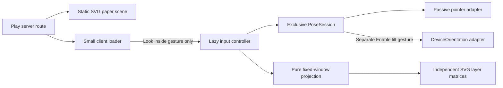
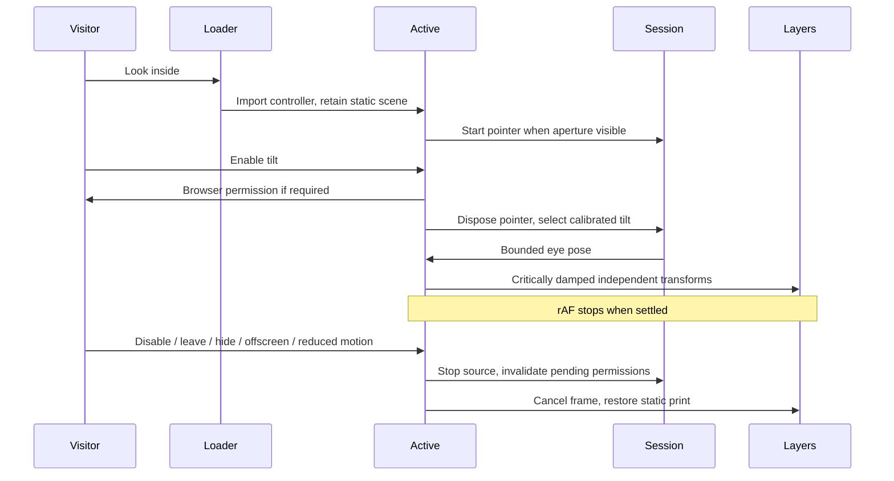

# Ryugu Paper Toys architecture

## Pointer and tilt Peep-box · pm-264/t-1590

The Play route server-renders `PeepBoxScene` inside `PeepBoxLoader`. The scene is source SVG: palace, seabed/kelp, fish and turtle at depths 500, 300, 160 and 60 SVG units. The 600×360 window reserves its aspect ratio, clips its contents, and uses existing paper/ink/colour tokens and the isolated `peep-ryugu-ink` filter. The controls reserve 320 CSS pixels before activation. Claw, Pond and Ink Press keep their existing implementations and entry points.

The pure `lib/peep-box.ts` port defines `EyePose`, `Aperture`, `LayerProjection` and `PoseSource`. Coordinates are relative to the aperture centre, +y down; the eye is in front at positive z and layer depth is behind at negative z. Ray intersection with z=0 gives `scale=z/(z+depth)` and window position `scale*world+(1-scale)*eye`. The SVG matrix adds the aperture centre. This scales and translates each layer separately; a displaced eye moves deeper layers farther. Eye x/y are bounded to ±150/±100, distance to half through 1.5× nominal viewer distance. Invalid eye/depth values normalize safely, negative depths stop at the aperture plane, and malformed aperture geometry throws `invalid_aperture`.

`PoseSession.select` disposes its previous source before starting another. Generation guards reject late callbacks after handoff/stop. A future camera adapter implements the same `PoseSource` and can enter through the controller's `choose` function. This task adds no camera UI, media request, worker, SDK, model, binary asset or dependency.

Pointer events are passive, accept mouse/pen, and never capture pointers. Touch input retains native `touch-action: pan-y`; touch/keyboard users have labelled directional buttons. Arrows/Home work only inside the direction group. Button input explicitly hands ownership back to pointer. Enable tilt alone may request DeviceOrientation permission; denial/missing API leaves pointer controls usable. The first valid sample calibrates beta/gamma, screen-angle changes recalibrate, wrapped angular deltas are rotated into screen coordinates, and Recenter tilt resets the neutral sample.

The exact critically damped spring step clamps elapsed time to 50ms and snaps at a finite rest threshold. Only movement schedules rAF. IntersectionObserver, document visibility, pagehide and effect cleanup cancel frames and detach input listeners; returning selects pointer and requires a fresh gesture for tilt. Live reduced motion tears down the controller's observers/input work and presents the static scene, retaining only the motion preference subscription. Save-Data has the same explicit activation requirement as every visit. No hover or viewport prefetch opens the lazy controller.

## Verification notes

Run `run-8819` uses the board-recorded profile `codex-sol-6-1-high`, model `gpt-6.1-sol`, reasoning effort `high`; fleet worker `avietidol-z490`. Dependencies are installed with `npm ci` under Node 22.23.3, Next 16.4.2, React 19.3.0 and Playwright Core 1.64.0. Browser checks use the real production build, actual SVG screen matrices and Chrome 154.0.8037.57, with a disposable embedded Postgres 17 instance provided by `scripts/e2e.mjs`.

The unit fixtures calculate neutral and mirrored ray intersections independently, cover distinct depth displacement, near-plane bounds, malformed/nonfinite inputs, rotated/calibrated orientation, spring rest and exclusive/late source handoff. Browser checks cover 390×844 and 1366×768 actual layer geometry, keyboard/pointer input, clipping/reserved dimensions, native touch scrolling, Save-Data, no-JS, permission grant/denial/absence, pending permission cancellation, rotation, rest/offscreen/hidden/pagehide/Disable, live reduced motion and client-side route cleanup. Normal movement producing nonzero attributed rAF is the negative control for the zero-work assertions. A real CDP touch pan scrolling the document is the touch negative control.

Orientation values, permission responses and document hidden-state events are synthetic browser fixtures. They prove adapter policy and lifecycle, not a physical sensor. Actual phone sensor quality remains unmeasured and is explicitly outside this delivery gate. Camera inference/privacy implementation belongs to plan task 5; no camera execution is claimed here.

The production browser measures a conservative 8,456-byte gzip upper bound at both required viewports: the entire Play page chunk (5,281 bytes, including pre-existing Play code), lazy controller and its pure helpers (2,637 bytes), plus scoped source CSS (538 bytes). Existing shared React/Next runtime is excluded. No camera/model/Wasm request, Worker construction or getUserMedia call occurs. Attributable CLS is 0 and stabilized inactive frame scheduling is 0. `e2e/peep-box.test.ts` prints the emitted chunk paths, SHA256 hashes, browser identity, gzip total and CLS and enforces the 35KiB/0.001 budgets.

The pre-existing Ink Press expands its mobile placeholder when loaded during scrolling. Geometry tests first finish that sibling's DOM layout, then start their attribution baseline; projected coordinates are measured against the aperture using the actual SVG viewBox scale. Next history may update before the outgoing ViewTransition/Activity hides its page, so route cleanup is asserted at the actual old-scene hide/commit.

The full regression also exposed the existing Kame 499/500ms fixture flake. `e2e/kame.test.ts` now explicitly pauses its installed clock after hydration and before key-down, preserving both boundary assertions and all Kame product code. Installing Playwright's clock alone leaves time running between protocol calls; the focused Kame suite verifies the repaired fixture.

The run summary records final commands, source/build fingerprints and local results. CI, deployment and independent QA are owned by plan-manager after the pushed delivery; this engineering run stops at push and makes no deployed-product claim.

## Rescue delivery verification · run-8844

The runner resumed the task as a single commit on local `main`, already based on `0c4a25d`. Retained all Peep-box code and the Kame clock fixture fix. No additional product behavior was needed. The earlier side-branch delivery failed the runner's `push_not_on_main` gate; this run delivers through `git push origin HEAD` from `main`. The incidental `content/history.json` prebuild refresh is excluded so the amended commit does not leave a snapshot pointing at its superseded provisional SHA.

Fresh locked installation and production execution use Node 22.23.3, Next 16.4.2, React 19.3.0, Playwright Core 1.64.0 and Chrome 154.0.8037.57. The actual profile remains `codex-sol-6-1-high`, model `gpt-6.1-sol`, effort `high`, worker `avietidol-z490`. Final build `Gc-DZDimCpinBxFycHj1H` reproduces the same subsystem fingerprint `6d4b115e33cfb82bdae3c9ded455c7817f7d92746fab693b7896e20f876e73c3` and emitted chunk hashes above. All four contract commands pass: six focused unit tests, 2,133 repository unit tests, lint/type checks (10 existing warnings), and eight production browser cases. Both required viewports reproduce 8,456 bytes gzip and zero attributable CLS; lifecycle tests demonstrate zero stabilized inactive rAF with moving input as a nonzero control. Native touch scrolling is exercised through CDP. Orientation/permission/visibility fixtures remain synthetic, with physical sensor quality outside the gate.

The new run summary and shared artifacts hold complete local logs and final browser regression results. The board's nonpaginated plan-run listing returned four runs: one failed task attempt, this running retry, and two succeeded research/planning runs; there is no completed SWE attempt for t-1590. The prior runner's raw tail is truncated and cannot establish complete historical execution. Its persisted terminal failure and report do establish the main-delivery failure. Red gate `ver-3533` targets original plan SHA `095c899`, where the new test files were absent; it is not a failure of this executable. No green gate exists yet. CI/deployment/independent QA remain plan-manager's post-push checks for t-1590; local browser execution does not establish deployed product delivery.

The first push rejected because main advanced to `841ca69`. Rebased without conflicts and retained its CI diagnostics and Kame flowing-clock negative control. Repeated the four task contracts and the full serial browser regression on the new real runner; this adds two unit cases without changing the Peep-box fingerprint or resource measurements. The delivery remains a single task-prefixed commit on main.
