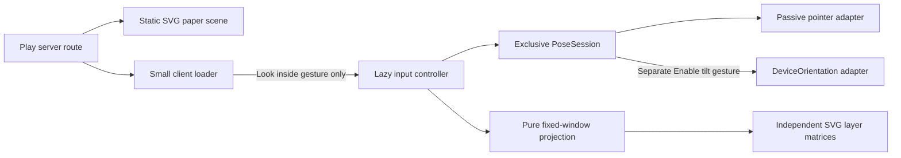
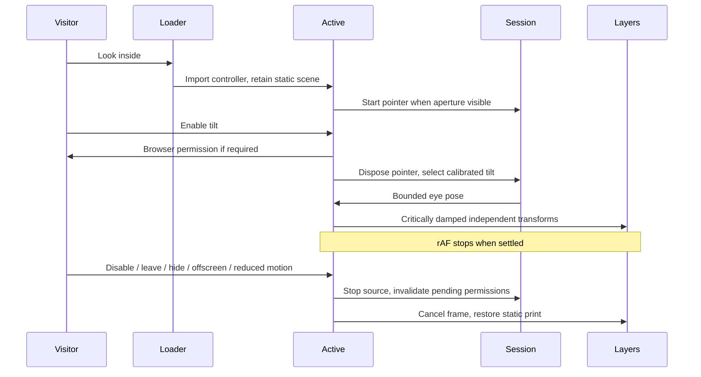
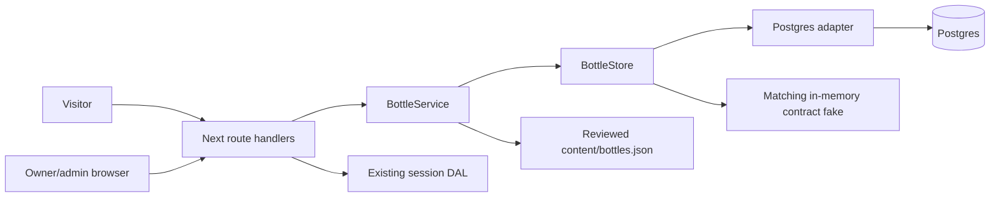
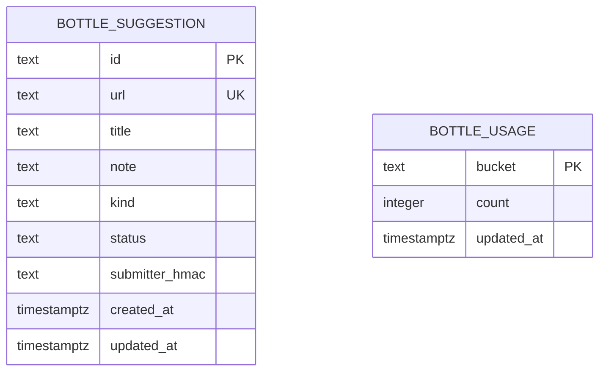

# Ryugu Paper Toys architecture

## Pointer and tilt Peep-box · pm-264/t-1590

The Play route server-renders `PeepBoxScene` inside `PeepBoxLoader`. The scene is source SVG: palace, seabed/kelp, fish and turtle at depths 500, 300, 160 and 60 SVG units. The 600×360 window reserves its aspect ratio, clips its contents, and uses existing paper/ink/colour tokens and the isolated `peep-ryugu-ink` filter. The controls reserve 320 CSS pixels before activation. Claw, Pond and Ink Press keep their existing implementations and entry points.



The pure `lib/peep-box.ts` port defines `EyePose`, `Aperture`, `LayerProjection` and `PoseSource`. Coordinates are relative to the aperture centre, +y down; the eye is in front at positive z and layer depth is behind at negative z. Ray intersection with z=0 gives `scale=z/(z+depth)` and window position `scale*world+(1-scale)*eye`. The SVG matrix adds the aperture centre. This scales and translates each layer separately; a displaced eye moves deeper layers farther. Eye x/y are bounded to ±150/±100, distance to half through 1.5× nominal viewer distance. Invalid eye/depth values normalize safely, negative depths stop at the aperture plane, and malformed aperture geometry throws `invalid_aperture`.

`PoseSession.select` disposes its previous source before starting another. Generation guards reject late callbacks after handoff/stop. A future camera adapter implements the same `PoseSource` and can enter through the controller's `choose` function. This task adds no camera UI, media request, worker, SDK, model, binary asset or dependency.

Pointer events are passive, accept mouse/pen, and never capture pointers. Touch input retains native `touch-action: pan-y`; touch/keyboard users have labelled directional buttons. Arrows/Home work only inside the direction group. Button input explicitly hands ownership back to pointer. Enable tilt alone may request DeviceOrientation permission; denial/missing API leaves pointer controls usable. The first valid sample calibrates beta/gamma, screen-angle changes recalibrate, wrapped angular deltas are rotated into screen coordinates, and Recenter tilt resets the neutral sample.



The exact critically damped spring step clamps elapsed time to 50ms and snaps at a finite rest threshold. Only movement schedules rAF. IntersectionObserver, document visibility, pagehide and effect cleanup cancel frames and detach input listeners; returning selects pointer and requires a fresh gesture for tilt. Live reduced motion tears down the controller's observers/input work and presents the static scene, retaining only the motion preference subscription. Save-Data has the same explicit activation requirement as every visit. No hover or viewport prefetch opens the lazy controller.

## Verification notes

Run `run-8819` uses the board-recorded profile `codex-sol-6-1-high`, model `gpt-6.1-sol`, reasoning effort `high`; fleet worker `avietidol-z490`. Dependencies are installed with `npm ci` under Node 22.23.3, Next 16.4.2, React 19.3.0 and Playwright Core 1.64.0. Browser checks use the real production build, actual SVG screen matrices and Chrome 154.0.8037.57, with a disposable embedded Postgres 17 instance provided by `scripts/e2e.mjs`.

The unit fixtures calculate neutral and mirrored ray intersections independently, cover distinct depth displacement, near-plane bounds, malformed/nonfinite inputs, rotated/calibrated orientation, spring rest and exclusive/late source handoff. Browser checks cover 390×844 and 1366×768 actual layer geometry, keyboard/pointer input, clipping/reserved dimensions, native touch scrolling, Save-Data, no-JS, permission grant/denial/absence, pending permission cancellation, rotation, rest/offscreen/hidden/pagehide/Disable, live reduced motion and client-side route cleanup. Normal movement producing nonzero attributed rAF is the negative control for the zero-work assertions. A real CDP touch pan scrolling the document is the touch negative control.

Orientation values, permission responses and document hidden-state events are synthetic browser fixtures. They prove adapter policy and lifecycle, not a physical sensor. Actual phone sensor quality remains unmeasured and is explicitly outside this delivery gate. Camera inference/privacy implementation belongs to plan task 5; no camera execution is claimed here.

The production browser measures a conservative 8,456-byte gzip upper bound at both required viewports: the entire Play page chunk (5,281 bytes, including pre-existing Play code), lazy controller and its pure helpers (2,637 bytes), plus scoped source CSS (538 bytes). Existing shared React/Next runtime is excluded. No camera/model/Wasm request, Worker construction or getUserMedia call occurs. Attributable CLS is 0 and stabilized inactive frame scheduling is 0. `e2e/peep-box.test.ts` prints the emitted chunk paths, SHA256 hashes, browser identity, gzip total and CLS and enforces the 35KiB/0.001 budgets.

The pre-existing Ink Press expands its mobile placeholder when loaded during scrolling. Geometry tests first finish that sibling's DOM layout, then start their attribution baseline; projected coordinates are measured against the aperture using the actual SVG viewBox scale. Next history may update before the outgoing ViewTransition/Activity hides its page, so route cleanup is asserted at the actual old-scene hide/commit.

The full regression also exposed the existing Kame 499/500ms fixture flake. `e2e/kame.test.ts` now explicitly pauses its installed clock after hydration and before key-down, preserving both boundary assertions and all Kame product code. Installing Playwright's clock alone leaves time running between protocol calls; the focused Kame suite verifies the repaired fixture.

The run summary records final commands, source/build fingerprints and local results. CI, deployment and independent QA are owned by plan-manager after the pushed delivery; this engineering run stops at push and makes no deployed-product claim.

## Rescue delivery verification · run-8844

The runner resumed the task as a single commit on local `main`, already based on `0c4a25d`. Retained all Peep-box code and the Kame clock fixture fix. No additional product behavior was needed. The earlier side-branch delivery failed the runner's `push_not_on_main` gate; this run delivers through `git push origin HEAD` from `main`. The incidental `content/history.json` prebuild refresh is excluded so the amended commit does not leave a snapshot pointing at its superseded provisional SHA.

Fresh locked installation and production execution use Node 22.23.3, Next 16.4.2, React 19.3.0, Playwright Core 1.64.0 and Chrome 154.0.8037.57. The actual profile remains `codex-sol-6-1-high`, model `gpt-6.1-sol`, effort `high`, worker `avietidol-z490`. Final build `Gc-DZDimCpinBxFycHj1H` reproduces the same subsystem fingerprint `6d4b115e33cfb82bdae3c9ded455c7817f7d92746fab693b7896e20f876e73c3` and emitted chunk hashes above. All four contract commands pass: six focused unit tests, 2,133 repository unit tests, lint/type checks (10 existing warnings), and eight production browser cases. Both required viewports reproduce 8,456 bytes gzip and zero attributable CLS; lifecycle tests demonstrate zero stabilized inactive rAF with moving input as a nonzero control. Native touch scrolling is exercised through CDP. Orientation/permission/visibility fixtures remain synthetic, with physical sensor quality outside the gate.

The new run summary and shared artifacts hold complete local logs and final browser regression results. The board's nonpaginated plan-run listing returned four runs: one failed task attempt, this running retry, and two succeeded research/planning runs; there is no completed SWE attempt for t-1590. The prior runner's raw tail is truncated and cannot establish complete historical execution. Its persisted terminal failure and report do establish the main-delivery failure. Red gate `ver-3533` targets original plan SHA `095c899`, where the new test files were absent; it is not a failure of this executable. No green gate exists yet. CI/deployment/independent QA remain plan-manager's post-push checks for t-1590; local browser execution does not establish deployed product delivery.

The first push rejected because main advanced to `841ca69`. Rebased without conflicts and retained its CI diagnostics and Kame flowing-clock negative control. Repeated the four task contracts and the full serial browser regression on the new real runner; this adds two unit cases without changing the Peep-box fingerprint or resource measurements. The delivery remains a single task-prefixed commit on main.

## Verifier repair · run-8885

QA run-8876 saw two intermittent failures in `e2e/peep-box.test.ts` on the same executable: the analytic displacement check and the native touch-scroll control. Both were in the verifier. Product code is unchanged; the emitted Play chunk `b399ef8c…` and lazy controller `3570b1f3…` are byte-identical to the delivery.

**Geometry.** The controller renders its direction buttons before its effect wires `control.current`. `look()` and `tilt()` then ignore input until the IntersectionObserver marks the aperture visible and sets `data-running="true"`. The old test pressed Enter as soon as `[data-peep-controller]` appeared. On a loaded worker that input was dropped, so "right" equalled "neutral". A throwaway probe on the production build reproduced this on demand by clicking Look right from a MutationObserver as the button appeared: `data-running` was unset and the layer transform was unchanged. The same click after running moved the far layer's matrix translation from 136.364 to 190.909 SVG units, which is 120·500/1100, the analytic ray intersection. `activate()` now waits for `data-running="true"` and `data-source="pointer"`, except in reduced motion, where the controller never runs. The 0.1px assertion keeps its tolerance. On failure it now reports expected and actual displacement, neutral and right points, SVG bounds and, for both poses, every layer's screen CTM, aperture and SVG bounds, scroll position and running/source/moving state. Dropping input during the one- or two-frame start-up window is accepted product behaviour.

**Touch.** The control used to swipe once after a fixed 150ms while Ink Press could still grow its placeholder (QA measured max scroll 3904→4089). It now first finishes Ink Press's layout, the same way the geometry cases do. It records `scrollY`, `scrollHeight − innerHeight` and the aperture bounds, pans toward whichever side has at least 60px of room, and waits up to 2s for a delta above 30px. Start, end and maximum values appear in the failure. The real CDP touch events, the `touch-action: pan-y` check and the 30px threshold are unchanged.

**Local evidence (run-8885).** macOS lease, Node 22.23.3, `npm ci`, Next 16.4.2, Playwright Core 1.64.0, Chrome 156.0.8078.48, production build `L7KbzHbgDU2LtGMkvOaz_` with embedded Postgres via `scripts/e2e.mjs`. Pure projection 6/6, `npm test` 2155/2155, lint (10 existing warnings) and typecheck exit 0. Focused production browser suite: 8/8 on the fresh build, 8/8 on three `SKIP_BUILD=1` repeats, and 8/8 with all 12 CPUs saturated by busy loops. Full serial production browser regression `npm run test:e2e`: 110/110, none skipped. Both viewports still measure 8,456 bytes gzip and 0 attributable CLS. Orientation, permission and visibility inputs remain synthetic fixtures; no physical-sensor claim is made. The `.github/workflows/ci.yml` concurrency change from fix_plan_run-8876 is left to plan pm-270, which owns that file's edits. The live site already serves a descendant of `28d4542`.

## CI scheduling repair · run-9012

Following `fix_plan_run-8904.md`, workflow-level concurrency is removed. Checks use `ci-checks-${{ github.event.pull_request.number || github.run_id }}`: PR updates cancel stale checks while each main push/manual recovery has a separate group. Preview uses its own cancellable PR group so it cannot cancel checks. Only production shares `otohime-production-main`, with `cancel-in-progress: false` and the existing `needs: checks`. Report-only path filters, pinned runners, manual recovery and served-SHA verification are preserved. A pending production job may still be superseded; concurrency does not prove commit order or delivery. QA must verify live ancestry after successful checks/deploy. No queue expansion, application or Peep-box verifier change is introduced.

The configuration regression first failed 3/10 cases against the old workflow, then passed 10/10 after the repair. It rejects the shared workflow queue even with cancellation disabled and guards separate checks/preview groups, per-run main checks, production serialization and report-only filtering. This is a source configuration contract, not execution of GitHub's scheduler. Local production execution and its real/synthetic boundaries are recorded in [run-9012-summary.md](run-9012-summary.md), with full logs and fingerprints in shared artifacts.

Pre-push history is bounded and incomplete: two pages each cover 50/100 failed and 50/439 completed main runs; the current 25-run page has no nonterminal run. Public run `40319533832` confirms the old verifier CI was cancelled before jobs by `ci-refs/heads/main`. Descendant `40319672622` is now successful; this is an observed CI result, not a new live-site check. Latest observed `40340641001`/checks `121634081296` failed `Run npm test`; raw REST logs returned 403 and the public step log returned 404, so its assertion is unread. The separately diagnosed installed-Chrome/inherited-CI fixture defect is repaired upstream by `17bca22`, integrated here with its fake Chrome/node handoff coverage and public unit-failure annotations. Preserve that repair and the concurrent deploy-script/terminal fixes; run all required checks on the combined tree. A broad production run also exposed stale Riso heading assertions: upstream fixes Pocket Terminal's accessible-name assertion, and this task bounds Ink Radio's SSR heading match while preserving its plain source, placement, credit and privacy checks. Final serial regression: 138 pass, 0 fail, 1 optional screenshot-evidence case skipped because its artifact directory was not requested.

Plan pm-275's deployment repair and real Ubuntu CI/deployment behavior remain post-push checks; macOS and fake shell success alone cannot establish them. No post-push pipeline watch or deployed-system probe runs here: plan-manager owns the new SHA's CI/green gate and QA/live ancestry, and failure of any of them blocks product delivery.

## Footer title verifier repair · run-9040

Following `fix_plan_run-9032.md`, `scripts/walk-end.sh` now reads the complete `riso-source` class token inside its existing bounded `h2#end-title` match. It compares that uninterrupted plain source exactly with `site.end.title`; plain headings retain their previous behavior. Decorative, aria-hidden character plates no longer duplicate the title. All other footer, link, scene, layout, isolation and build-identity checks remain intact. No application, Peep-box, dependency or workflow change is needed.

`lib/end.test.ts` executes the actual shell verifier's heading block with nested Riso markup, encoded apostrophes, additional source classes and plain-heading fallback. Negative controls reject a wrong source even when the plate is correct, extra title text, a missing heading id, matching text outside the heading and an imitation source class. The original implementation fails the nested-heading fixture; a word-boundary-only selector also fails the class-token control. Verification and execution boundaries are recorded in [run-9040-summary.md](run-9040-summary.md); full logs and executable/build hashes are in the run artifacts. The fresh production Footer walk passes 67 checks with zero failures across all seven public pages and the existing auth/404/isolated-project controls. New CI/deployment and independent live QA remain owned by plan-manager after the tested push.

## Footer Chromium probe heading repair · run-9044

Following `fix_plan_run-9043.md`, the Chromium probe's heading expressions now live in `scripts/probe-end-dom.mjs`. They are self-contained page functions that `scripts/probe-end.mjs` serializes into Chrome with `inPage()`. `endTitleText` reads the single `.riso-source` span inside `h2#end-title` (a complete class token through the selector engine). It falls back to a plain heading's own text, returns null without the heading id, and returns a never-matching marker when two sources compete. The seven route checks and the no-JS check compare that text exactly with `site.end.title`. Every other landmark, SVG, link, copy, year and anchor assertion is unchanged.

The desktop text-bounds check first runs `settleEndTitle`. That waits, for at most 3 s, until the heading has left `data-riso-state="ready"` and its finite Riso entry animations have finished; infinite animations are ignored. `endTitleBounds` then requires every visible `.riso-anchor` glyph box (or a plain heading's text range) to lie inside the heading and the viewport. A plain heading must also not scroll. A Riso heading's `scrollWidth` includes its aria-hidden plates. Those are offset from the glyphs by design even after settling: the first repaired real run measured /music at 1366 px with 0 pending animations, glyphs inside (1161.9 ≤ 1163) and `scrollWidth` 429 against a clientWidth of 424. That excess is reported as `plateOverflow` instead of failing; page-level horizontal overflow is still its own check. The failure detail records scroll/client widths, plate overflow, glyph and heading edges, the line count, the Riso state and any animations still pending. The readout, link-column, grid, mobile and reduced-motion checks are untouched. The opacity-0 source is deliberately not measured: in real Chrome its pre-wrap line ends hang spaces about 5 px past the heading edge.

`scripts/probe-end-dom.test.mjs` is part of `npm test`. It launches Chrome through `scripts/probe-browser.mjs` and runs these exact functions against RisoText-shaped footers styled by the real `components/riso-heading.css`. The positive cases cover nested, extra-class, decorative-mismatch, plain and no-JS-expression headings, and show that whole-heading `textContent` duplicates the title. The negative controls are a wrong source under a correct plate, extra text, a wrong id, a source outside the heading, an imitation class and two sources. For bounds, a paused first-frame entry scrolls (`noScroll=false`, which the old check failed) while its glyphs stay inside the heading, and a printed entry settles to zero pending. Plain nowrap overflow, plain and Riso off-viewport text, Riso glyphs spilling past a narrow heading and a missing heading all still fail. Fixtures are synthetic HTML; the real served pages are covered by the full probe run recorded in [run-9044-summary.md](run-9044-summary.md).

## Bottle persistence and moderation — pm-269/t-1587

The public Bottle launcher is a later task. This delivery supplies its data/service contracts, twelve curated discoveries, suggestion API and existing-admin-area moderation page. Pure `lib/bottles.ts` can be imported by that future client without importing secrets or Postgres. `Bottle` is `{id,url,title,note,kind}`; `BottleStore` and `BottleService` are declared in `lib/bottles-service.ts` before their adapters. `BottleStore` has atomic `admit`, public `approved`, bounded `list` and authorized `moderate` methods. Services accept the store, seed data, clock, id generator and secret; selection accepts RNG/seen ids, with `seededRng` for reproducible visits. Seen ids that no longer exist do not exhaust the pool; after all current ids have been seen, selection starts another cycle.





Migration `0005_magenta_william_stryker` is additive, generated by Drizzle with its snapshot/journal. Status and kind have check constraints, text lengths are bounded, URLs are unique, and usage count is constrained to 0–5. Existing users, auth data, songs and guestbook rows are untouched. `bottle_review_idx(status,id)` supports keyset pages of at most 25 suggestions, with one lookahead row and opaque/stable id cursors (no offsets or unbounded page sizes). Admin DTOs omit the submitter HMAC. Public DTOs contain only Bottle fields.

```mermaid
sequenceDiagram
  Visitor->>HTTP: POST suggestion (same trusted Origin, JSON ≤8KiB)
  HTTP->>Service: validate text, canonical HTTPS URL and honeypot
  Service->>PG: admit (HMAC, UTC-hour bucket)
  PG->>DB: BEGIN, per-bucket transaction lock
  PG->>DB: check duplicate; conditional usage upsert (<5)
  PG->>DB: insert unique URL as pending; COMMIT
  HTTP-->>Visitor: 201 {id,status:pending}
  Owner->>HTTP: PATCH approved/rejected with session
  HTTP->>DAL: current session + bottle:moderate
  HTTP->>PG: moderate with actor id
  PG->>DB: lock/recheck actor role + ban; lock suggestion
  PG->>PG: revalidate stored content before approval
  PG->>DB: update status; COMMIT
  Visitor->>HTTP: GET public pool
  HTTP->>DB: approved rows only (no cache)
  HTTP-->>Visitor: curated union approved; degraded flag
```

Admission consumes a quota slot only when a valid, new suggestion commits. Validation failures, duplicates (including curated URLs) and rolled-back writes do not consume slots. Different IPs racing on one URL are resolved by the unique constraint, with the losing usage increment rolled back. Expired usage receives a bounded 100-row cleanup during successful admission. All identifiers and SQL values use parameters.

URL rules: only HTTPS; reject credentials, nonstandard ports, any IP literal (including WHATWG-normalized hex/decimal/short forms), local/reserved DNS names, fragments, known tracking parameters, backslashes, whitespace/controls and URL strings over 2048 characters. Lowercase and trim the host's terminal dot, normalize default `:443`, and sort query parameters for dedupe. Fragments/trackers are rejected rather than silently removed, as the task requests. Arbitrary public-looking DNS names can still resolve privately; this is not a DNS reputation service. No destination lookup occurs. All titles/notes are 1–80 Unicode code points, trimmed plain text; markup, entity-like payloads and control/format characters are rejected. Unsafe legacy rows may be viewed as escaped text and rejected, but cannot be approved.

Trusted client identity is the [Vercel-overwritten `x-vercel-forwarded-for` header](https://vercel.com/docs/headers/request-headers#x-vercel-forwarded-for), read only with server-side `VERCEL=1` and only for a valid IP. Generic forwarded-for/real-ip headers are ignored. Direct/local servers conservatively share `unknown`; operators of a different deployment must implement its trusted proxy boundary before enabling per-client identity. No test-only header bypass is shipped. HMAC-SHA256 uses existing `BETTER_AUTH_SECRET` and a Bottle-specific namespace. Neither raw IP nor HMAC is logged or exposed publicly. HMAC is pseudonymous, not reversible encryption.

Writes require an explicit trusted Origin from the configured auth URL, the two production site origins, or the exact current Vercel preview URL; request Host/forwarded-host never expand trust. POST and PATCH cap streamed bytes as well as Content-Length. Responses use `cache-control: no-store`; public GET explicitly awaits `connection()` so a build-time fallback cannot become a cached pool. Admin page uses the existing DAL, proxy and permission; direct APIs independently return 401/403. Transactional actor-row locking rechecks current owner/admin permission and ban state before a status write, even if the service's actor is stale. Ordinary users have no `bottle:moderate` permission. The roles page discovers the new permission from the same access-control statements.

Stable reasons/statuses: `shape|honeypot|url|text|kind|json|status|cursor|invalid` 400; `duplicate` 409; `oversized` 413; `unsupported_content` 415; `rate_limited` 429 (UTC-hour Retry-After); `unavailable` 503; `unauthenticated` 401; `forbidden|origin` 403; `not_found` 404. Success is 201 `{id,status:'pending'}`. GET `/api/bottles` is `{bottles,degraded}` and returns all curated seeds with `degraded:true` on missing/unavailable database. Failed writes never claim success. Rejection takes effect on the next public read. Reviewed JSON takes precedence over an approved duplicate; rejected suggestions cannot override a curated seed.

Admin controls use the site's paper/card/button tokens and ordinary labelled buttons, with pending, success, failure and empty states. Status and page cursor live in the URL. URLs/notes are escaped text, never clickable submission anchors, HTML, images or iframes. In-flight moderation requests are aborted on unmount. No new authentication, crawler, external request, notification, launcher or animation is added.

### Local operator recipe and verification boundary

1. `npm ci`; configure the usual `DATABASE_URL`, `BETTER_AUTH_SECRET`, `BETTER_AUTH_URL`; run `npm run db:migrate` then `npm run dev`. Never put secret values in a committed file.
2. Use the existing account bootstrap documented in README: create an account, promote its user row to owner with your database console, then sign in normally. Existing admins can moderate too. Navigate to `/admin/bottles` or use the Bottles sidebar link.
3. Submit JSON `{url,title,note,kind,website:''}` to `/api/bottles/suggestions` with the site's Origin; observe pending and its id. GET the public pool: that id is absent. Review pending, approve, GET again, reject, GET again. Check the roles page for owner/admin-only `bottle:moderate`.
4. For a disposable real database, production build/server and integration fixtures: `node --experimental-strip-types --disable-warning=ExperimentalWarning --disable-warning=MODULE_TYPELESS_PACKAGE_JSON scripts/e2e.mjs --test e2e/bottles-api.test.ts`. No manual database, personal account or external-site access is required by the tests.

The shared contract runs against memory and real Postgres. Integration tests cover fresh migration, populated users/songs retention, reconstructed service persistence, tied-id pagination, concurrency, forged headers/origins, ordinary/anonymous API access, current-role/demotion checks, corrupted stored content, approval/rejection visibility and deliberate table unavailability. Chromium exercises actual admin controls at a mobile viewport, with ordinary-user page denial and zero external browser requests. A fetch trap with a positive failing control exercises the real handler/service/Postgres chain in the integration process; this proves no destination fetch in that chain, not instrumentation of every request inside the separate Next process. Production HTTP routes are separately exercised end to end. No fake runner or mocked SQL is offered as persistence proof.

This is local implementation/integration evidence only. No durable background job, runtime-capacity queue, inference executable, external callback, or paginated platform job history exists in this feature; those execution-history requirements are inapplicable. Deployment, CI green gate and independent deployed QA remain owned by plan-manager after the tested push. This engineering run does not watch CI or claim deployed product acceptance.


## Kamishibai Theatre · pm-269/t-1589

`content/project-stories.ts` keys eleven stories by the existing project href. Each has three original source-SVG path drawings, a title and a substantive caption describing behavior documented in README's Layout section and the project's current engine. They make no claims about traffic, personal history or invented outcomes. `lib/kamishibai.ts` owns the plain schema, bounded index movement, project reset and arrow policy. Coverage tests require the exact directory href set, unique ids, readable plain captions and path-only owned art.

The Projects directory remains intact, including its original `project-*` title transition names and project anchors. The separate server `ProjectStories` component renders every story as a linked section and ordered list. `TheatreLoader` receives that server content as children. Its small client boundary defaults to the complete list; only an explicit Theatre selection renders `React.lazy`/Suspense's stage. The project controller, story data and pure babble generator are absent from the initial scripts and arrive after selection. CSS uses paper/ink tokens, source wood-grain gradients, a stack of paper sheets and a single isolated `kamishibai-ink` displacement filter. All selectors, animation classes and keyframes use the theatre prefix.

The stage keeps committed React state and an immediately updated ref, so rapid input advances from the latest requested card. Endpoint buttons remain focusable with `aria-disabled`; they cannot move beyond the stack. Arrow handling bubbles only through the enhanced stage and excludes modified keys, text/select/editable fields and dialog/Pocket targets. Captions stay actual text. Controls sit outside the transition participant and retain focus. Read all cards returns to the complete server list and focuses its heading.

Per the installed Next 16.4.2 View Transitions guide, changes use `startTransition` with `addTransitionType` and React 19.3 `ViewTransition`. One `kamishibai-story-card` participant changes key per card; only typed `kamishibai-next`/`kamishibai-prev` transitions slide. Default transition behavior is none, preserving the surrounding page-in/page-out boundary. Unsupported native APIs take the immediate state update path. A live reduced-motion external store removes the enhanced stage and exposes every server card; a CSS fallback also reveals the list immediately on the media change. With no JavaScript, all 33 cards and ordinary links remain visible.

`babble(text, seed)` returns pure pentatonic notes with deterministic syllable choices, whitespace gaps and punctuation pauses. Input scanning, pitch, duration and note count are bounded: at most 28 voice notes plus two quiet clapper notes, each requiring one oscillator and gain (60 nodes, or 64 including the shared enable cue). The final envelope/scheduler margin stays below 2.5 seconds. There is no speech API, recording or network audio. The existing `sound-client` exposes a bounded voice port that uses its one gesture-unlocked AudioContext and sound preference; the generator and stage decide to call it only on deliberate card/project/enable input. Merely opening Theatre, restoring stored sound or enabling the masthead toggle never reads a caption aloud. Its visible switch subscribes to the same preference as the global toggle.

Voice generation guards and cancellation functions stop and disconnect every pending note before replacement or mute. List/reduced mode and React effect teardown cancel it; hidden/pagehide cancel pending resumes and active nodes. Pagehide closes the shared context. A late or refused resume remains silent; natural completion releases the lifecycle listeners. No second context is introduced.

### Theatre verification · run-9051

Actual board profile `codex-sol-6-1-high`, model `gpt-6.1-sol`, effort `high`, worker `avietidol-z490`. Locked installed versions: Node 22.23.3, Next 16.4.2, React 19.3.0, Playwright Core 1.64.0; real Chrome 154.0.8037.57. Production build `_JqrC7YzWbNjoMwoUriVU`; relevant code/lock/config fingerprint `82aba5ebf86f7611033894e89a96438b874b30001ace57777dbe66b756840162` (algorithm and per-file hashes in `.agent-artifacts/pm-269-t-1589/verification-output.txt`). No binary assets or new dependencies.

All four contract commands pass: focused 27 tests, repository 2,344 tests, lint/type checks (10 existing lint warnings, no errors), six production-browser cases using a fresh build and isolated real Postgres 17. Tests cover all 11 stage selections/33 no-JS captions, endpoints and focus, scoped/input/dialog/outside arrows, real CSS slide animation names, unsupported transitions, initial/live reduced motion, global/theatre preference synchronization, bounded real WebAudio construction, rapid replacement, immediate mute, list/hidden/pagehide/reduced/route cancellation and normal site/project navigation without duplicate-name errors.

Budget is a conservative **22,734 bytes gzip** at 1366×768 desktop, 390×844 touch, and 683×384 CSS pixels at DPR 2 (200%-equivalent reflow of a 1366×768 viewport). It includes the complete loader-bearing route chunk, feature stylesheet, lazy controller and all later fetched resources, even existing project-link prefetches; shared initial runtime is excluded. Touch uses an actual browser tap; all layouts retain readable controls and no horizontal overflow. Browser logs pin each resource SHA256. The native SVG stage was also visually inspected.

The Node audio adapter is a fake for deterministic cancellation/resume-race tests. Browser audio is real: an observing subclass calls native context, gain, oscillator, stop and disconnect methods, reads actual context state and records nodes. Hidden/pagehide events and unsupported API removal are synthetic lifecycle fixtures. Different seeds, punctuation delays, enabled live nodes and working scoped arrows are the positive/negative controls for silent or excluded paths. Closed-context ordinary enable notes do not receive onended in Chrome; the spy correctly counts audibility by real context state instead of treating those historical nodes as active. Human listening and physical-device tests are not claimed.

History audit is bounded and partial globally: two coding-task pages each for FAILED (40 of 81) and COMPLETED (40 of 1,428); no Theatre title match. The plan's nonpaginated SWE history contains succeeded Bottle run-9049 and active Theatre run-9051, each with zero callback-application failures; no prior Theatre attempt. A raw sibling Peep-box failure tail confirms the historical off-main push/rescue failure, not an executable failure of this fingerprint; truncated/unread history is inconclusive. This task's local earlier failures were fixture timing/accounting defects corrected before the final passing production build. Existing unrelated sibling failures are not waived.

Local execution is demonstrated. CI, integration deployment and independent deployed acceptance belong to plan-manager after push (pm-269/t-1589, run-9051; failure condition any CI/green-gate/QA regression). This run does not inspect CI or the deployed system. No capacity or human prerequisite is deferred. Full commands, hashes, real/fake boundaries and history limits are retained with the verification artifact; delivery SHA is the summary report's `git_sha` and generated artifacts `commits.txt`.


After the first push was rejected (concurrent main changes), git pull --rebase --autostash integrated origin/main 0a21579 cleanly. Upstream changed documentation only. All four contract gates passed again on rebased HEAD: 27 focused, 2344 repository, lint/typecheck, 6 fresh-production browser cases. Rebased build lbm2CuP7typK4fkkJlmZ4; executable fingerprint remains 82aba5ebf86f7611033894e89a96438b874b30001ace57777dbe66b756840162. Conservative gzip values: 22734, 22734, 22734. Full retry logs are artifacts/*-rebase1.log. No force push or CI/deployed-system inspection.
