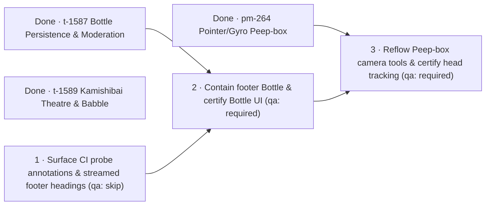

# Ryugu Paper Toys II

Plan: `pm-269` · Revision 2 · Product owner: `run-9097` · 2026-10-27
Chained after: `pm-264` (`done`)
Research: [rep-5121, preserved verbatim](research.md)
Prerequisites: [prerequisites.json](prerequisites.json) · [probe results](prerequisite-probe.md) · [proposed contracts](tasks.json)
Planning base: `25400127ac6ccc51c607f37a32eb804fc5b35b06`; delivery identity is the commit containing this document.
Actual run profile: `agy-argon-high`, model `Gemini 4 Argon (High)` (`gemini-4-argon`), effort `high`, worker `avietidol-z490`, account `billie-agy`.

## Outcome, completed scope, and Revision 2 delta

`otohime.dev` ships three paper-and-ink Urashima/Otohime folklore toys—Message in a Bottle, Kamishibai Theatre, and Peep-box Diorama—while preserving server-rendered readable HTML, paper/ink design tokens, strict lazy loading, `prefers-reduced-motion` fallbacks, off-by-default sound, and strictly opt-in on-device camera tracking.

Three of the five original contracts across `pm-264` and `pm-269` Revision 1 are already **done** and verified in production:

| Plan / Task | Title | Board state | Landed SHA / QA receipt |
| --- | --- | --- | --- |
| `pm-264` (`t-1590`) | Build the pointer and gyro Peep-box | `done` | Landed on `main` prior to `pm-269` |
| `pm-269` / `t-1587` | Persist and moderate Bottle suggestions | `done` | `9bdb3b2` · QA pass `rep-5323` (`f1f8ff3`) |
| `pm-269` / `t-1589` | Stage project case studies with ink babble | `done` | `4b8278a` · QA pass `rep-5325` (`a688012`) |
| `pm-269` / `t-1588` | Wash up Bottles from footer and Pocket | `superseded` | Exhausted 3 fix cycles (`run-9064`/`9075`/`9082`/`9091`, last QA fail `qa_report_run-9096.md`) |
| `pm-269` / `t-1591` | Track opt-in heads entirely on device | `superseded` | Superseded when Revision 2 opened (`3912d2b` / `e21f832` / late `2540012`, last QA fail `qa_report_run-9084.md`) |

Revision 2 keeps all completed `done` work intact and proposes **only** the remaining unfinished scope on `pm-269` as three focused `software_engineer` contracts so that both superseded surfaces (`t-1588` Bottle UI/footer and `t-1591` opt-in Peep-box camera) finish `done` with green CI and deployed QA before final plan acceptance.

### What Revision 2 does differently from failed Revision 1 cycles

1. **Eliminate blind CI `Footer Chromium probe` failures and streamed `/dashboard` skeleton races first (Task 1, `qa: skip`)**:
   - In GitHub Actions runs `40387187938` (job `121798467743`) and `40409123749` (job `121874634016`), `Footer Chromium probe` exited `1` and skipped production deploy, yet `e21f832` wrote failure details only to `$GITHUB_STEP_SUMMARY`—which GitHub's public job page does not render while raw job logs return HTTP 403 without admin rights, leaving only `Process completed with exit code 1.` visible. Task 1 adds `scripts/ci-probe-annotate.mjs` so `Real CPU camera and privacy verifier`, `Motion probe, signed in`, `Footer walk`, and `Footer Chromium probe` emit escaped `::error title=...::...` workflow annotations to stdout alongside `$GITHUB_STEP_SUMMARY` while preserving exact exit codes under `pipefail` and keeping exact `bash scripts/walk-end.sh` and `bash scripts/probe-end.sh` invocations intact for `lib/end.test.ts` and `scripts/ci-workflow.test.mjs`.
   - Simultaneously, `scripts/probe-end.mjs` (`local 390x844 reduced-motion 403 exit`) clicks `nav[aria-label="Main"] a[href="/dashboard"]` and reads `document.querySelector("main h1")` after a fixed `450ms` delay plus footer hydration, even though `/dashboard` streams behind `app/(site)/(app)/dashboard/loading.tsx` (a skeleton with no `<h1>`). Under hosted-runner load, sampling during the skeleton reads `h1: ""`. Task 1 replaces that fixed sleep with a bounded 10s observation for a non-empty `main h1` (matching `556a3ec`'s repair in `scripts/probe-motion-signed-in.mjs`), proven with a 1.5s delayed streamed `/dashboard` positive control and a missing-heading negative control.
2. **Contain the footer Bottle inside `footer.end` as well as above `.end-canvas`, with rem scaling and 44px touch targets (Task 2, `qa: required`)**:
   - Earlier `t-1588` runs anchored `.bottle-footer-entry` from its top (`inset-block-start: -2.4rem`), overlapping `.end-canvas` by `4.796875px` when button `font-size` grew to `24px` (`qa_report_run-9096.md`). Late commit `2540012` (`run-9095`) flipped `.bottle-footer-entry` to `inset-block-end: 100%; margin-block-end: .25rem;`, stopping downward overlap into `.end-canvas`, **but** `run-9095/artifacts/geometry-scale.log` proves `.end-inner` (`padding-block: 2.5rem 2.25rem`, `sceneTop = 42px`, `gap = 4px`) leaves only `38px` above `.end-canvas`: at `24px` button text (`height = 43.1875px`), `bottle.top - footer.top = -5.1875px`, pushing the Bottle cork across `footer.end`'s top border and `::before` dashed hairline into `<main>`'s bottom margin! Moreover, `geometry-scale.log` shows `scaled.rootFont = 32` (`200%` root scaling) left `scaled.height = 36` unchanged because `.chip` sets pixel `font-size`, and `36px` misses the `44px` minimum touch target contract.
   - Task 2 expands `.end-inner` top padding (`>= 3.75rem`), switches `.bottle-entry` to `rem` font sizing and `min-height: 44px` while keeping `position: absolute; inset-block-end: 100%; margin-block-end: .25rem;` (preserving `Math.abs(stageRect.top - copyRect.top) < 40`, `/music` TV `>= 16px` margin gap, and `<= 1px` state-to-state layout stability), asserts **both** `scene.top - bottle.bottom >= 0` **and** `bottle.top >= footerContentTop` at `1366×768`, `768×1024`, and `390×844` across default, `24px`/`32px` button text, and settled `200%` root font scaling, and certifies the full Bottle footer and Pocket UI to `done`.
3. **Reflow Peep-box camera tools under enlarged text/zoom and certify superseded `t-1591` to `done` (Task 3, `qa: required`)**:
   - `components/peep-box/peep-box.css` currently sets a fixed `height: 460px` on `.peep-tools`, risking vertical overflow/clipping of camera consent/fallback copy and directional buttons under `390×844` mobile + `24px` text or `200%` root scaling. Task 3 switches `.peep-tools` to `min-height: 460px` (retaining `CLS <= 0.001` at default size while expanding cleanly under zoom/text enlargement, verified with a fixed-height overflow negative control) and re-certifies the complete opt-in on-device MediaPipe `0.10.32` FaceLandmarker worker, same-origin checksum-verified assets, pinned NASA `astronaut.png` real CPU 478-landmark inference + pose shift + crop zero-landmark control, lifecycle/pending-permission teardown, `/play` `Permissions-Policy: camera=(self), microphone=()`, zero frame egress, full serial `npm run test:e2e`, and `verify-bottle-footer.mjs`.

## Repository and framework evidence

- Read root `AGENTS.md` and verified installed Next 16.4.2 documentation after `npm ci`:
  - `node_modules/next/dist/docs/01-app/02-guides/lazy-loading.md` (`ssr: false` belongs in Client Components; `webpackIgnore` / `turbopackIgnore` govern runtime worker/module expressions)
  - `node_modules/next/dist/docs/01-app/02-guides/view-transitions.md` (React 19.3 `<ViewTransition>` inside transitions with `default="none"` to isolate unrelated route transitions)
  - `node_modules/next/dist/docs/01-app/02-guides/content-security-policy.md`
- Platform `mono-v2` documents (`projects/20260921222547_plan_manager_chief_of_staff_extraction.md` and `docs/claude/software-development.md`) are absent from this standalone `otohime` repository; standing repository rules in `AGENTS.md`, `.github/workflows/ci.yml`, and `scripts/check-gate-closure.mjs` govern changes here.
- Any task touching `scripts/check-gate-closure.mjs`'s fingerprinted paths (`.github/workflows/ci.yml`, `scripts/probe-end.mjs`, `components/end-footer.tsx`, `components/handheld.tsx`, `app/(site)/globals.css`) runs `node scripts/check-gate-closure.mjs` in `verification[]` so `lib/e2e-runner.test.ts`, `lib/end.test.ts`, and `lib/urashima.test.ts` gate invariants never drift.

## Task DAG and prerequisites

- Sequential dependencies `1 -> 2 -> 3` prevent merge/rebase collisions on shared verification notes (`architecture.md`), `.github/workflows/ci.yml`, and full-page browser probes (`verify-bottle-footer.mjs` / `npm run test:e2e`), ensuring Task 1's CI `::error` annotations and streamed `/dashboard` fix protect Tasks 2 and 3's GitHub checks runs immediately.
- External capabilities (`github:otohime:git`, `fleet:otohime:software-engineer`, `github:otohime:actions`, `vercel:otohime:production`) are declared in [prerequisites.json](prerequisites.json) and probed in [prerequisite-probe.md](prerequisite-probe.md) under `legacy_v1` shadow mode. None require a person-only action; if a new person-only prerequisite ever surfaces, the first task encountering it raises `plan_manager_ask_user(kind=operator_action)` at task start. Runtime placement belongs to `task-manager`, never an operator chore.
- No scheduled/periodic job or background compute queue is introduced. Every task includes a new red-at-base regression file (`scripts/ci-probe-annotate.test.mjs` & `scripts/probe-end-stream.test.mjs` in Task 1; `lib/bottle-footer-layout.test.ts` in Task 2; `lib/peep-box-layout.test.ts` in Task 3), proves its claims inside the checkout, and stops at the tested commit and `git push origin HEAD`.

## Acceptance walkthrough (all three toys)

Independent QA (Tasks 2 and 3) and final plan acceptance verify exact served SHA ancestry on `https://otohime.dev/api/health`, green GitHub checks + production jobs, build/chunk/asset SHA256 identities, and independent `1366×768` + `390×844` + `200%` zoom + `24px` button-text browser checks across all three toys:

| Surface | Starting state -> action -> observable result | Negative control |
| --- | --- | --- |
| **CI & Footer gate** | Triggered workflow on `main` runs checks + production deploy; `verify-bottle-footer.mjs` passes 65/65 walk and 170/170 Chromium assertions including 390×844 403 -> streamed `/dashboard` heading. | Exit-7 fixture emits escaped `::error` annotation + `next-start.log` tail; missing `/dashboard` heading fails after bounded 10s timeout. |
| **Bottle (`/` & footer & `/admin/bottles`)** | Footer and Pocket `Bottle` buttons (>=44px, strictly inside `footer.end` and above `.end-canvas` at 16px, 24px/32px button text, and settled 200% root scaling) open the lazy paper panel (`<=3KiB` bootstrap, `<=25KiB` UI/CSS, `CLS <= 0.001`), draw without premature repeats, expose `Visit` (`target="_blank" rel="noopener noreferrer"`), and submit pending suggestions for owner/admin moderation. | Pre-`2540012` `-2.4rem` offset fails scene clearance; `2540012` `2.5rem` padding fails footer top-border containment at `24px` text; unauthenticated/ordinary users get `401`/`403` on `/api/admin/bottles`; modal keys never trigger footer Konami. |
| **Kamishibai Theatre (`/projects`)** | Explicit Theatre mode renders wooden stage + >=3 inked cards for all 11 projects (`<=40KiB` gzip), slides directionally via React `ViewTransition` on buttons/scoped arrows, and plays cancellable pentatonic babble + clapper only when sound is enabled. | Inputs/dialogs/Pocket ignore stage arrows; mute/list/hidden/route exit stops oscillators immediately; reduced motion and no-JS render full plain card list. |
| **Peep-box Diorama & Camera (`/play`)** | `Look inside` opens layered Ryugu-jo aperture (`<=35KiB` non-camera gzip, `CLS <= 0.001`) with distinct depth displacement under pointer/keyboard/opt-in tilt, overflow-free `.peep-tools` reflow at 390×844 + 24px/200% zoom, and click-only `Use my camera` (`video` only, `Permissions-Policy: camera=(self), microphone=()`) running same-origin checksum-verified MediaPipe `0.10.32` worker with proven 478-landmark CPU inference on the pinned NASA fixture. | Fixed `height: 460px` fails zoom overflow control; cropped non-face fixture yields 0 landmarks; worker/model corruption or permission denial falls back cleanly to pointer mode; Off during pending permission/model load disposes late tracks; zero frame/landmark network requests occur. |

## Build contracts

The authoritative machine-readable array is in [tasks.json](tasks.json) and passed verbatim to `plan_manager_propose_tasks`:

1. **`1` · Surface CI probe annotations and streamed footer headings** (`software_engineer`, `qa: skip`, `depends_on: []`)
2. **`2` · Contain footer Bottle within reserved header band and certify Bottle UI** (`software_engineer`, `qa: required`, `depends_on: ["1"]`)
3. **`3` · Reflow Peep-box camera tools under zoom and certify on-device head tracking** (`software_engineer`, `qa: required`, `depends_on: ["2"]`)
