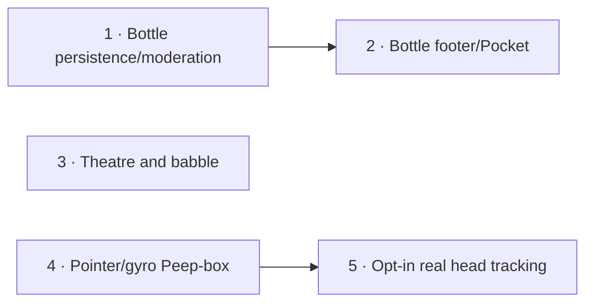

# Ryugu Paper Toys

Plan: pm-264 · Revision 1 · Product owner: run-8807 · 2026-10-26
Research: [rep-5121, preserved verbatim](research.md)
Planning base: `15fd171`; delivery identity is the commit containing this document.
Actual run profile: `codex-sol-6-1-high`, model `gpt-6.1-sol`, effort `high` (run-8807 board record, not historical guide defaults).

## Outcome and scope

Bring the Urashima/Otohime story into three small paper-and-ink interactions: discoveries wash ashore in a Bottle, project stories play through a wooden Kamishibai stage, and Ryugu-jo becomes a peep-box window on Play. Every toy enhances existing public routes, keeps real text and links readable, loads optional code on demand, and respects reduced motion. Sound starts off; camera and motion permissions require explicit separate gestures.

This product-owner delivery is a plan and preserved research, not an implementation claim. Five SWE build contracts below cover the entire requested scope. Each changes visible behavior and retains required QA; the platform already dispatches QA and final acceptance, so there are no duplicate QA-only tasks. Nothing depends on a person curating links, owning a webcam, giving browser permission, or approving a design before implementation can proceed. Implementers curate the launch list and use fixtures to exercise permissions. If a genuinely person-only chore appears, the first affected task raises `plan_manager_ask_user(kind=operator_action)` immediately with a stable fingerprint and readiness probe where available, then reports the exact missing prerequisite; independent work proceeds.

## Product decisions

**Bottle:** footer button plus a labelled action beside the homepage Pocket console (`components/handheld.tsx`, not the Pocket Terminal). Both open the same paper panel. A visitor deliberately opens a bottle, reads its one-line note, chooses Visit or Another bottle, and can suggest a site. No automatic navigation. Twelve launch links are reviewed by the implementer; more can be added later. Each entry has a stable id, HTTPS URL, title, note of at most 80 characters and site|toy|art kind. Bounded local history prevents repeats until exhaustion; blocked storage degrades to memory.

Suggestions are durable and pending by default. Admin/owner moderation is available in the existing admin area and authenticated API. A submitted note or URL is data, never HTML. The server never fetches visitor URLs. Curated JSON remains a usable pool if the database is unavailable. No email, daily digest, scheduled moderation, server URL preview, analytics or external queue is introduced.

**Theatre:** explicit mode on `/projects`, with project selection and at least three substantive cards for every current project. The directory and full ordered story content remain in server HTML. Wooden frame and hand-inked cards use source SVG/CSS. Next/Previous and scoped arrows animate one card at a time with React ViewTransition; feature absence produces instant swaps. Reduced motion selects the complete plain list. Read all cards remains available in enhanced mode. Captions are readable DOM text; decorative babble never replaces them.

Babble is deterministic pure event generation, pentatonic blips with punctuation pauses, at most 2.5 seconds and 64 nodes. It and a clapper use the existing shared AudioContext and sound preference. A visible stage mute control stays synchronized with global sound. Advancing cancels the previous voice; mute, hidden state and teardown cancel all active/pending voice work. No autoplay, cloud TTS or audio files.

**Peep-box:** explicit Look inside on `/play`, retaining Claw, Pond and Ink Press. The static paper seabed, palace, kelp, fish and turtle are useful without enhancement. A fixed aperture contains layers projected from a displaced eye; different depths must produce different measured displacement. Pointer and labelled directional controls work first. Tilt requires a separate gesture and permission when applicable. Smooth only active motion; stop at rest, offscreen and hidden.

Camera arrives in the final contract. Use my camera alone requests video without audio; permission grant precedes model download and inference. The indication Camera on and Turn camera off stay visible. A lazy same-origin worker runs the locked MediaPipe adapter, at most 15 inference starts per second and one frame in flight, with GPU attempt/CPU fallback. Frames/landmarks stay in memory on device. Off, pending-start cancellation, hidden, offscreen, reduced motion, route exit and pagehide release tracks/workers/bitmaps. Returning never silently resumes camera. Failures leave a short message and usable pointer controls.

## Repository and framework evidence

Read: root `AGENTS.md`; platform reference `/data/build-worker/repo/mono-v2/projects/20260921222547_plan_manager_chief_of_staff_extraction.md`; `/data/build-worker/repo/mono-v2/docs/claude/software-development.md` and its frontend guide. Those shared documents are not files in this repository. Standing rules remain in their sources; this document declares product interfaces and proof, not a replacement instruction file.

After `npm ci`, installed Next 16.4.2 guides exist at:

- `node_modules/next/dist/docs/01-app/02-guides/lazy-loading.md`
- `node_modules/next/dist/docs/01-app/02-guides/view-transitions.md`
- `node_modules/next/dist/docs/01-app/01-getting-started/15-route-handlers.md`
- `node_modules/next/dist/docs/01-app/02-guides/content-security-policy.md`

The lazy-loading guide places `ssr:false` in a Client Component; merely importing a Client Component dynamically from a Server Component does not create the intended lazy boundary. React 19.3 provides ViewTransition without an experimental Next flag; card updates need a React transition. Existing `page-in`, `page-out` and `project-*` transition names must remain distinct from Theatre names.

The explicit user request concerns this Next paper site. Keep its routes, design tokens, Better Auth, Drizzle and Vercel deployment; platform mono-v2's Astro/Vite/Atelier migration conventions do not authorize a framework/hosting rewrite here. The actual CI source is `.github/workflows/ci.yml`: checks, Vercel preview and production jobs. Generic GitLab child-pipeline/k3s instructions do not identify this app's deployment.

Official [MediaPipe Web guide](https://developers.google.com/edge/mediapipe/solutions/vision/face_landmarker/web_js) confirms separate SDK/model initialization and synchronous inference; isolate inference in the worker. Do not assume model licensing from the SDK license. Three inspiration links in the original request could not be fetched (cache misses); their supplied descriptions govern the design, not an unobserved screenshot.

## Interfaces

| Interface | Contract |
| --- | --- |
| `Bottle` | `{id,url,title,note,kind}`; validated before seed publication and again before approval. |
| `BottleStore` / `BottleService` | Pure/service ports, fake store and actual Postgres adapter share validation, moderation and atomic rate-limit contract tests. |
| `GET /api/bottles` | Curated union approved entries, no private queue metadata, curated URL precedence; fresh approval/rejection visibility; degraded seed-only response on DB error. |
| `POST /api/bottles/suggestions` | Bounded JSON, honeypot, trusted-origin and atomic HMAC-IP/hour cap; `201 {id,status:"pending"}`; stable error reasons. |
| `GET /api/admin/bottles` | Authenticated owner/admin only, status and cursor pagination; never a public queue. |
| `PATCH /api/admin/bottles/{id}` | Same server authorization; validated approved/rejected transition, persisted immediately. |
| `bottle:moderate` | Dedicated permission on current owner/admin roles; unknown/plain roles cannot moderate. |
| `project-stories` / `KamishibaiState` | Stable project/card ids, validated projectList coverage, complete readable baseline and bounded selected-card navigation. |
| `babble(text,seed)` | Deterministic finite events `{t,freq,dur,gain}`; no browser/audio imports. |
| `PoseSource` / projection | Normalized bounded pose and fixed-window geometry; pure layer transform, fake inputs and browser adapters. |
| `HeadTracker` | start/stop, status, pose/error; vendor types isolated, late-resolution cancellation and deterministic disposal. |
| Asset manifests/vendor script | Text-only version/source/license/SHA256 manifests generate same-origin Wasm/model build assets into ignored paths; failure is fatal, no unpinned CDN in production. |
| Real inference test fixture | Pinned licensed face image acquired into ignored test cache; deterministic crop/translation and blank frame controls; no fixture binary in Git or deployed public assets. |

Use existing `lib/dal.ts` session checks and `lib/permissions.ts` role helpers; frontend visibility alone is never authorization. JSON errors carry stable machine-readable reasons. Moderation API and page use the same service methods. New public handlers use the repository's same-origin Next API conventions; no platform IAM or unauthenticated admin bypass is introduced.

## Delivery order and size

Settings observed in run-8807: `max_plan_elapsed=6h0m0s`, `max_live_runs_per_plan=1`, `qa_mode=auto`. All five contracts are software_engineer with `qa=required`.



Dependencies are functional only. Tasks 1, 3, 4 are independently startable and sequence gives Bottle first preference. Shared repository paths and the plan architecture notes are honestly declared for conflict scheduling. At the documented 1h fallback per task, weighted sum is 5h and longest dependency path 2h, under 6h. The admission service's measured role-p50 calculation is authoritative. If refused `plan_too_large`, retain only Bottle tasks 1–2 here, file Theatre as part 2 after pm-264 and Diorama as part 3 after the returned part 2 id via `plan_manager_submit_idea`. Later parts draft only against landed predecessor code; use `after_plan_id`, never `parent_plan_id`. The full scope in this document remains their brief.

No cron, durable compute job or external runtime queue is part of these browser features. Tests drive gestures, clocks, inputs and errors now. There are no soak, natural-run, dated or human-receipt acceptance steps.

## Verification design and acceptance

The JSON contracts below are the exact proposal, not examples. Named new tests/scripts belong to their task and must fail or be missing at the red gate until implemented. An already-green `npm test` alone cannot close a feature. Unique checks assert behavior and negative controls; source string matching is not sufficient evidence.

All verification commands run inside the checkout and may mutate only isolated test databases, generated assets and this run's fixtures. Provision dependencies with `npm ci` under Node 22. The repository's `scripts/e2e.mjs` without BASE_URL builds/starts an isolated production app with embedded Postgres and cleanup. Never point state-changing e2e at a shared production database. In CI its BASE_URL mode uses the job's disposable database. Browser suites stay serial; no skipped/missing-browser/zero-test result is proof.

The Bottle footer verifier must reproduce the actual CI environment: build with `CI=true GITHUB_SHA=$(git rev-parse HEAD)`, start a local production server/database, run `walk-end.sh` and `probe-end.sh` with BASE_URL and matching EXPECT_SHA, and clean up. A standalone local probe without these variables does not reproduce remote-mode CI assumptions. Prefer reuse of existing runner lifecycle over another fragile subprocess manager.

Budgets count real transitive emitted JavaScript gzip, excluding existing React/Next runtime but including new shared helpers once: Bottle bootstrap <=3KiB and panel <=25KiB; Theatre <=40KiB; non-camera Diorama <=35KiB. Camera SDK/worker/model/Wasm are never fetched on initial navigation, on hover, on plain Look inside, on denial, or in reduced motion. Camera bundles are measured and reported separately rather than hidden in the base budget. All toys reserve geometry, produce no attributable layout shift above 0.001, pause inactive work and retain 44px touch targets, visible focus and readable light/dark contrast.

Independent QA and final acceptance inspect the delivered diff and actual build identities (build-sha plus relevant chunks, lock/model/Wasm/fixture hashes) and use their own browser/API actions beyond rerunning the supplied verifier. Exercise 1366×768 and 390×844 plus 200% zoom. Report starting state → action → observable result → evidence for:

| Flow | Positive proof | Independent negative control |
| --- | --- | --- |
| Bottle draw | Footer and Pocket open equivalent cards; repeated draws exhaust pool without premature repeats; explicit Visit anchor. | A normal footer/Pocket action still works; drawing never opens a tab; unsafe submitted markup stays inert. |
| Suggest/moderate | Submit via browser, reconstruct store/refresh, inspect pending by id, approve with authorized operator fixture, reopen public pool, reject and verify disappearance. | Unauthenticated/plain role direct moderation returns 401/403; forged role/body, cross-origin and rate-limit cases do not publish. |
| Theatre | Select each project, next/back via real clicks and scoped keys, inspect all captions; enable sound then mute during voice. | Keys in a field/Pocket do not advance; sound-off schedules no voice; unsupported ViewTransition and no-JS retain links/content. |
| Diorama | Observe layer geometry from distinct poses and explicit tilt fixture; Center/Disable recover. | Scroll still scrolls; reduced motion/inactive/hidden has no pose rAF; base Play sends no camera requests. |
| Camera | Real locked CPU worker/model with licensed fixture yields nonempty landmarks and changed pose; explicit fake-media start shows Camera on. | Blank frame has no face; broken model/worker returns pointer mode; Off during pending permission disposes late tracks; no frame/landmark-bearing network traffic. |

Consent and lifecycle fakes establish policy, not model execution. The positive inference proof must instantiate the actual locked SDK, worker, processor, model and Wasm in production-browser CPU mode and process actual decoded fixture pixels. A blank synthetic webcam stream, fake worker or successful import alone is insufficient. Unit-tested projection is separate from real rendered off-axis geometry. GPU availability and physical-device orientation remain explicitly identified compatibility observations, not prerequisites requiring an operator's hardware.

Reports identify actual run profile/model/effort, delivered build and executable fingerprints, real/fake boundaries, negative controls, defects and deferred checks with exact ids/owner/failure condition. Runtime job history/callback counts are not applicable here because there are no external submitted jobs; do not invent them. A missing deployed build is unresolved integration evidence and must name the CI/deploy id and owner rather than silently checking a stale site. QA/acceptance own deployed proof; SWE action items end at tested commit/push.

## Build contracts

### 1. Persist and moderate Bottle suggestions

```json
{
  "sequence": 1,
  "title": "Persist and moderate Bottle suggestions",
  "role": "software_engineer",
  "qa": "required",
  "depends_on": [],
  "problem": "Visitors cannot submit discoveries and the site has no durable reviewed link pool or moderation controls.",
  "action_items": [
    "Declare Bottle, BottleStore and BottleService ports before adapters. Add red tests for validation, normalization, duplicate handling, picking, rate limits and moderation authorization; add content/bottles.json with at least 12 personally inspected HTTPS indie sites/toys/artworks and short original notes. Record source, final URL, review date and content rationale in the plan's bottle-curation.md. This curation is engineering work, not a person-only prerequisite.",
    "Implement lib/bottles.ts pure parsing and seeded no-repeat selection with injected RNG/seen ids; reject credentials, non-HTTPS URLs, nonstandard ports, localhost/.local, IP literals and private/reserved destinations represented as literals, fragments and tracking parameters. Normalize host/default port and deduplicate canonical URLs. Titles 1–80 chars, plain-text notes 1–80 chars, URL <=2048 chars; kinds site|toy|art. Never fetch visitor URLs server-side, render their HTML or embed them.",
    "Add additive Drizzle bottle_suggestion and bottle_usage tables plus generated migration/journal. Store id, canonical url, title, note, kind, pending|approved|rejected, created/updated timestamps and submitter HMAC; unique canonical URL. Implement real Postgres adapter and matching in-memory contract tests. A fresh database migrates and a populated database retains existing users/songs.",
    "Implement GET /api/bottles (curated JSON union approved rows, deterministic dedupe, curated precedence, no pending/rejected or submitter metadata; on database failure return the curated seed pool with an explicit degraded flag); POST /api/bottles/suggestions (JSON <=8KiB, honeypot, validation, atomic 5 accepted attempts/IP/UTC-hour cap, HMAC of trusted deployment client IP with existing server secret, no raw-IP logging). Use stable reason codes and 201 {id,status:'pending'}, 400 invalid, 409 duplicate, 413 oversized, 415 unsupported content, 429 rate_limited, 503 unavailable. Reject cross-origin writes using trusted Origin checks. No external URL requests.",
    "Implement GET /api/admin/bottles?status=pending&cursor=... with bounded pagination and PATCH /api/admin/bottles/{id} {status:'approved'|'rejected'}; both use existing session/DAL checks and a dedicated bottle:moderate permission granted only to owner/admin. Unauthenticated 401, ordinary user 403, missing row 404. Recheck rights at write time. Add /admin/bottles with labelled review controls and navigation; unsafe/unapproved submissions remain plain text and cannot be opened from public UI. Approval revalidates stored content; rejection removes it from subsequent public reads without stale caches.",
    "Create lib/bottles.test.ts, lib/bottles-service.test.ts and e2e/bottles-api.test.ts. Exercise actual HTTP and Postgres with the repository isolated runner; fixtures cover write persistence across service reconstruction, migrate-up sentinel retention, concurrent caps, unauthorized direct API access, approve/reject/public pool transitions, hostile URL/note payloads and zero server fetches. Document schema, interfaces and local operator recipe in architecture.md under the plan. Run full local gates and stop at tested commit/push; deployed proof belongs to QA."
  ],
  "interfaces": [
    "content/bottles.json",
    "lib/bottles.ts",
    "lib/bottles.test.ts",
    "lib/bottles-service.ts",
    "lib/bottles-service.test.ts",
    "lib/bottles-store.ts",
    "lib/permissions.ts",
    "lib/permissions.test.ts",
    "db/schema.ts",
    "db/migrations/",
    "app/api/bottles/",
    "app/api/admin/bottles/",
    "app/(site)/(app)/admin/bottles/",
    "app/(site)/(app)/layout.tsx",
    "e2e/bottles-api.test.ts",
    "projects/otohime-dev-three-paper-and-ink-toys-that-lean-into-the-uras/architecture.md",
    "projects/otohime-dev-three-paper-and-ink-toys-that-lean-into-the-uras/bottle-curation.md"
  ],
  "non_goals": [
    "public Bottle launcher or animation",
    "automatic publication or crawler/link-preview fetches",
    "email notifications, cron jobs or new authentication system",
    "Theatre and Diorama"
  ],
  "acceptance_criteria": "A valid suggestion is durably pending and absent from the public pool until an authorized owner/admin approves it. Rejection hides it again. Ordinary users cannot moderate via page or API; duplicates, hostile URLs, oversized requests and rate limits return stable reasons. Twelve reviewed seed links remain usable if the database is unavailable.",
  "verification": [
    {
      "name": "Bottle validation and service contracts",
      "cwd": ".",
      "cmd": "node --experimental-strip-types --disable-warning=ExperimentalWarning --disable-warning=MODULE_TYPELESS_PACKAGE_JSON --test lib/bottles.test.ts lib/bottles-service.test.ts",
      "expect": "exit0",
      "timeout_s": 300
    },
    {
      "name": "repository unit suite",
      "cwd": ".",
      "cmd": "npm test",
      "expect": "exit0",
      "timeout_s": 300
    },
    {
      "name": "lint and type contracts",
      "cwd": ".",
      "cmd": "npm run lint && npm run typecheck",
      "expect": "exit0",
      "timeout_s": 300
    },
    {
      "name": "migration consistency",
      "cwd": ".",
      "cmd": "npx drizzle-kit check && npm run db:generate && test -z \"$(git status --porcelain db/migrations)\"",
      "expect": "exit0",
      "timeout_s": 300
    },
    {
      "name": "isolated HTTP, Postgres and migration integration",
      "cwd": ".",
      "cmd": "node --experimental-strip-types --disable-warning=ExperimentalWarning --disable-warning=MODULE_TYPELESS_PACKAGE_JSON scripts/e2e.mjs --test e2e/bottles-api.test.ts",
      "expect": "exit0",
      "timeout_s": 900
    }
  ]
}
```

### 2. Wash up Bottles from footer and Pocket

```json
{
  "sequence": 2,
  "title": "Wash up Bottles from footer and Pocket",
  "role": "software_engineer",
  "qa": "required",
  "depends_on": [
    "1"
  ],
  "problem": "The curated/reviewed pool has no discoverable playful entry point or visitor suggestion form.",
  "action_items": [
    "Add a small labelled corked-bottle SVG button beside existing footer controls and a reachable Bottle action beside the homepage Pocket console in components/handheld.tsx. Both open the same lazily imported components/bottle panel. Keep art vector/source-only with existing paper tokens and scoped SVG ink filter ids; preserve footer/Pocket labels, geometry, credits, links, keyboard handlers and existing games.",
    "Use the service/picker from task 1, fetch public pool only on opening, and fall back to bundled curated entries with a clear quiet offline notice on API failure. Guard localStorage under bottles:v1, bound seen history to pool size (max100), normalize unknown ids and avoid repeats until the pool is exhausted; exhausted resets exclude the immediately previous bottle when at least two exist. Empty/single-entry/throwing storage remain usable. Draw on explicit button press, never navigate or open a popup automatically.",
    "Reveal a paper card with original note/title/kind and explicit Visit link target=_blank rel='noopener noreferrer'; Another bottle draws again, Escape closes and restores focus to the correct originating button. Use short wash-up motion only when permitted; reduced motion reveals instantly and a live preference change ends the animation. One labelled dialog/panel owns focus at a time with Pocket Terminal/Ask; no duplicate ids or orphaned overlays.",
    "Provide labelled Suggest a site URL/title/note/kind inputs, honeypot and submit/error/success states backed by POST /api/bottles/suggestions. State that suggestions are reviewed before publication. Retain input on errors, prevent duplicate submits and expose returned reason accessibly. Suggestion text stays inert. Honor 429 and unavailable responses without disabling Bottle browsing.",
    "Write e2e/bottle-ui.test.ts using real production-browser clicks/keys/touch, blocked storage, no-JS baseline, request failure, repeat exhaustion, safe external anchors, suggestion validation and footer/Pocket coexistence. Add scripts/verify-bottle-footer.mjs to orchestrate an isolated production build/database/server with CI=true and GITHUB_SHA/EXPECT_SHA=delivery HEAD, then invoke walk-end.sh and probe-end.sh using BASE_URL against that server (remote mode); clean up on all exits. Reuse existing runner lifecycle rather than changing existing gate assertions to hide failures.",
    "Add browser network evidence that Bottle content/UI chunks load only after entry activation, measure incremental bootstrap <=3KiB gzip and Bottle UI <=25KiB gzip excluding existing runtime, and assert no toy-caused CLS beyond 0.001 on open/close. Update plan architecture/verification notes and finish after tested commit/push."
  ],
  "interfaces": [
    "components/bottle/",
    "components/end-footer.tsx",
    "components/handheld.tsx",
    "lib/bottles.ts",
    "lib/bottles.test.ts",
    "e2e/bottle-ui.test.ts",
    "scripts/verify-bottle-footer.mjs",
    "projects/otohime-dev-three-paper-and-ink-toys-that-lean-into-the-uras/architecture.md"
  ],
  "non_goals": [
    "new Bottle persistence or auth semantics",
    "auto-opening external sites",
    "changes to footer navigation contracts or unrelated paper gestures",
    "Theatre or camera"
  ],
  "acceptance_criteria": "Footer and Pocket Bottle buttons reveal the same accessible paper card, offer a deliberate safe external visit, avoid repeats and submit a suggestion to pending moderation. Keyboard/touch, reduced motion, blocked storage and API failure work; existing footer/Pocket behavior passes the CI-mode footer walk and Chromium probe.",
  "verification": [
    {
      "name": "repository unit suite",
      "cwd": ".",
      "cmd": "npm test",
      "expect": "exit0",
      "timeout_s": 300
    },
    {
      "name": "lint and type contracts",
      "cwd": ".",
      "cmd": "npm run lint && npm run typecheck",
      "expect": "exit0",
      "timeout_s": 300
    },
    {
      "name": "Bottle production-browser flow",
      "cwd": ".",
      "cmd": "node --experimental-strip-types --disable-warning=ExperimentalWarning --disable-warning=MODULE_TYPELESS_PACKAGE_JSON scripts/e2e.mjs --test e2e/bottle-ui.test.ts",
      "expect": "exit0",
      "timeout_s": 900
    },
    {
      "name": "CI-mode isolated footer walk and Chromium probe",
      "cwd": ".",
      "cmd": "node scripts/verify-bottle-footer.mjs",
      "expect": "exit0",
      "timeout_s": 900
    }
  ]
}
```

### 3. Stage project case studies with ink babble

```json
{
  "sequence": 3,
  "title": "Stage project case studies with ink babble",
  "role": "software_engineer",
  "qa": "required",
  "depends_on": [],
  "problem": "Projects are a flat directory; they lack the requested hand-inked paper theatre and optional caption voice.",
  "action_items": [
    "Declare and test case-study schema/state and pure babble(text,seed) event generation before rendering. Add content/project-stories.ts keyed by stable existing project href/id, with at least 3 substantive title/caption/ink-SVG-art cards for every project in site.projectList. Derive facts from current repository/README, link to each project and avoid invented outcomes. Validate coverage, ids, captions and text-only/owned SVG references in lib/kamishibai.test.ts.",
    "Enhance /projects with an explicit Theatre mode/project selector while preserving directory anchors and a server-rendered ordered case-study list. Selected project uses a wooden stage drawn with CSS/source SVG and a stack of inked cards; next/previous and scoped ArrowLeft/ArrowRight advance without stealing keys from inputs, dialogs or Pocket. Show card n of N, bounded endpoints and a Read all cards action. Keep captions as real readable text and focus on controls; artwork is decorative or has concise alternatives.",
    "Use React 19.3 ViewTransition inside startTransition per installed Next guide, unique theatre-only names and scoped directional card slides. No support means instant swaps; reduced motion selects the plain ordered list, including on preference changes. No-JS renders all case-study text and normal links. Avoid duplicating existing project-* transition names or interrupting normal page-in/page-out behavior.",
    "Implement deterministic seed-to-note pentatonic babble with punctuation pauses, finite frequencies/gains, empty input handling, <=2.5s total and bounded scheduled nodes (<=64). Integrate a clapper cue and cancellable babble voice into the one lib/sound-client.ts AudioContext and existing sound preference. Sound defaults off and begins only from deliberate card/enable input. Expose a visible theatre sound/mute control synchronized with the global toggle; cancellation on advance, mute, list mode, hidden/pagehide or route departure stops all pending voice nodes. No network speech APIs, recordings or second context.",
    "Use components/kamishibai/loader.tsx to defer enhanced stage/audio until Theatre is selected; server-render the static content separately. Use existing paper tokens and ink filters; scope CSS to avoid sibling route leakage. Write lib/kamishibai.test.ts, lib/ink-babble.test.ts and e2e/kamishibai.test.ts for determinism, coverage, keyboard navigation, no-JS/list fallback, unsupported transition API, rapid changes/mute/teardown and duplicate-name console errors.",
    "Measure lazy chunk boundaries and incremental Theatre code <=40KiB gzip excluding existing runtime; verify existing /projects links and page transition flows at desktop/touch and 200% zoom. Update architecture/verification notes under the plan and stop at tested commit/push."
  ],
  "interfaces": [
    "content/project-stories.ts",
    "lib/kamishibai.ts",
    "lib/kamishibai.test.ts",
    "lib/ink-babble.ts",
    "lib/ink-babble.test.ts",
    "lib/sound.ts",
    "lib/sound-client.ts",
    "lib/sound.test.ts",
    "lib/sound-client.test.ts",
    "components/kamishibai/",
    "app/(site)/(app)/projects/page.tsx",
    "e2e/kamishibai.test.ts",
    "projects/otohime-dev-three-paper-and-ink-toys-that-lean-into-the-uras/architecture.md"
  ],
  "non_goals": [
    "new case-study routes or framework configuration changes",
    "cloud TTS, stored audio or autoplay",
    "replacing the projects directory",
    "Bottle or camera"
  ],
  "acceptance_criteria": "Each listed project has at least three real inked story cards in /projects Theatre mode, advanced by buttons or scoped arrow keys with sliding View Transitions. A synchronized sound toggle enables bounded clapper/babble from user input and stops immediately when muted. Reduced motion and no-JS expose the complete readable card list; unsupported transitions retain navigation.",
  "verification": [
    {
      "name": "Theatre data/state and babble contracts",
      "cwd": ".",
      "cmd": "node --experimental-strip-types --disable-warning=ExperimentalWarning --disable-warning=MODULE_TYPELESS_PACKAGE_JSON --test lib/kamishibai.test.ts lib/ink-babble.test.ts lib/sound.test.ts lib/sound-client.test.ts",
      "expect": "exit0",
      "timeout_s": 300
    },
    {
      "name": "repository unit suite",
      "cwd": ".",
      "cmd": "npm test",
      "expect": "exit0",
      "timeout_s": 300
    },
    {
      "name": "lint and type contracts",
      "cwd": ".",
      "cmd": "npm run lint && npm run typecheck",
      "expect": "exit0",
      "timeout_s": 300
    },
    {
      "name": "Theatre production browser, mute and fallbacks",
      "cwd": ".",
      "cmd": "node --experimental-strip-types --disable-warning=ExperimentalWarning --disable-warning=MODULE_TYPELESS_PACKAGE_JSON scripts/e2e.mjs --test e2e/kamishibai.test.ts",
      "expect": "exit0",
      "timeout_s": 900
    }
  ]
}
```

### 4. Build the pointer and gyro Peep-box

```json
{
  "sequence": 4,
  "title": "Build the pointer and gyro Peep-box",
  "role": "software_engineer",
  "qa": "required",
  "depends_on": [],
  "problem": "The Play page has no opt-in layered Ryugu-jo window or tested perspective input interface for future head tracking.",
  "action_items": [
    "Declare PoseSource and pure off-axis projection interfaces in lib/peep-box.ts with bounded eye pose, aperture/viewer geometry and layer depths. Derive layer screen transforms from a fixed window and displaced eye, not a uniform group translation; test neutral, mirrored left/right/up/down, near-plane constraints, nonfinite inputs and distinct depth displacement against analytic fixture coordinates.",
    "Add an opt-in Look inside section to /play with lazy components/peep-box/loader.tsx. Server markup supplies a static SVG paper Ryugu-jo seabed, kelp, fish and turtle with reserved dimensions; the frame clips layers as a fixed aperture. Source SVG/CSS only, using current paper/ink tokens and isolated filter ids. Original Claw, pond and Ink Press remain accessible.",
    "Implement pointer pose and explicit Enable tilt gesture for DeviceOrientation permission where required, with orientation normalization/calibration and denial/unavailable fallback to pointer plus labelled Look left/right/up/down/Center controls for keyboard/touch. Do not request motion permission automatically; do not prevent ordinary touch scrolling. Choose an active source explicitly, and define source handoff to camera without importing camera code yet.",
    "Use bounded critically damped smoothing and rAF transforms only when enabled, visible and moving. Stop on rest, offscreen, hidden, route exit and Disable; clear listeners/captures. Reduced motion is a static diorama with no pose loop or gyro permission prompt, including when toggled live. Save-Data keeps activation explicit. No camera button or permission request until task 5 lands.",
    "Add lib/peep-box.test.ts and e2e/peep-box.test.ts for projection fixtures, pointer/keyboard views, synthetic orientation permission grant/deny, touch scroll negative control, offscreen/visibility teardown, reduced motion, no-JS and lazy loading. Assert actual layer geometry in the production browser at 390x844 and 1366x768; fake orientation does not count as a real-device sensor check.",
    "Measure incremental non-camera diorama <=35KiB gzip excluding runtime, no initial camera/model/worker requests, no diorama-caused CLS beyond0.001 and inactive rAF zero after stabilization. Update plan architecture/verification notes and stop at tested commit/push."
  ],
  "interfaces": [
    "lib/peep-box.ts",
    "lib/peep-box.test.ts",
    "components/peep-box/",
    "app/(site)/(app)/play/page.tsx",
    "e2e/peep-box.test.ts",
    "projects/otohime-dev-three-paper-and-ink-toys-that-lean-into-the-uras/architecture.md"
  ],
  "non_goals": [
    "camera or MediaPipe dependency/assets",
    "3D engine or photorealism",
    "rewriting existing Play toys",
    "real-device access as a delivery gate"
  ],
  "acceptance_criteria": "Look inside opens a layered paper Ryugu-jo window whose layers project differently with pointer/keyboard pose and optional explicitly enabled tilt. Turning it off, leaving, hiding or reducing motion stops work. Touch scrolling and existing Play toys work; no camera permission or heavy camera download occurs.",
  "verification": [
    {
      "name": "off-axis projection and pose policy",
      "cwd": ".",
      "cmd": "node --experimental-strip-types --disable-warning=ExperimentalWarning --disable-warning=MODULE_TYPELESS_PACKAGE_JSON --test lib/peep-box.test.ts",
      "expect": "exit0",
      "timeout_s": 300
    },
    {
      "name": "repository unit suite",
      "cwd": ".",
      "cmd": "npm test",
      "expect": "exit0",
      "timeout_s": 300
    },
    {
      "name": "lint and type contracts",
      "cwd": ".",
      "cmd": "npm run lint && npm run typecheck",
      "expect": "exit0",
      "timeout_s": 300
    },
    {
      "name": "Peep-box production browser and resource lifecycle",
      "cwd": ".",
      "cmd": "node --experimental-strip-types --disable-warning=ExperimentalWarning --disable-warning=MODULE_TYPELESS_PACKAGE_JSON scripts/e2e.mjs --test e2e/peep-box.test.ts",
      "expect": "exit0",
      "timeout_s": 900
    }
  ]
}
```

### 5. Track opt-in heads entirely on device

```json
{
  "sequence": 5,
  "title": "Track opt-in heads entirely on device",
  "role": "software_engineer",
  "qa": "required",
  "depends_on": [
    "4"
  ],
  "problem": "The diorama cannot yet follow head movement; camera inference introduces download, lifecycle and privacy risks absent from pointer mode.",
  "action_items": [
    "Declare HeadTracker start/stop/status/pose/error interface with discriminated idle|loading|active|fallback states and cancellation generation ids; add red lifecycle tests with a fake media/worker adapter. Pin @mediapipe/tasks-vision exactly in package-lock.json. Keep imports in a worker loaded only from Use my camera after the diorama is active.",
    "Add a source-only assets manifest under content/ with package/model versions, immutable upstream URLs, SHA256, sizes and actual redistribution licenses/notices for model and Wasm (verify each asset's terms rather than assuming package licensing). Implement scripts/vendor-peep-box.mjs to copy locked-package Wasm and fetch the pinned model into a gitignored versioned public/vendor/peep-box directory, verify checksums atomically, support cache validation and --check. Wire fail-closed vendoring into prebuild/CI and preserve ledger prebuild behavior. Commit source/manifest/licenses only, never binary assets; deployment serves generated assets from same origin with versioned paths.",
    "Provide Use my camera with a short plain statement that frames stay on device, visible Camera on and Turn camera off controls. Request video only (audio:false) from the click, never initial load/hover/revisit. Obtain permission before downloading model/starting inference; denial, missing device, insecure context, asset or worker failure gives an inline explanation and working pointer/tilt mode. Cancellation during pending getUserMedia/model load must stop any late-arriving tracks and never reactivate after Off.",
    "Construct the real FaceLandmarker in VIDEO/one-face mode in a same-origin worker with GPU attempt and CPU fallback, bounded decoded frame size, at most 15 inference starts/sec and one frame in flight. Use transferable ImageBitmap frames, close every bitmap, emit normalized/clamped eye/nose-derived pose without persisting landmarks and return neutral/fallback on lost face. Do not infer on the UI thread or send frames/landmarks to fetch, sockets, analytics or storage.",
    "Stop tracks, video srcObject, inference, worker/landmarker and pending frames on Off, diorama disable, hidden, offscreen, pagehide, route exit and live reduced-motion. Returning to the page/viewport requires a new camera click; never silently resume a stream. Ensure actual /play headers permit camera only for self and deny microphone; inspect existing effective policy and document any narrow change needed for workers/Wasm without weakening unrelated site behavior.",
    "Create lib/head-tracker.test.ts, lib/peep-box-assets.test.ts, e2e/peep-box-camera.test.ts and scripts/verify-peep-box-camera.mjs. Test opt-in absence, denial, revoke, late-resolution race, model corruption/fetch failure, no-face recovery, stop on every lifecycle path and zero frame-bearing network requests. Preflight actual locked SDK imports, checksums, production worker, CPU landmarker construction and a pinned openly licensed face fixture downloaded into an ignored test cache in the real browser; assert real nonempty landmarks and head-pose change using deterministic crops/translations of that fixture. A blank fake webcam or fake worker proves lifecycle only, never tracking. Record fixture URL, SHA256 and redistribution terms in a text test manifest; acquire it only for verification, exclude it from deployment assets and never commit its binary. The same fixture bytes must drive positive/negative controls.",
    "Wire the verifier into the existing CI checks after build, expose the same on-demand local command, and record actual browser/SDK/model/Wasm fingerprints plus real-vs-fake results in the plan verification notes. Exercise worker error as negative control and the real CPU path independently of GPU availability. Run the full serial e2e suite and CI-mode footer verifier to catch global frame/status interactions; stop engineering work at tested commit/push."
  ],
  "interfaces": [
    "lib/head-tracker.ts",
    "lib/head-tracker.test.ts",
    "lib/peep-box-assets.test.ts",
    "components/peep-box/",
    "content/peep-box-assets.json",
    "scripts/vendor-peep-box.mjs",
    "scripts/verify-peep-box-camera.mjs",
    "e2e/peep-box-camera.test.ts",
    "e2e/peep-box-face-fixture.ts",
    "package.json",
    "package-lock.json",
    ".gitignore",
    ".github/workflows/ci.yml",
    "next.config.ts",
    "projects/otohime-dev-three-paper-and-ink-toys-that-lean-into-the-uras/architecture.md",
    "content/peep-box-test-assets.json"
  ],
  "non_goals": [
    "remote inference, face recognition or retained biometric data",
    "camera autoplay or automatic resume",
    "microphone access",
    "committed Wasm/model/photo binaries",
    "hand tracking or replacing pointer fallback"
  ],
  "acceptance_criteria": "Use my camera alone starts an on-device real FaceLandmarker worker and drives the same off-axis diorama pose. Same-origin checksum-verified assets stay unloaded before consent; a pinned licensed face fixture proves nonempty landmarks with the locked real CPU adapter. Off/hidden/offscreen/navigation/reduced motion stop tracks and late results; permission/model/worker failures preserve pointer mode and no frames leave the browser.",
  "verification": [
    {
      "name": "head tracker lifecycle and asset contract",
      "cwd": ".",
      "cmd": "node --experimental-strip-types --disable-warning=ExperimentalWarning --disable-warning=MODULE_TYPELESS_PACKAGE_JSON --test lib/head-tracker.test.ts lib/peep-box-assets.test.ts",
      "expect": "exit0",
      "timeout_s": 300
    },
    {
      "name": "repository unit suite",
      "cwd": ".",
      "cmd": "npm test",
      "expect": "exit0",
      "timeout_s": 300
    },
    {
      "name": "lint and type contracts",
      "cwd": ".",
      "cmd": "npm run lint && npm run typecheck",
      "expect": "exit0",
      "timeout_s": 300
    },
    {
      "name": "pinned assets intact",
      "cwd": ".",
      "cmd": "node scripts/vendor-peep-box.mjs && node scripts/vendor-peep-box.mjs --check",
      "expect": "exit0",
      "timeout_s": 300
    },
    {
      "name": "real CPU adapter and camera privacy in isolated production browser",
      "cwd": ".",
      "cmd": "node scripts/verify-peep-box-camera.mjs",
      "expect": "exit0",
      "timeout_s": 900
    },
    {
      "name": "complete serial browser regression suite",
      "cwd": ".",
      "cmd": "npm run test:e2e",
      "expect": "exit0",
      "timeout_s": 1800
    },
    {
      "name": "footer CI-mode regression",
      "cwd": ".",
      "cmd": "node scripts/verify-bottle-footer.mjs",
      "expect": "exit0",
      "timeout_s": 900
    }
  ]
}
```
